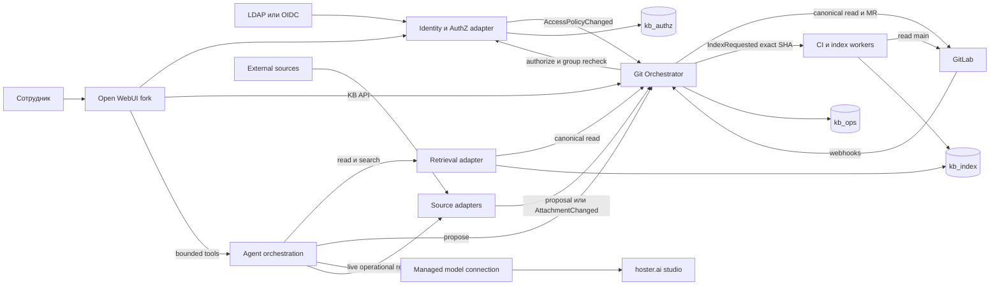

# Architecture Spine — Corporate Agentic Knowledge Platform

## Design Paradigm

GitLab владеет документным lifecycle. Open WebUI остаётся продуктовой оболочкой, GO — отдельным модульным монолитом с ports-and-adapters, CI/workers строят read projections. Канонические записи идут через GitLab; PostgreSQL не участвует в canonical write path. CQRS применяется только к пересобираемым проекциям, без второго командного API к данным проекций.

## Invariants & Rules

### AD-1 — Git-native canonical storage [ADOPTED]

- **Binds:** R02, R03, R06–R14; все компоненты документов.
- **Prevents:** две независимо редактируемые копии документа, revision или decision.
- **Rule:** Markdown + front matter в GitLab — канон; полный commit SHA — revision; MR — proposal; DecisionRecord — единый canonical JSON в append-only structured MR note от GO и protected annotated tag `kb-decisions/<decision_id>` на `proposal_sha`. Начальная публикация подтверждается CutoverRecord на exact `main_sha`; последующая — реальным merge commit с `Decision-ID`, `Decision-Note-ID`, `Decision-Hash` и `Approved-by`. Fast-forward-only business merge не допускается. Любая БД-проекция пересобирается без потери канона.

### AD-2 — Минимальный fork и изолированный GO [ADOPTED]

- **Binds:** Open WebUI fork, GO, agent tools, CI/index workers.
- **Prevents:** переписывание upstream auth/chat/RAG, доступ агентного процесса к merge credential, расползание клиентских изменений по fork.
- **Rule:** Open WebUI переиспользует identity, users, chat, model connections, grants и native tools. GO — отдельный deployable для Git reads/writes, proposals, всех business/engineering merges, webhook ingestion и reconciliation. После cutover только merge service identity GO имеет merge permission; люди делают review/approve, а final apply проходит GO. Agent, connector и CI/indexer используют отдельные минимальные credentials. Managed KB включается feature flag; personal Notes и обычные чаты не мигрируются и не изменяются.

### AD-3 — Двухфазная публикация без auto-merge [ADOPTED]

- **Binds:** R06, R07, R12; import, connectors, GO, cutover.
- **Prevents:** скрытый bypass review, публикацию непроверенного corpus и окно незащищённого `main`.
- **Rule:** До cutover controlled engineering bulk push допустим только в unpublished `main` без пользовательского доступа и published index. Import dry-run заранее возвращает path→ID map, provenance, links/attachments и ошибки без canonical writes; traversal, symlinks, executable HTML/MDX, secrets и oversized inputs отклоняются. CutoverRecord связывает Space, exact `main_sha`, validation evidence, sign-off actor и timestamp. Cutover сначала включает write freeze и требует `HEAD == cutover_sha`, затем создаёт protected tag и MR-only rules с merge только через GO, строит inactive preflight index и лишь после успеха активирует Space и published index. После cutover любые managed-изменения идут через GO и MR с human merge; agent/connector/LLM auto-merge запрещён.

### AD-4 — Двухуровневая RBAC и Space ACL [ADOPTED]

- **Binds:** R05, R11, R15, R16; UI, API, tools, files, history, export, search.
- **Prevents:** различие прав по каналу вызова, page-level ACL drift, выдачу недоступного текста модели.
- **Rule:** Versioned Git policy связывает внешние группы с ролями и Spaces; Identity/AuthZ adapter — единственный writer managed grants в upstream и `kb_authz`. Документ наследует единый ACL Space; разные ACL требуют разных Spaces. В MVP один GitLab repository = один Space, поэтому ACL, blobs, history, protected branch, credentials, cutover, index и clone/export имеют единый периметр. GitLab RBAC применяется только к инженерному контуру. Tree/titles/snippets/chunks/files/history/export авторизуются до exposure в payload; `access` во front matter не является самостоятельным источником прав. Default private; personal grants — только явно аудируемое исключение.

### AD-5 — Ограниченный execution capability [ADOPTED]

- **Binds:** R06, R15, R16; agent, connectors, native tools.
- **Prevents:** privilege escalation через tool registration, prompt injection, generic SQL/shell/filesystem или agent token.
- **Rule:** Агент получает только read/search/propose tools в явном scope. Merge, grants, arbitrary Git push, shell, generic SQL, Tool Creation и arbitrary Python Tools недоступны агенту независимо от роли chat user и канала direct/deferred/note/automation/channel/OpenAPI. `actor`, `space`, `groups` и `tenant` принимаются только из trusted execution context. Первый vertical slice ограничен single-page proposals; agent bulk operations, subtree moves и attachment management требуют отдельных задач.

### AD-6 — Business merge без GitLab users [ADOPTED]

- **Binds:** R05, R07–R10; ADR-09; GO, approval policy, GitLab.
- **Prevents:** shadow accounts, подмену approver, merge мимо владельца пути.
- **Rule:** Бизнес-владельцы не имеют GitLab user records. Versioned `approval-policy.yaml` связывает внешние группы с path-scoped approver roles. Append-only ProposalRecord каждой версии обязательно содержит `author_stable_id`, `version_author_stable_id`, `requester_stable_id`, `actor_type`, optional `run_id`, `rationale`, `evidence[]`, `proposal_sha`, `base_sha` и idempotency metadata. MVP требует одного approver, не совпадающего ни с author, ни с requester; редактор proposal создаёт новую версию и не может утвердить её сам. Все business/engineering merges сериализуются GO per repository/target branch через advisory lock с owner/fencing token и коротким critical section. GO использует один `policy_bundle_id` и согласованные access/approval revisions, повторно проверяет external group, path scope, exact source `proposal_sha` и `target HEAD == base_sha` непосредственно перед merge; несовпадение даёт conflict и ноль writes в `main`. CODEOWNERS остаётся инженерным ownership/review контуром.

### AD-7 — Canonical DecisionRecord и recoverable projection [ADOPTED]

- **Binds:** R07–R10; DecisionRecord, merge commit, GO DB, reconciliation.
- **Prevents:** duplicate merge, потерю audit при потере БД, ложный `merged` после timeout.
- **Rule:** До merge GO сохраняет один canonical JSON с `decision_id` UUID, `proposal_sha`, `base_sha`, action, actor `stable_id`, timestamp, evidence, `policy_bundle_id`, access/approval revisions и `record_sha256` в append-only MR note и protected annotated tag `kb-decisions/<decision_id>` на `proposal_sha`. MR note — API/UI representation; tag хранит полный Git-native durability anchor для accept/reject/cancel и входит в clone. Исправление создаёт новый `decision_id` со `supersedes_decision_id`; missing/mismatched note или tag делает decision `invalid`. Merge commit содержит `Decision-ID`, `Decision-Note-ID`, `Decision-Hash` и `Approved-by`. Squash, automatic rebase и fast-forward запрещены; reconciliation требует first parent = `base_sha`, second parent = `proposal_sha`, а также совпадение trailers/note/tag. Повтор с тем же `decision_id` или уже применённым `(repository_id, target_branch, proposal_sha)` возвращает существующий Git-derived результат. GO projection имеет `unique(decision_id)` и состояния `recorded → merge_attempted → merged/failed/conflicted/invalid`. Перед внешним merge call GO в одной DB transaction устанавливает `merge_attempted` и per-target `recovery_required`; этот barrier блокирует все новые merges target после crash/fencing до conclusive target-wide reconciliation. Timeout не снимает barrier; недоказуемый outcome остаётся quarantined. Полная пересборка гарантирует Git-derived current state; transient attempt timestamps/errors могут быть disposable. Только проверенный merge commit в `main` подтверждает `merged`.

### AD-8 — Единственный владелец каждой схемы [ADOPTED]

- **Binds:** PostgreSQL, Open WebUI extensions, GO, indexer, migrations.
- **Prevents:** shared-table writes, неопределённую миграцию и потерю данных при rebuild.
- **Rule:** Один dedicated PostgreSQL instance на клиента содержит upstream tables и независимые `kb_authz`, `kb_ops`, `kb_index` schemas с отдельными DB roles. Только owning component выполняет writes и migrations своей схемы; межкомпонентный доступ — через contracts. Identity/AuthZ adapter единолично пишет `kb_authz` и managed upstream grants; GO — `kb_ops`; indexer — `kb_index`. Upstream migrations не переносятся в продуктовые schemas.

### AD-9 — Индекс только из eligible published main [ADOPTED]

- **Binds:** R04, R05, R11, R13; CI, retrieval, attachments, policy events.
- **Prevents:** выдачу pending/rejected/stale/недоступного содержимого и rollback на старый SHA.
- **Rule:** Exact и semantic индекс строится at-least-once из активированного published `main` либо из inactive cutover preflight на exact `cutover_sha`; preflight никогда не обслуживает retrieval до активации Space. Только eligible corpus paths попадают в индекс; `inbox`, templates, служебные и непроверенные critical media исключаются. GO принимает GitLab/AuthZ/attachment events и инициирует CI; CI владеет index runs. Обработка идемпотентна, с bounded retry, dead-letter и periodic HEAD reconciliation. Только CI/index writer продвигает active index pointer после завершения полного run, сериализуя запись per Space/profile across all generations. `main_generation` определяется Git ancestry, `index_profile_version` отдельно версионирует embedding/chunking; history rewrite создаёт новую generation и full rebuild, сортировка SHA запрещена. Contract `index-snapshot-v1` различает `snapshot_sha`, `document_revision_sha`, blob/content hash и dependency hash; incremental run публикуется только если его полный dependency closure эквивалентен full snapshot на том же `main_sha`. Retrieval отклоняет candidate при stale `revision_sha`, повторно авторизует payload и не возвращает historical content молча. Смена embedding/chunking создаёт новую версию индекса без destructive live rebuild.

### AD-10 — Источник определяет update contract [ADOPTED]

- **Binds:** R12, R13; `migrated`, `source_managed`, `curated`, `live_operational`.
- **Prevents:** overwrite curated-правок, молчаливое удаление и ложное продвижение cursor.
- **Rule:** `migrated` не принимает обновления старого источника; `source_managed` запрещает локальные правки, но обновляется через MR + human merge; `curated` превращает внешнее изменение в proposal/conflict; `live_operational` использует typed read-only API/snapshot и не становится wiki-страницей автоматически. Каждый managed object хранит provenance и previous imported base. Повтор по hash/version — no-op; удаление источника — tombstone/obsolete review. Для source object допускается не более одного outstanding proposal; cursor различает `seen`, `proposed` и `merged` versions и продвигается только после durable результата.

### AD-11 — Dedicated deployment и полный portability package [ADOPTED]

- **Binds:** R14, R15, R17, R18; configuration, secrets, backup, upgrade.
- **Prevents:** клиентские code branches, общие secrets/data между клиентами, непроверенный restore и потерю GitLab-only audit.
- **Rule:** Каждый клиент получает независимые repositories, configuration, PostgreSQL/index, object storage, secrets и backups. Различия — только versioned configuration/adapters. Export — `git clone + manifest` согласованного repository snapshot с явными refs; обязательный decisions manifest включает DecisionRecords и MR metadata, assets manifest — immutable external objects и hashes. Full-repository clone разрешён только при export permission на Space и всю его историю; filtered export и удаление истории требуют отдельного privileged workflow. Backup включает Git mirror, GitLab metadata, object storage, config и secrets policy; restore drill проверяет snapshot closure, rebuild projections и grants. Upstream upgrade сохраняет branding/notices, seam registry, rollback и license/SBOM review.

### AD-12 — Stable identity и revocation barrier [ADOPTED]

- **Binds:** R05, R11, R16; LDAP/OIDC, JIT, grants, review queue.
- **Prevents:** разрыв истории при rename login, устаревшие права и потерю доступа после mover/leaver.
- **Rule:** `stable_id` = AD objectGUID, OpenLDAP entryUUID или OIDC sub; email/login запрещены как identity key. Используются upstream LDAP/OIDC, read-only bind, LDAPS/StartTLS, отказ на пустой пароль, nested AD groups, JIT и group-assigned review queues. Группы обновляются не реже 15 минут и перепроверяются при merge/export/выдаче закрытых страниц; TTL сессий и live subscriptions ограничен. Каждый запрос использует server-issued `AuthzContext` со `stable_id` и per-Space scope entries, каждая из которых содержит effective path scopes, `policy_bundle_id`, access/approval revisions, `evaluated_at` и `group_snapshot_at`; длительные операции обновляют его перед каждым payload/export/merge, revocation event закрывает live subscriptions. Revocation SLO ≤ 30 минут; sensitive operations применяют ближайшую перепроверку.

### AD-13 — Полный document/read/review lifecycle [ADOPTED]

- **Binds:** R01–R03, R07–R10, R13; tree, links, direct read, review, restore, attachments.
- **Prevents:** нестабильные deep links, скрытые изменения и silent overwrite.
- **Rule:** Document ID не зависит от пути; links используют ID; CI проверяет duplicate IDs, cycles и orphans. Direct read поддерживает whole/section, bounds, cursor и explicit `truncation`. Review показывает текст, front matter, структуру, ссылки и attachment revisions; недостоверный preview блокирует merge. Новый commit/rebase сбрасывает approval и запрещает повторную LLM-генерацию при apply. Accept/reject/edit идемпотентны по exact proposal SHA; reject фиксируется DecisionRecord и закрытием MR, edit создаёт новую ProposalVersion. Restore — revert-MR/new commit без перезаписи истории. UI различает `draft`, `in_review`, `published`, `indexed`, `archived` и `conflicted`.

### AD-14 — Data profiles и санкционированный inference [ADOPTED]

- **Binds:** R15, R16; extraction, embeddings, reranking, OCR, model connections, egress.
- **Prevents:** неутверждённый provider/fallback и утечку PII через вспомогательные AI-вызовы.
- **Rule:** `strict` — default; владелец источника и завершённый data barrier обязательны до передачи в corpus, каждое PII-срабатывание разбирает человек. `pii_permitted` требует documented legal basis и собственный согласованный inference без внешнего PII egress. Все inference/extraction/embedding/reranker/OCR providers и fallback входят в inventory и allowlist; unplanned fallback запрещён. Open WebUI model connection владеет provider credentials, retries и model config. Offline model assets подготавливаются заранее. Raw private content допустим только в авторизованном tool/provider payload внутри profile; logs, audit и unapproved export его не содержат.

### AD-15 — Versioned attachments с ACL страницы [ADOPTED]

- **Binds:** R02, R05, R11–R14; originals, assets, media validation, retention.
- **Prevents:** доступ к чужой/старой версии файла и непроверенное media-содержимое в ответах.
- **Rule:** Каждая attachment revision связана с document revision и Space ACL через `{object_id, version, sha256, size, media_type, source_ref}`. Внешние объекты immutable/versioned; чтение по текущему URL без hash запрещено. `AttachmentChanged` проходит тот же event/index/reconciliation контур. Критические медиа и рукописный текст индексируются только после требуемой человеческой транскрипции/сверки; автоматические описания маркируются и ссылаются на оригинал. Retention/deletion учитывает Git history, mirrors и object versions.

### AD-16 — Воспроизводимые evidence и quality gates [ADOPTED]

- **Binds:** R18; CI, evaluation, security tests, operations.
- **Prevents:** DONE по UI smoke и подмену детерминированной безопасности модельной оценкой.
- **Rule:** Каждый release candidate фиксирует corpus SHA, code/config/model/tool-schema versions, dataset и sanitized results. Negative merge/push/ACL/disclosure tests детерминированы; golden set оценивает retrieval, factual support, citation correctness и abstention отдельно. LLM judge не единственный арбитр. Metrics включают TTFT/full response, Git/merge latency, CI lag, HEAD/index drift, restore и upgrade regression.

### AD-17 — GitLab вне application namespace, профили Shared/Dedicated [ADOPTED]

- **Binds:** R05, R14, R17, R18; tenant profile, GitLab provisioning, GO credentials, backup/restore.
- **Prevents:** связывание lifecycle канонических данных с application namespace, cross-client credentials/backups и несовместимые клиентские deployment-схемы.
- **Rule:** GitLab — отдельный platform data service вне клиентского application namespace и его release lifecycle. Tenant profile выбирает `shared` или `dedicated`. Shared использует общий hardened instance с приватной group на клиента и repository=Space, но не общие canonical repositories, managed credentials или backups. Dedicated использует тот же pinned baseline и versioned configuration template с отдельными instance, endpoints, secrets, storage, network и backups без client code branch. Общий template не означает общие секреты. Shared GitLab — общий trust/failure domain с restricted admin governance, audit и reconciliation; per-client export/restore обязателен в обоих профилях. Конкретные production instances и rollout требуют отдельных gates и owner authorization.

## Consistency Conventions

| Concern | Convention |
| --- | --- |
| IDs | `space_id` — стабильный lowercase slug; `document_id` — opaque UUID, не зависящий от пути; `decision_id` — UUID и idempotency key; `source_id` отделён от `document_id`; ID не переиспользуются. |
| Git revisions | Только полный lowercase SHA без short SHA. `base_sha` — target branch HEAD, на котором построен diff; `proposal_sha` — exact source branch HEAD; `merge_commit_sha` — созданный merge commit; `main_sha` — observed target HEAD. Порядок revisions определяется Git ancestry, не сортировкой SHA. |
| Proposal identity | Каждая версия MR различает `author_stable_id`, `version_author_stable_id`, `requester_stable_id`, `actor_type`, optional `run_id`; GitLab bot/service identity не заменяет эти поля. |
| Время и текст | UTC RFC 3339 `date-time`; Markdown/YAML/JSON — UTF-8; технические enum values — lower_snake_case, UI labels — на русском. |
| Policy | Для каждого Space `policy_bundle_id` идентифицирует repository + policy paths; `access_policy_revision` и `approval_policy_revision` — полные Git commit SHA. Multi-Space context сохраняет независимый bundle/revisions/group snapshot для каждого Space; path matching нормализует разделители, Unicode и отсутствие `..`. |
| API | Продуктовые контракты версионируются `/api/kb/v1`; mutations требуют `Idempotency-Key`; ключ ограничен actor + route + payload hash; повтор с другим payload — `IDEMPOTENCY_KEY_REUSED`. |
| Errors | Machine-readable `code`, человекочитаемое `message`, `request_id`, optional `details` и `retryable`; anti-enumeration применяет `NOT_FOUND` по policy. |
| State | Canonical document/proposal/decision outcomes выводятся из GitLab; DB status — projection metadata. `failed` не доказывает отсутствие merge до GitLab reconciliation. |
| Secrets/PII | Secrets только в deployment secret mechanism; logs/audit/unapproved export не содержат tokens, bind passwords или raw private content; авторизованные provider payloads регулируются AD-14. |
| Derived files | CI не делает post-merge push в `main`; производный `INDEX.md` — build artifact либо часть того же reviewed MR, никогда отдельный bypass commit. |

## Structural Seed

Стрелки показывают разрешённые зависимости. Домен GO не импортирует UI или Open WebUI internals; агент никогда не вызывает merge API.

| Data / state | Canonical owner | Projection / writer |
| --- | --- | --- |
| Documents, revisions, drafts, proposals, Decisions, cutover, access/approval policy | GitLab | GO и CI создают только пересобираемые projections |
| External group membership | LDAP/OIDC provider | Identity/AuthZ adapter |
| Users, sessions, chats, model connections | Open WebUI upstream | Upstream-owned tables |
| Managed Space grants и group snapshots | Git policy + IdP | Только Identity/AuthZ adapter в `kb_authz` и managed upstream grants |
| Proposal/decision/operation/webhook/source-sync projections | GitLab/source registry | Только GO в `kb_ops` |
| Documents, chunks, embeddings, attachments, index runs | Git + immutable assets | Только CI/index workers в `kb_index` |
| Originals and large assets | External S3/object storage | Metadata/hash projections |
| Credentials and bind secrets | Deployment secret mechanism | Не хранятся в продуктовых tables |

| Environment | Назначение | Обязательная изоляция |
| --- | --- | --- |
| Local/T00 | Upstream audit, synthetic fixtures | Без клиентских документов и реальных secrets |
| Integration test | Real sandbox GitLab + PostgreSQL + CI | Scoped tokens, отдельный project/group, deterministic negative tests |
| Dedicated client | Отдельный managed/on-prem instance | Независимые repos, DB, storage, secrets, backup и egress |

## Capability → Architecture Map

| Capability / Area | Lives in | Governed by |
| --- | --- | --- |
| R01–R03: tree, editor, direct read | Open WebUI fork + GO read adapter | AD-1, AD-2, AD-4, AD-13, AD-15 |
| R04, R11: retrieval and index | Retrieval adapter + CI/index workers | AD-1, AD-4, AD-9, AD-15 |
| R05, R16: identity and authorization | Identity/AuthZ adapter + GO policy enforcement | AD-4, AD-5, AD-6, AD-12 |
| R06–R10: proposals, review, merge, restore | GO + GitLab + review UI | AD-1, AD-3, AD-5, AD-6, AD-7, AD-13 |
| R12–R13: import and external updates | Source adapters + staging + GO | AD-3, AD-10, AD-14, AD-15 |
| R14, R17: portability and packaging | Deployment configuration + Git/GitLab/object backup | AD-7, AD-11, AD-17 |
| R15: approved inference | Open WebUI model integration + provider adapters | AD-5, AD-11, AD-14 |
| R18: regression and operations evidence | CI, test harness, reconciliation, metrics | AD-3, AD-7, AD-9, AD-11, AD-16 |

## Deferred

- **Open WebUI commit/tag, GitLab version/edition, toolchain и editor:** выбираются и проверяются в T00; реальные code references и migration/test conventions появляются только после checkout.
- **Upstream identity/RAG capabilities:** stable LDAP attributes, nested groups, StartTLS/LDAPS, group recheck, grants, exact-SHA reads и adapter seams — обязательные target capabilities, а не подтверждённые факты; пробелы требуют минимального adapter design или stop condition по T00.
- **GitLab merge commit message/trailers, MR note ID/hash/audit, protected annotated decision tags, metadata export, merge-only-GO и token/branch-rule semantics:** обязательные capabilities для AD-6/AD-7/AD-11, проверяются на целевой версии; append-only DecisionRecord не считается физически неизменяемым хранилищем, а отсутствие capabilities требует design review.
- **Repository provisioning:** naming, GitLab group layout, creation/order и migration существующих корпусов определяются в T00; правило один repository = один Space уже фиксировано и не откладывается.
- **Retrieval engine:** существующий backend обязателен к audit; pgvector + FTS, HNSW/IVFFlat, partitioning и exact fallback принимаются только после ACL-aware recall benchmark.
- **Embedding model/dimensions, chunking, hoster model IDs:** configuration и benchmark, не invariant.
- **WYSIWYG component:** готовый компонент выбирается в T00 по front matter fidelity, diff/preview, Cyrillic, attachments и лицензии.
- **Первый source connector и object-store layout:** выбираются после корпуса и source-system audit; общие contracts не зависят от SharePoint/S3/Bitrix24/Kayako.
- **Latency, freshness, RPO/RTO, retention, idempotency replay retention, quality thresholds и budgets:** owner decisions до соответствующих release gates; revocation SLO ≤ 30 минут уже зафиксирован.
- **Admin break-glass и privacy hard purge:** в MVP отключены; включение требует отдельного ADR, privileged workflow, history-rewrite/index-generation/mirror-retention протокола и owner approval.
- **GitLab-outage index read mode:** по умолчанию отключён; stale read mode требует отдельного ADR, явного UX и повторной авторизации.
- **Realtime collaboration, page-level ACL, multiple approvers/quorum, GraphRAG, OpenSearch и universal two-way sync:** вне MVP; требуют новых требований и ADR. Realtime collaboration или обязательный page-level ACL — stop-триггер для пересмотра Git-native модели.
