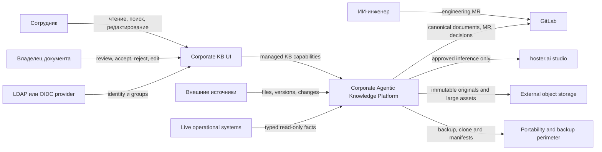
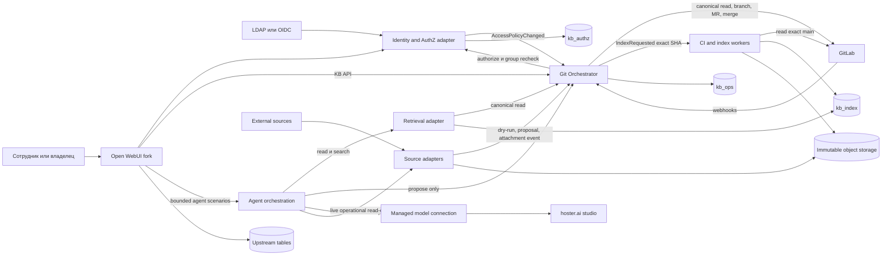

# Corporate Agentic Knowledge Platform — component solution design

## 1. Назначение и статус

Документ переводит обязательные инварианты Architecture Spine в компонентный engineering design: границы ответственности, контракты, владение состоянием, сквозные протоколы, recovery и критерии проверки. Он предназначен для G0 и последующей декомпозиции в stories, но не разрешает реализацию, production rollout, миграции или выбор непроверенных upstream-возможностей.

**Статус:** T00 DONE, G0 APPROVED, дополнен T00 evidence 2026-11-08. AD-1–AD-16 приняты и не переоткрываются; AD-17 owner-approved отдельно 2026-11-09 как deployment addendum. Pinned baseline выбран и runtime-проверен на synthetic sandboxes: Open WebUI `v0.13.0` (`c38885a1a737da4968f157092f304f3b5481d0bf`), GitLab CE `19.5.3-ce.0`, PostgreSQL `18.6` + pgvector `0.8.7`, Keycloak `26.8.2` (sandbox IdP) — [baseline.md](baseline.md), [evidence/t00](evidence/t00/README.md). Это **не production readiness**: deferred gates T04 browser editor, T13/T16 object-store ACL, T11 hoster inputs, production AD/live-SLO и legal clearance перед managed distribution остаются обязательными. Owner decision record — [g0-review.md](g0-review.md) (APPROVED).

Используемые обозначения:

- **REQUIREMENT** — R01–R18, I01–I14 и принятые AD-1–AD-17; обязательно.
- **DESIGN** — уточнение реализации в этом документе, не заменяющее требование.
- **UNKNOWN** — должно быть подтверждено в T00 или соответствующей задаче.
- **DEFERRED** — не входит в MVP и требует отдельного решения владельца/ADR.

### 1.1. Источники и приоритет

1. Главный authority: [Architecture Spine](architecture-spine.md), AD-1–AD-17.
2. [Платформенная спецификация](spec.md): R01–R18, I01–I14, acceptance и backlog.
3. [Content standard](content-standard.md): ознакомительный контекст ETL, первичной сборки, DocOps и медиа.
4. [AGENTS.md](../../AGENTS.md): текущий phase gate и ограничения безопасности.
5. Компонентные детали: [Open WebUI fork](components/open-webui-fork.md), [Git Orchestrator](components/git-orchestrator.md), [Identity and Access](components/identity-access.md), [Retrieval and Indexing](components/retrieval-indexing.md), [Ingestion and Connectors](components/ingestion-connectors.md).

При расхождении применяются Spine и R/I, а не более ранняя плановая деталь. В частности:

- в MVP **один GitLab repository = один Space**; корневая папка не является альтернативным ACL-периметром;
- `access` во front matter не является самостоятельным источником прав; единый ACL Space задаётся versioned Git policy и IdP-группами;
- после cutover **все обычные managed** business/engineering/source-managed merges выполняет GO с human review; auto-merge не допускается. Routine/self-service admin break-glass product capability отсутствует. Привилегированный GitLab Owner может технически обойти protected rules вне GO: это out-of-band integrity incident, обнаруживаемый reconciliation, с immediate affected-target `recovery_required`/quarantine, managed-write freeze и G0-D3 runbook, а не approved managed path или абсолютное merge-only-GO для admins;
- CODEOWNERS остаётся инженерным ownership/review контуром, а business approval задаёт `approval-policy.yaml` по внешним группам;
- controlled engineering bulk push допустим только до cutover, в unpublished `main`, без пользовательского доступа и published index.

## 2. Архитектурная рамка

**Парадигма:** Git-native document lifecycle, hexagonal ports-and-adapters, rebuildable CQRS projections.

GitLab владеет каноническими документами, revisions, proposals, decisions, cutover и policy. GO — отдельный модульный монолит и единственный координатор canonical writes и всех merges. CI/index workers строят пересобираемые read projections. PostgreSQL не участвует в canonical write path и не имеет второго командного API к проекциям.

Open WebUI остаётся продуктовой оболочкой: переиспользуются identity, users, chat, model connections, grants и native tools. Managed KB включается feature flag; personal Notes и обычные чаты не мигрируются и не изменяются. Агент получает только read/search/propose capabilities; human merge execution context не экспортируется в tool schema.

## 3. System context



Граница доверия проходит не по типу клиента, а по server-side capability. Direct/deferred/note chat/automation/channel/OpenAPI используют ту же авторизацию и те же запреты. Содержимое документов и источников — недоверенные данные, а не инструкции и не источник `actor`, `space`, `groups` или `tenant`.

## 4. Containers и разрешённые зависимости



Браузер и agent не подключаются к PostgreSQL напрямую. `kb_authz`, `kb_ops`, `kb_index` расположены в одном dedicated PostgreSQL instance клиента, но имеют независимые schemas, DB roles и migrations. Физическая близость не разрешает cross-schema writes.

### 4.1. Матрица ответственности

| Container | Ответственность | Явно не отвечает |
| --- | --- | --- |
| Open WebUI fork | Дерево, чтение, WYSIWYG seam, review UX, chat, bounded tools, managed model connections, upstream users/sessions/grants | Canonical writes, merge credential, решение доступа только в UI, arbitrary shell/SQL/Python Tools, изменение personal Notes |
| Git Orchestrator (GO) | Canonical Git reads/writes, drafts, ProposalRecords, все managed merges, DecisionRecords, cutover, webhooks, source-sync projection, reconciliation, export coordination; единственный owner correction-task current projections/events/evidence/idempotency в `kb_ops` | Аутентификация, canonical group membership, index writes, LLM-генерация при apply, ручное редактирование проекций, canonical content/DecisionRecord через correction task |
| Identity/AuthZ adapter | Stable identity, group snapshots, policy evaluation, `AuthzContext`, managed upstream grants, review queues, revocation barrier | Merge, документы, GitLab business accounts, самостоятельный LDAP/OIDC client, запись в `kb_ops`/`kb_index` |
| Retrieval adapter + CI/index workers | Exact+semantic projections, preflight, index runs, dependency closure, single active pointer writer, scoped retrieval и candidate validation | Изменение `main`, активация Space, самостоятельное разрешение прав, индексация pending/rejected content |
| Ingestion/source adapters | Dry-run, security/data barrier, extraction staging, provenance, ownership modes, source proposals, immutable assets, live operational reads | Direct push/merge, auto-merge, прямые writes в `kb_ops`/`kb_index`, универсальная двусторонняя синхронизация |
| GitLab | Canonical content/history/MR/notes/tags/policies и инженерный Git RBAC | Платформенная бизнес-идентичность и производный search index |
| hoster.ai studio через managed connections | Согласованный inference в пределах data profile | Решение прав, merge, незапланированный provider fallback |

### 4.2. Dependency and credential matrix

| Зависимость | Credential / execution context | Обязательное ограничение |
| --- | --- | --- |
| Browser → Open WebUI | Upstream authenticated session; CSRF policy по выбранному upstream | Нет anonymous managed API; sensitive actions используют human browser context |
| Open WebUI/Agent → GO | Server-issued `AuthzContext` плюс отдельный service capability; actor/run только из trusted context | Agent route допускает read/propose, но не merge/grants/arbitrary Git |
| GO → Identity/AuthZ | Service identity GO; fresh `authz-context-v2` и group recheck | Для каждого Space независимые repository/bundle/access+approval revisions/group snapshot/revocation epoch; чужой binding не переиспользуется |
| GO → GitLab proposal/write path | Scoped GO proposal credential | Branch/MR только в разрешённом scope; отсутствие merge permission у agent/connector identities |
| GO → GitLab merge path | Отдельная merge service identity GO | После cutover единственная managed identity с merge permission; недоступна agent, connector, CI и UI. Privileged Owner bypass — out-of-band incident, не managed credential/path |
| Engineering user → GitLab | Инженерная GitLab identity | После cutover только MR через GO final apply; нет direct push в `main` |
| Identity adapter → LDAP/OIDC | Upstream LDAP/OIDC configuration; read-only LDAP bind | LDAPS/StartTLS, пустой пароль отклоняется, nested AD groups; bind secret только в deployment secrets |
| CI/index → GitLab/object storage | Отдельный read-only credential на exact `main`/immutable object versions | Нет merge, нет чтения mutable URL без hash |
| CI/index → approved inference | Только согласованный provider/model connection в inventory | Нет собственных неучтённых provider credentials и unplanned fallback |
| CI/index → `kb_index` | Только index-writer DB role | Единственный writer/migrator схемы и active pointer |
| Retrieval → `kb_index` | Read-only DB role | Никаких mutations и обхода server-side scope checks |
| GO → `kb_ops` | Только GO DB role | Единственный writer/migrator; схема пересобираема |
| Identity adapter → `kb_authz` и managed upstream grants | Только Identity/AuthZ DB role и delegated upstream grant capability | Единственный writer managed grants; нет shared-table writes |
| Connector → source и GO | Source read credential с минимальным scope; proposal-only GO capability | Нет merge/index/grant credentials; source credential не передаётся модели |
| Export/backup → GitLab/storage/config | Privileged operational credential вне agent perimeter | Export permission на Space и всю историю; secrets не входят в обычный export |

Механизмы зафиксированы T00 evidence и не ослабляют эту матрицу: GitLab CE role-based profile (`push_access_level=0`, `merge_access_level=40`, GO — единственный Maintainer, protected decision tags `kb-decisions/*`), external migrator + runtime non-DDL roles (`ENABLE_DB_MIGRATIONS=False`, head `e42c8f710a36`), read-only CI/index credentials — [baseline.md](baseline.md) §3 и [evidence/t00](evidence/t00/README.md). Exact product token types/wiring реализуются после G0 в пределах этой матрицы.

## 5. Владельцы состояния и контракты

### 5.1. Канон и проекции

| State | Canonical owner | Единственный writer projection / integration |
| --- | --- | --- |
| Documents, revisions, drafts, proposals, ProposalRecords, Decisions, CutoverRecords, access/approval policy | GitLab | GO координирует writes; GO/CI создают только rebuildable projections |
| External identity и group membership | LDAP/OIDC provider | Identity/AuthZ adapter |
| Users, sessions, chats, model connections | Open WebUI upstream | Только upstream-owned paths |
| Managed Space grants и group snapshots | Git policy + IdP | Только Identity/AuthZ adapter в `kb_authz` и managed upstream grants |
| Proposal/decision/operation/webhook/source-sync projections | GitLab/source registry | Только GO в `kb_ops` |
| DocOps correction tasks, task events, restricted evidence, idempotency | GO-owned operational records, не Git-derived canonical state | Только GO в `kb_ops`; durable backup обязателен, Git-only rebuild не воссоздаёт task lifecycle |
| Documents, chunks, embeddings, attachments, index runs и active pointer | Git + immutable assets | Только CI/index workers в `kb_index` |
| Originals and large assets | External S3/object storage | Immutable/versioned object writes; metadata/hash projections |
| Credentials and bind secrets | Deployment secret mechanism | Не хранятся в продуктовых tables, Git, logs или обычном export |

Чужие schemas доступны только через версионированные contracts. Например, retrieval не читает `kb_authz` таблицами, ingestion не меняет cursor в `kb_ops` напрямую, а Open WebUI fork не выполняет migrations продуктовых schemas.

### 5.2. Общие соглашения

- API: логический префикс `/api/kb/v1`; реальные upstream routes и schemas определяются по repository conventions после T00.
- IDs: `space_id` — stable lowercase slug; `document_id` — opaque UUID, не зависящий от пути; `decision_id` — UUID и idempotency key; `source_id` отделён от `document_id`; IDs не переиспользуются.
- Revisions: только полный lowercase commit SHA. `base_sha` — target HEAD, на котором построен diff; `proposal_sha` — exact source HEAD; `merge_commit_sha` — созданный merge commit; `main_sha` — observed target HEAD. Порядок определяется Git ancestry, не сравнением SHA.
- `policy_bundle_id` идентифицирует repository + policy paths; `access_policy_revision` и `approval_policy_revision` — полные SHA одного согласованного bundle.
- Mutations требуют `Idempotency-Key`, связанный с actor + route + payload hash. Повтор с другим payload — `IDEMPOTENCY_KEY_REUSED`.
- Ошибки: `code`, `message`, `request_id`, optional `details`, `retryable`; anti-enumeration использует `NOT_FOUND` там, где раскрытие существования запрещено.
- Время — UTC RFC 3339; Markdown/YAML/JSON — UTF-8; enum values — lower_snake_case.
- CI не делает post-merge push производных файлов в `main`. `INDEX.md` — build artifact либо часть того же reviewed MR.

### 5.3. ProposalRecord

Каждая immutable ProposalVersion имеет append-only ProposalRecord, связанный с `(proposal_id, proposal_sha)`. GitLab владеет записью; `kb_ops` хранит только projection. Физическое MR metadata representation и его export/audit semantics подтверждаются в T00, не предполагаются по документации другой версии.

Обязательные поля:

| Поле | Смысл |
| --- | --- |
| `proposal_id`, `proposal_sha`, `base_sha` | MR и две exact revisions |
| `author_stable_id` | Инициатор исходного proposal; не GitLab bot identity |
| `version_author_stable_id` | Создатель именно этой версии; editor получает новую версию и не может сам её утвердить |
| `requester_stable_id` | Человек, по запросу которого создана версия; для agent/manual flow не подменяется service account |
| `actor_type` | Тип trusted actor; определяется сервером |
| `run_id` | Optional по схеме; заполняется для agent/deferred run из trusted orchestration context, не из аргументов модели |
| `rationale`, `evidence[]` | Причина и проверяемые ссылки на source/document revision, section/range/hash |
| `idempotency_key`, `payload_hash` | Безопасный replay и обнаружение reuse с другим payload |
| `created_at` | UTC timestamp сервера |

`author_stable_id`, `version_author_stable_id` и `requester_stable_id` неизменяемы внутри версии. Изменение текста, rebase или новый commit создаёт новый ProposalRecord с новым `proposal_sha`; старый approval не переносится.

### 5.4. DecisionRecord

До применения accept/reject/cancel GO сохраняет один canonical JSON одновременно:

1. в append-only structured MR note от GO — API/UI representation;
2. в protected annotated tag `kb-decisions/<decision_id>` на `proposal_sha` — Git-native durability anchor, входящий в clone.

Запись включает `decision_id`, `proposal_sha`, `base_sha`, action, actor `stable_id`, timestamp, evidence, `policy_bundle_id`, access/approval revisions и `record_sha256`. Missing/mismatched note или tag делает decision `invalid`. Исправление создаёт новый `decision_id` со `supersedes_decision_id`; существующий JSON не редактируется.

Принятый merge создаёт настоящий merge commit с trailers `Decision-ID`, `Decision-Note-ID`, `Decision-Hash`, `Approved-by`. Squash, automatic rebase и fast-forward запрещены.

### 5.5. Версионированные machine contracts и projection mappings

Нормативная сквозная спецификация находится в [integration.md](integration.md); машинные контракты перечислены в [contracts/README.md](contracts/README.md). Для данного design обязательны следующие согласования:

- `authz-context-v2`: каждый `space_scopes[]` сам содержит `space_id`, `repository_id`, `policy_bundle_id`, обе policy revisions, `group_snapshot` и `revocation_epoch`; top-level actor epoch отдельный. Multi-Space search и cursor сохраняют полный ordered набор per-Space snapshots/profiles/bindings и не заимствуют policy/group контекст другого Space.
- `document-front-matter-v2`: canonical `links[]` по target UUID и `valid_until`; `migrated`/`source_managed` требуют `origin`, а `origin.ownership_mode == ownership_mode`. `archived=true` iff присутствует `archive`; restore создаёт reviewed revision без `archive`. DocOps metadata — revision-bound projection `valid_until`, не второй канон и не ACL. Stable link resolution обязан сохранять тот же UUID в same Space/snapshot.
- `agent-tools-v2`: agent получает curated body-only create и `AgentAnchoredPatchChange` с обязательной body section. `editProposalVersion`, whole-document/front-matter replacement, attachments/archive/origin/access и privileged operations доступны только вне agent boundary; GO независимо отклоняет forbidden diff через все каналы.
- `export-manifest-v2`: каждый Decision содержит explicit publication outcome, attempt и recovery evidence. Accepted `recorded/merge_attempted/failed/conflicted/invalid` экспортируется без merge; только `merged` имеет merge proof. Integrity-valid rejected/cancelled имеют verified MR closure. Complete/ready требует decisions/assets/authorization closure, пустой `missing[]` и только exported assets с совпадающими hashes.
- [projection-mapping.md](contracts/projection-mapping.md) фиксирует canonical↔API↔event↔DB actions, derived states, IDs и paths, включая `accepted/rejected/cancelled ↔ accept/reject/cancel`, derived quarantine, ProposalView `archived` из документа, Cutover/index/source states и absolute↔relative policy scopes.
- [t01-contract-tests.yaml](contracts/t01-contract-tests.yaml) содержит synthetic CF-01–CF-30 positive/negative/concurrency/crash vectors. Это **DESIGN_NOT_EXECUTED**, не выполненные contract, product или sandbox tests.
- `docops-correction-task-v1`: [closed schema](contracts/docops-correction-task.schema.json), [API/lifecycle/durability contract](contracts/docops-correction-api.md) и OpenAPI create/get/resolve/cancel endpoints. Task — GO-owned `kb_ops` operational record с exact reported revision, stable trusted actor, policy-derived owner, evidence hash, optional linked MR, idempotency и monotonic `task_version`; он не canonical content/ProposalRecord/DecisionRecord и не редактирует канон.

### 5.6. Correction-task ownership и durability

Lifecycle `open/in_review/resolved/cancelled` отделён от DocOps `valid_until` и Proposal states. Create/get/resolve/cancel используют fresh per-Space AuthzContext и anti-enumeration. `open → in_review` требует durable valid linked MR; content `resolved` требует verified governed ProposalRecord/MR/human DecisionRecord/GO merge; no-MR resolution и cancellation требуют reason + evidence hash. Terminal states не reopen через replay; all mutations используют global idempotency tuple и CAS.

Current projection, append-only events, restricted sanitized evidence и idempotency records — **не полностью Git-derived operational state**. Они входят в durable `kb_ops` backup и восстанавливаются под external global managed-write freeze с последующей linked-MR reconciliation. Git/MR rebuild не может воссоздать исходный report, evidence или owner/actor disposition и не должен fabricate/delete/resolve/cancel tasks. Missing/corrupt backup оставляет affected scope unavailable/quarantined и требует incident review. Ordinary Space export и Git mirror не заменяют этот backup; active tasks/evidence не удаляются generic TTL.

## 6. Сквозной lifecycle: draft → proposal → review → decision → merge → index

```mermaid
sequenceDiagram
    actor U as Автор или requester
    participant UI as Open WebUI fork
    participant GO as Git Orchestrator
    participant IAM as Identity/AuthZ
    participant GL as GitLab
    actor O as Владелец/approver
    participant CI as CI/Index

    U->>UI: Создать или изменить страницу
    UI->>GO: Save draft от exact base_sha
    GO->>IAM: Authorize author и Space/path scope
    GO->>GL: Branch + attributed commit
    GO->>GL: Create/update MR
    GO->>GO: Append ProposalRecord для exact proposal_sha
    GO-->>UI: draft или in_review + proposal_sha
    UI->>GO: Read exact diff, front matter, links, attachments, rationale, evidence
    GO-->>O: Достоверный review только после authorization
    O->>UI: Accept/reject/edit exact proposal_sha
    alt Edit
        UI->>GO: Новый commit и ProposalVersion
        GO-->>UI: Новый proposal_sha; прежний approval недействителен
    else Reject или cancel
        UI->>GO: Decision command + Idempotency-Key
        GO->>GL: DecisionRecord note + protected tag; conditional MR close
        GO-->>UI: Rejected/cancelled после Git-derived verification
    else Accept
        UI->>GO: Human apply exact proposal_sha + decision_id
        GO->>GO: Per-target lock, fresh policy/group/precondition checks
        GO->>GL: DecisionRecord note + protected tag
        GO->>GO: DB transaction: merge_attempted + recovery_required
        GO->>GL: Merge exact SHA, real merge commit, required trailers
        GO->>GL: Verify first/second parents, trailers, note, tag
        GO->>GO: Git-derived merged; target-wide reconciliation всех unresolved accepts
        GO->>GO: Завершить barrier только при отсутствии unresolved/unknown links всего target
        GO-->>UI: published + merge_commit_sha
        GL-->>GO: Merge webhook
        GO->>CI: IndexRequested exact main_sha
        CI->>GL: Read eligible published snapshot
        CI->>CI: Full/incremental validation и single-writer pointer publish
        CI-->>UI: indexed через read contract
    end
```

### 6.1. Правила review и apply

- Review показывает текст, front matter, структуру, ссылки, attachment revisions, rationale и evidence. Недостоверный preview блокирует merge.
- В MVP требуется один approver. Он не совпадает с `author_stable_id`, `requester_stable_id` или `version_author_stable_id`, имеет актуальную external group и path-scoped approver role.
- Непосредственно перед merge GO повторно проверяет external group, path scope, exact source `proposal_sha`, `target HEAD == base_sha`, policy bundle/revisions и отсутствие `recovery_required`.
- Новый commit/rebase сбрасывает approval. При apply нет повторной LLM-генерации, automatic conflict merge, squash, rebase или fast-forward.
- Reject/cancel не меняет `main`, но требует durable DecisionRecord и подтверждённого закрытия MR. Restore выполняется revert-MR/new commit, без history rewrite.
- Merge завершается независимо от indexing latency. UI различает `draft`, `in_review`, `published`, `indexed`, `archived`, `conflicted`.

## 7. Надёжность и эксплуатационные протоколы

### 7.1. Cutover

1. Периметр repository=Space и исходный corpus согласованы; production corpus до этого не создаётся.
2. Import dry-run возвращает path→ID map, provenance, links/attachments и все ошибки без canonical writes.
3. Controlled engineering bulk push допустим только в unpublished `main`, при закрытом пользовательском доступе и отсутствующем published index.
4. Cutover включает write freeze и проверяет `HEAD == cutover_sha`. CutoverRecord связывает Space, exact `main_sha`, validation evidence, sign-off actor и timestamp.
5. GO создаёт protected cutover tag и применяет MR-only rules: direct push закрыт для non-privileged людей и ботов, normal managed merge permission только у merge service identity GO; privileged Owner bypass остаётся out-of-band incident по G0-D3.
6. CI строит **inactive full preflight** exact `cutover_sha` с отдельными request/run/snapshot IDs; exact+semantic paths, dependency closure, policy triple включая `approval_policy_revision`, eligibility и ACL tests завершаются успешно. Preflight имеет `purpose=cutover_preflight`, `serving_allowed=false`, никогда не active и не обслуживает retrieval.
7. GO создаёт отдельный `IndexRequested(preflight=false)`, а CI — отдельные published run и non-preflight descriptor с новыми request/run/snapshot IDs, но тем же `cutover_sha == main_sha == snapshot_sha`, closure и exact/semantic hashes. Published descriptor повторно полностью валидируется; preflight не мутирует в published.
8. Единственный index writer сериализует publication per `(space_id,profile_id)` для **всех generations** и атомарно выполняет CAS по expected publication fence/current pointer, latest Git ancestry и exact validated run/snapshot. Stale owner обновляет ноль rows. Только published non-preflight descriptor получает active pointer; после наблюдения pointer GO активирует Space. До завершения обоих шагов пользовательский доступ остаётся закрыт.
9. После cutover любые изменения идут через GO/MR → human DecisionRecord → final merge только GO. Откат ошибок — новый reviewed MR, не history rewrite.

Crash до активации оставляет Space неактивным, а preflight — immutable non-serving. Повтор cutover идемпотентен по Space + `cutover_sha`; при смене HEAD требуется новый CutoverRecord, sign-off и preflight.

### 7.2. Сериализация merge

GO сериализует все business и engineering merges по `(repository_id, target_branch)` через advisory lock с owner и fencing token. Lock не охватывает LLM или человеческое review. Каждый owner проверяет fencing token при записи projection и снятии recovery barrier; stale owner не может изменить состояние после потери lock.

Перед началом нового decision новый owner проверяет target на unresolved accept DecisionRecords. Такой unresolved record восстанавливает `recovery_required` ещё до нового merge. Это закрывает окно crash между note/tag и DB transaction.

Advisory lock сам по себе не является доказательством отмены уже отправленного GitLab request. Durable barrier обязателен.

### 7.3. Decision durability barrier и retry

Перед внешним merge call GO в одной DB transaction устанавливает `merge_attempted` и per-target `recovery_required`. С этого момента все новые merges target блокируются до conclusive target-wide reconciliation. Timeout, потеря lock или смена owner barrier не снимают.

`kb_ops.decisions` имеет `unique(decision_id)` и логические состояния `recorded → merge_attempted → merged/failed/conflicted/invalid`. Только проверенный merge commit в `main` подтверждает `merged`. `failed` допустим только после доказанных `request_state=completed`, `no_merge_proven=true` и reconciliation evidence; unknown остаётся `merge_attempted + recovery_required + target_quarantined`, без отдельного canonical/API state `quarantined`.

После conclusive `failed` recovery coordinator может выполнить guarded recovery edge `failed → merge_attempted`: новый `attempt_id`, тот же `decision_id`, exact base/proposal, fresh policy/group/HEAD preconditions и атомарно восстановленный barrier до нового call. Identical HTTP replay создаёт ноль attempts. `conflicted` и `invalid` terminal и не retryable: первый требует новой reviewed ProposalVersion, второй — нового decision UUID со supersedes. Ни terminal state, ни supersedes сами по себе не доказывают merge/no-merge и не очищают barrier. Полный mapping — [projection-mapping.md](contracts/projection-mapping.md#1-decision-action-outcome-и-attempts).

### 7.4. Git-derived reconciliation

Для accept reconciliation проверяет:

- merge commit существует в целевой history и имеет first parent = `base_sha`, second parent = `proposal_sha`;
- trailers совпадают с `decision_id`, MR note ID и `record_sha256`;
- `Approved-by` соответствует actor DecisionRecord;
- canonical JSON note и tag совпадают, tag указывает на `proposal_sha`;
- `(repository_id, target_branch, proposal_sha)` ещё не применён либо возвращает тот же Git-derived результат;
- все unresolved accept links **всего target** получили доказанный `verified_merged` либо `verified_not_merged`, request completion подтверждён и unresolved/unknown/quarantined links отсутствуют.

Barrier очищается отдельной fenced target-wide transaction только при выполнении последнего условия для каждого accept target. `invalid` при unknown external outcome сохраняет unresolved link и quarantine; `failed`/`conflicted` требуют доказанного no-merge перед terminal serialization с recovery flags=false. Недоказуемый outcome остаётся quarantined. Повтор того же `decision_id` не создаёт второй merge. Повтор с новым idempotency key не используется для «лечения» timeout.

### 7.5. Index recovery

Index events обрабатываются at-least-once, с deduplication, bounded retry и dead-letter. Periodic reconciliation сравнивает Git ancestry/HEAD и active snapshot, а не сортирует SHA. Потерянный webhook приводит к новому run от актуального eligible `main`; поздний run старой generation не может продвинуть pointer.

Потеря `kb_index` не влияет на канон: выполняется full rebuild. Active pointer не восстанавливается из непроверенного backup как истина; он создаётся заново после полного validated run. ACL revocation действует через fresh authorization даже пока index отстаёт.

### 7.6. Потеря БД, backup и restore

Backup включает Git mirror, GitLab metadata, object storage, configuration и secrets policy. `export-manifest-v2` содержит согласованный `git clone + manifest` единого format ID `git_clone_with_manifests`, явные refs, decisions/assets/policies manifests и immutable objects/hashes. Для каждого DecisionRecord сохраняются note/tag/canonical JSON hashes, explicit outcome, attempt и recovery evidence; accepted до merge/unknown/failed/conflicted/invalid не получает выдуманный merge, а rejected/cancelled — verified MR closure. Только `merged` содержит exact parent/trailer/raw-commit proof. `ready` и `closure.complete=true` допустимы только при decisions/assets/authorization complete flags, пустом `missing[]` и всех assets `exported`; missing/rejected asset делает package incomplete и не имеет выдуманного exported hash.

После полной потери `kb_ops` GO первоначально запрещает merges deployment-wide. Пересборка сканирует protected decision tags/notes, MR и target histories; каждый target с unresolved accept или недостаточным evidence получает `recovery_required`. Target открывается только после conclusive target-wide reconciliation. Отсутствие DB row никогда не трактуется как доказательство «merge call не отправлялся». Correction tasks/events/evidence/idempotency records восстанавливаются только из согласованного durable backup с последующей linked-MR reconciliation; Git-derived rebuild не фабрикует и не удаляет эти operational records.

Restore drill проверяет snapshot closure, refs/decision/assets manifests, grants mapping, rebuild всех projections и отсутствие cross-client secrets/data. RPO/RTO и retention — owner decisions, не предполагаются.

### 7.7. Crash recovery — локальные component invariants

Единая нормативная crash-фазовая таблица находится в [integration.md §7](integration.md#7-crash-recovery-и-timeout-reconciliation-spec-71-73) и здесь не дублируется. Architecture добавляет только component invariants:

- canonical note+tag, Git ancestry/parents/trailers и GitLab audit являются evidence; DB row, HTTP status, lock и worker memory — нет;
- durable per-target barrier и target_barrier_decisions связывают каждый unresolved accept с его Space/repository/target; соседний target/Space не блокируется и не служит доказательством исхода;
- `merge_attempted` с unknown, а также `invalid` с недоказанным external outcome сохраняют quarantine; terminal classification/supersedes сам по себе barrier не очищает;
- `failed` получает guarded same-decision retry только после completed+no-merge evidence и fresh preconditions; `conflicted`/`invalid` не имеют retry edge;
- merged projection и index request восстанавливаются без повторного external merge; полная потеря DB начинается с external bootstrap freeze и conservative rebuild.

Operational действия описаны в [operations.md §7](operations.md#7-recovery-quarantine-outages-и-reconciliation), test injection/assertions — в [test-plan.md §8](test-plan.md#8-детерминированная-crashfault-матрица).

## 8. Indexing и retrieval

### 8.1. Единый snapshot contract

`index-snapshot-v1` различает:

- `snapshot_sha` — exact `main` commit всего индексируемого snapshot;
- `document_revision_sha` — полный commit SHA версии конкретного документа, не alias snapshot SHA;
- blob/content hash — идентичность содержимого, но не Git revision;
- `dependency_hash` — детерминированный hash всех inputs, влияющих на представление документа в индексе, включая связанные document/attachment dependencies;
- `main_generation` — Git ancestry generation; history rewrite создаёт новую generation и требует full rebuild;
- `index_profile_version` — независимая версия embedding/chunking profile;
- `policy_bundle_id`, `access_policy_revision`, `approval_policy_revision` — обязательная согласованная policy dependency snapshot; stored ACL metadata не заменяет fresh delivery authorization;
- `closure.complete`, `closure_sha256`, `full_snapshot_equivalence`, `missing_inputs` — durable closure evidence, включая независимо вычисленный full-run proof для incremental.

Incremental run публикуется только если его полный dependency closure эквивалентен независимо построенному full snapshot на том же `main_sha`. Иначе выполняется расширение closure или full run; частичный результат не активируется. History rewrite требует новой generation и full rebuild. Cutover использует separate same-SHA preflight/published pair по §7.1, а не активацию preflight descriptor.

### 8.2. Публикация и чтение

- Индексируются только eligible paths активированного published `main` или inactive cutover preflight. `inbox`, templates, служебные и непроверенные critical media исключаются.
- Exact и semantic projections одного run завершаются и валидируются до pointer publication.
- Только CI/index writer продвигает active pointer. Publication lock/CAS register имеет ключ `(space_id,profile_id)` **без generation**, поэтому old/new generations одного pointer сериализуются вместе. В одной transaction проверяются expected publication fence/current pointer, latest Git ancestry и exact validated run/snapshot; stale owner получает zero updated rows. Active допустим только для `purpose=published`, `is_preflight=false`, complete closure и ready exact+semantic hashes.
- AccessPolicyChanged содержит независимые per-Space bindings; AttachmentChanged использует тот же event/index/reconciliation контур. Запрет доступа не ждёт переиндексации.
- Multi-Space retrieval выполняет per-Space fan-out в active published snapshot/profile каждого Space. Response/cursor хранит полный ordered набор per-Space descriptors и policy/group/revocation bindings; подмена или потеря одного элемента даёт stale error, а не заимствование чужого контекста.
- Retrieval выполняет exact/semantic candidate search в server-issued scope, проверяет active snapshot и `revision_sha`, повторно авторизует document/snippet/file/history payload и лишь затем отдаёт его.
- Stale candidate отклоняется. Historical или revoked content не возвращается молча; direct read текущей canonical revision — отдельная операция через GO.
- Pending/rejected proposals и ветки не попадают в published search corpus.
- GitLab-outage stale read mode по умолчанию отключён и требует отдельного ADR.
- Смена embedding/chunking создаёт новый index profile и shadow build; destructive live rebuild запрещён.

## 9. Deployment и environments

GitLab развёртывается как отдельный platform data service **вне клиентского application namespace и его release lifecycle** по [ADR-17](adr/ADR-017-gitlab-deployment-topology.md). Tenant profile выбирает `shared` или `dedicated`: Standard использует общий hardened instance с приватной group на клиента, а Isolated/Dedicated — отдельный instance из того же pinned baseline и versioned configuration template. `gitlab_mode` и `gitlab_instance_id` являются client-level invariant для всех Spaces клиента. В обоих режимах repositories=Spaces, managed credentials имеют scope `(tenant_id,space_id,repository_id,capability)`, а backup/restore состоит из независимых per-Space packages внутри per-client outer perimeter; общий configuration template не содержит общие секреты. Application release и его ServiceAccounts/hooks не создают, не удаляют и не управляют GitLab workloads/PVC. Platform-wide backup в Shared используется только для restricted control-plane DR и не является клиентским restore package; upgrades Shared координируются для всех tenants. Миграция существующего Space между профилями DEFERRED до отдельного ADR/runbook.

| Environment | Назначение | Обязательные ограничения |
| --- | --- | --- |
| Local/T00 | Upstream audit, synthetic fixtures, capability matrix | Без клиентских документов, реальных secrets и production migrations |
| Integration test | Real sandbox GitLab + PostgreSQL + CI + synthetic corpus | Scoped tokens, отдельный project/group, deterministic negative/concurrency/crash tests |
| Dedicated client | Managed/on-prem production instance | Независимые repositories, PostgreSQL/index, object storage, secrets, backups, config и egress |

Каждый клиент получает один reusable code line и versioned configuration/adapters, не клиентскую code branch. Online app и CI workers имеют отдельные concurrency/resource budgets. Managed KB opt-in не меняет personal Notes и ordinary chats.

Provider inventory включает chat, task/title/summarization, extraction, embeddings, reranking и OCR. Offline model assets готовятся заранее; cold offline startup проверяется отдельно. Точные endpoints/model IDs/dimensions не фиксируются в этом документе.

Upgrade сохраняет branding/notices, seam registry, rollback, license/SBOM review и regression evidence. Full-repository clone разрешён только с export permission на Space и всю историю; filtered export/history removal — отдельный privileged workflow. Routine/self-service admin break-glass и privacy hard purge в MVP отключены. Emergency out-of-band privileged Owner action — не product path: unexpected history обнаруживается reconciliation, affected target немедленно quarantined, managed writes frozen, audit preserved и G0-D3 incident runbook завершается owner-reviewed remediation.

## 10. Security и data profiles

### 10.1. Общая security boundary

- Default private; документ наследует единый ACL Space. Разные ACL требуют разных repositories/Spaces.
- Tree/titles/snippets/chunks/files/history/export авторизуются до exposure в payload, включая отправку модели.
- `stable_id` = AD objectGUID, OpenLDAP entryUUID или OIDC sub; email/login не являются identity keys.
- Group snapshots обновляются не реже 15 минут. Merge/export/выдача закрытых страниц перепроверяют groups; long operations обновляют `AuthzContext` перед каждым payload. Revocation SLO ≤ 30 минут; revocation event закрывает live subscriptions.
- Agent не получает merge, grants, arbitrary Git push, shell, generic SQL, Tool Creation или arbitrary Python Tools независимо от роли chat user и канала вызова.
- Secrets находятся только в deployment secret mechanism. Logs, audit, traces и unapproved export не содержат raw private content, tokens или bind passwords.
- Import отклоняет traversal, symlinks, executable HTML/MDX, secrets и oversized inputs. Preview защищает от XSS и раскрывает скрытые front matter/link/attachment changes.
- Attachment revision `{object_id, version, sha256, size, media_type, source_ref}` наследует Space ACL и связывается с document revision. Текущий mutable URL без hash не является доказательством версии.

### 10.2. Профили обработки

| Profile | Admission и inference | Запреты |
| --- | --- | --- |
| `strict` — default | Владелец источника и завершённый data barrier обязательны до corpus; owner checklist + post-conversion scan; каждое PII-срабатывание разбирает человек | Файл с персональными/идентифицирующими клиентскими данными отклоняется или возвращается на очистку; unresolved hit не публикуется |
| `pii_permitted` | Documented legal basis зафиксирован до import; собственный согласованный inference hoster.ai/client perimeter; усиленные access/retention policy | Внешний PII egress и любой unplanned provider fallback |

Все inference/extraction/embedding/reranker/OCR providers и fallbacks входят в inventory/allowlist. Raw private content допустим только в авторизованном tool/provider payload внутри выбранного profile.

### 10.3. Медиа

Декоративные медиа исключаются; иллюстративные сохраняются как assets с подписью; содержательные могут иметь явно помеченное автоматическое описание со ссылкой на оригинал и риск-based human check. Критические медиа и рукописный текст индексируются только после требуемой человеческой транскрипции/сверки. Ответ по автоматическому описанию обязан ссылаться на оригинал и раскрывать характер описания.

## 11. NFR и обязательные evidence

Числовые SLA, кроме revocation SLO, не выдумываются. Ниже — evidence contract, а не утверждение о выполненных проверках. Каждый release candidate фиксирует corpus SHA, code/config/model/tool-schema versions, dataset и sanitized results. Машинные reports размещаются согласно workspace rules; здесь результатов нет.

| Область | Метрика / проверка | Минимальное evidence и gate |
| --- | --- | --- |
| Merge safety | Direct push, bot merge, all-channel bypass, approver mismatch, stale SHA | Детерминированные negative tests на real sandbox GitLab; G1 blocker |
| Concurrency/crash | Два concurrent/different MR, timeout, lock loss, crash points §7.7, DB loss | Fault-injection report: один подтверждённый outcome, barrier удерживает target, ноль duplicate merges; G1 |
| Decision integrity | Parents, all trailers, note/tag JSON/hash, replay | Git-derived verification vectors и corrupted/missing-record negative tests; G1 |
| ACL/disclosure | Tree/search/chunks/files/history/export/tools и prompt injection | Zero unauthorized disclosures в согласованном adversarial suite; G1/G2 по scope |
| Revocation | Group removal → denied payload/subscription closure | Измеренное время ≤ 30 минут; sensitive operation denial при ближайшей recheck; A25 |
| Retrieval quality | Exact/semantic recall, factual support, citation correctness, abstention | Expert golden set, отдельные metrics, deterministic safety отдельно от LLM judge; G2 |
| Performance | TTFT и full response отдельно; Git read/merge latency; CI lag | Cold/warm measurements с corpus SHA/config/concurrency; thresholds владельца до release |
| Freshness | HEAD/index ancestry drift, webhook loss, late job, archive/delete | Reconciliation и late-job tests; lag dashboard/alert; G2 |
| Import/media | Dry-run losses, links/attachments, PII hits, critical media | Human-reviewed sanitized sample, loss report, unresolved-hit blocking; G2 |
| Portability | Clone+manifests → clean instance → rebuild | Restore drill с decisions/assets/grants closure и rebuild evidence; G3 |
| Upgrade/operations | Upstream regression, backup restore, RPO/RTO, backlog | Runbook rehearsal, rollback, SBOM/license/seam diff; thresholds владельца до G3 |
| Cost | Inference+embedding+extraction+storage+review+GitLab | Измерение по согласованному workload, без выдуманного budget |

LLM judge не является единственным арбитром качества и никогда не заменяет deterministic security tests. Mocked GitLab/hoster.ai integration не считается PASS реальной проверки.

## 12. AD/ADR и document map

### 12.1. Прослеживаемость AD-1–AD-17

| AD | Обязательное следствие в design | Основные компоненты |
| --- | --- | --- |
| AD-1 | Git canonical, SHA revisions, MR proposals, note+tag Decisions, real merge commits | GO, Open WebUI, Retrieval |
| AD-2 | Минимальный fork, отдельный GO, отдельные least-privilege credentials | Все |
| AD-3 | Controlled pre-cutover load, dry-run, freeze, CutoverRecord, inactive preflight, no auto-merge | GO, Ingestion, Index |
| AD-4 | Repository=Space, двухуровневая RBAC, ACL до payload | Identity, GO, Retrieval, UI |
| AD-5 | Agent read/search/propose only; trusted actor/scope | Open WebUI, GO, Identity |
| AD-6 | Business approvers без GitLab users, ProposalRecord principals, per-target lock и exact checks | GO, Identity |
| AD-7 | Canonical DecisionRecord, trailers/parents, fencing и durable recovery barrier | GO |
| AD-8 | Один owner на schema; только contracts между компонентами | Все |
| AD-9 | Published-only exact+semantic index, snapshot/dependency semantics, single pointer writer | Retrieval/Index |
| AD-10 | Четыре ownership modes, one outstanding proposal, seen/proposed/merged cursor | Ingestion, GO |
| AD-11 | Dedicated client deployment, clone+manifests, restore drill | Все, operations |
| AD-12 | Stable identity, server `AuthzContext`, group recheck и revocation barrier | Identity, все consumers |
| AD-13 | Полный document/read/review/restore lifecycle и явные UI states | Open WebUI, GO |
| AD-14 | Strict/pii_permitted, provider inventory, approved inference | Ingestion, Open WebUI, Index |
| AD-15 | Versioned attachments с Space ACL и media verification | Ingestion, Index, GO |
| AD-16 | Воспроизводимые release evidence и deterministic security gates | Все |
| AD-17 | GitLab вне application namespace; Shared/Dedicated по tenant profile; per-client credentials/backups | Deployment, GO, GitLab, operations |

### 12.2. ADR map

[ADR index](adr/README.md) и файлы ADR-03–ADR-17 существуют. Их Accepted/Proposed статусы относятся к отдельным решениям и не образуют общий owner G0 approval. ADR-17 принят владельцем отдельно 2026-11-09 и не меняет исторический G0 record. T00 evidence записано в [baseline.md](baseline.md) и [evidence/t00](evidence/t00/README.md); editor direction resolved как owner-approved TipTap adapter (G0-D8), оставшиеся UNKNOWN относятся к owner thresholds, hoster.ai endpoints и license legal review; CI Runner exact-SHA/no-write — PASS 7/7.

| ADR | Соотношение с этим design | Фактический статус / T00 evidence |
| --- | --- | --- |
| [ADR-03](adr/ADR-003-retrieval-adapter.md) Retrieval | Existing backend audit, versioned ACL-aware adapter; AD-9 | **Proposed**; backend audit выполнен, pgvector synthetic benchmark 22/22 PASS; production thresholds TBD |
| [ADR-04](adr/ADR-004-execution-capability-boundary.md) Execution boundary | Human/agent separation, merge-only-GO; AD-2/AD-5/AD-6 | **Proposed**; upstream STOP подтверждён (arbitrary Python, multi-channel bypass), deny-by-default adapter обязателен; GitLab enforcement 42 completed probes |
| [ADR-05](adr/ADR-005-index-delivery.md) Index delivery | Webhooks + CI + reconciliation, separate cutover pair и pointer CAS; AD-9 | **Proposed**; pointer fencing/late-job/closure gates и CI Runner exact-SHA/no-write PASS synthetic |
| [ADR-06](adr/ADR-006-portability-retention.md) Portability/retention | Clone+manifests, mirror/restore; AD-11 | **Proposed**; decision-tag/note export в clone подтверждён synthetic; retention/RPO/RTO — owner decisions |
| [ADR-07](adr/ADR-007-client-packaging-license.md) Packaging/license | Dedicated deployment, branding/notices, SBOM | **Proposed**; license engineering evidence записано (BSD-3-Clause + branding restriction); legal review pending (G0-D10) |
| [ADR-08](adr/ADR-008-git-native-canonical-storage.md) Git-native canonical | AD-1, AD-3, AD-7–AD-9, AD-13 | **Accepted** по spec; GitLab canonical capabilities 42 completed probes synthetic; implementation после G0 |
| [ADR-09](adr/ADR-009-platform-review-ux.md) Review UX | Минимальный platform review без GitLab accounts; AD-6/AD-13 | **Accepted** по spec; TipTap adapter selected and owner-approved at G0-D8; canonical adapter и T04 browser gate не завершены |
| [ADR-10](adr/ADR-010-ldap-oidc-identity.md) Identity | LDAP/OIDC + per-Space policy/group bindings; AD-4/AD-12 | **Accepted** по spec; adapter mandatory: Keycloak 9/9 PASS, stock OIDC 4 PASS/2 FAIL, stock LDAP/OIDC gaps подтверждены |
| [ADR-11](adr/ADR-011-two-phase-publication.md) Two-phase publication | Controlled load, preflight→published pair, pointer→activation; AD-3/AD-9 | **Accepted** during architecture coaching; cutover GitLab side PASS synthetic; full preflight→activation chain — product implementation после G0 |
| [ADR-12](adr/ADR-012-business-approval-without-gitlab-users.md) Business approval | External groups/path policy и approver separation; AD-6 | **Accepted** during architecture coaching; stock tool approval NOT ACCEPTABLE подтверждено; merge trailers/parents PASS synthetic |
| [ADR-13](adr/ADR-013-merge-serialization-recovery.md) Merge recovery | Per-target lock/fencing, durable barrier и Git-derived retry; AD-7 | **Accepted** during architecture coaching; GitLab не даёт target-branch CAS — barrier mandatory подтверждено; race/crash suite не выполнялся |
| [ADR-14](adr/ADR-014-canonical-decision-record.md) DecisionRecord | Note+tag, canonical hashes и merge linkage; AD-1/AD-7 | **Accepted** during architecture coaching; note+tag/hash/invalid-after-mutation PASS synthetic |
| [ADR-15](adr/ADR-015-postgresql-schema-ownership.md) Schema ownership | Single-writer schemas и full-perimeter associations; AD-8 | **Accepted** during architecture coaching; external migrator PASS (head `e42c8f710a36`), runtime DDL denial PASS; `kb_*` schemas не созданы |
| [ADR-16](adr/ADR-016-repository-per-space.md) Repository=Space | Единый ACL/history/index/export perimeter; AD-4 | **Accepted** during architecture coaching; cross-Space isolation PASS synthetic; repository provisioning proposal — owner decision |
| [ADR-17](adr/ADR-017-gitlab-deployment-topology.md) GitLab deployment topology | GitLab вне application namespace; Shared/Dedicated, per-client credentials/backups; AD-17 | **Accepted by project owner 2026-11-09**; production instances, shared two-client isolation, dedicated deployment и restore drills — BLOCKED до real evidence |
| ADR-01/02 v1.1 | Сняты ADR-08; Notes/DB collab не канон | **Withdrawn**; не реализовывать |

### 12.3. Document map

| Документ | Роль |
| --- | --- |
| [Architecture Spine](architecture-spine.md) | Главный набор обязательных инвариантов |
| [Specification](spec.md) | Requirements, acceptance, tasks и gates |
| [Content standard](content-standard.md) | ETL/корпус/DocOps/media context, subordinate AD |
| [Tasks](tasks.md) | Единственный live tracker состояний и evidence index; этот design не меняет статусы |
| [Integration specification](integration.md) | Нормативные сквозные protocols, включая crash recovery |
| [Database design](database.md) + [catalog](contracts/database-catalog.yaml) | Logical ownership, full-perimeter associations, transactions и rebuild DESIGN |
| [Contracts README](contracts/README.md) | Фактическая карта существующих PROPOSED API/tool/event/schema contracts |
| [Projection mapping](contracts/projection-mapping.md) | Canonical↔API↔event↔DB enum/state/ID/path mapping |
| [T01 contract vectors](contracts/t01-contract-tests.yaml) | CF-01–CF-30 DESIGN_NOT_EXECUTED, включая correction-task lifecycle/idempotency/CAS/no-MR/backup negatives; не test evidence |
| [Correction-task schema](contracts/docops-correction-task.schema.json) + [API](contracts/docops-correction-api.md) | GO-owned `kb_ops` operational record, create/get/resolve/cancel, exact revision, stable actor/owner/evidence/MR/idempotency и backup/rebuild DESIGN |
| [Open WebUI fork](components/open-webui-fork.md) | UI/agent/component boundaries |
| [Git Orchestrator](components/git-orchestrator.md) | Canonical writes, decisions, merge/recovery |
| [Identity and Access](components/identity-access.md) | Identity, AuthzContext, grants, revocation |
| [Retrieval and Indexing](components/retrieval-indexing.md) | Snapshot/run/pointer/query semantics |
| [Ingestion and Connectors](components/ingestion-connectors.md) | Dry-run, data barrier, ownership, cursor, media |
| [Operations](operations.md) | DESIGN NOT EXECUTED deployment/runbooks; T18 rehearsals не выполнялись |
| [Test plan](test-plan.md) | Полные A01–A36 и fault matrix DESIGN NOT EXECUTED; R/I navigation в traceability |
| [Traceability](traceability.md) | Единый R/I/A/T/E и contract coverage index |
| [AGENTS.md](../../AGENTS.md) | Phase, safety, validation и approval rules |

## 13. T00 status: закрыто evidence и открытые items

### 13.1. Закрыто T00 evidence (2026-11-07; synthetic sandboxes, не production)

1. **Pin и reproducibility:** Open WebUI `v0.13.0` (`c38885a1…`), GitLab CE `19.5.3-ce.0`, PostgreSQL `18.6` + pgvector `0.8.7`, GitLab Runner `19.5.3`, Keycloak `26.8.2`, Python `3.12.13`/uv, Node `22.23.4`; commands и environment — [baseline.md](baseline.md), [evidence/t00/environment.md](evidence/t00/environment.md).
2. **GitLab capabilities:** 42 completed probes — exact-SHA reads/merge, parents/trailers, notes/tags/export, merge-only-GO CE profile, cutover, webhooks — [evidence/t00/gitlab-capabilities.md](evidence/t00/gitlab-capabilities.md). Подтверждено: нет target-branch CAS (GO barrier обязателен); privileged Owner bypass — G0-D3.
3. **Open WebUI seams и toolchain:** static seam audit, runtime API/migration/DDL-denial PASS, Vitest/direct build PASS; svelte-check/ESLint/`npm run build` FAIL — [evidence/t00/openwebui-toolchain.md](evidence/t00/openwebui-toolchain.md), [auth audit](evidence/t00/openwebui-auth-audit.md).
4. **Identity adapter feasibility:** Keycloak 9/9 PASS; stock OIDC 4 PASS/2 FAIL; stock LDAP/OIDC JIT не является ADR-010 implementation — [identity](evidence/t00/identity-capabilities.md), [OIDC runtime](evidence/t00/openwebui-oidc-runtime.md).
5. **Retrieval candidate:** pgvector synthetic deterministic gates 22/22 PASS — [benchmark](evidence/t00/retrieval-benchmark.md). Production quality thresholds остаются TBD.
6. **CI exact-SHA/no-write:** GitLab Runner 7/7 PASS — real job, `HEAD == CI_COMMIT_SHA`, protected ref, exact object reads, artifact SHA match, no main writes — [ci-runner.md](evidence/t00/ci-runner.md).
7. **License engineering evidence:** BSD-3-Clause + branding restriction зафиксированы — [license review](evidence/t00/openwebui-license-review.md); legal clearance отсутствует.

### 13.2. Deferred follow-up после T00 DONE / G0 APPROVED

1. **Browser editor checks:** TipTap adapter selected and owner-approved at G0-D8. WYSIWYG/raw preview, IME, accessibility, XSS и full managed preview — deferred T04 gate, не PASS. Realtime collaboration/CRDT вне MVP и не является BLOCKED MVP check; вместо него обязательны conflict detection, exact/fresh revisions, full diff и новая ProposalVersion.
2. **Identity runtime остаток:** production AD/LDAP profile и live subscription closure, измеренный revocation SLO.
3. **Repository provisioning:** [repository-provisioning.md](repository-provisioning.md) предлагает naming/group layout/creation order; owner подтверждает фактические namespaces/corpus mapping.
4. **Models/config:** embedding model/dimensions/chunking, hoster model IDs/endpoints, extraction/reranker/OCR inventory и offline assets — UNKNOWN/owner.
5. **Sources:** первый connector, source objects/auth/edition constraints, object-store layout и согласованный sanitized sample — owner decision.
6. **Owner thresholds:** corpus/concurrency, p95/p99, freshness, queue lag, RPO/RTO, retention, idempotency replay retention, quality thresholds и budgets. Revocation ≤ 30 минут уже зафиксирован.
7. **Implementation readiness:** [g0-review.md](g0-review.md) APPROVED 2026-11-08 не закрывает dependencies/readiness PASS, deferred implementation, browser, integration, legal или production gates.

**G0 stop:** отсутствие required GitLab enforcement/durability capabilities, невозможность stable identity/group recheck, незакрытый merge bypass или невозможность ACL/SHA-safe retrieval. Нужный adapter или другое решение проходит design review/ADR; инвариант молча не ослабляется.

**DEFERRED:** realtime collaboration, page-level ACL, multiple approvers/quorum, GraphRAG, OpenSearch, universal two-way sync, agent bulk/subtree/attachment operations, routine/self-service admin break-glass product capability, privacy hard purge и GitLab-outage stale reads. Их включение требует новых требований и ADR. Emergency G0-D3 privileged incident runbook не откладывается и не является routine break-glass feature.
