# Git Orchestrator — component solution design

**Статус:** DESIGN DRAFT для G0.  
**Authority:** [Architecture Spine](../architecture-spine.md), прежде всего AD-1–AD-3, AD-5–AD-8, AD-10–AD-13, AD-15–AD-16.  
**Связанные документы:** [platform design](../architecture.md), [integration specification](../integration.md), [projection mapping](../contracts/projection-mapping.md), [T01 vectors](../contracts/t01-contract-tests.yaml), [specification](../spec.md), [Open WebUI](open-webui-fork.md), [Identity](identity-access.md), [Index](retrieval-indexing.md), [Ingestion](ingestion-connectors.md).

Точные GitLab/Open WebUI versions, edition, API routes, token types и code paths — **UNKNOWN T00**. Ниже описаны логические модули и contracts, а не предполагаемые upstream классы.

## 1. Назначение и границы

Git Orchestrator (GO) — отдельный deployable модульный монолит с ports-and-adapters. Он единолично координирует canonical Git reads/writes и все business/engineering merges после cutover. PostgreSQL `kb_ops` — только его rebuildable projection и operational journal, не вторая истина.

### 1.1. Responsibilities

- Canonical reads документов, истории, diffs, links и attachment bindings на exact revisions.
- Save-to-branch/draft autosave с атрибуцией реального пользователя, создание и редактирование MR.
- Append-only ProposalRecord для каждой immutable ProposalVersion.
- Human review commands: accept/reject/cancel; exact-SHA binding и сброс approval при edit/rebase.
- Canonical DecisionRecord в append-only MR note и protected annotated tag.
- **Все merges**, включая business, engineering и source-managed, через per-target serialization, fresh authorization и human DecisionRecord; final merge выполняет только GO.
- Merge commit verification, idempotent replay, target quarantine и crash recovery.
- Controlled cutover, protected branch/tag/MR-only configuration через audited operations path.
- Приём GitLab/AuthZ/attachment/source events, deduplication и инициирование CI с exact SHA.
- Source-sync projections и coordination one-outstanding-proposal/cursor contracts.
- Periodic Git-derived reconciliation, export metadata/decisions manifest coordination.
- Единственные writes и migrations `kb_ops`.

### 1.2. Non-responsibilities

- Не аутентифицирует пользователей и не является источником group membership.
- Не пишет `kb_authz`, `kb_index` или upstream tables; не управляет active index pointer.
- Не вызывает LLM для повторной генерации при apply и не удерживает lock во время inference/review.
- Не предоставляет agent merge, grants, arbitrary Git push, shell или generic SQL.
- Не выполняет automatic conflict merge, squash, automatic rebase, fast-forward или history rewrite.
- Не разрешает agent/connector/LLM auto-merge, включая `source_managed`.
- Не считает DB status доказательством Git outcome и не редактирует index вручную.
- Не создаёт production corpus до согласования perimeter/source corpus.

## 2. Внутренние модули

| Модуль | Ответственность | Ключевые ports |
| --- | --- | --- |
| API boundary | `/api/kb/v1`, idempotency, trusted context, machine-readable errors | UI, bounded agent, connector |
| Authorization coordinator | Fresh `AuthzContext`, policy bundle/revisions, path/approver checks | Identity/AuthZ adapter |
| GitLab read adapter | Exact-SHA document/tree/history/diff/MR reads | GitLab read API |
| Draft/document service | Branch commits, attributed save, revert-MR, archive proposal | GitLab write port |
| Proposal service | MR lifecycle, ProposalRecords, exact diff/rationale/evidence | GitLab MR port |
| Decision service | Canonical JSON, hash, append-only note и protected tag | GitLab note/tag ports |
| Merge coordinator | Preconditions, real merge commit, trailers, result verification | Lock, decision, GitLab merge port |
| Target lock/fencing manager | `(repository_id,target_branch)` owner/fencing, short critical section | `kb_ops` |
| Recovery/reconciler | Target-wide и bootstrap reconciliation, quarantine, projection rebuild | GitLab, `kb_ops` |
| Cutover coordinator | Freeze, exact HEAD, CutoverRecord, MR-only rules, Space activation | GitLab, CI contract |
| Event intake | Webhook authenticity, dedupe, bounded retry, dead-letter | `kb_ops`, CI trigger |
| Source-sync coordinator | Source object outstanding proposal и seen/proposed/merged versions | Ingestion API, `kb_ops` |
| Export/rebuild coordinator | Explicit refs, MR/decision metadata, restore/rebuild orchestration | GitLab/export port |

Доменные модули не импортируют UI или Open WebUI internals. Конкретная декомпозиция на packages определяется после checkout и не должна менять эти ports.

## 3. Inputs, outputs и schema ownership

### 3.1. Логические inputs

| Input | Обязательные данные | Источник доверия |
| --- | --- | --- |
| Document read/list/history | `space_id`, optional `document_id`, `revision_sha`, section/cursor/bounds | Server `AuthzContext`; IDs/revisions валидируются |
| Save draft / manual edit | `document_id` или parent, `base_sha`, patch/content, idempotency metadata | Actor из session, не из payload |
| Agent propose | Single-page create/edit, `base_sha`, patch, rationale, evidence, `run_id` context | Только bounded proposal capability; agent не задаёт actor/groups/tenant |
| Review edit/reject/cancel/accept | `proposal_id`, exact `proposal_sha`, action, rationale/evidence, `Idempotency-Key` | Human browser context и fresh approver check |
| Source proposal | Source binding/object/version, base, deterministic patch/curated conflict, provenance | Proposal-only connector capability |
| GitLab/AuthZ/attachment event | Verified event identity, repository/Space, exact revision, event ID | Authenticated webhook/event adapter; payload не является доказательством результата |
| Cutover | Space/repository, `cutover_sha`, validation evidence, sign-off actor | Privileged controlled cutover context |
| Recovery/rebuild | Repository/target optional scope | Privileged operational context, никогда agent tool |

### 3.2. Логические outputs

- Document snapshots: `document_id`, `document_revision_sha`, path/section, content bounds, `truncation`, next cursor, Space scope.
- Draft/proposal: proposal ID, exact `base_sha`/`proposal_sha`, state, diff summary, rationale/evidence и ProposalRecord principals.
- Decision/apply: `decision_id`, Git-derived state, attempt evidence, `merge_proof` только для verified merged, `recovery_required`, `target_quarantined`, `retryable`.
- Events к CI: `IndexRequested(request_id, space_id, repository_id, target_branch, main_sha, main_generation_id, index_profile_version, reason, preflight)`; preflight и published requests имеют разные IDs.
- Source-sync result: existing/new proposal, outstanding version, seen/proposed/merged cursors, conflict/tombstone status.
- Errors: `code`, `message`, `request_id`, optional sanitized `details`, `retryable`.

### 3.3. Owned state — только `kb_ops`

Имена ниже логические и не навязывают physical schema.

| State | Назначение | Rebuild semantics |
| --- | --- | --- |
| Proposal/version projection | Быстрый queue/status/diff index | Пересобирается из MR и ProposalRecords |
| Decision projection | `unique(decision_id)`, record/action/result links | Пересобирается из note+tag+MR/main |
| Merge attempts | Owner/fencing, timestamps, sanitized transient errors | Current truth из Git; transient errors disposable |
| Target recovery | `(repository_id,target_branch)`, `recovery_required`, unresolved decisions, active fencing owner | После потери БД восстанавливается консервативно |
| Idempotency operations | Global key registry: key → actor+normalized route/concrete path+payload hash+durable result/reference | Replay retention — owner decision; Git dedupe остаётся backstop |
| Webhook inbox/outbox | Event dedupe, attempts, dead-letter, CI dispatch | HEAD reconciliation закрывает потерю |
| Source-sync projection | Source object versions, outstanding proposal, cursor | Пересобирается из source registry, proposals и merges |
| Cutover projection | Space, exact SHA, evidence refs, activation state | Пересобирается из CutoverRecord/GitLab/index status |
| Audit/operation metadata | Actor, request/run/decision IDs, result, timestamps | Без raw private content/secrets; canonical decisions остаются в Git |

GO не даёт другим компонентам DB credentials на запись. Ingestion меняет cursor только через GO contract; retrieval получает Git read через GO; Identity получает canonical policy snapshot через согласованный canonical-read/policy-delivery adapter без доступа к `kb_ops` tables.

## 4. Proposal и document workflows

### 4.1. Draft → ProposalVersion

1. Авторизовать author и проверить current `base_sha` на target HEAD.
2. Создать/переиспользовать пользовательскую draft branch по idempotency contract; commit атрибутируется пользователю, service identity не заменяет `author_stable_id`.
3. Валидировать stable `document_id`, path normalization, front matter, links, structure и attachment revisions. Для agent first vertical slice — только single-page create/edit.
4. Создать MR с exact base, diff, rationale/evidence и actor/run metadata.
5. Добавить append-only ProposalRecord для exact `proposal_sha`.
6. Вернуть `draft` до открытия MR либо `in_review`; `main` не изменён.

Partial patch с неоднозначным anchor отклоняется `PATCH_AMBIGUOUS`. Whole-page replacement требует exact base и полного review. Повтор save с тем же key возвращает существующую версию; повтор с другим payload — `IDEMPOTENCY_KEY_REUSED`.

### 4.2. Proposal state machine

```mermaid
stateDiagram-v2
    [*] --> draft: ветка и commit
    draft --> in_review: MR + ProposalRecord
    in_review --> in_review: новый ProposalRecord и SHA; approval сброшен
    in_review --> conflicted: target HEAD изменился / несовместимость
    in_review --> rejected: DecisionRecord + MR closed
    in_review --> cancelled: DecisionRecord + MR closed
    in_review --> published: проверенный merge commit
    in_review --> superseded: новая ProposalVersion заменяет прежнюю
    conflicted --> draft: новая proposal от свежего HEAD
    published --> [*]
    rejected --> [*]
    cancelled --> [*]
    superseded --> [*]
```



`indexed` — отдельный projection status после `published`, не canonical Git state. ProposalView `archived` является производным от canonical document `archived=true + archive`, а не от proposal `superseded`; archive выполняется отдельным reviewed MR. `conflicted` не разрешается автоматическим merge; автор/agent создаёт новую версию от свежего HEAD. Reject/cancel/edit идемпотентны по exact proposal SHA; stale command получает `PROPOSAL_VERSION_MISMATCH`. Полный mapping — [projection-mapping.md §2](../contracts/projection-mapping.md#2-proposal-document-и-actors).

### 4.3. ProposalRecord principals

Каждая версия обязательно хранит:

- `author_stable_id` — исходный автор proposal;
- `version_author_stable_id` — автор именно этого commit/diff;
- `requester_stable_id` — человек, инициировавший работу;
- `actor_type` и optional `run_id` из trusted execution context;
- `proposal_sha`, `base_sha`, rationale, evidence и idempotency metadata.

Для agent run `requester_stable_id` — человек-requester, `run_id` связывает orchestration trace; GitLab bot/service identity не подставляется в эти поля. Для editor создаётся новый `version_author_stable_id` и новый SHA. Approver не совпадает ни с author, ни с requester, ни с version author.

Физическое хранение ProposalRecord в GitLab MR metadata, его append-only/audit/export properties — **T00 capability check**. Оно не должно менять `proposal_sha`; `kb_ops` не является canonical substitute.

## 5. DecisionRecord contract

Canonical JSON содержит как минимум:

```text
decision_id
proposal_id
repository_id
space_id
target_branch
proposal_sha
base_sha
action
actor_stable_id
actor_type=human
timestamp
rationale
evidence[]
policy_bundle_id
access_policy_revision
approval_policy_revision
payload_hash
record_sha256
supersedes_decision_id?
request_id?
```

`decision_id` — UUID и idempotency key. Canonical serialization/hash зафиксированы в [decision-record-v1](../contracts/decision-record.schema.json): JCS UTF-8 без `record_sha256` для record hash, полный JSON включая hash одинаков в note/tag. T01 vectors проверяют это после G0; наличие schema не является выполненным test.

GO записывает один и тот же JSON и hash:

1. в append-only structured MR note от GO;
2. в protected annotated tag `kb-decisions/<decision_id>` на `proposal_sha`.

Note — API/UI representation; tag — Git-native durability anchor для accept/reject/cancel. Missing/mismatched record, wrong tag target или wrong note/tag hash → `invalid`. Исправление — новый `decision_id` со `supersedes_decision_id`, не mutation старого JSON.

Accepted merge commit содержит `Decision-ID`, `Decision-Note-ID`, `Decision-Hash`, `Approved-by`. Reconciliation требует first parent = `base_sha`, second parent = `proposal_sha`, совпадение всех trailers/note/tag и присутствие commit в target ancestry.

## 6. Merge protocol

### 6.1. Preconditions под per-target lock

1. Проверить actor capability human Decision apply; agent/connector route не имеет этого endpoint, final merge execution остаётся у GO.
2. Получить fresh `AuthzContext` и перепроверить external group, effective Space/path approver scope и session/revocation barrier.
3. Проверить одинаковый `policy_bundle_id` и согласованные access/approval revisions в AuthzContext и будущем DecisionRecord.
4. Проверить approver ≠ author/requester/version author и ровно один required business approval MVP.
5. Проверить MR open, exact source HEAD = `proposal_sha`, target HEAD = `base_sha`, reviewed diff/preview полноту, attachments и required evidence.
6. Проверить отсутствие unresolved accept и `recovery_required`; если recovery найден, сначала выполнить reconciliation.
7. Запретить squash, automatic rebase, fast-forward и любые unreviewed server-side changes.

Base mismatch, revoked access, path mismatch или SHA mismatch → conflict/forbidden/version mismatch и **ноль writes в `main`**.

### 6.2. Apply

1. Сохранить canonical DecisionRecord note+tag.
2. В одной DB transaction установить decision `merge_attempted` и per-target `recovery_required`, зафиксировав owner/fencing token.
3. Выполнить GitLab merge exact SHA с merge service identity GO и required trailers.
4. Независимо от возвращённого success прочитать target и проверить merge commit, parents, trailers, note/tag/hash/actor.
5. Записать Git-derived `merged` с `merge_commit_sha` и полным `merge_proof`; затем выполнить target-wide reconciliation **всех** unresolved accepts. Barrier очищается отдельной fenced transaction только когда каждый accept имеет доказанный merged/no-merge outcome, request completion подтверждён и unresolved/unknown/quarantined links отсутствуют.
6. Вернуть прежний результат при replay `decision_id` или уже применённого `(repository_id,target_branch,proposal_sha)` без создания нового attempt.
7. `failed` допустим только после `request_state=completed + no_merge_proven=true + reconciliation evidence`. После target-wide clear recovery coordinator может сделать guarded retry `failed → merge_attempted`: новый `attempt_id`, тот же `decision_id`, exact base/proposal, fresh preconditions и атомарно восстановленный barrier до call. `conflicted`/`invalid` terminal и не retryable.
8. Отдельно принять webhook/reconcile HEAD и отправить `IndexRequested`; merge не ждёт index completion.

Timeout оставляет `merge_attempted + recovery_required + target_quarantined`, а не автоматически `failed`; отдельного canonical/API state `quarantined` нет. `invalid` при unknown external outcome сохраняет unresolved link и barrier; invalid/failed/conflicted/supersedes сами по себе barrier не очищают. Stale fencing owner не может записать результат или снять barrier.

### 6.3. Decision projection state machine

```mermaid
stateDiagram-v2
    [*] --> recorded: note + tag совпадают
    recorded --> merge_attempted: DB barrier до external call
    merge_attempted --> merge_attempted: timeout / unknown; target quarantined
    merge_attempted --> merged: проверенный merge commit
    merge_attempted --> conflicted: доказанный conflict, main unchanged
    merge_attempted --> failed: request completed + verified no-merge
    failed --> merge_attempted: guarded recovery; same decision, new attempt, fresh preconditions
    recorded --> invalid: missing/mismatched decision evidence
    merge_attempted --> invalid: нарушены note/tag/parent/trailer invariants
    merged --> [*]
    conflicted --> [*]
    failed --> [*]: terminal handling без retry
    invalid --> [*]
```



`failed` и `conflicted` не доказывают отсутствие merge сами по себе: переход допустим только на основании Git-derived reconciliation и request completion. Guarded retry — не HTTP replay; replay создаёт ноль attempts. `conflicted` требует новой reviewed ProposalVersion, `invalid` — нового UUID со supersedes; оба terminal и не retryable. `invalid` при unknown merge outcome сохраняет unresolved link и quarantine. Полное состояние проверяется tuple `(decision.state, attempt.state, target_barrier, target_barrier_decisions)`, а не одним Decision enum.

## 7. Reliability

### 7.1. Per-target lock и fencing

Lock key — `(repository_id,target_branch)`, а не document ID. Это сериализует documents и policy changes одного target. Owner получает fencing token; каждая DB mutation результата и barrier clear проверяет token. Critical section короткий и не включает review/inference.

При потере lock уже отправленный HTTP request может завершиться. Поэтому новый owner обязан увидеть `recovery_required` и блокировать все merges target, а не только повтор того же MR.

### 7.2. Idempotency

- Все mutations: global key-registry lookup по `Idempotency-Key` до side effect; сравниваются verified actor/service, normalized operationId/route+concrete path и payload hash. Другой actor/route/path/payload под тем же key → `IDEMPOTENCY_KEY_REUSED`; PK per actor/route не заменяет guard.
- Path/body/header duplicates `space_id`, `document_id`, `proposal_id`, `import_id`, `run_id`, idempotency key проверяются на equality до side effect; decision требует `decision_id == body key == header`. Tool route строится из одного canonical input.
- Decision replay: один `decision_id` допускает не более одного merge outcome и не создаёт attempt при identical command replay.
- Git backstop: `(repository_id,target_branch,proposal_sha)` возвращает существующий проверенный результат.
- Одинаковый source hash/version — no-op или существующий outstanding proposal.
- Webhook/CI dispatch dedupe по event identity и exact target revision; at-least-once не означает duplicate merge/index activation.
- Blind retry mutation с новым key запрещён. Retention idempotency records — UNKNOWN owner decision; Git-derived keys продолжают действовать при rebuild.

### 7.3. Startup и lock handover

На startup и после fencing GO не предполагает, что прежний request отменён. Перед первым новым merge на target он проверяет DB barrier и unresolved Git DecisionRecords. При обнаружении записи без terminal verified outcome target переводится в `recovery_required` до reconciliation.

### 7.4. Webhook recovery

Webhook считается подсказкой, не доказательством. GO дедуплицирует событие, читает GitLab current state, фиксирует exact observed `main_sha` и инициирует CI. Periodic HEAD reconciliation ловит потерянные/неvalidные события. Bounded retry завершается dead-letter и alert, но canonical merge не откатывается из-за CI failure.

### 7.5. Cutover recovery

Повтор cutover по Space+SHA безопасен только при сохранённом write freeze и `HEAD == cutover_sha`. Protected tag/rules и preflight проверяются по desired state. Если HEAD изменился, прежний CutoverRecord нельзя использовать для активации. Успешный inactive full preflight имеет собственные request/run/snapshot IDs и остаётся immutable non-serving. Затем GO создаёт отдельный `IndexRequested(preflight=false)`, CI — published non-preflight run/descriptor с новыми run/snapshot IDs, но тем же SHA, dependency closure, policy triple и exact/semantic hashes; выполняется повторная полная validation.

Единственный pointer writer сериализуется per `(space_id,profile_id)` для всех generations и делает fencing/CAS по expected current pointer/fence, latest ancestry и exact validated run/snapshot. Только published descriptor получает active pointer; после его наблюдения GO активирует Space. До published pointer + Space activation пользовательский доступ закрыт; после активации rollback выполняется reviewed MR.

### 7.6. Полная потеря `kb_ops`

1. Включить global bootstrap merge freeze.
2. Пересобрать proposals/decisions/cutover/source projections из GitLab и source registry.
3. Сканировать protected `kb-decisions/*` tags, matching notes, MR states и target histories.
4. Для каждого unresolved accept или неполного evidence установить per-target `recovery_required`.
5. Выполнить target-wide reconciliation; открывать target только после доказанного отсутствия unresolved in-flight outcomes.
6. Не считать отсутствие merge attempt row доказательством отсутствия внешнего вызова.

### 7.7. Crash recovery — локальные GO invariants

Нормативная crash-фазовая таблица поддерживается только в [integration.md §7](../integration.md#7-crash-recovery-и-timeout-reconciliation-spec-71-73). GO добавляет следующие implementation-design invariants, не создавая вторую таблицу состояний:

- до нового merge сканируются unresolved accepts всего target, включая окно note+tag → DB transaction; соседний target не используется как evidence;
- barrier decision links сохраняют full Space/repository/target perimeter и не очищаются по timeout, lock handover, terminal label или supersedes;
- unknown остаётся `merge_attempted + quarantined`; `invalid` при недоказанном external outcome остаётся unresolved;
- guarded retry допускается только из conclusive `failed` по same decision/new attempt/fresh preconditions, с атомарным восстановлением barrier до call; `conflicted`/`invalid` retry не имеют;
- Git-derived merged/no-merge записывается без повторного external call; index request инициируется отдельно после merge evidence;
- bootstrap потери `kb_ops` начинается с external global merge freeze и conservative full-perimeter barriers.

Operational runbook — [operations.md §7.1](../operations.md#71-target-recoveryquarantine-runbook); fault injection и tuple assertions — [test-plan.md §8](../test-plan.md#8-детерминированная-crashfault-матрица).

## 8. Errors и concurrency outcomes

| Code / outcome | Условие | `main` / retry semantics |
| --- | --- | --- |
| `NOT_FOUND` / `FORBIDDEN` | Anti-enumeration или явно разрешимое denial | Ноль writes; безопасно после новой авторизации |
| `STALE_BASE` | Target HEAD ≠ `base_sha` | Ноль `main` writes; новая proposal от fresh HEAD |
| `PROPOSAL_VERSION_MISMATCH` | Source HEAD или reviewed SHA изменился | Ноль writes; получить новую версию |
| `PATCH_AMBIGUOUS` | Patch не имеет единственного применения | Ноль writes; уточнить patch |
| `INVALID_STRUCTURE` / `INVALID_STATE` | IDs/links/preview/MR state нарушены | Ноль canonical writes |
| `POLICY_REVISION_MISMATCH` | Access/approval bundle не совпадает | Ноль writes; получить согласованный context |
| `DECISION_INVALID` | Note/tag/hash/target не совпадают | Merge запрещён, quarantine/review |
| `RECOVERY_REQUIRED` | Target имеет unknown/unresolved outcome | Все новые merges target отклонены; только guarded same-decision retry из conclusive `failed`, не blind replay |
| `UPSTREAM_UNAVAILABLE` | GitLab/IdP/CI unavailable | Не утверждать `failed` merge без reconciliation; retryable по ситуации |
| `IDEMPOTENCY_KEY_REUSED` | Тот же key, другой actor/route/payload | Ноль новых writes; вернуть ошибку |
| `LIMIT_EXCEEDED` | Bounds/size/concurrency limit | Ноль writes либо explicit read truncation |

Concurrent edits никогда не разрешаются last-write-wins. Два разных MR: первый подтверждённый merge меняет base второго; второй получает `STALE_BASE`. Crash первого с unknown outcome не даёт второму использовать target до recovery.

## 9. Security

- Merge service identity не доступна UI process, agent, connector, CI или general GO proposal adapters; credential separation подтверждается на уровне GitLab, не только скрытием endpoint.
- `actor`, `space`, `groups`, `tenant`, `requester`, `run_id` принимаются только из trusted execution context. Evidence и rationale — недоверенные данные с limits/sanitization.
- Business approver существует в Open WebUI/IdP, не требует GitLab user record. GO применяет external group path policy; GitLab merge bot не impersonates бизнес-пользователя как GitLab user.
- Review/apply не принимает generated-on-apply content. Exact diff включает front matter, links, structure, attachments.
- Webhooks проверяются на authenticity/replay согласно target GitLab capabilities; точный механизм T00.
- Logs содержат IDs, hashes, request/run IDs и sanitized errors, но не raw documents, evidence text, tokens или bind secrets.
- Export permission включает Space и всю историю. `export-manifest-v2` сохраняет Decisions/MR metadata с explicit outcome+attempt+recovery evidence: accepted без доказанного merge не получает merge entry, rejected/cancelled имеют verified closure, только merged — parent/trailer proof. Complete/ready требует decisions/assets/authorization closure; missing/rejected assets не скрываются. Secrets не экспортируются.
- Hard purge/history rewrite и break-glass в MVP отключены.

## 10. Observability

| Signal | Обязательные dimensions | Alert / назначение |
| --- | --- | --- |
| Merge latency/result | Space, target, action, result code; без content | Error budget и GitLab degradation |
| Lock wait/handover | Target, owner generation, fencing outcome | Stuck lock и unsafe handover detection |
| `recovery_required` | Target, age, unresolved decision IDs | Немедленный alert; oldest unresolved/quarantine |
| Decision integrity | Missing note/tag, hash/parent/trailer mismatch | Security/integrity alert |
| Reconciliation | Scanned targets, merged/failed/unknown, duration | Unknown outcomes и repeated drift |
| Webhook/CI dispatch | Lag, retry, dead-letter, observed HEAD | Потеря событий, CI backlog |
| Source sync | Outstanding age, seen/proposed/merged lag | Застрявшие proposals/cursors |
| Cutover | Exact SHA, preflight, activation result | Незавершённый cutover, freeze duration |
| Rebuild/export | Closure, refs/decision/assets counts, failures | Restore/export completeness |

Audit events связывают `request_id`, `run_id`, `proposal_id`, `proposal_sha`, `decision_id`, `merge_commit_sha`, actor stable ID и policy revisions. Payload документа в telemetry не попадает.

## 11. Tests и acceptance

Обязательные тесты выполняются после T00 на real sandbox GitLab там, где требуется фактическое поведение. Mocks подходят для unit state machines, но не доказывают GitLab capability.

1. Save/restart/history/revert-MR, attribution, Cyrillic и explicit conflicts (A08–A10).
2. Exact ProposalRecord principals: author/requester/version author/run; self-approval и editor-approval отклонены.
3. Double accept same SHA, two clients, two different MRs — максимум один проверенный merge; другой получает conflict/replay.
4. Rebase/new commit изменяет SHA и инвалидирует approval; apply не вызывает LLM.
5. Revoked group между MR и merge → ноль `main` writes; agent/connector/direct/deferred/channel/API не имеют merge.
6. Note/tag missing/mismatch, wrong tag target, bad hash/trailer/parent → `invalid`, никогда `merged`.
7. Fast-forward/squash/rebase request отклонён; merge commit имеет exact first/second parents и все trailers.
8. Fault injection по нормативной [integration crash table](../integration.md#7-crash-recovery-и-timeout-reconciliation-spec-71-73) и [test-plan §8](../test-plan.md#8-детерминированная-crashfault-матрица), включая request accepted + response lost, lock handover и late response; до/после retry сверяется полный tuple `(decision.state,attempt.state,barrier,barrier_decisions)`.
9. После crash A с unknown outcome merge B на том же target блокируется даже при потере advisory lock. Отдельно: `invalid + unknown external outcome + second MR denied`; supersedes/terminal label не очищает barrier. Conclusive failed получает same-decision/new-attempt retry, conflicted/invalid — нет.
10. Полная потеря `kb_ops` → global freeze, conservative recovery, rebuild и только затем merges.
11. Webhook loss/duplicates и CI outage не меняют канон и ловятся HEAD reconciliation.
12. Cutover crash/replay: preflight non-serving и никогда active; separate published request/run/snapshot IDs имеют тот же SHA/closure/hashes, pointer предшествует Space activation; HEAD mismatch не активируется, после cutover direct push невозможен.
13. Source connector не может merge; один source object не создаёт два outstanding proposals; cursor не выдаёт proposed за merged.
14. Export/restore сохраняет note/tag/decision/MR metadata, explicit outcomes/recovery и assets/decisions/authorization closure; accepted-before-merge не требует выдуманный merge.

Acceptance evidence фиксирует baseline, commands/environment, sanitized Git refs/results, blocked real integrations и upgrade impact. UI success без parent/trailer/recovery tests не закрывает gate.

## 12. T00 dependencies

- Подтвердить GitLab version/edition и API для exact-SHA merge, real merge commits, custom trailers, first/second parent reads, conflict/idempotency semantics.
- Проверить MR structured notes: stable note ID, append-only/audit limitations, permissions и metadata export; не объявлять физическую неизменяемость без evidence.
- Проверить protected annotated tags `kb-decisions/*`, tag-on-exact-SHA, clone/mirror/export и защиту от mutation/deletion.
- Доказать protected branch/MR-only rules: direct push закрыт для всех, только GO merge identity имеет merge, proposal/agent/connector/CI identities merge не имеют.
- Проверить webhooks authenticity/replay fields, audit events, exact-SHA reads и достаточность target-wide reconciliation для timeout outcomes. Недоказуемый timeout остаётся quarantined, а не получает предполагаемый PASS.
- Найти реальные seams для attributed commits без GitLab business users, ProposalRecord persistence, CutoverRecord и policy revision reads.
- Определить repository provisioning/naming/group layout; repository=Space не меняется.
- Проверить advisory lock/fencing и migration/test conventions выбранного toolchain без выбора новой инфраструктурной зависимости.
- Зафиксировать idempotency replay retention как owner question; Git-derived recovery не зависит от бессрочной БД-истории.
