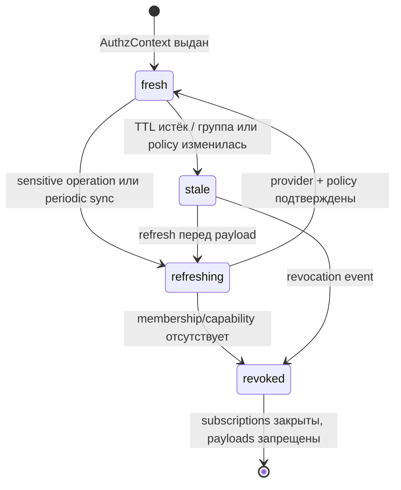

# Identity and Access — component solution design

**Статус:** DESIGN DRAFT для G0.  
**Authority:** [Architecture Spine](../architecture-spine.md), AD-2, AD-4–AD-6, AD-8, AD-11–AD-14, AD-16.  
**Связанные документы:** [platform design](../architecture.md), [integration specification](../integration.md), [authz-context-v2](../contracts/authz-context.schema.json), [projection mapping](../contracts/projection-mapping.md), [T01 vectors](../contracts/t01-contract-tests.yaml), [specification](../spec.md), [GO](git-orchestrator.md), [Open WebUI](open-webui-fork.md), [Retrieval](retrieval-indexing.md), [Ingestion](ingestion-connectors.md).

Точные upstream identity seams, LDAP/OIDC attributes, token/session mechanics и code paths — **UNKNOWN T00**. Компонент переиспользует Open WebUI LDAP/OIDC и не создаёт собственный authentication protocol или LDAP/OIDC client.

## 1. Назначение и границы

Identity/AuthZ adapter отвечает на вопросы «кто этот stable actor», «какие Space/path capabilities у него сейчас» и «может ли он утвердить этот path по этой policy revision». Он единолично пишет managed upstream grants и `kb_authz`, выдаёт server-side `AuthzContext` и обеспечивает revocation barrier для всех каналов.

### 1.1. Responsibilities

- Переиспользование upstream LDAP/OIDC authentication и JIT provisioning.
- Нормализация `{stable_id, username, display_name, groups[]}` без использования email/login как identity key.
- Поддержка AD objectGUID, OpenLDAP entryUUID и OIDC sub; nested AD groups, read-only bind, LDAPS/StartTLS и отказ пустого пароля.
- Чтение/валидация versioned access и `approval-policy.yaml` policy bundles с exact Git revisions.
- Mapping external groups → roles/Spaces/path-scoped approver roles; default private и repository=Space.
- Выдача и обновление server-issued `AuthzContext` с effective scopes и policy revisions.
- Единственный writer managed upstream grants и `kb_authz`; group snapshots и grant drift reconciliation.
- Group-assigned review queues; joiner/mover/leaver без разрыва истории по stable ID.
- Периодическое обновление групп ≤ 15 минут, sensitive recheck и revocation events.
- Повторная авторизация long operations перед каждым payload/export/merge и закрытие live subscriptions при revocation.

### 1.2. Non-responsibilities

- Не создаёт GitLab accounts для business users и не зависит от GitLab LDAP group sync.
- Не выполняет merge, canonical document writes или index mutations.
- Не принимает `actor`, `groups`, `space`, `tenant` или approver identity из LLM/tool/browser payload как доказательство.
- Не реализует page-level ACL внутри Space и не использует `access` front matter как самостоятельный источник прав.
- Не пишет `kb_ops`, `kb_index` или arbitrary upstream tables.
- Не обещает «забыть» уже отправленный браузеру/модели текст; chat retention регулируется отдельно.
- Не вводит собственный deny precedence поверх additive upstream grants; managed mapping учитывает фактическую upstream semantics.

## 2. Внутренние модули

| Модуль | Ответственность |
| --- | --- |
| Upstream identity seam | Получение authenticated identity/session из Open WebUI LDAP/OIDC |
| Identity normalizer | Stable ID, display attributes, provider-specific mapping, защита истории при rename |
| Group snapshotter | Periodic/nested group resolution, fresh recheck, timestamp и error handling |
| Policy bundle loader | Canonical policy snapshot, exact revisions, path normalization, schema validation |
| Access evaluator | Reader/Author/Owner/Space admin capabilities и effective Space scopes |
| Approval evaluator | External group + path scope, approver separation, review queue membership |
| AuthzContext issuer | Server-issued immutable request context, expiry и refresh |
| Managed grants synchronizer | Единственные writes в upstream managed grants и `kb_authz` |
| Revocation coordinator | Group/policy/session changes, cache invalidation, live subscription close |
| Audit/telemetry | Policy/recheck/grant/revocation events без secrets/raw content |

Policy bundle поступает как versioned canonical snapshot через согласованный GitLab/canonical-read adapter. Физический seam выбирается после T00; прямой доступ к `kb_ops` или неучтённая mutable копия policy запрещены.

## 3. Inputs и outputs

### 3.1. Inputs

| Input | Содержимое | Правила доверия |
| --- | --- | --- |
| Authenticated upstream identity | Provider attributes, session/upstream user reference | Только upstream server-side seam |
| LDAP/OIDC group data | Stable group identifiers, nested membership, snapshot time | Read-only provider connection; ошибка не расширяет права |
| Access policy | Groups → roles/Spaces, managed grant rules, policy bundle ID | Exact `access_policy_revision` из Git |
| Approval policy | Groups → path-scoped approver roles | Exact `approval_policy_revision` из того же bundle |
| Authorization request | Stable actor/upstream session, requested capability, Space/path, operation type | Requested scope не равен granted scope |
| Sensitive recheck | Merge/export/private page/long-running payload | Fresh groups и current policy перед действием |
| Revocation signal | IdP sync, policy/session event, administrator-controlled operational event | Server-side verified source |

### 3.2. Outputs

- `AuthzContext` для GO, retrieval, Open WebUI tools, files/history/export и live subscriptions.
- Allow/deny с machine-readable reason без раскрытия существования protected object.
- Effective review queues для групп, не персональных списков approvers.
- `AccessPolicyChanged.changes[]` с независимым per-Space `{space_id,repository_id,policy_bundle_id,access_policy_revision,approval_policy_revision,group_snapshot,revocation_epoch}` для GO и index event flow.
- Managed upstream grant mutations и `kb_authz` projections.
- Revocation event для invalidation и subscription closure.

## 4. `authz-context-v2` contract

Каждый managed request использует server-issued контекст, который нельзя сформировать или изменить tool arguments. Машинная схема: [authz-context.schema.json](../contracts/authz-context.schema.json).

| Поле | Семантика |
| --- | --- |
| `stable_id`, `issuer`, `actor_type` | Trusted stable identity и classification; AD objectGUID, OpenLDAP entryUUID или issuer-scoped OIDC sub; не email/login или self-asserted claim |
| `revocation_epoch` | Независимый actor/session epoch; не заменяет per-Space epochs |
| `space_scopes[].space_id`, `repository_id` | Уникальная 1:1 binding каждого effective Space; один repository = один Space |
| `space_scopes[].capabilities` | Effective Space capabilities; agent/connector ограничены read/search/propose/source_read |
| `space_scopes[].policy_bundle_id` | Repository + access/approval policy paths именно этого Space |
| `space_scopes[].access_policy_revision`, `approval_policy_revision` | Полные Git SHA одного согласованного bundle именно этого Space |
| `space_scopes[].group_snapshot` | `{snapshot_id,captured_at,membership_sha256,groups[]}` с direct/nested membership именно для этой evaluation |
| `space_scopes[].revocation_epoch` | Независимый epoch Space для cursor/payload/recheck invalidation |
| `path_scopes[]` | Нормализованные propose/review/merge scopes со ссылкой на ровно один `space_scopes` entry; не page-level read ACL |
| `evaluated_at`, `expires_at` | UTC evaluation и TTL; каждый `group_snapshot.captured_at <= evaluated_at < expires_at`; long operation обязана refresh |
| `context_id` | Correlation/audit ID без полномочий сам по себе |

Top-level reusable `groups[]`, `policy_bundle_id`, policy revisions или `group_snapshot_at` для нескольких Spaces отсутствуют. Multi-Space operation использует только binding соответствующего Space и сохраняет полный ordered per-Space snapshot/profile/policy/group/epoch набор в cursor; потеря или подмена одного binding даёт `AUTHZ_CONTEXT_STALE`, а не заимствование другого Space.

OIDC `sub` сравнивается только в пределах configured issuer identity mapping. Dedicated deployments не смешивают identities разных issuers в один stable key namespace без отдельного согласованного design.

Контекст является входом для проверки, а не bearer merge credential. GO всё равно выполняет sensitive recheck именно нужного per-Space binding и actor epoch, а retrieval повторно авторизует каждый выдаваемый payload. При смене policy revisions старый контекст недействителен для sensitive operation. Projection разделяет `authz_contexts` envelope и `authz_context_spaces` с full composite policy/Space/repository reference; disposable row ID не заменяет durable epochs.

## 5. Owned state и внешние schemas

### 5.1. Canonical owners

- Group membership и authentication attributes — LDAP/OIDC provider.
- Access/approval mapping — versioned Git policy.
- Users/sessions/chats/model connections — Open WebUI upstream.
- Documents/proposals/decisions — GitLab через GO.
- Index state — `kb_index` через index contracts.

### 5.2. Только Identity/AuthZ writer: `kb_authz`

| Logical state | Назначение |
| --- | --- |
| Identity mapping | Upstream user ↔ stable ID/provider attributes; rename сохраняет историю |
| Group snapshots | Effective membership, `group_snapshot_at`, sync status/error |
| Effective grants projection | Group/policy-derived Space/path capabilities |
| Policy activation | Bundle ID, exact revisions, activation/validation state |
| Managed grant sync | Upstream grant references, desired/observed state, drift |
| Review queue projection | Group-assigned queues, не canonical proposal state |
| AuthzContext envelope + per-Space bindings | Actor epoch, expiry и independent `(context_id,space_id)` repository/policy/group/revocation bindings; fresh rebuild only |
| Revocation/outbox metadata | Actor/per-Space epochs, dedupe, invalidation/subscription closure progress и retries |

Никакой другой компонент не мигрирует и не пишет эти таблицы/grants. Consumers получают decisions через AuthZ API/events. `kb_authz` пересобирается из Git policy + IdP + upstream references; она не является независимым источником привилегий.

## 6. Ключевые workflows

### 6.1. Login и JIT

```mermaid
sequenceDiagram
    actor U as Пользователь
    participant UI as Open WebUI upstream auth
    participant IDP as LDAP/OIDC
    participant IAM as Identity/AuthZ adapter
    participant DB as kb_authz/upstream grants

    U->>UI: Login
    UI->>IDP: Authenticate через согласованный upstream mode
    IDP-->>UI: Identity attributes; пустой/невалидный password отклонён
    UI->>IAM: Trusted authenticated identity
    IAM->>IAM: Normalize stable_id и resolve nested groups
    IAM->>DB: JIT user/grants sync, если actor новый или mapping изменился
    IAM-->>UI: Server AuthzContext и effective Spaces
    UI-->>U: Только авторизованный managed experience
```

JIT не создаёт GitLab user. Personal Notes и ordinary chats используют upstream behavior и не получают managed corpus permissions автоматически.

### 6.2. Policy activation

1. Получить immutable policy snapshot и проверить bundle ID, полные revisions и composite связь repository=Space; current/previous cutovers и grants не могут ссылаться на policy другого Space.
2. Нормализовать path separators, Unicode и отклонить `..`, неоднозначные IDs, неизвестные Spaces и неподдерживаемые page-level правила. Canonical absolute scopes losslessly маппируются в repository-relative projection: `/` ↔ empty prefix, `/pricing` ↔ `pricing`; reverse добавляет ровно один `/`.
3. Проверить group mappings, default private, approver scopes и отсутствие смешанных revisions. `rule_id` и normalized approval prefixes уникальны включая NFC/NFD/trailing-separator variants; для документа выбирается ровно одно longest-normalized-prefix правило на segment boundary, без union с менее специфичными группами.
4. Активировать bundle как согласованный access+approval unit **для каждого Space**; multi-Space consumer получает независимые bindings, а не один общий `policy_bundle_id`.
5. Синхронизировать managed upstream grants и `kb_authz` идемпотентно.
6. Отправить `AccessPolicyChanged.changes[]` с independent per-Space policy/group/epoch entries; retrieval немедленно применяет fresh authorization, не дожидаясь rebuild.
7. При ошибке activation сохранить предыдущий полностью согласованный bundle; частичная policy не выдаётся.

### 6.3. Sensitive operation

Перед merge/export/выдачей закрытой страницы:

1. Перепроверить stable identity, actor epoch и external groups у provider/fresh group path.
2. Для конкретного Space загрузить/подтвердить его собственные repository, policy bundle, access+approval revisions, group snapshot и Space revocation epoch; чужой binding запрещён.
3. Вычислить capability на конкретный Space/path, а не только global role.
4. Для merge проверить approver separation от author/requester/version author и longest-prefix path rule.
5. Выдать короткоживущий refreshed `authz-context-v2`; при недоступности recheck sensitive operation не выполняется по устаревшему allow.

### 6.4. Long-running operation и live subscription

Перед каждым новым payload/export batch/tool result GO/retrieval/UI запрашивает refresh или подтверждение актуальности контекста. Cursor хранит полный per-Space snapshot/profile/policy/group/epoch набор плюс actor epoch; stream или subscription не сохраняет право навсегда. Revocation event:

- инвалидирует cached contexts и derived grants;
- закрывает live subscriptions;
- предотвращает новые retrieval/tool/file/history/export payloads;
- переводит очереди mover в соответствии с новыми группами;
- не изменяет Git history и attribution.

### 6.5. Joiner / mover / leaver

| Событие | Результат |
| --- | --- |
| Joiner | JIT при первом login либо групповое обновление; доступ и group review queue появляются по policy |
| Mover | Новые effective scopes и queues; старые scopes отзываются; proposal/history сохраняют stable attribution |
| Leaver | Доступ/search/tools/files/history/export прекращаются не позднее SLO; merge/export отклоняются при ближайшей recheck; subscriptions закрываются |
| Login/email rename | Тот же stable ID; chats/history/proposals/decisions не перепривязываются по строковому login |

## 7. Revocation state machine и SLO



- Фоновое group refresh выполняется не реже 15 минут.
- Revocation SLO — **≤ 30 минут** для закрытых разделов, поиска и agent tools.
- Merge/export/private page denial происходит при ближайшей sensitive recheck, которая может быть раньше фонового цикла.
- TTL сессий и live subscriptions ограничен; точная duration — configuration/owner decision, не ослабляющая SLO.
- При provider outage нельзя безгранично использовать cached allow. Sensitive operations fail closed; обычные payloads не выходят за подтверждённый freshness/SLO barrier.

## 8. Ошибки, идемпотентность и concurrency

| Code / случай | Поведение |
| --- | --- |
| `NOT_FOUND` | Anti-enumeration для объекта вне visible scope |
| `FORBIDDEN` | Authenticated actor не имеет capability и раскрытие разрешено policy |
| `AUTHZ_CONTEXT_STALE` | Обновить groups/policy перед payload; старый allow не применять |
| `POLICY_REVISION_MISMATCH` | Операция остановлена до получения одного bundle |
| `GROUP_SNAPSHOT_STALE` | Sensitive operation fail closed; запланировать recheck |
| `IDENTITY_UNAVAILABLE` | Нет новых privileged grants/merge/export; retryable по типу сбоя |
| `APPROVER_CONFLICT` | Approver совпал с author/requester/version author или потерял path role |
| `INVALID_POLICY` | Не активировать bundle; сохранить предыдущий согласованный |

Grant/policy sync идемпотентна по `(space_id, repository_id, policy_bundle_id, access_revision, approval_revision, group_snapshot.snapshot_id, group_snapshot.membership_sha256, revocation_epoch)` и desired-state hash. Повтор не создаёт дублирующие grants. Старая group sync не перезаписывает более свежий snapshot; ordering использует observed snapshot/generation, не timestamp client.

Только один writer выполняет mutations `kb_authz` и managed grants. Concurrent consumers могут читать предыдущий активный bundle, но sensitive apply требует согласованный fresh context. Частично активированная access/approval пара недопустима.

## 9. Security

- Read-only LDAP bind, LDAPS/StartTLS, nested AD groups и отказ пустого пароля обязательны; CVE-2026-44551 проверяется на pinned upstream.
- Secrets только в deployment secret mechanism. Group DNs/attributes не попадают в LLM payload, если не являются необходимым авторизованным результатом.
- Managed KB authorization применяется одинаково к direct/deferred/note chat/automation/channel/OpenAPI и native tool registration.
- Сервер фильтрует tree/titles/snippets/chunks/files/history/export до exposure. SQL/index filter сам по себе не заменяет final payload authorization.
- Personal grants — только явно аудируемое исключение; групповой mapping — норма. Default private.
- Front matter `access` не повышает и не понижает права самостоятельно. Разные ACL → разные repositories/Spaces.
- Prompt injection не может изменить policy, stable actor, groups, scopes или review queue.
- Instance admin/break-glass вне agent trust boundary; break-glass в MVP отключён.

## 10. Observability

| Signal | Назначение |
| --- | --- |
| Group sync age/success/failure | Контроль ≤ 15 минут и stale providers |
| Sensitive recheck result/latency | Merge/export/private-page denial и provider health |
| Revocation propagation latency | Доказательство SLO ≤ 30 минут |
| Live subscriptions closed/lag | Проверка revocation barrier |
| AuthzContext stale/mismatch denials | Выявление смешанных revisions и cache drift |
| Managed grants desired/observed drift | Reconciliation и upstream regression |
| Policy activation failures | Invalid paths/groups/bundles без partial activation |
| Review queue changes | Mover/joiner/leaver audit |

Telemetry использует stable IDs, policy revisions, request IDs и result codes; passwords, bind secrets, raw private queries/documents и полные provider payloads не логируются.

## 11. Tests и acceptance

1. LDAP/OIDC happy path на pinned baseline; невалидные и пустые LDAP credentials отклонены (A24).
2. objectGUID/entryUUID/sub остаются stable при rename login/email; история/MR/decisions не теряются (A26).
3. Nested AD groups, read-only bind и encrypted LDAP mode; неподдерживаемый attribute → BLOCKED, не fallback на email.
4. JIT создаёт только upstream identity/grants, не GitLab business account.
5. Reader/Author/Owner scopes одинаково действуют на UI/API/tools/files/history/export/search; IDOR/cross-space negative tests. Два Spaces имеют разные repository/bundle/revisions/group snapshots/epochs; borrowed binding и policy/cutover/grant другого Space отклоняются composite references.
6. Mover меняет доступ и review queue; leaver теряет доступ ≤ 30 минут (A25).
7. Revoke между candidate search и payload, между MR и merge, перед export и во время live stream → payload/merge/export denied.
8. Long operation обновляет контекст перед каждым batch; multi-Space cursor/subscription не обходят revocation, а подмена/удаление одного per-Space snapshot/binding даёт explicit stale error без payload.
9. Access/approval revision mismatch, partial bundle activation, duplicate approval rules/prefixes и borrowed parent-rule approval отклоняются; `/` vs `/pricing` выбирает только `/pricing`; absolute↔relative `/`, `/pricing`, `/approval-policy.yaml` roundtrip lossless.
10. Approver = author/requester/version author отклоняется; group-assigned queue не требует персонального GitLab user.
11. Front matter tampering не меняет Space ACL; `access` не становится privilege escalation.
12. Grant sync retry/concurrent stale snapshot не дублирует и не откатывает более свежие grants.
13. Personal Notes и ordinary chats не меняются; managed feature flag не расширяет их права.

Evidence содержит real sandbox results где требуется IdP/GitLab; mocks не помечаются как проверка реальной LDAP/OIDC интеграции.

## 12. T00 dependencies

- Pin Open WebUI commit и найти реальные LDAP/OIDC/JIT/session/grants/live subscription seams с code references.
- Подтвердить исправление CVE-2026-44551 и negative test пустого пароля на выбранном baseline.
- Проверить доступность objectGUID/entryUUID/sub, nested AD group resolution, read-only bind, LDAPS/StartTLS и fresh group recheck без нового самописного auth protocol.
- Определить фактическую additive upstream grants semantics и минимальный managed-grants adapter; не выдумывать deny precedence.
- Проверить способ получения exact Git policy snapshots и одинакового bundle IAM/GO, включая activation и revision mismatch behavior.
- Подтвердить механизм invalidation/closure live subscriptions и измеримость revocation SLO.
- Определить конкретные клиентские groups/roles/owners как owner configuration; технические defaults не заменяют этот список.
- GitLab LDAP group sync не использовать как зависимость; GitLab identity остаётся инженерным контуром.
