# Ingestion and Connectors — component solution design

**Статус:** DESIGN DRAFT для G0.  
**Authority:** [Architecture Spine](../architecture-spine.md), AD-1–AD-5, AD-8, AD-10–AD-16.  
**Связанные документы:** [platform design](../architecture.md), [integration specification](../integration.md), [front-matter-v2](../contracts/front-matter.schema.json), [projection mapping](../contracts/projection-mapping.md), [T01 vectors](../contracts/t01-contract-tests.yaml), [specification](../spec.md), [content standard](../content-standard.md), [GO](git-orchestrator.md), [Identity](identity-access.md), [Retrieval/Index](retrieval-indexing.md).

Open WebUI pinned на `v0.13.0`; upstream extraction/RAG seams audited ([RAG/editor audit](../evidence/t00/openwebui-rag-editor-audit.md)), controlled cutover и export capabilities проверены на GitLab CE `19.5.3` synthetic sandbox ([gitlab-capabilities](../evidence/t00/gitlab-capabilities.md)). Первый connector, source-system versions/editions/API, exact repository layout, object-store layout, extraction library route и size/retention thresholds остаются **owner decisions** — T00 их не выбирал. Docling проверяется как существующая upstream integration и добавляется только при доказанной необходимости. Production corpus не создаётся до согласования perimeter и source corpus.

## 1. Назначение и границы

Ingestion/source adapters готовят проверяемые, воспроизводимые proposals из файлов и внешних систем. Они не обходят Git lifecycle: до cutover передают проверенный пакет в controlled engineering import; после cutover создают proposals только через GO, затем human DecisionRecord и final merge только GO.

### 1.1. Responsibilities

- Source registry bindings и минимальные read credentials для явно выбранных объектов.
- Dry-run с path→ID map, provenance, links/attachments, validation и ошибками без canonical writes.
- Intake security: traversal/symlink/executable HTML/MDX/secrets/oversize rejection и safe path normalization.
- Обязательный owner/data barrier для `strict` и `pii_permitted` до передачи в corpus.
- Extraction/conversion staging с original/extracted/canonical provenance и явными потерями.
- Четыре ownership modes: `migrated`, `source_managed`, `curated`, `live_operational`.
- Hash/version no-op, previous imported base + current curated + incoming diff, tombstone/obsolete review.
- Не более одного outstanding proposal на source object и `seen`/`proposed`/`merged` cursor coordination через GO.
- Immutable/versioned originals и attachments с hashes, media classification и human verification gates.
- Typed read-only live operational API/snapshot с snapshot time; никакой автоматической wiki-публикации.
- Идемпотентный retry/resume, bounded backoff, observable failures и sanitized dry-run/quality reports.

### 1.2. Non-responsibilities

- Не выполняет direct push после cutover, merge, auto-merge, grants или index pointer mutations.
- Не пишет `kb_ops`, `kb_index`, `kb_authz` или upstream tables; source cursor меняется через GO API.
- Не перезаписывает curated changes, не удаляет молча при source deletion и не продвигает cursor при failure.
- Не разрешает local edits `source_managed`; это также enforcing policy GO, а не только connector convention.
- Не применяет обновления старого источника к `migrated` и не превращает `live_operational` в страницу.
- Не строит universal two-way sync, generic crawler или все connectors одновременно.
- Не использует неутверждённые extraction/LLM/OCR/embedding providers и unplanned fallback.
- Не принимает файл без владельца/завершённого data barrier и не индексирует непроверенные critical media.

## 2. Внутренние модули

| Модуль | Ответственность |
| --- | --- |
| Source binding registry adapter | Versioned source/account/remote object mapping, ownership mode, profile и owner reference |
| Connector adapter | list/changes/fetch/version/attachments/deletions/access hints для выбранного source |
| Dry-run planner | Детерминированный path→ID map, manifest, provenance, errors; ноль canonical writes |
| Intake security gate | Archive/path/type/size/symlink/secrets/executable-content checks |
| Data barrier | Owner evidence, profile/legal basis, PII scan results и human dispositions |
| Extraction router | Использование проверенного upstream route; original/extracted hashes и loss report |
| Media processor | Media classes, immutable assets, transcription/verification admission |
| Provenance/diff engine | Previous imported base/current curated/incoming, hash no-op, explicit conflicts |
| Proposal coordinator | GO propose contract, rationale/evidence, one outstanding per source object |
| Cursor coordinator | Вызовы GO для durable seen/proposed/merged transitions; нет direct DB |
| Attachment adapter | Immutable object/version writes и metadata/hash manifest |
| Live operational reader | Typed bounded read-only queries, snapshot time, authorization и no persistence as wiki |
| Quality/audit reporter | Sanitized validation/extraction/media/cursor metrics |

LLM-генерированный анализ/summary всегда остаётся proposal content и проходит тот же review. Содержимое источника не получает полномочий инструкции.

## 3. Inputs и outputs

### 3.1. Inputs

| Input | Обязательные данные |
| --- | --- |
| Selected raw file/source object | Source ID/account/remote ID, owner, version/hash, media/type/size, source_ref |
| Deployment data profile | `strict` или `pii_permitted`, legal basis где требуется, approved provider inventory |
| Source binding | Space/repository mapping, ownership mode, path policy, source credential reference |
| Dry-run request | Package/source snapshot, mapping/config version, limits, idempotency context |
| Source change | Stable remote ID, new version/hash, deletion marker, optional access hints |
| Existing Git state | Current document, previous imported base и exact revision через GO |
| Human verification | Owner checklist, PII dispositions, extraction/media review evidence |
| Live operational query | Typed operation/filters, server `AuthzContext`, bounds; source object не передаёт actor |

### 3.2. Outputs

- Dry-run manifest: path→stable ID map, source/provenance, tree/links/anchors/attachments, ownership mode, errors/warnings и validation evidence; **без canonical writes**.
- Controlled pre-cutover staging package для engineering import, если corpus unpublished и все gates завершены.
- GO proposal request/result с exact base/proposal SHA, rationale/evidence и source versions.
- Source-sync status: no-op/outstanding/conflict/tombstone, seen/proposed/merged versions, retryable error.
- Immutable assets manifest: object/version/hash/size/media type/source refs и verification status.
- Typed live operational result с `snapshot_time`, source version, bounds и freshness semantics; read-only.
- Sanitized quality/loss/security/PII/media reports без raw secrets/неутверждённого private content.

## 4. Owned state и доступ к чужим schemas

### 4.1. Собственное состояние

Ingestion **не владеет продуктовой PostgreSQL schema**. Его durable operational state находится в `kb_ops` и принадлежит GO; компонент использует только source-sync API.

| State | Owner и способ доступа |
| --- | --- |
| Source registry/binding | Versioned deployment/source configuration; GO создаёт projection |
| Seen/proposed/merged cursor и outstanding proposal | Только GO `kb_ops`; ingestion через versioned API |
| Proposal/Decision/MR outcome | GitLab через GO |
| Originals and large assets | Immutable external object storage через scoped ingestion adapter |
| Dry-run/staging artifacts | Noncanonical bounded staging; package/manifest связаны hashes и не являются published truth |
| Source ACL hints | Входная подсказка, не platform grant; effective ACL выдаёт Identity/AuthZ |
| Index/admission state | CI/index workers через `AttachmentChanged`/run contracts |

Object storage originals immutable и не редактируются под тем же version. Повторная загрузка того же hash — no-op/существующий object reference. Обычный export содержит assets manifest по правам, но не credentials.

## 5. Dry-run и security/data gates

### 5.1. Dry-run protocol

1. Проверить согласованный Space/repository perimeter, source binding, owner и data profile.
2. Прочитать source snapshot immutable по version/hash; не использовать нестабильный current URL как версию.
3. Выполнить все intake checks и нормализацию путей: separators, Unicode, запрет `..`, `.git`, `.env`, secrets и collisions.
4. Построить deterministic path→document ID map, сохраняя существующие IDs при rename по provenance; IDs не зависят от basename/path.
5. Построить tree, relative links/anchors, attachment manifest, provenance и ownership mapping.
6. Выполнить extraction в staging, если применимо, и зафиксировать converter/model/config versions и потери.
7. Завершить data/media/quality checks; каждый unresolved blocker виден в manifest.
8. Вернуть manifest и errors. Не создавать branches, MR, `main` commits, active index entries или source cursor `merged`.

Повтор dry-run с тем же source/config snapshot воспроизводит IDs/manifest. Изменение config/source создаёт новый manifest/hash, не мутирует старый evidence.

### 5.2. Intake security

Отклоняются или изолируются до явного supported workflow:

- archive traversal, absolute/ambiguous paths, symlinks и escape за staging root;
- executable HTML/MDX, active content и небезопасный preview;
- `.git`, `.env`, keys/tokens/password-like secrets и запрещённые скрытые файлы;
- oversized/decompression-bomb inputs и превышение согласованных count/size limits;
- duplicate stable IDs, unsupported formats, невалидная UTF-8 canonical output и unresolved links;
- mutable/unhashed external attachments и несоответствие declared/observed media metadata.

Лимиты и supported formats фиксируются после audit; отсутствие выбранного числа здесь не означает unlimited input.

### 5.3. Data profiles

| Gate | `strict` — default | `pii_permitted` |
| --- | --- | --- |
| Owner | Обязателен до intake | Обязателен до intake |
| Legal basis | Не является разрешением на PII corpus | Documented legal basis фиксируется до import |
| Проверка | Owner checklist до conversion включая scans/signatures/photos + post-conversion auto scan | Согласованный усиленный barrier и access/retention policy |
| Hits | Каждое срабатывание разбирает человек; unresolved → `на правке`/reject | Разбираются по клиентской policy; нет молчаливого accept |
| Inference | Только approved providers внутри profile | Только собственный согласованный hoster.ai/client inference; внешний PII egress запрещён |
| Fallback | Unplanned fallback запрещён | Особенно запрещён для extraction/OCR/embeddings/reranking |

Auto scan — вспомогательный сигнал, не доказательство отсутствия PII. В logs/report не копируются сами чувствительные совпадения.

### 5.4. Canonical `document-front-matter-v2` и DocOps

- Dry-run и proposal validation используют закрытую [front-matter-v2](../contracts/front-matter.schema.json): stable `links[]` по target document UUID и canonical `valid_until: date|null` обязательны; Markdown body links и front matter links проецируются в один stable-ID graph. Resolved projection обязан содержать тот же target UUID в same Space/snapshot; swapped projection/UUID — invalid.
- `migrated` и `source_managed` требуют canonical `origin`; `origin.ownership_mode` всегда равен outer `ownership_mode`. `live_operational` запрещён в outer/inner canonical document mode и остаётся typed read-only. Stable source IDs вида `DOC-0001` сохраняются без silent lowercase normalization.
- `archived=true` iff присутствует `archive` с date/reason/replacement. Restore создаёт reviewed revision `archived=false` без archive. Replacement должен быть другим active document в same Space; descendants архивируются только явно в том же reviewed MR либо получают repaired parent/link; неявный cascade запрещён.
- [docops-review-metadata-v1](../contracts/docops-review-metadata.schema.json) — projection, не второй канон: `document_id + document_revision_sha + valid_until + provenance` обязаны совпадать с front matter. Future UTC date → `scheduled`, expired → `due` и authorized queue/`kb.docops.review_requested.v1`, удаление даты reviewed revision → `removed` с `review_required=false,valid_until=null`. Expiry не даёт access и не архивирует автоматически.
- `access` запрещён и не влияет на ACL; `valid_until` и `links` также не создают authorization effect. Полные mappings и CF-03–CF-06/CF-27 vectors находятся в [projection-mapping.md](../contracts/projection-mapping.md) и [t01-contract-tests.yaml](../contracts/t01-contract-tests.yaml) со статусом DESIGN_NOT_EXECUTED.

## 6. Ownership modes и update workflows

| Mode | Source update | Local edit | Публикация после cutover |
| --- | --- | --- | --- |
| `migrated` | Старый источник игнорируется как writer; изменение может быть только audit signal | Разрешены через обычный GO/MR | GO/MR → human DecisionRecord → final merge только GO |
| `source_managed` | Детерминированный diff от source previous imported base | Запрещены policy; GO отклоняет local proposal | Только GO/MR → human DecisionRecord → final merge только GO; auto-merge запрещён |
| `curated` | Сравнение previous imported base + current curated + incoming; proposal/conflict | Разрешены через GO/MR и сохраняются | GO/MR → human DecisionRecord → final merge только GO, ноль overwrite |
| `live_operational` | Typed read-only API/snapshot по запросу | Нет wiki document для edit | Нет ingestion proposal/index автоматически |

Спецификационная ранняя возможность source-managed auto-merge не применяется: главный Spine AD-3 требует human DecisionRecord и final merge только GO для всех managed changes после cutover.

### 6.1. Source update state machine

```mermaid
stateDiagram-v2
    [*] --> observed: source version/hash увиден
    observed --> seen_durable: GO сохранил seen version
    seen_durable --> no_op: hash/version совпадает с применённым
    seen_durable --> proposal_pending: один GO proposal создан
    proposal_pending --> proposal_pending: новая source version только обновляет seen; второго MR нет
    proposal_pending --> merged: проверенный merge; merged version продвинут
    proposal_pending --> rejected: human reject; merged не меняется
    proposal_pending --> conflicted: stale/curated conflict; merged не меняется
    rejected --> seen_durable: явный новый run от свежего base
    conflicted --> seen_durable: coalesce latest seen в новый proposal
    merged --> observed: следующее изменение
    no_op --> observed: следующее изменение
```

Диаграмма показывает основной happy/conflict path; versioned projection/event enum дополнально сохраняет `tombstone`, `retry` и `dead_letter` без переименования. `merged` требует verified merge SHA. Точные canonical↔API↔event↔DB mappings перечислены в [projection-mapping.md §3](../contracts/projection-mapping.md#3-index-cutover-и-source-states). `live_operational` не имеет `source_sync_states`, document/MR/index/seen/proposed/merged cursor mapping вообще.

### 6.2. Cursor semantics

Для каждого `(source_binding_id, source_object_id)` GO хранит раздельно:

- `seen_version` — последняя durable зафиксированная observed source version/hash;
- `proposed_version` — версия, связанная с текущим durable outstanding proposal;
- `merged_version` — версия, для которой проверен Git-derived merge outcome.

Правила:

1. `seen` продвигается после durable записи observation и достаточных source metadata, не при временном fetch.
2. `proposed` продвигается только после durable MR + ProposalRecord; crash до этого не оставляет ложного proposed.
3. `merged` продвигается только после проверенного merge commit и reconciliation source mapping, никогда после MR creation/timeout/CI indexing.
4. На source object существует не более одного outstanding proposal независимо от retries/workers.
5. Если во время outstanding пришла новая версия, обновляется `seen`, но не создаётся второй MR. После terminal outcome последняя seen версия обрабатывается от fresh base; промежуточные версии сохраняются в provenance/evidence по supported contract.
6. Тот же hash/version — no-op или возврат существующего proposal. Extraction/LLM/GitLab failure не даёт false success.
7. Reject/conflict не продвигает `merged`; новый proposal является явным новым решением и не overwrite curated state.

### 6.3. Curated three-way comparison

Алгоритм использует:

- **previous imported base** — source-derived содержимое последнего учтённого import;
- **current curated document** — актуальная Git revision;
- **incoming source** — новая immutable source version/extraction.

Если current отличается от previous только ожидаемым source-независимым образом, ручные изменения сохраняются. Same-paragraph/semantic conflict не разрешается автоматически: proposal явно показывает расхождение и evidence. Молчаливая whole-file replacement запрещена.

### 6.4. Source deletion

Deletion marker создаёт tombstone/obsolete review proposal с source version/provenance. GO не удаляет документ и attachments молча. Владелец выбирает archive/delete/retain через reviewed MR; `merged_version` меняется только после применённого решения по согласованному mapping. Git history/mirrors/object retention сохраняются согласно policy.

## 7. Attachments и media

### 7.1. Version contract

Каждая attachment revision содержит `{object_id, version, sha256, size, media_type, source_ref}` и связывается с document revision и Space ACL. Оригиналы/большие assets immutable/versioned. Чтение текущего URL без hash не доказывает версию и запрещено как canonical reference.

Мелкие поддерживаемые assets могут быть частью reviewed Git MR; большие/чувствительные originals остаются во внешнем object storage. `AttachmentChanged` проходит через GO в общий event/index/reconciliation контур.

### 7.2. Media admission

| Класс | Обработка | Index/answer admission |
| --- | --- | --- |
| Декоративные | Не переносить | Не индексировать |
| Иллюстративные | Asset + короткая подпись; не выдумывать содержание | Asset/caption после checks |
| Содержательные | Original + явно помеченное approved auto description + риск-based human check | Description с пометкой и ссылкой на original |
| Критические | Только требуемая ручная транскрипция/сверка; LLM лишь помощник | Только после human verification |
| Рукописные | Ручная транскрипция со сверкой, reject либо страница-ссылка на original | Нетранскрибированное не индексировать |

Ответ по автоматическому описанию обязан раскрывать это и ссылаться на оригинал страницы/слайда. Права на media равны правам страницы/Space, ссылка не обходит ACL.

## 8. `live_operational` read-only workflow

1. Agent/UI вызывает typed operation через bounded source adapter с server `AuthzContext`.
2. Adapter проверяет operation allowlist, bounds, source credential scope и data profile.
3. Source выполняется read-only; результат содержит `snapshot_time`, source version/record ID и freshness/limits.
4. Payload повторно авторизуется по Space/operation scope перед отправкой модели/браузеру.
5. Timeout/error не маскируется stale данными как current facts. Кэш, если появится, должен быть keyed client+ACL+snapshot/policy и отдельно согласован.
6. Не создаются Git page, MR, embedding/index entry или source cursor `merged` автоматически.

Generic arbitrary source query, write operation и source-provided actor/grants не поддерживаются.

## 9. Ошибки, идемпотентность и concurrency

| Code / случай | Поведение и cursor |
| --- | --- |
| `INVALID_STRUCTURE` | IDs/links/tree невалидны; canonical writes и merged отсутствуют |
| `SECURITY_REJECTED` | Traversal/symlink/executable/secrets/oversize; quarantine/reject |
| `PII_REVIEW_REQUIRED` | Не передавать в corpus до human disposition |
| `UNSUPPORTED_FORMAT` | В manifest; не выдумывать extraction success |
| `EXTRACTION_LOSS` | Quarantine/другой route/human review; cursor не выдаёт success |
| `OUTSTANDING_PROPOSAL_EXISTS` | Вернуть существующий proposal; обновить только seen для новой source version |
| `STALE_BASE` / `CURATED_CONFLICT` | Явный conflict proposal/result; нет overwrite и merged transition |
| `SOURCE_GONE` | Tombstone/obsolete review; не удалять молча |
| `UPSTREAM_UNAVAILABLE` | Bounded retry/backoff; durable cursors не продвигаются без результата |
| `IDEMPOTENCY_KEY_REUSED` | Тот же operation key с другим source/config payload отклоняется |
| `FORBIDDEN` / `NOT_FOUND` | Source/platform anti-enumeration и ACL enforcement |

Idempotency key связывается с source binding + remote object + immutable source version/hash + operation + normalized config/payload hash. Повтор после crash возвращает durable operation/proposal либо безопасно продолжает тот же key. Worker не создаёт новый key для маскировки uncertain outcome.

GO сериализует source-sync transition per source object. Несколько watchers могут наблюдать версии параллельно, но только один outstanding proposal создаётся. Merge serialization остаётся отдельным per-target GO lock; source lock не используется как merge lock и не удерживается во время human review.

## 10. Security

- Отдельный `connectorCredential` не заменяется browser или bounded agent credential. Он имеет только выбранные source reads, dry-run/staging и proposal-only GO capability для exact source binding; pre-cutover controlled bulk, merge/auto-merge, other-Space binding и GitLab merge permission запрещены на уровне GitLab/GO. Path/body/source binding IDs проверяются на equality до side effect.
- Source credentials, deployment bind secrets и object-storage credentials не попадают в documents, MR evidence, model args, logs или dry-run export.
- Source ACL hints не копируются автоматически как grants. Space mapping явный, default private; разные ACL требуют разных Spaces.
- Все extraction/OCR/LLM/vision calls идут через approved provider inventory в data profile; raw private content не попадает в unapproved export/log.
- Документы/source text — недоверенные данные. Скрытый текст и prompt injection не меняют ownership, credentials, actor, merge или index policy.
- Paths и preview безопасны; executable HTML/MDX и XSS не считаются markdown fidelity.
- Originals immutable, hashes проверяются; attachment access совпадает со страницей и историей.
- До cutover bulk import доступен только controlled engineering path при unpublished Space; после cutover прямой push закрыт для всех.

## 11. Observability

| Signal | Назначение |
| --- | --- |
| Dry-run counts/manifests/errors | Воспроизводимость, loss/security review |
| Source lag и last successful observed version | Свежесть без ложного merged success |
| Seen/proposed/merged transitions | Cursor audit и stuck updates |
| Outstanding proposal age/count | Гарантия one outstanding и review backlog |
| No-op/hash duplicate rate | Идемпотентность |
| Extraction route/version/loss | Качество конвертации и upgrade impact |
| PII hits/dispositions count | Barrier evidence без самих PII values |
| Media classes/pending verification | Труд валидации и blocked index admission |
| Attachment hash/size/version mismatches | Integrity и missing assets |
| Retry/backoff/dead-letter | Source outage и poison objects |
| Live read latency/snapshot age/errors | Operational freshness, read-only health |

Logs содержат source/object IDs, hashes, request/run/proposal IDs и sanitized result codes. Raw documents, source payloads, PII snippets и secrets не логируются.

## 12. Tests и acceptance

1. Dry-run nested structure, relative links/anchors, same basename, Cyrillic, attachments и deterministic path→ID map; ноль canonical writes (A13).
2. Repeat import без duplicates; interrupted resume с тем же key; same source hash/version — no-op.
3. Pre-cutover package не активирует index/users без sign-off/CutoverRecord; после cutover connector direct push/merge отклонён.
4. Archive traversal, symlink, `.git`/`.env`/secrets, executable HTML/MDX, oversized/decompression cases отклонены (A23).
5. Strict: нет owner/checklist или unresolved PII hit → файл не принят; каждый hit имеет human disposition. PII-permitted external egress отклонён.
6. `migrated` игнорирует старый source writer; `source_managed` local edit отклонён GO; внешнее обновление всё равно требует human DecisionRecord и final merge только GO.
7. `curated`: разные абзацы сохраняются, same-paragraph conflict явен, ручные ссылки/front matter не теряются (A14).
8. Source deletion создаёт tombstone/obsolete review, не удаляет curated knowledge и не очищает молча assets/index.
9. Два workers/несколько новых versions создают максимум один outstanding proposal; latest seen обрабатывается после terminal outcome.
10. Crash до MR, после MR до cursor, после merge до cursor: seen/proposed/merged восстанавливаются корректно, нет false success.
11. Extraction/LLM/OCR failure не продвигает merged и не создаёт blind summary publication; original recoverable.
12. Media classes: decorative excluded, substantive descriptions marked, critical/handwritten без verification не индексируются; attachment ACL не обходится.
13. `live_operational` поддерживает только typed reads, возвращает snapshot time, не пишет wiki/index/cursor и не выдаёт stale как current.
14. Первый реальный connector отдельно проверяет update/revoke/delete/retry/attachments на sandbox; остальные connectors не объявляются готовыми. Browser/agent credential substitution, pre-cutover commit, other-Space binding и path/body mismatch отклоняются без writes.
15. Sanitized sample проходит human extraction/media quality review; mocked source не считается реальной интеграционной проверкой.
16. Front-matter-v2 CF-03–CF-06/CF-27 vectors: archive inverse/restore/replacement/descendants, every outer/inner origin mismatch, `DOC-0001`, stable links/swapped IDs и future/expired/removed `valid_until` с exact revision-bound DocOps queue/event. Все source states включая tombstone/retry/dead_letter проходят explicit mapping roundtrip; live_operational не получает запрещённые cursor rows.

## 13. T00 dependencies

- Согласовать repository-perimeter layout и source corpus; правило repository=Space уже фиксировано.
- Выбрать первый source connector владельцем и проверить target edition/API/auth/rate limits/deletions/attachments/access hints на sandbox.
- Аудировать существующие upstream extraction integrations, включая Docling; не добавлять второй pipeline без documented причины и не выбирать версии заранее.
- Определить object-store layout, immutable version/hash semantics, asset limits и restore/export closure после source audit.
- Проверить существующие PII/security scanning capabilities и human-review evidence flow без выбора непроверенной библиотеки; strict blocking не зависит от качества auto scanner.
- Определить supported formats/media sample и extraction loss/quality criteria на synthetic/sanitized corpus; реальные клиентские documents только после отдельного разрешения.
- Проверить GO source-sync API для transactional one-outstanding и durable cursor transitions, включая crash recovery и rebuild из Git/source registry.
- Зафиксировать approved provider inventory/data residency для extraction/OCR/vision/embedding; endpoints/model IDs и offline assets не выдумывать.
- Определить size/rate/retention/idempotency thresholds владельцем; до этого применять fail-closed bounded test configuration, не unlimited defaults.
