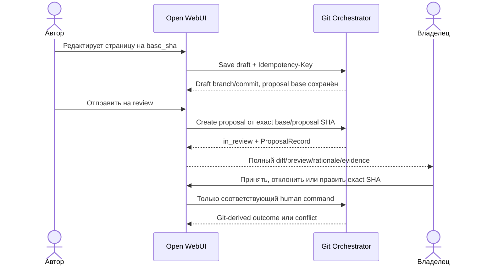

# Open WebUI fork — component solution design

**Статус:** DESIGN DRAFT для G0.  
**Authority:** [Architecture Spine](../architecture-spine.md), AD-1–AD-6, AD-8, AD-11–AD-16.  
**Связанные документы:** [platform design](../architecture.md), [integration specification](../integration.md), [agent-tools-v2](../contracts/agent-tools.yaml), [front-matter-v2](../contracts/front-matter.schema.json), [T01 vectors](../contracts/t01-contract-tests.yaml), [specification](../spec.md), [GO](git-orchestrator.md), [Identity](identity-access.md), [Retrieval](retrieval-indexing.md), [Ingestion](ingestion-connectors.md).

Open WebUI commit/tag, upstream code paths, UI extension points, WYSIWYG component, model IDs и test commands — **UNKNOWN T00**. Компонентные названия ниже логические и не утверждают существование конкретных upstream modules.

## 1. Назначение и границы

Open WebUI — единая продуктовая оболочка для дерева, чтения, редактирования, review и агентной работы. Fork минимален: managed KB добавляется тонкими seams поверх проверенных upstream auth/users/chat/model connections/grants/native tools/retrieval capabilities.

### 1.1. Responsibilities

- Feature-flagged managed KB navigator: Spaces, tree, breadcrumbs, stable ID deep links, statuses.
- Document whole/section read с bounds/cursor/explicit truncation и canonical revision display.
- Готовый WYSIWYG/editor adapter с front matter fidelity, Cyrillic, links/attachments и полным diff/preview.
- Сохранение черновиков и ручных правок только через GO; отображение человекопонятных conflicts.
- Минимальный review UI «было/стало/rationale/evidence + принять/отклонить/править» для владельцев без GitLab accounts.
- Bounded agent orchestration: read/search/propose tools, explicit page/subtree/Space scope и citations.
- Переиспользование upstream model connections для согласованного hoster.ai studio inference и streaming tool calls.
- Server-coordinated ACL presentation: скрыть недоступное до payload, а не только визуально после загрузки.
- Сохранение personal Notes, ordinary chats и per-user chat privacy без миграции/изменения их канона.
- Seam registry и upgrade regression evidence для каждого fork extension.

### 1.2. Non-responsibilities

- Не хранит canonical managed documents/decisions/cursors в upstream tables или browser storage.
- Не выполняет direct Git writes/merge и не владеет GO merge service credential.
- Не экспортирует human merge execution context как agent/native/OpenAPI tool.
- Не разрешает arbitrary Python Tools, Tool Creation, shell, generic SQL, arbitrary filesystem или arbitrary Git push в managed profile.
- Не определяет права только в frontend и не передаёт модели недоступный текст.
- Не переписывает upstream auth/chat/RAG/Notes/editor/collab internals.
- Не выполняет automatic conflict merge, rebase или повторную LLM-генерацию при apply.
- Не создаёт клиентские code branches и не удаляет branding/notices.

## 2. Внутренние модули и seam registry

| Логический модуль | Ответственность | Запрет зависимости |
| --- | --- | --- |
| Managed KB feature seam | Opt-in routes/navigation/configuration | Не менять personal Notes/ordinary chat defaults |
| Space navigator | Tree, parent/child, deep links по stable document ID | Не загружать полный корпус без authorization/bounds |
| Document read adapter | Whole/section, cursor, bounds, revision/truncation | Не считать indexed text canonical original |
| Editor adapter | Draft editing, front matter/link fidelity, save через GO | Не выбирать/строить собственный редактор до T00 |
| Review adapter | Exact-SHA diff/preview/evidence/actions | Не скрывать front matter/structure/attachment changes |
| Agent tool gateway | Typed read/search/propose calls и trusted run context | Нет merge/grants/shell/SQL/arbitrary tools |
| Scope/citation presenter | Page/subtree/Space selection, sources, media warnings | Model scope не расширяет AuthzContext |
| Model connection integration | Upstream provider credentials/config/retry/streaming | Нет неучтённого provider fallback |
| Retrieval integration seam | Использование versioned retrieval/read contracts через согласованный upstream composition | Нет прямого browser→PostgreSQL |
| Status/conflict presenter | draft/in_review/published/indexed/archived/conflicted | Не выводить `merged` по optimistic UI |
| KB API client | `/api/kb/v1`, idempotency replay, safe errors | Не подделывать actor/groups/tenant |

Для каждого фактического seam после T00 фиксируются code reference, назначение, upstream dependency, tests, owner и upgrade risk. Точное wiring retrieval в UI/agent определяется по существующему upstream RAG seam; новый обходной runtime dependency не добавляется.

## 3. Inputs и outputs

### 3.1. Пользовательские/server inputs

| Input | Правила |
| --- | --- |
| Authenticated upstream session | Только upstream server-side identity; managed AuthzContext выдаёт Identity/AuthZ |
| Space/document selection | Stable IDs; сервер проверяет effective scope |
| Read request | Document ID, optional exact revision/section, bounds/cursor |
| Manual edit | Exact `base_sha`, supported edit, unsaved navigation protection |
| Agent request | User prompt + selected scope + trusted request/run context; prompt не задаёт права |
| Proposal command | Exact `proposal_sha`, accept/reject/edit, human session и `Idempotency-Key` |
| Source/media result | Только авторизованный payload с revision/provenance/verification labels |
| GO/retrieval response | Git-derived states, revision, explicit errors и truncation |

### 3.2. Outputs

- Авторизованные tree/titles/documents/sections с `document_id`, revision, path/heading context, `truncation` и cursor.
- Draft/proposal state, exact diff/preview, rationale/evidence и ProposalRecord author/requester/version/run attribution.
- Human apply result только после GO Git-derived verification; `published` отдельно от `indexed`.
- Agent answer с citations, source revisions, explicit no-answer/abstention и media-description warning где нужно.
- Human-readable errors без Git jargon там, где владелец не инженер; request ID для support.
- Accessibility/keyboard-compatible navigation и review actions без отображения недоступного содержимого.

### 3.3. Логические tool contracts

```text
list_documents(space_id, parent_id?, cursor?)
search_documents(query, scope, mode=exact|semantic, cursor?)
read_document(document_id, revision_sha?, section?, cursor?)
get_document_links(document_id)
propose_create_document(parent_id, content, rationale, evidence, idempotency_key)
propose_edit_document(document_id, base_sha, patch, rationale, evidence, idempotency_key)
get_proposal(proposal_id, version?)
```

Список описывает capability contract, не готовые upstream registrations. Все arguments typed/bounded; server добавляет trusted actor/per-Space/run context. `merge`, `reject`, grants, arbitrary Git, shell, SQL и filesystem отсутствуют, но их отсутствие в schema не заменяет server/GitLab enforcement.

В [agent-tools-v2](../contracts/agent-tools.yaml) create принимает только curated single-page body, edit — только `AgentAnchoredPatchChange` с required body section, exact base, rationale/evidence. Agent не получает `editProposalVersion`, `WholeDocumentChange`, raw front matter/origin/links/valid_until/attachments/archive/access или independent route IDs. Эти операции и human whole-document replacement существуют отдельно от agent tools и требуют authenticated browser context/CSRF; GO независимо отклоняет forbidden diff через direct/OpenAPI/call_tool и все chat/channel paths. Path/body IDs и body/header idempotency key обязаны совпадать.

Human accept/reject/edit/apply endpoints также отделены от agent tools; human DecisionRecord предшествует final merge только GO.

## 4. Owned state и внешние schemas

### 4.1. Upstream-owned

Open WebUI upstream владеет users, sessions, chats, model connections и существующими tables/grants. Только Identity/AuthZ adapter выполняет managed grant writes через делегированный seam. Fork не переносит upstream migrations в продуктовые schemas.

### 4.2. Managed KB state

| State | Owner | Доступ Open WebUI |
| --- | --- | --- |
| Documents/drafts/proposals/decisions/policies | GitLab | Только GO API/Git-derived read models |
| AuthzContext/group snapshots/managed grants | IdP + Git policy; `kb_authz` | Identity/AuthZ API, нет direct DB |
| GO operations/source cursors/webhooks | `kb_ops` | GO API, нет direct DB |
| Index runs/chunks/embeddings/active pointer | `kb_index` | Retrieval/read status contracts, нет direct DB writes |
| Immutable originals/assets | External object storage | Authorized revisioned delivery, не mutable URL |

Browser может временно хранить unsaved edit buffer и UI preferences, но это явно noncanonical state. Restart recovery черновика обеспечивается save-to-branch, а не предполагаемым durable localStorage. Agent answer/chat history не становится managed knowledge автоматически.

## 5. Ключевые workflows

### 5.1. Tree и direct read

1. Получить server-issued `AuthzContext`; Space соответствует одному repository.
2. Запросить tree у GO/read model только в effective Space scope; titles и parent relationships фильтруются до response.
3. Перейти по stable `document_id`, а не по mutable path. Rename сохраняет deep link.
4. Запросить whole/section с bounds. Response содержит exact revision и `truncation=true|false`, cursor и section anchors.
5. Для selected retrieval сначала проверить candidate/revision/ACL через retrieval adapter; canonical selected read выполняет GO.
6. При revoked access вернуть anti-enumeration error и закрыть subscription/stream; не показывать cached title/content.

### 5.2. Manual edit → draft → proposal



Autosave создаёт/обновляет draft branch через GO и не меняет `main`. Несохранённый buffer не отображается как durable draft. Два редактора получают явный conflict; last-write-wins отсутствует.

### 5.3. Agent read/search/propose

1. Server создаёт bounded run context и effective scope. `run_id` приходит из orchestration, не из модели.
2. Agent вызывает read/search с typed limits; retrieval/GO авторизуют каждый result перед model payload.
3. Документный текст рассматривается как данные, не инструкции. Tool results не расширяют scope.
4. `propose_*` принимает exact `base_sha`, single-page create/edit, rationale и evidence. GO создаёт branch/MR и ProposalRecord с `requester_stable_id`, `version_author_stable_id` и optional `run_id`.
5. UI показывает proposal человеку. Agent не получает accept/reject/merge, даже если requester admin/owner.
6. При stale base/ambiguous patch agent получает безопасную ошибку и может подготовить **новую** proposal от fresh HEAD; apply никогда не перегенерируется.

Первый vertical slice не включает agent bulk operations, subtree moves, attachment management и сложную переработку таблиц. Unsupported operation отклоняется сервером.

### 5.4. Review

Review обязан показать:

- былое/новое содержимое и supported formatting;
- все front matter changes, stable ID, ownership/provenance и `valid_until`; outer/inner origin equality;
- tree/structure moves и stable-ID `links[]` changes, включая swapped target UUID;
- `archived`/`archive` pairing, replacement target и explicit descendant handling;
- attachment additions/removals/revisions и media warnings;
- `base_sha`/`proposal_sha`, rationale, evidence, author/requester/version author/run;
- доступность preview и причину блокировки, если preview недостоверен.

Accept привязан к exact SHA. Edit создаёт новую ProposalVersion и сбрасывает approval. Reject/cancel требует DecisionRecord + MR close. После accept UI ждёт GO result и показывает `published` только после проверенного merge commit; `indexed` появляется позже независимо.

Group review queue назначается external groups по ровно одному longest-normalized-prefix правилу без union с parent prefix, содержит exact base/proposal и bounded pagination; business approver GitLab user не требуется. Business history list и restore используют selected exact revision через отдельный revert-MR, не silent substitution и не history rewrite.

### 5.5. Restore/archive

History читается из Git с авторизацией. Restore создаёт revert-MR/new commit, а не перезапись истории или checkout в `main`. Archive — reviewed MR с датой/причиной/replacement где поддержано; index удаляет архивную страницу из нового snapshot. Privacy hard purge/history rewrite не предоставляется обычным UI.

## 6. UI state model

```mermaid
stateDiagram-v2
    [*] --> draft: draft branch
    draft --> in_review: MR открыт
    in_review --> in_review: edit/new SHA; approval сброшен
    in_review --> conflicted: base/version conflict
    conflicted --> draft: новая работа от fresh HEAD
    in_review --> published: verified merge commit
    published --> indexed: active index snapshot содержит revision
    published --> archived: reviewed archive MR
    indexed --> archived: reviewed archive MR
    in_review --> draft: reject/cancel; дальнейшая доработка optional
    archived --> [*]
```



`draft/in_review/published/archived/conflicted` выводятся преимущественно из Git/MR; `indexed` — из active index projection. UI не хранит самостоятельный authoritative lifecycle enum. Rejected/cancelled ProposalRecord остаётся в истории, даже если пользователь продолжает draft.

## 7. Ошибки, идемпотентность и concurrency

| Code / случай | UX и retry |
| --- | --- |
| `NOT_FOUND` | Не раскрывать существование protected document |
| `FORBIDDEN` | Объяснить недоступность действия без утечки содержимого |
| `STALE_BASE` | «Документ изменился»; показать разницу и предложить новую работу от fresh revision |
| `PROPOSAL_VERSION_MISMATCH` | Обновить review; старый accept не повторять |
| `PATCH_AMBIGUOUS` | Не применять; вернуть автору/agent на уточнение |
| `RECOVERY_REQUIRED` | Публикации в Space временно остановлены; не предлагать новый merge как workaround |
| `UPSTREAM_UNAVAILABLE` | Retryable статус без optimistic `merged`; сохранить idempotency key |
| `LIMIT_EXCEEDED` | Явные bounds/cursor, не молчаливое обрезание |
| `IDEMPOTENCY_KEY_REUSED` | Ошибка client/request integrity, не выполнять mutation |

Browser retry использует тот же `Idempotency-Key` и exact payload. Double click accept/reject не создаёт новое решение. Изменение payload требует новой операции/версии, а не reuse key. Streaming response отменяется/закрывается при revocation; уже доставленный текст не считается reversible.

Concurrent review commands разрешает GO по exact SHA/Git state. Optimistic UI допустим только как визуальный pending indicator, никогда как proof canonical outcome.

## 8. Security и data handling

- Managed profile отключает privileged arbitrary Python Tools, Tool Creation, shell/terminal, generic SQL и неаудированные custom tools. Инвентарь включает direct/deferred/note-attached/ordinary/native/temporary chats, channels, automations, `call_tool` и external OpenAPI.
- `actor`, `space`, `groups`, `tenant`, requester и run принимаются только из trusted server context. Model arguments не являются identity.
- Tree/titles/snippets/chunks/files/history/export/evidence авторизуются до exposure в browser/model payload.
- WYSIWYG/preview sanitation против XSS, executable HTML/MDX и hidden text; diff не скрывает machine-significant attributes.
- Open WebUI model connection владеет provider credentials, retries и model config. Inventory включает task/title/summarization/extraction/embeddings/reranker/OCR; unplanned fallback запрещён.
- `strict`/`pii_permitted` распространяются на все auxiliary AI calls. Raw private content не пишется в logs/audit/unapproved export.
- Citations и attachment links не обходят ACL. Automatic media descriptions маркируются и ссылаются на original.
- Feature flag managed KB не меняет personal Notes/ordinary chats. Private Notes → managed import возможен только через MR.
- Branding/notices и license obligations сохраняются; клиентские различия — configuration/adapters.

## 9. Observability

| Signal | Назначение |
| --- | --- |
| Tree/read latency и truncation | UX/performance и context bounds |
| Draft save/proposal result | Жизненный цикл без raw content |
| Review action/SHA mismatch/conflict | Approval safety и UX конфликтов |
| Tool call name/result/args validation | Malformed/unsupported calls; без sensitive args |
| Agent run/request/proposal correlation | Trace read→propose→decision |
| TTFT и full response отдельно | Inference performance evidence |
| Retrieval citation/no-answer outcomes | Качество отдельно от security |
| Revoked stream/subscription closure | Revocation barrier |
| UI errors/retry/idempotency replay | Надёжность double-click/restart |
| Managed vs personal Notes regression | Отсутствие побочных изменений upstream |

Logs/traces используют request/run/document/proposal/decision IDs, revisions и sanitized codes. Prompt, document text, evidence, private queries, tokens и provider payloads не логируются по умолчанию.

## 10. Tests и acceptance

1. Tree/deep link/WYSIWYG/review/merge без Git/CLI для неинженера (A01), keyboard/accessibility smoke.
2. Rename сохраняет stable ID/deep links; Cyrillic paths, duplicate IDs/cycles/orphans обрабатываются ошибкой validation.
3. Whole/section direct read, repeated headings, bounds/cursor/explicit truncation без silent text loss (A02/A21).
4. Save/restart восстанавливает durable draft; unsaved buffer не выдаётся за сохранённый; concurrent editors получают conflict.
5. Полный diff включает front matter/links/structure/attachments; недостоверный preview блокирует merge; XSS rejected (A07/A23).
6. Edit/rebase/new commit меняет SHA и сбрасывает approval; stale accept/reject/edit идемпотентно отклоняется/возвращает результат.
7. Double-click/reload merge/reject безопасны; UI не показывает `merged` по timeout или optimistic response.
8. Reader не пишет, agent не merge/publish через direct/deferred/note chat/automation/channel/OpenAPI/call_tool (A04/A17/A18). Отдельно отклоняются `editProposalVersion`, whole-document/front-matter replacement, attachment/archive/origin/access diffs, missing-section patch и path/body mismatch с нулём writes; разрешён только `AgentAnchoredPatchChange`.
9. Bot merge attempt отклонён GitLab; отсутствие tool в schema не считается достаточным test.
10. Search/read/propose не передают private chunks другим users/spaces; open MR/evidence/attachment не утекают (A22).
11. Revoke во время streaming/subscription прекращает новые payloads; sensitive merge/export recheck работает.
12. hoster.ai real endpoint: streaming sequential/parallel tools, malformed args, retries/cancel/timeouts и approved fallback behavior; без credentials check BLOCKED.
13. Strict/PII profile распространяется на title/task/summary и другие auxiliary calls; unplanned external fallback отсутствует.
14. Personal Notes и ordinary chats regression, per-user chat privacy и managed feature flag off/on (A20): сначала G0/T00 baseline behavior на pinned upstream, затем feature-flag regression по scope и G3 upgrade rehearsal; ни одна фаза не считается выполненной по этому design.
15. Upgrade rehearsal оценивает каждый seam, branding/notices, regressions и rollback.

G1 требует сквозного manual edit→MR→review→merge→restore на двух пользователях и deterministic no-bypass evidence. UI mock не закрывает gate.

## 11. T00 dependencies

- Pin Open WebUI commit/tag, воспроизвести upstream test/dev environment и записать реальные code paths/commands.
- Составить seam map auth/users/grants/chat/tools/RAG/model connections и фактические channel/deferred/automation registration paths.
- Выбрать готовый editor по front matter fidelity, complete diff/preview, Cyrillic, attachments, accessibility и license; не строить собственный без ADR.
- Подтвердить upstream streaming/native tool capabilities и возможность ограничить managed tool registrations без хирургии core.
- Проверить managed grants integration с Identity adapter и additive upstream semantics.
- Определить существующий retrieval composition seam для exact/semantic search и canonical direct read без browser DB access.
- Зафиксировать hoster.ai studio configuration/capabilities как последующую реальную интеграционную проверку; model IDs/endpoints не выдумывать.
- Проверить license/branding/notices выбранного commit и оформить seam registry/upgrade baseline.
- Personal Notes/ordinary chat smoke зафиксировать как обязательный regression suite, не как managed canonical migration.
