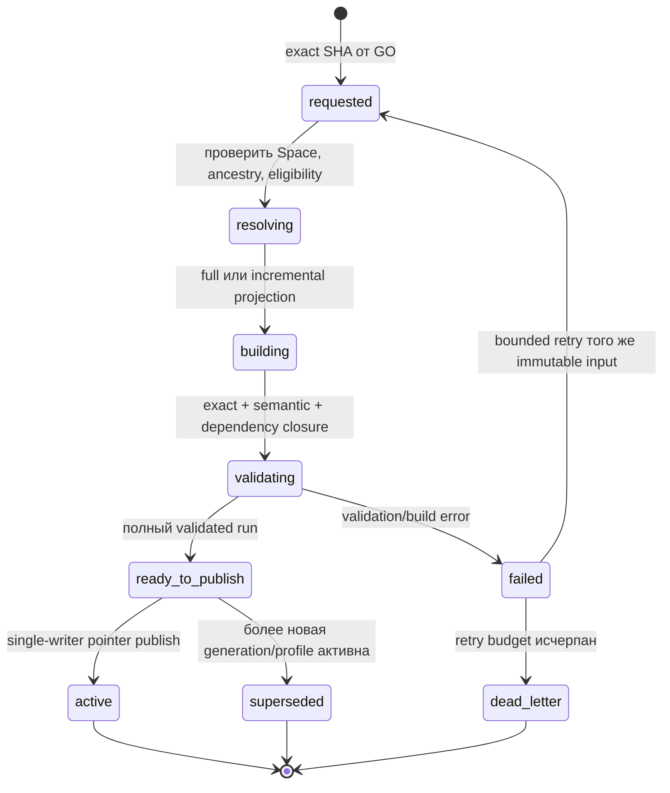

# Retrieval and Indexing — component solution design

**Статус:** DESIGN DRAFT для G0.  
**Authority:** [Architecture Spine](../architecture-spine.md), AD-1–AD-5, AD-8–AD-9, AD-11–AD-16.  
**Связанные документы:** [platform design](../architecture.md), [integration specification](../integration.md), [index-snapshot-v1](../contracts/index-snapshot.schema.json), [projection mapping](../contracts/projection-mapping.md), [T01 vectors](../contracts/t01-contract-tests.yaml), [specification](../spec.md), [GO](git-orchestrator.md), [Identity](identity-access.md), [Ingestion](ingestion-connectors.md), [Open WebUI](open-webui-fork.md).

Точный existing retrieval backend, Open WebUI code paths, PostgreSQL extensions, embedding model/dimensions, chunking, pgvector index type/parameters и reranker — **UNKNOWN T00**. pgvector+FTS остаётся кандидатом, не выбранным решением; OpenSearch не добавляется без измеренной необходимости и ADR.

## 1. Назначение и границы

Компонент состоит из двух связанных ролей:

- **CI/index writer** строит exact и semantic projections из exact eligible published `main` или inactive cutover preflight и единолично пишет `kb_index` и active pointer.
- **Retrieval adapter** выполняет scoped exact/semantic search только через read-only index access, валидирует revisions и повторно авторизует каждый payload перед выдачей.

### 1.1. Responsibilities

- Приём `IndexRequested` exact SHA от GO и обработка GitLab/AuthZ/attachment-driven runs.
- Full и incremental indexing с Git ancestry generations, dependency closure и `index_profile_version`.
- Eligibility filtering: только published eligible corpus; исключение drafts/MR/rejected/inbox/templates/service paths.
- Exact и semantic indexing, versioned chunk/embedding projections и citations metadata.
- AttachmentChanged и AccessPolicyChanged в общем event/reconciliation контуре.
- At-least-once processing, idempotency, bounded retry, dead-letter и periodic HEAD reconciliation.
- Единственный active index pointer writer per Space/profile; одна fence/CAS register сериализует все generations этого pointer.
- Inactive cutover preflight без обслуживания retrieval до активации.
- Server-side scope filtering, stale candidate rejection, fresh payload authorization и canonical selected read через GO.
- Полный rebuild `kb_index` без потери canonical data.

### 1.2. Non-responsibilities

- Не изменяет `main`, MR, Decisions, grants, Space activation или source cursors.
- Не принимает active pointer updates от GO, UI, connectors или webhook payload напрямую.
- Не индексирует pending/rejected branches и не превращает live operational data в wiki автоматически.
- Не хранит user-editable document copies и не предоставляет generic SQL агенту.
- Не полагается на index ACL metadata как единственный revocation barrier.
- Не возвращает historical/revoked/stale content молча и не включает GitLab-outage stale reads по умолчанию.
- Не выбирает неучтённый embedding/reranker/OCR provider и не владеет обходными provider credentials.
- Не выполняет destructive live rebuild при смене profile.

## 2. Внутренние модули

| Модуль | Роль | Writer/reader |
| --- | --- | --- |
| Run intake/planner | Принимает exact-SHA request, dedupe, выбирает full/incremental plan | CI writer |
| Snapshot resolver | Проверяет Space activation/preflight, Git ancestry, `main_generation` | Git read через CI credential |
| Eligibility resolver | Published paths, archive, service exclusions, critical media admission | CI reader |
| Document/chunk projector | Stable IDs, sections, links, exact-ready chunks, explicit metadata | CI writer |
| Dependency tracker | Document/attachment closure и deterministic `dependency_hash` | CI writer |
| Embedding provider adapter | Согласованный managed provider/model config, retry limits | Approved inference port |
| Exact projection writer | Exact-search representation | `kb_index` writer |
| Semantic projection writer | Versioned embeddings/semantic metadata | `kb_index` writer |
| Run validator | Full/incremental equivalence, exact+semantic readiness, negative ACL checks | CI writer |
| Active pointer publisher | Сериализованная fence/CAS activation per Space/profile across all generations | Единственный pointer writer |
| HEAD reconciler | Обнаруживает потерянные events, late jobs, history rewrite | CI writer |
| Retrieval query service | Exact/semantic bounded candidates и server scope | `kb_index` read-only |
| Candidate/payload validator | Active snapshot, revision, fresh AuthzContext, attachment scope | Identity + GO ports |
| Canonical selected reader | Читает выбранную current revision и citations через GO | GO API |

Доменные run/retrieval contracts не зависят от UI internals. Реальное размещение модулей в upstream/CI определяется после audit, но single-writer boundary сохраняется.

## 3. Inputs и outputs

### 3.1. Inputs

| Input | Обязательные поля / ограничения |
| --- | --- |
| `IndexRequested` | Space/repository, target branch, exact `main_sha`, generation reference, reason, preflight flag |
| Cutover preflight | Exact `cutover_sha`, inactive Space, CutoverRecord reference |
| AccessPolicyChanged | `changes[]` с independent per-Space `{space_id,repository_id,policy_bundle_id,access_policy_revision,approval_policy_revision,group_snapshot,revocation_epoch}`; общего bundle для нескольких Spaces нет |
| AttachmentChanged | Space, document/revision, immutable `{object_id,version,sha256,...}` |
| Git snapshot | Exact full SHA и eligible content через read-only CI identity |
| Immutable asset | Version + hash; mutable current URL без hash отклоняется |
| Inference configuration | Approved provider/model/profile version из inventory; без unplanned fallback |
| Search request | Query, mode `exact|semantic`, server scope, bounds/cursor, `AuthzContext` |
| Direct selected read | Document ID/revision/section через GO и fresh authorization |

### 3.2. Outputs

- Index run status: requested/building/validating/ready/active/failed/dead-letter, exact SHA/generation/profile и sanitized error.
- Active snapshot descriptor для UI status `indexed` и HEAD drift monitoring.
- Bounded candidates: `document_id`, `document_revision_sha`, `snapshot_sha`, section/heading path, score/mode, citation refs; raw content выдаётся только после authorization.
- Canonical selected document/section от GO с bounds/cursor/truncation.
- Reconciliation/dead-letter/alert events без raw private content.
- Machine-readable errors с retry semantics.

## 4. Owned state и внешние contracts

### 4.1. Только CI/index writer: `kb_index`

| Logical state | Назначение |
| --- | --- |
| Index runs | Exact input SHA, generation/profile, full/incremental type, attempts, status, sanitized errors |
| Snapshot descriptors | `snapshot_sha`, `main_generation`, `index_profile_version`, eligibility/config hashes |
| Document projections | Stable ID, `document_revision_sha`, path/archive/eligibility, blob/content hash |
| Chunks/exact entries | Section/heading metadata, exact-search projection, snapshot links |
| Semantic entries | Embedding/profile reference, chunk link; dimensions/model не hardcoded |
| Dependency projections | Direct/transitive document/attachment inputs и `dependency_hash` |
| Attachment projections | Immutable object/version/hash, media verification/admission state |
| Publication fences / active pointers | Space + profile fence/CAS register для всех generations → fully validated published non-preflight snapshot |
| Retry/dead-letter metadata | Deduplication, bounded attempts, reconciliation markers |

Retrieval получает read-only role и не выполняет migrations. Другие компоненты не пишут `kb_index`; UI получает status через read contract, ingestion отправляет события через GO, Identity выдаёт `AuthzContext` через API.

### 4.2. `index-snapshot-v1`

| Поле | Семантика |
| --- | --- |
| `snapshot_sha` | Exact target `main` commit, из которого построен полный логический snapshot |
| `document_revision_sha` | Полный commit SHA версии конкретного документа в этом snapshot; не заменяется blob hash или lexicographic SHA ordering |
| `blob_sha` / `content_hash` | Проверка идентичности содержимого и no-op; не является достаточным proof published revision |
| `dependency_hash` | Детерминированная свёртка всех inputs, влияющих на index representation документа |
| `main_generation` | Поколение target history по Git ancestry; history rewrite создаёт новое поколение |
| `index_profile_version` | Версия chunking/embedding и связанной index semantics, отдельная от Git generation |
| `policy_bundle_id` / access+approval revisions | Согласованная policy dependency snapshot; document/chunk/pointer composite references сохраняют Space/repository/target/SHA/profile и policy triple; stored ACL не заменяет fresh delivery authorization |
| `closure` / `full_snapshot_equivalence` | Durable complete closure, missing inputs и independently computed full-run proof для incremental; cutover pair сохраняет одинаковые closure/exact/semantic hashes |

Dependency closure включает document content/front matter, связанные ID/link metadata, используемые shared dependencies, immutable attachment revisions и media admission metadata. Точная versioned schema closure фиксируется в T01; incremental publisher обязан доказать полноту, а не предполагать её по списку изменённых файлов.

## 5. Index run workflow



### 5.1. Normal published run

1. GO принимает/реconciles Git event и отправляет exact `main_sha`; webhook payload сам не выбирает active revision.
2. Planner проверяет Space active, target published `main`, Git ancestry и dedupe key.
3. Resolver определяет full/incremental plan. History rewrite → новая generation + full rebuild.
4. Workers читают exact snapshot, исключают неeligible paths и строят обе projections в inactive run storage.
5. Incremental вычисляет полный dependency closure и сравнивает с результатом full snapshot на том же `main_sha`. Несовпадение запрещает publication.
6. Validator проверяет exact+semantic readiness, stable IDs, archive/delete handling, attachment revisions и negative ACL cases.
7. Pointer publisher блокирует `publication_fences(space_id,profile_id)` без generation в lock key и в одной transaction выполняет CAS по expected current fence+pointer, latest Git ancestry/generation и exact validated run/snapshot. Проверяются full-perimeter FK, policy triple, complete closure, independently computed full equivalence для incremental и ready hashes; stale owner получает zero updated rows.
8. Только `purpose=published,is_preflight=false` descriptor может стать active. Поздний run помечается superseded и не откатывает pointer. Успешный старый build можно сохранить для audit, но не для serving.

Runs могут строиться параллельно; pointer publication — нет. Сравнение SHA как чисел/строк запрещено: только ancestry и explicit generation/profile state.

### 5.2. Cutover preflight → published

- Вход — exact `cutover_sha`, Space inactive, write freeze включён. Отдельные preflight request/run/snapshot IDs строят full descriptor с `purpose=cutover_preflight,is_preflight=true,serving_allowed=false`, `snapshot_sha=cutover_sha`, complete closure и ready hashes. Preflight никогда не active и не отвечает на search.
- После successful preflight GO создаёт **другой** `IndexRequested(preflight=false)`. CI создаёт separate full published non-preflight run/descriptor с новыми request/run/snapshot IDs, но `cutover_sha == main_sha == preflight.snapshot_sha == published.snapshot_sha`, одинаковыми dependency closure, policy triple и exact/semantic hashes. Вся validation повторяется; preflight не мутируется и его identity не переиспользуется.
- Единственный index writer активирует только published descriptor через per-Space/profile fence/CAS для всех generations. Сначала наблюдается active published pointer, затем GO активирует Space и пользовательский доступ. Controlled cutover — единственное pre-activation publication exception; до Space activation serving пользователям всё равно закрыт.
- Если `cutover_sha` перестал равняться frozen HEAD, отличается closure/hash или validation incomplete, activation запрещена.
- Повтор события не создаёт второй активный pointer и не открывает пользовательский доступ сам по себе.

### 5.3. Profile evolution

Новая embedding/chunking semantics получает новую `index_profile_version` и независимый shadow build. Проверяются golden set, ACL-aware recall, latency/cost и full snapshot closure. Переключение выполняет pointer writer контролируемо; старый live profile не удаляется во время build. Конкретные ANN/fallback/partitioning параметры выбираются только после benchmark.

## 6. Retrieval workflow

```mermaid
sequenceDiagram
    participant C as Open WebUI/Agent
    participant R as Retrieval adapter
    participant I as kb_index read-only
    participant A as Identity/AuthZ
    participant G as GO canonical read

    C->>R: Query + scope; trusted AuthzContext reference
    R->>A: Validate/refresh effective Space/path scopes
    R->>I: Exact или semantic bounded candidate query в active snapshot
    I-->>R: Candidate IDs, revisions, sections
    loop Каждый candidate/payload
        R->>R: Проверить active snapshot и document_revision_sha
        R->>A: Повторно авторизовать title/snippet/chunk/file/history exposure
    end
    R->>G: Read selected canonical document/section exact revision
    G-->>R: Authorized content + revision + bounds/truncation
    R-->>C: Bounded results/citations без stale/historical fallback
```

### 6.1. Query rules

- Scope page/subtree/Space/allowed Spaces вычисляется сервером. Model-supplied scope может только сужать запрос после проверки. Для каждого Space обязателен собственный `authz-context-v2` binding; отсутствие или mismatch fail closed.
- Multi-Space exact/semantic paths выполняют per-Space fan-out в active published snapshot/profile каждого Space независимо. `SearchPage.snapshots[]` содержит полный ordered per-Space descriptor set, item/citation повторяет `space_id+snapshot_id+snapshot_sha`; нельзя объединить их одним global snapshot. Semantic filtering не выполняется после отправки chunks модели.
- Candidate с несовпадающим `document_revision_sha`, inactive snapshot, удалённым/архивным документом или несогласованной dependency metadata отклоняется.
- Нельзя молча заменять stale candidate historical content. Явный новый direct read current canonical revision возможен через GO как отдельная операция с новым результатом/revision.
- Snippets, titles, files, history и attachments авторизуются до exposure; revocation не ждёт index rebuild.
- Cursor связан с query/scope и полным ordered per-Space snapshot/profile/policy bundle+revisions/group snapshot/revocation epoch set плюс actor epoch. Потеря/подмена любого элемента даёт explicit stale error; доступ после expiry/revocation отсутствует.
- Direct short-page read идёт через GO без обязательного global search.
- `live_operational` facts не извлекаются из устаревшего wiki snapshot; используется typed read-only source contract.
- GitLab outage не включает stale read mode без отдельного ADR и явного UX.

## 7. Events, deletion и media

- Merge/push в published `main`, archive/delete, AccessPolicyChanged и AttachmentChanged создают/обновляют runs через GO.
- Archive/delete применяется в новом Git snapshot; удаление projection без canonical snapshot запрещено. Updates и deletions обрабатываются независимо, чтобы ни одно не блокировало другое.
- AccessPolicyChanged инициирует обновление ACL metadata, но fresh deny действует немедленно при retrieval.
- AttachmentChanged связывает `{object_id,version,sha256,size,media_type,source_ref}` с document revision и Space ACL.
- Декоративные media исключаются. Автоматические описания содержательных media маркируются и ссылаются на оригинал.
- Критические и рукописные media без требуемой человеческой транскрипции/сверки не индексируются. Страница-ссылка на нетранскрибированный оригинал не превращается в текстовый факт.
- Retention/deletion учитывает Git history, mirrors и object versions; очистка только активного индекса не является privacy hard purge.

## 8. Ошибки, идемпотентность и concurrency

| Code / случай | Поведение |
| --- | --- |
| `INDEX_NOT_READY` | Нет validated active snapshot; не возвращать preflight/partial index |
| `STALE_INDEX_CANDIDATE` | Отклонить candidate; не выдавать historical content молча |
| `INDEX_GENERATION_CONFLICT` | Поздний run не публикуется; запланировать/использовать актуальную generation |
| `DEPENDENCY_CLOSURE_MISMATCH` | Incremental publication запрещена; расширить/full rebuild |
| `PROFILE_MISMATCH` | Query/run profile несовместимы; использовать явно выбранный active profile |
| `STALE_AUTHZ_CONTEXT` | Обновить контекст перед payload; старый cursor не помогает |
| `NOT_FOUND` / `FORBIDDEN` | Anti-enumeration или explicit denial |
| `UPSTREAM_UNAVAILABLE` | Retryable build/read по типу; не менять canonical SHA и не включать stale mode |
| `LIMIT_EXCEEDED` | Bounded query/read; explicit truncation/cursor там, где поддержано |

Run idempotency key строится из immutable Space/repository + `snapshot_sha` + generation + `index_profile_version` + run type и validated config/dependency inputs. Повтор exact run возвращает существующий run/result. Retry использует тот же immutable input; новый observed HEAD создаёт новый run, не меняет старый.

Pointer publication выполняется одним writer под per-Space/profile fence и CAS по expected current pointer/fence, latest ancestry и exact validated run/snapshot; stale publisher обновляет ноль rows независимо от generation. Search read-only и естественно повторяем; pagination не смешивает одно-Space snapshots, а multi-Space сохраняет весь ordered descriptor/context set либо явно завершается stale error.

## 9. Security

- CI имеет read-only exact-main Git credential и отдельную `kb_index` writer role; retrieval — только read-only DB role.
- Index metadata не считается источником прав. Identity/AuthZ повторно авторизует каждый candidate/payload и attachment.
- Запросы и документы — потенциально private data; raw queries/chunks не пишутся в обычные logs/traces/eval exports.
- Approved inference inventory распространяется на embeddings, reranking, OCR/extraction и все fallbacks. `pii_permitted` запрещает внешний PII egress.
- Prompt injection в документе не меняет scope, tool registration, provider, active pointer или merge credentials.
- Pending/rejected evidence и attachments не попадают в published projections. Full clone/export требует отдельного permission и не выдаётся search credential.
- SQL/ANN filtering benchmark обязан измерять recall после ACL filters; нельзя компенсировать плохой recall отправкой лишних закрытых candidates модели.

## 10. Observability

| Signal | Назначение |
| --- | --- |
| Merge→index lag и queue lag | Freshness SLO/evidence, backlog alerts |
| HEAD vs active ancestry drift | Потерянные webhooks, stale serving |
| Run duration/result/retry/dead-letter | CI health и повторяемые failures |
| Dependency mismatch count | Неполный incremental planner |
| Late/superseded pointer attempts | Доказательство monotonic publication |
| Active generation/profile | Контроль shadow builds и history rewrite |
| Stale candidate rejections | Index/canonical drift |
| Authorization denials по payload | Revocation/IDOR negative monitoring без content |
| Exact/semantic quality | Recall, citation correctness, no-answer отдельно |
| TTFT/full response и provider latency | Раздельная performance evidence |
| Embedding/extraction cost | Стоимость successful response и profile selection |

Metrics связываются с corpus SHA, code/config/model/tool-schema versions и sanitized dataset. Raw private content и секреты не являются observability labels.

## 11. Tests и acceptance

1. Exact и semantic search по published main со citations, Cyrillic, repeated headings, long pages и explicit bounds (A03/A21).
2. Pending/open/rejected MR, branch content, inbox/templates/service paths и evidence не попадают в index (A22).
3. Revoke/archive/delete не выдают title/snippet/chunk/file/history/attachment даже до завершения reindex (A11/A12).
4. Late old-SHA job не активируется; SHA sorting не используется; history rewrite вызывает new generation + full rebuild.
5. Потерянный/duplicate webhook ловится reconciliation; CI outage не меняет main; dead-letter виден.
6. Incremental dependency closure эквивалентен full snapshot на том же SHA; changed linked/attachment dependency инвалидирует все затронутые entries.
7. Два concurrent runs и специально одновременные old/new generation publishers на одном Space/profile проходят одну fence/CAS register, даже если generation locks различны; stale fence/ancestry/run обновляет ноль pointer rows, newest validated generation активируется один раз. Cross-Space/repository/target/SHA/profile/policy mismatches отклоняются composite references.
8. Preflight exact cutover SHA недоступен retrieval и никогда active; separate published request/run/snapshot IDs имеют тот же SHA/closure/policy/hashes и повторную full validation. Crash/replay не создаёт partial published pointer; pointer наблюдается до Space activation, пользовательский доступ включается только после него.
9. Stale candidate отклоняется; historical fallback и GitLab-outage stale reads не происходят молча.
10. Full `kb_index` loss → rebuild из Git+immutable assets, сравнение content/links/attachments и новый validated pointer.
11. Embedding/chunking change создаёт shadow profile без destructive live rebuild; quality/ACL/latency evidence зафиксировано.
12. Critical/untranscribed media исключены; auto descriptions маркированы и citations ведут на оригинал; attachment ACL совпадает со Space.
13. ACL-aware recall benchmark для candidate backend; approximate filtering не скрывает обязательные exact/fallback проверки.
14. Adversarial query/prompt injection не меняет scopes и не вызывает cross-client/cache disclosure. Multi-Search fan-out сохраняет полный per-Space descriptor/policy/group/epoch set; borrowed binding или удалённый cursor descriptor отклоняется без payload.

Acceptance требует real sandbox GitLab/PostgreSQL/CI для integration behavior. Модельный score не заменяет deterministic disclosure/pointer/revision tests.

## 12. T00 dependencies

- Зафиксировать Open WebUI commit, PostgreSQL/CI test conventions и реальные retrieval/RAG seams с code references.
- Аудировать existing backend: exact+semantic support, snapshot/revision mapping, extension/schema ownership, read/write roles и CI entry points.
- Проверить GitLab exact-SHA snapshot reads, ancestry/history rewrite detection и достаточность metadata для `document_revision_sha`.
- Выполнить ACL-aware recall benchmark до выбора pgvector+FTS, HNSW/IVFFlat, iterative/exact fallback, partitioning или других parameters; никакой выбор здесь не сделан.
- Определить через configuration/benchmark embedding model/dimensions, chunking, reranking и hoster provider connections; подготовить offline assets после согласования.
- Проверить способ единственного pointer writer и transactional publication на выбранном backend без shared-writer migrations.
- Определить versioned dependency schema и full/incremental equivalence fixtures в T01 на основе audited corpus/links/attachments.
- Проверить AccessPolicyChanged/AttachmentChanged event seams и reconciliation достаточность на target GitLab/CI.
- Не обещать freshness/latency/quality thresholds до owner-approved measurements.
