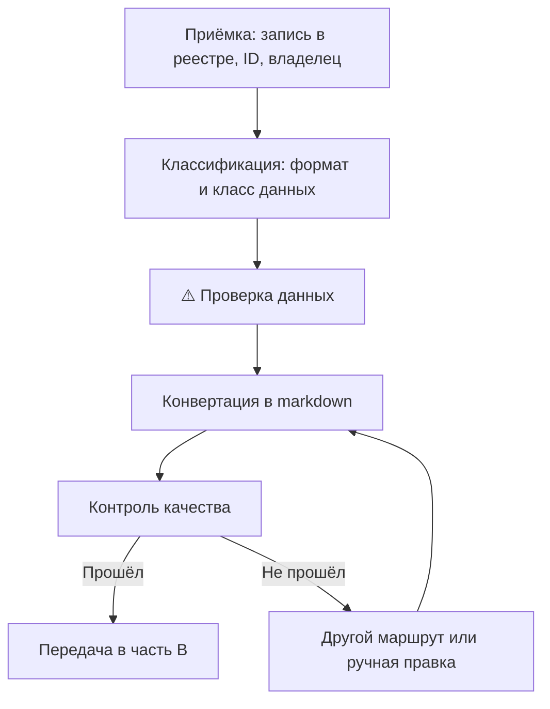
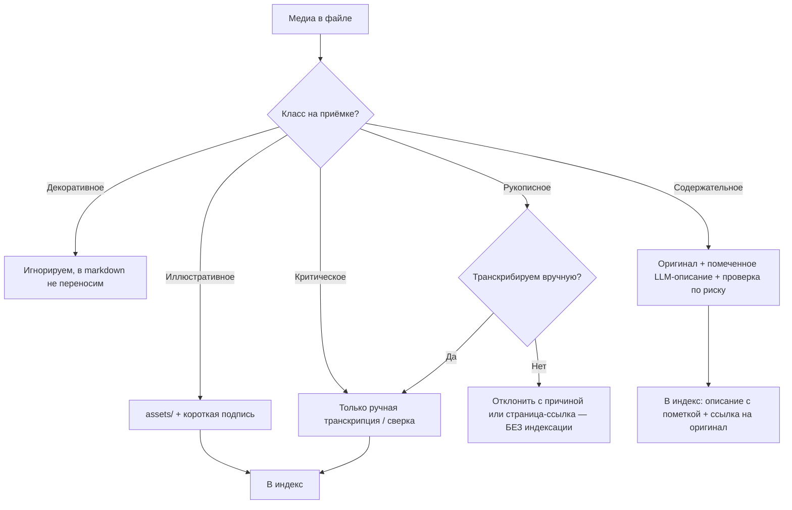
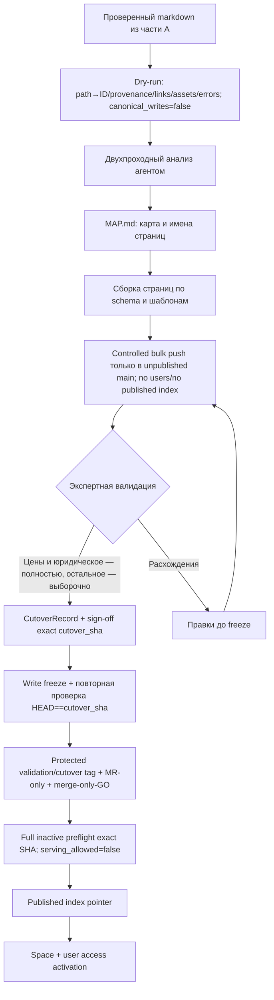
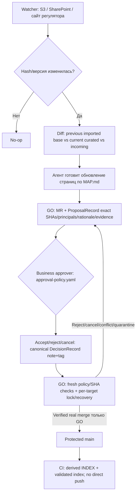

# Стандарт ИИ-команды: база знаний — ETL, первичная сборка, DocOps

Версия 2.3, 6 ноября 2026. Внутренний стандарт ИИ-команды hoster.by.
Заменяет черновик от 4 ноября 2026 (изменения — в changelog в конце).

Связанные документы: [`spec.md`](spec.md) — спецификация платформы 1.3 (Open WebUI + GitLab), [`contracts/front-matter.schema.json`](contracts/front-matter.schema.json) — canonical front matter, [`contracts/decision-record.schema.json`](contracts/decision-record.schema.json) — протокол accept/reject/cancel, [`adr/README.md`](adr/README.md) — обязательные ADR-03–ADR-17. Этот стандарт описывает **контентные процессы** вокруг платформы: как готовится корпус и как он остаётся актуальным. ETL-методика сохранена; нормативные границы синхронизированы с design package без разрешения implementation, production corpus load или cutover.

## Коротко о стандарте

Git (GitLab) с markdown-страницами — единственный источник истины, RAG-индекс — его пересобираемая копия. Работа делится на **три разных процесса** с разными правилами контроля:

| Процесс | Что это | Кто | Контроль |
| :---- | :---- | :---- | :---- |
| **A. ETL** | Первичная подготовка данных: сырые файлы → проверенный markdown | Source owner + команда разработки | Автоматические и ручные проверки качества конвертации и strict data barrier. Без MR и без canonical writes в dry-run |
| **B. Первичная сборка корпуса** | Анализ агентом, проектирование структуры, сборка страниц, controlled load в Git | Engineering owners + эксперт | Controlled bulk push только в unpublished `main`, без user access/published index. Экспертный sign-off на exact SHA, затем freeze → tag/protection → inactive preflight → activation |
| **C. DocOps** | Поддержание актуальности опубликованной базы: внешние источники, правки пользователей и агента | Business approvers + агент + платформа + engineering owners | Все business/engineering/source-managed changes через GO/MR/human decision; canonical DecisionRecord; final merge только GO; auto-merge и direct human merge запрещены |

Главное правило границы: **пока база не опубликована — строго controlled engineering загрузка (A/B); после публикации — любые изменения только через GO/MR (C)**. Protected unpublished corpus и strict data barrier сохраняются до активации. После cutover direct push/merge закрыт для людей, ИИ-команды, агента, connector и CI.

Нормативные границы 2.3:

- **Один GitLab repository = один Space.** Единый Space ACL покрывает documents/attachments/history/export; разные ACL требуют разных repositories, включая pricing. Папка не является отдельным Space, а `access` во front matter не является самостоятельным ACL.
- **Роли не смешиваются:** source owner — stable external identity в реестре источника и владелец data barrier; business approver — external group/path role в `approval-policy.yaml`, без GitLab user; engineering owner/reviewer — CODEOWNERS. Business approval никогда не выводится из CODEOWNERS.
- Canonical front matter следует [`contracts/front-matter.schema.json`](contracts/front-matter.schema.json) и не дублирует Git status, owner или commit time. DecisionRecord для accept/reject/cancel следует [`contracts/decision-record.schema.json`](contracts/decision-record.schema.json): canonical JSON+hash в MR note и protected annotated tag `kb-decisions/<uuid>` на exact proposal SHA.
- `source_managed` не имеет auto-merge даже для детерминированной синхронизации. `live_operational` — typed read-only API/snapshot, не wiki-страница автоматически.
- `INDEX.md` — derived build artifact либо часть того же reviewed MR; CI никогда не делает direct post-merge push в `main`. Export/backup включают decisions manifest и assets manifest с immutable external objects/hashes.

```mermaid
flowchart LR
    subgraph A[A. ETL]
        F[Сырые файлы] --> M[Проверенный markdown]
    end
    subgraph B[B. Controlled pre-cutover]
        M --> AN[Анализ агентом] --> MAP[Карта базы] --> PAGES[Сборка страниц]
        PAGES --> PUSH[Bulk push только в unpublished main]
        PUSH --> VAL{Экспертная валидация exact cutover_sha}
        VAL --> FRZ[Write freeze + HEAD==cutover_sha]
        FRZ --> PROT[Protected tag + MR-only + merge-only-GO]
        PROT --> PRE[Inactive preflight: no retrieval]
        PRE --> PUB[Published pointer + Space/user activation]
    end
    subgraph C[C. DocOps — после публикации]
        SRC[Источник изменился] --> DIFF[Diff по hash] --> AG[Агент готовит обновление]
        AG --> MR[GO: MR + ProposalRecord]
        MR --> OWN[Business approver: approval-policy.yaml]
        OWN --> DEC[Canonical DecisionRecord note+tag]
        DEC --> GO[GO: checks/lock/recovery + real merge]
        GO --> MAIN[Protected main] --> IDX[CI: derived INDEX + index без push]
    end
    PUB --> SRC
```



### Открытые вопросы

| Часть | Вопрос | Статус в 2.3 |
| :---- | :---- | :---- |
| A | Как и кем проверяем файлы на персональные и клиентские данные | **Закрыт:** два профиля `strict` / `pii_permitted`; source owner подтверждает data barrier (часть A) |
| A | Где лежат оригиналы и назначены ли владельцы файлов | **Закрыт:** immutable external objects с ограниченным доступом; source owner со stable external identity обязателен при приёмке; assets manifest сохраняет hashes |
| A | Что автоматизируем в проверке таблиц, что остаётся человеку | Частично: трёхуровневая проверка (часть A), размер выборки после теста |
| B | Кто отвечает за `shared/` | **Принцип закрыт:** business approver groups/path scopes задаются в `approval-policy.yaml`; CODEOWNERS только engineering owners/reviewers. Конкретные группы — owner decision |
| B | Как разделяются ACL, включая pricing | **Закрыт принцип:** один repository = один Space; разные ACL = разные repositories до corpus load |
| C | Какой Git-сервис используем | **Закрыт:** GitLab; final merge любого business/engineering MR выполняет только GO |
| C | Кто собирает тестовые вопросы | **Закрыт:** продажи дают реальные вопросы, оператор базы ведёт набор, прогон в CI |
| C | Какое время ответа и доля верных ответов достаточны | Открыт, определим после пилота на реальных вопросах |

---

# Часть A. ETL: что мы делаем с сырыми данными

**Цель:** получить из отобранного файла точную копию в markdown и всегда знать, из какого исходника она сделана. Содержание на этом этапе не меняем.

**Вход:** файлы, которые команда отобрала для базы знаний как актуальные и верные.

**Выход:** проверенные markdown-файлы со ссылкой на ID исходника.

В этой части работают source owner, оператор и команда разработки. Merge requests не используются для staging-конвертации: canonical corpus ещё не изменяется, dry-run выполняется с `canonical_writes=false`. Это не снимает защиту исходников, immutable objects, реестра и будущего unpublished corpus. Контроль — качество конвертации и strict data barrier, а не публикация без владельца.

## Схема процесса



⚠️ — обязательный data barrier; профиль данных уже выбран, открытым остаётся только размер выборки проверки качества.

## Правила

1. Оригинал не редактируется. Исправления вносятся только в markdown-копию.
2. Содержание не пересказывается.
3. У каждого markdown-файла есть ссылка на исходник. Для PDF и PowerPoint по возможности указываем страницу или слайд, для DOCX и Google Docs раздел.
4. Конкретные инструменты в этой версии не закрепляем, определим их позже.

## Этапы

1. **Приёмка.** Файл вносится в реестр, получает source ID и source owner со **stable external identity** (AD objectGUID / OpenLDAP entryUUID / issuer-scoped OIDC sub, не email/login). Source ID имеет вид `DOC-0001` и не меняется при переименовании файла; он отделён от opaque UUID страницы в canonical front matter. Hash показывает, менялся ли файл, и находит точные дубли.
2. **Классификация.** Указываем формат и класс данных: `публичные` или `внутренние`.
3. **Проверка данных.** Файл проходит барьер персональных и клиентских данных по выбранному профилю (см. ниже «Два профиля обработки данных»). В режиме `strict`: source owner подтверждает по чек-листу до конвертации (включая медиа: сканы документов, подписи, печати, фото людей — автоскан их не ловит), после конвертации автоматический PII-скан markdown; все срабатывания разбирает человек, файл остаётся `на правке`, пока каждое не разрешено. Автоскан — подсказка, его качество на русском калибруем на пилоте.
4. **Конвертация.** Файл переводится в markdown по маршруту для своего формата и профиля сложности.
5. **Контроль качества.** Выполняем проверки из таблицы ниже.
6. **Передача.** Проверенный файл переходит в часть B.

### Два профиля обработки данных (решение владельца 2026-11-06)

| Профиль | Когда применяется | Правила |
| :---- | :---- | :---- |
| **`strict`** (по умолчанию) | Нет документированных правовых оснований на обработку персональных данных | Файл с персональными или идентифицируемыми клиентскими данными возвращается на очистку или отклоняется. Барьер: чек-лист source owner + автоскан + разбор срабатываний человеком |
| **`pii_permitted`** | У клиента есть документированные правовые основания на процессинг | Обработка разрешена **только на собственном инференсе hoster.ai** — в выделенном контуре клиента или hoster.ai (зависит от заказчика). Никакого внешнего egress с такими данными; права доступа и retention — по усиленной политике клиента. Профиль и основания фиксируются в реестре до импорта |

Профиль выбирается владельцем до начала ETL и является конфигурацией deployment (см. спецификацию, раздел 9). **Файл без владельца и без пройденного барьера не передаётся в часть B** — это жёсткий гейт, а не рекомендация.

## Реестр

Реестр создаём в Google Sheets, одна строка соответствует одному файлу. Реестр учитывает **сырые источники**, не страницы базы — карта страниц живёт в Git (часть B).

**Поля:** `source_id`, `название`, `immutable_source_ref`, `sha256`, `дата версии источника`, `source_owner_stable_id`, `формат`, `класс данных`, `data_profile`, `правовое основание` (для `pii_permitted`), `медиа-профиль`, `профиль сложности`, `маршрут`, `версия конвертера`, `статус`. Stable external identity владельца не дублируется в canonical front matter страницы; business approver и engineering owner ведутся отдельно.

**Статусы:** `принят`, `конвертирован`, `проверен`, `на правке`, `отклонён`.

**Роли:**

- **Source owner** подтверждает содержание исходника и отвечает за прохождение data barrier. Он идентифицируется stable external identity в реестре; **нет source owner — файл не принят.** Эта роль не создаёт GitLab user и не заменяет approver последующего MR.
- **Business approver** назначается внешней группой и path scope в `approval-policy.yaml`, принимает/отклоняет/отменяет proposals после cutover и не имеет direct GitLab merge. Совпадение с author/version-author/requester запрещено.
- **Engineering owner/reviewer** назначается в CODEOWNERS только для инженерного ownership/review; не является источником business authorization.
- **Оператор базы** ведёт реестр и процесс.
- **Разработчик** отвечает за инструменты (включая автоскан).

**Хранение оригиналов (решение владельца 2026-11-06):** оригиналы лежат во **внешнем объектном хранилище (S3) с ограниченным доступом, неизменяемые и versioned**, в Git не попадают никогда. В реестре — opaque immutable `source_ref`, object version и SHA-256, не mutable current URL и не credentials. Тот же контур используется для крупных медиа из A7: Git — markdown, мелкие assets и canonical attachment bindings `{object_id,version,sha256,size,media_type,source_ref}`; полный export/backup включает assets manifest и сами external objects по policy.

## Маршруты конвертации

Маршрут зависит от формата и профиля сложности (колонки, вложенные и длинные таблицы, графики с цифрами, текст на картинках, качество сканов).

| Формат | Маршрут |
| :---- | :---- |
| DOCX | Прямая конвертация |
| PDF с текстом | Извлечение текста и структуры |
| PDF-скан | Распознавание текста |
| PowerPoint | Извлечение текста и отдельная обработка схем |
| Другие форматы | Маршрут определяет оператор при приёмке |

Перед основной конвертацией — **пилот: минимум 2 файла на каждый вариант и формат**, результаты оцениваем отдельно по типам.

## Контроль качества

| Что проверяем | Как | Если не прошло |
| :---- | :---- | :---- |
| Пустые страницы, битая кодировка | Автоматически | Другой маршрут |
| Количество страниц и слайдов | Автоматически, где формат позволяет | Другой маршрут |
| Таблицы и цифры | Три уровня: автоматически считаем таблицы; LLM сравнивает с оригиналом; файлы с ценами и условиями человек проверяет полностью, остальные выборочно | Ручная правка |

Размер выборки определим после теста на реальных файлах. LLM-сравнение таблиц — подсказка, а не доказательство: проверку цен и условий человеком оно не заменяет.

**Границы документа:** заранее решаем, что считается частью файла. Для PowerPoint: заметки докладчика, скрытые слайды и встроенные таблицы. **Шум:** оглавления, колонтитулы и водяные знаки игнорируем, иконки не описываем; сноски в договорах сохраняем — там бывают условия.

**Качество по документу:** считаем не только поля, но и полностью годные документы — высокая точность по полям не гарантирует полностью верный документ.

## A7. Медиа и нетекстовое содержимое

PDF с картинками, презентации, сканы и рукописные документы проходят тот же ETL, но с **дополнительным медиапроходом** после извлечения текста. Принцип: медиа — третий тип содержимого, не мусор и не текст. Главный вопрос — что в медиа является знанием и кому мы позволим его исказить.

### Классификация медиа (на приёмке)

| Класс | Примеры | Что делаем |
| :---- | :---- | :---- |
| **Декоративные** | Логотипы, иконки, фото «для красоты», водяные знаки | Игнорируем, в markdown не переносим |
| **Иллюстративные** | Скриншоты интерфейса, фото оборудования | Сохраняем как asset + короткая подпись; LLM-описание не генерируем |
| **Содержательные** | Схемы, диаграммы, графики, таблицы-картинки | Сохраняем оригинал + LLM-описание отдельным помеченным слоем + проверка человеком по риску |
| **Критические** | Цены/условия в картинке, подписи и печати на скане, рукописные правки договора | Только ручная транскрипция или ручная сверка. LLM — помощник, не источник истины |

В реестр добавляется поле `медиа-профиль`: количество содержательных и критических медиа в файле. Оно определяет труд валидации и стоимость файла **до** конвертации. Если основная часть знаний файла заключена в картинках, а ценность файла низкая — отклоняем на приёмке с причиной в реестре, а не оплачиваем разбор на выходе.

### Маршруты с медиа

| Вход | Маршрут |
| :---- | :---- |
| PDF с картинками | Извлечение текста + медиапроход |
| Презентации | Текст слайдов + заметки докладчика + медиапроход по схемам (скрытые слайды и встроенные таблицы — по правилам границ документа) |
| Скан печатного документа | OCR + медиапроход; распознанные таблицы — результат OCR, не источник: сверка по трёхуровневой схеме, цены и условия человек проверяет полностью |
| Скан рукописного документа | **Только ручная транскрипция со сверкой**, либо отклонение с причиной в реестре, либо страница-ссылка на оригинал без транскрипции — **в индекс не идёт**. LLM/OCR рукописного не становится самостоятельным фактом базы |

Сводная маршрутизация медиа:



### Шаги медиапрохода

1. **Извлечь** медиа из контейнера (PDF/PPTX/DOCX) с привязкой к странице/слайду — provenance, как в правиле 3 части A.
2. **Классифицировать** по таблице выше.
3. **Сохранить:** мелкие изображения — в `assets/` репозитория; крупные — как immutable/versioned external objects с canonical binding в `attachments[]` по front-matter schema. Смысл прежнего `links` (связь страницы с внешним файлом) сохраняется через attachments и явные Markdown-ссылки; отдельный ключ `links` добавляется во front matter только после версионированного изменения схемы. Оригинал неизменен, Git не раздуваем, assets manifest хранит object/version/hash/export status.
4. **Описать содержательные** vision-моделью через согласованный inference. Описание пишется в markdown **с явной пометкой** «описание схемы, сгенерировано автоматически; оригинал — ссылка».

### Правила индексации и ответов

- В RAG идут текст и **помеченные** LLM-описания содержательных медиа.
- Критические медиа попадают в индекс **только после ручной сверки**; нетранскрибированное рукописное содержимое не индексируется.
- Агент при ответе ссылается на **оригинал медиа** (страница/слайд), а не только на описание. Если ответ построен на LLM-описании, пользователь видит пометку «по автоматическому описанию схемы — проверьте оригинал».
- Каждая attachment revision наследует единый ACL repository=Space и связывается с document revision; ссылка на asset не обходит Space policy, history/export permission или свежую авторизацию. Front matter `access` не используется как ACL.

## Часть завершена, когда

У каждого файла в реестре стоит статус `проверен` или `отклонён` с указанной причины, а все проверенные файлы переданы в часть B.

---

# Часть B. Первичная сборка корпуса

**Цель:** из проверенных markdown-файлов собрать структуру базы, залить её в Git и опубликовать после экспертной валидации.

**Вход:** проверенные markdown-файлы из части A.

**Выход:** activated база: страницы в protected `main`, CutoverRecord/sign-off на exact `cutover_sha`, protected validation/cutover tag, validated published index и доступ пользователям только после успешного preflight+activation.

В этой фазе **нет per-page MR** только для controlled engineering bulk path: база ещё unpublished, user access закрыт и published index отсутствует. Dry-run предшествует writes; protected unpublished corpus и strict data barrier обязательны. Контроль — **агрегированный экспертный гейт на exact SHA + cutover protections/preflight**, а не неограниченный прямой доступ к Git.



## B1. Анализ файлов

Анализ проходит в два прохода. Агент готовит черновики выводов, оператор базы обсуждает их с агентом **до** массовой сборки страниц.

### Проход 1. Каждый файл отдельно

| Шаг | Вопрос к файлу | Что фиксируем |
| :---- | :---- | :---- |
| 1. Назначение | Что это за документ, для кого и для какой задачи? | Тип документа, аудитория, задача |
| 2. Темы | На какие смысловые части он делится? | Список тем и их границы в файле |
| 3. Тип знания | Что содержит каждая тема? | Факт, правило, инструкция, объяснение или пример |
| 4. Польза | На какие вопросы пользователя отвечает тема? | 1–3 вопроса или пометка «нет явной пользы» |
| 5. Критичность | Что нельзя исказить? | Цены, условия, сроки, юридические формулировки |

### Проход 2. Все файлы вместе

| Шаг | Вопрос | Что фиксируем |
| :---- | :---- | :---- |
| 6. Пересечения | Где одна тема раскрыта в нескольких файлах? | Группы файлов по темам |
| 7. Дубли | Совпадает ли содержание по смыслу? | Какой текст считаем основным; уникальные детали переносим на основную страницу, решение записываем |
| 8. Расхождения | Где файлы говорят разное? | Вопрос source owner; при post-cutover решении — business approver |
| 9. Пробелы | На какие важные вопросы нет ответа? | Запись в `GAPS.md` |
| 10. Связи | Какие темы нужно читать вместе? | Связи между будущими страницами |

**Матрица покрытия:** для каждой темы — реальный вопрос (из help desk, FAQ, тикетов, вопросов продаж), страница, ответ. Вопросы без ответа идут в `GAPS.md`.

## B2. Решение по итогам анализа

Способ выбираем не для всего файла, а для каждой темы.

| Способ | Что делаем | Зачем | Когда подходит |
| :---- | :---- | :---- | :---- |
| **Зеркало** | Переносим текст в базу без изменений | Чтобы не исказить формулировки | Оферта, регламент, короткий файл на одну тему |
| **Нарезка** | Делим файл на отдельные страницы, текст не переписываем | Чтобы поиск находил нужный раздел, а не весь документ | Большой handbook про разные продукты |
| **Компиляция** | Собираем сведения из нескольких файлов на одну страницу | Чтобы всё по теме было в одном месте | Про один продукт есть презентация, FAQ и памятка |

### Правило выбора

1. **Договоры, регламенты, юридические тексты:** зеркало.
2. **Одна тема в нескольких файлах:** компиляция.
3. **Большой файл с разными темами:** нарезка.
4. **Презентации:** чаще компиляция, потому что текст слайдов обычно отрывочный. Если презентация самодостаточна, подойдёт зеркало или нарезка.

Если сомневаемся, выбираем способ с меньшим вмешательством в текст: зеркало, затем нарезку, затем компиляцию.

При компиляции **каждое важное утверждение проверяется по источнику**; автопроверка сначала калибруется на выборке, размеченной людьми. Точные термины (названия продуктов, тарифов) сохраняем, синонимы вносим в глоссарий.

## B3. Карта базы

Карта показывает, какие страницы будут в базе и из каких файлов они собираются. **Карта живёт в Git** (`MAP.md` в репозитории базы), а не в Google Sheets. Черновик готовит агент по итогам анализа, оператор базы утверждает. **Имена страниц фиксируются в карте до массовой сборки.**

Первым базой пользуется отдел продаж, затем подключаются остальные отделы. Ниже — рабочий драфт **двух repositories = двух Spaces**, а не корневых папок одного Git perimeter. Каждый repository содержит собственные access/approval policies, history, protected refs, cutover, index и export:

```
knowledge-base-sales/                # GitLab repository = Space sales
├── AGENTS.md
├── README.md
├── INDEX.md                         # derived build artifact ИЛИ reviewed content того же MR; never CI direct push
├── MAP.md                           # страница → источники → способ → риск
├── GAPS.md                          # реестр пробелов (маркеры ❓ GAP)
├── access-policy.yaml               # external groups → единый Space ACL
├── approval-policy.yaml             # external groups → path-scoped business approver roles
├── CODEOWNERS                       # ТОЛЬКО engineering owners/reviewers
├── templates/
│   ├── product.template.md
│   ├── process.template.md
│   ├── case.template.md
│   └── inbox-note.template.md
├── shared/
│   ├── company/
│   │   ├── company-facts.md
│   │   └── glossary.md
│   ├── products/                    # без цен и иного содержимого с другим ACL
│   ├── cases/
│   ├── legal/
│   └── competitors.md
├── departments/sales/
│   ├── processes/
│   ├── scripts/
│   ├── objections/
│   ├── onboarding/
│   └── inbox/                       # не входит в eligible index
├── validation/
└── assets/                          # мелкие objects; large immutable objects — external + attachments[]

knowledge-base-sales-pricing/        # отдельный GitLab repository = Space sales-pricing
├── access-policy.yaml               # ACL pricing, отличный от других Spaces
├── approval-policy.yaml             # business approvers pricing/
├── CODEOWNERS                       # engineering only
├── MAP.md
├── pricing/
├── validation/
└── assets/
```

Состав страниц, repository naming/group layout и подпапки финализируются после анализа материалов и T00/owner decision. Правило 1:1 уже обязательно: содержимое с разными правами на tree/history/files/export нельзя помещать в один repository и скрывать фильтрами. Общие знания между Spaces связываются явным контентным процессом без совместного скрытого history perimeter.

Правила размещения:

- **Цены** видит только назначенная pricing-группа: они находятся в отдельном `knowledge-base-sales-pricing` repository=Space. На страницах `shared/products/` цены не дублируем; path `pricing/` внутри общего repository не используется для создания отдельного read ACL.
- **Договоры и регламенты** — в `shared/legal/` только если их ACL совпадает с ACL остального Space; иначе выделяется отдельный repository=Space.
- **Кейсы** в `shared/cases/` только публичные или обезличенные и соответствующие data profile/Space ACL.
- **`inbox/`** хранит сырые заметки и не попадает в RAG-индекс; `templates/` и служебные файлы также исключаются.
- **Business approvers папок** назначаются в `approval-policy.yaml`: `shared/`, `pricing/` и другие path scopes задают только review routing. **Engineering owners/reviewers** назначаются в CODEOWNERS. Ни один из файлов не создаёт page-level read ACL.

Формат карты (`MAP.md`):

| Страница | Исходные файлы | Способ раскладки | Класс риска |
| :---- | :---- | :---- | :---- |
| `shared/products/cloud-servers.md` | `DOC-0003`, `DOC-0007`, `DOC-0012` | Компиляция | Основные |
| `departments/sales/processes/<страница>.md` | `DOC-0001` | Зеркало | Правовое |

Строки приведены для примера. Source owner остаётся в реестре исходников со stable external identity; business approver не дублируется в карте/front matter и выводится из `approval-policy.yaml`; engineering owner — из CODEOWNERS. Доступ выводится из versioned Space access policy, не из пути или front matter.

## B4. Сборка страниц и заливка в Git

Страницы собираются по карте, canonical front-matter schema и шаблонам. Агент готовит страницы пакетами по темам; до любого canonical write import dry-run возвращает path→ID map, provenance, links/anchors, attachments, source hashes и ошибки. Команда разработки выполняет **controlled engineering bulk push только в unpublished `main`** соответствующего repository=Space, при закрытом пользовательском доступе и отсутствии published index. Per-page MR в этой ограниченной фазе не требуется; traversal, symlinks, executable HTML/MDX, secrets, oversized inputs и файлы без source owner/completed data barrier отклоняются. После write freeze этот bulk path закрывается.

**Правила страницы:**

1. Одна страница посвящена одной теме.
2. Страница собирается по шаблону из `templates/`. Страницы-зеркала сохраняют исходный текст, для них заполняем только шапку.
3. В начале короткое резюме: о чём страница и на какие вопросы отвечает.
4. Каждый раздел понятен сам по себе, потому что поиск может вернуть только его.
5. Таблицы не разрываются, у них есть заголовки столбцов.
6. На связанные темы даём ссылки по `id` страницы, а не копируем текст.
7. Если данных не хватает, ставим маркер `❓ GAP` и вносим пробел в `GAPS.md`. При таком маркере агент отвечает, что данных нет, и не додумывает.

**Шапка страницы (canonical front matter):** только поля [`document-front-matter-v2`](contracts/front-matter.schema.json): `schema_version`, opaque UUID `id`, `title`, `parent_id`, `ownership_mode` (`migrated` / `source_managed` / `curated`), `origin` где требуется, stable-ID `links[]`, `valid_until`, `archived` + optional `archive`, `attachments[]` и объявленные внутри них поля. Схема закрыта (`additionalProperties: false`): `access`, произвольные `статус`, `owner`, `способ раскладки`, `sources`, `дата обновления` и другие самопровозглашённые ключи запрещены. `live_operational` отсутствует в front matter намеренно: такой источник предоставляется typed read-only contract и не становится wiki-страницей автоматически.

**Смысл `links` и `valid_until` сохраняется без нарушения схемы:**

- Внешние файлы/media связываются через immutable `attachments[]` (`object_id`, `version`, `sha256`, `size`, `media_type`, `source_ref`) и явные Markdown-ссылки с provenance страницы/слайда. Связи между документами дополнительно фиксируются в canonical `links[]` по stable target document UUID; path является presentation, не вторичной identity.
- Срок актуальности `valid_until` (`date|null`) обязателен для DocOps там, где данные устаревают и теперь объявлен отдельным versioned contract `document-front-matter-v2`. Реестр/DocOps review metadata — projection exact document revision, а не независимый второй канон или authorization field. Export `documentEntry.valid_until` обязателен и должен совпасть при restore roundtrip; commit time не дублируется.
- `способ раскладки` и исходные `DOC-*` остаются в `MAP.md`/`origin`, а не дублируются свободными полями шапки.

**Единая истина по полям** — дублирование запрещено:

| Данные | Где истина |
| :---- | :---- |
| Lifecycle статус | Git branch/MR/protected `main`, canonical `archived`/`archive` по schema и Git-derived UI projection; произвольного `статус` в шапке нет |
| Source owner | Реестр источника со stable external identity; не GitLab user и не front-matter owner |
| Business approver | Versioned `approval-policy.yaml`: external group + path scope; не CODEOWNERS |
| Engineering owner/reviewer | CODEOWNERS engineering only; не business authorization |
| Доступ | Versioned access policy единого repository=Space + server-issued AuthzContext; `access` во front matter не имеет authorization effect |
| История и время изменения | Git log/full commit SHA и commit metadata; ручного `CHANGELOG.md` и `дата обновления` в шапке нет |
| Решение по proposal | Canonical DecisionRecord JSON+hash в MR note и protected annotated tag `kb-decisions/<uuid>` по decision-record schema |
| Валидированность corpus | Validation evidence + CutoverRecord на exact `cutover_sha` + protected cutover/validation tag (B5/B6) |
| Оглавление `INDEX.md` | Derived build artifact либо содержимое того же reviewed MR; никогда отдельный CI direct push |

Платформа показывает статус, business approver и доступ из Git/MR, access/approval policy bundle и AuthzContext; engineering ownership — из CODEOWNERS. Ни одно из этих значений не извлекается из самописного текста шапки.

**Дубли и польза:**

- **Точный дубль:** оставляем одну страницу.
- **Совпадение по смыслу:** оставляем основную страницу, с остальных ставим ссылку.
- **Расхождение:** source owner и эксперт решают вопрос до валидации; после cutover решение оформляется через business approver и MR.
- **Нет явной пользы:** в базу не включаем, причину записываем в реестр.

## B5. Экспертная валидация — гейт публикации

После заливки, **до включения индекса и доступа пользователей**, эксперт проводит валидацию корпуса. Это агрегированная проверка, не per-page ревью.

| Способ раскладки | Что проверяем | Кто |
| :---- | :---- | :---- |
| Зеркало | Текст совпадает с исходным markdown | Автоматически |
| Нарезка | Ничего не потеряно и не задвоено | Автоматически и оператор выборочно |
| Компиляция | Цифры и условия совпадают с источниками | Автоматически, затем эксперт |

Объём экспертной проверки по риску:

- **Цены, условия, юридические тексты** — эксперт читает все страницы полностью.
- **Остальные компиляции** — эксперт проверяет выборочно по риск-ориентированной выборке.
- **Пробелы и расхождения** — все вопросы из `GAPS.md` и карточек анализа либо закрыты, либо явно приняты.

**Результат валидации:** отчёт в `validation/YYYY-MM-DD-initial.md` (объём, выборка, найденные расхождения, решения) + экспертный sign-off + **CutoverRecord**, связывающий Space/repository, exact `cutover_sha` (`main_sha`), validation evidence, sign-off actor stable ID и UTC timestamp. Validation tag/record относится к тому же exact SHA. Нельзя подписать один corpus, а активировать другой. Найденные после protection/публикации ошибки исправляются только через DocOps (часть C), без возврата к bulk bypass.

## B6. Публикация (cutover)

1. До cutover repository=Space, source owners, data profiles, access/approval policy bundle и corpus согласованы; dry-run losses/errors разобраны, unpublished `main` защищён от user access и published index.
2. Экспертный sign-off и CutoverRecord зафиксированы на exact `cutover_sha`.
3. **Первым включается write freeze** и повторно проверяется `HEAD == cutover_sha`. При HEAD drift cutover останавливается; требуются новый CutoverRecord/sign-off/preflight.
4. Затем создаются protected cutover/validation tag и MR-only branch rules. Direct push закрыт для людей, ИИ-команды и всех bots; **только merge service identity GO имеет merge permission**. Direct human merge и agent/connector/LLM auto-merge запрещены.
5. CI строит full **inactive preflight** на exact `cutover_sha`: eligibility, exact+semantic paths, complete dependency closure, attachments/media, negative ACL checks, non-null hashes и `preflight_validated_at`. Requested/failed/empty evidence не является prerequisite. `INDEX.md` формируется как derived build artifact либо заранее включается в reviewed MR; CI direct push в `main` запрещён.
6. **Preflight никогда не обслуживает retrieval** (`snapshot_sha=cutover_sha`, `serving_allowed=false`) и не считается published index. Пользовательский доступ остаётся закрыт.
7. Только после conclusive preflight создаются отдельные published run+non-preflight descriptor с новыми IDs и `published_validated_at` на том же SHA. Единственный CI/index writer per `(space_id,profile_id)` across generations атомарно публикует pointer через current fence/latest ancestry/run CAS, затем GO активирует Space и пользовательский доступ. Обратный порядок и per-generation-only lock запрещены.
8. Тестовый набор вопросов прогоняется на activated corpus; sanitized results и exact corpus SHA фиксируются. Ошибки после cutover исправляются reviewed/revert MR через GO, без history rewrite.

**В activated RAG попадают** только eligible страницы из published `main`; `inbox/`, `templates/`, служебные файлы и unverified critical media исключаются. Фрагменты имеют ссылку на страницу, exact document/snapshot revision и dependency metadata; авторизация наследуется от Space policy, а не из поля `access`. Active pointer продвигает только CI/index writer per `(space_id,profile_id)` после полного validated run и CAS; incremental `ready/active` требует nonempty evidence distinct conclusive full run+snapshot на том же SHA/profile/closure hash с пустым missing-input list. Индекс вручную не редактируется: ошибку исправляют canonical MR и пересобирают projection.

## Часть завершена, когда

По каждому файлу заполнена карточка анализа, source owner/data barrier подтверждены, расхождения переданы владельцам, пробелы в `GAPS.md`, карта утверждена, canonical schema/provenance/links/attachments проверены, controlled bulk выполнен только unpublished, CutoverRecord соответствует exact HEAD, write freeze и protections включены, preflight успешен и никогда не обслуживал retrieval, published pointer и Space activation выполнены в правильном порядке, тестовый набор прогнан. Дальше любые changes — только часть C.

---

# Часть C. DocOps: поддержание актуальности после публикации

**Цель:** опубликованная база остаётся точной и свежей, а все изменения проходят согласование владельцем — без ручной синхронизации и silent overwrite.

**Вход:** изменения внешних источников (S3, SharePoint, сайт регулятора и др.), правки пользователей и агента в платформе, обратная связь «нашёл ошибку», истёкший срок актуальности (`valid_until` в canonical front-matter-v2 и его revision-bound DocOps projection).

**Выход:** согласованные обновления в main и актуальный индекс.

Главное правило: **после cutover любое business/engineering/source-managed изменение базы — GO/MR/human decision/GO merge**. Агент и connector не публикуют напрямую: нет push, merge или auto-merge. Business approver выбирается по `approval-policy.yaml`, не имеет GitLab user и не выполняет direct merge; CODEOWNERS применяется только к engineering review. Approver не совпадает с `author_stable_id`, `version_author_stable_id` или `requester_stable_id`; редактор версии не может утвердить её сам. Все merges сериализуются GO per repository/target с durable `recovery_required` и Git-derived reconciliation.

Жизненный цикл страницы после публикации (Git-derived статусы и canonical archive metadata, не произвольное поле `статус`):

```mermaid
stateDiagram-v2
    [*] --> Draft: ветка (черновик)
    Draft --> Review: MR + ProposalRecord exact base/proposal
    Review --> Review: новый commit/rebase = новый SHA/version author, approval сброшен
    Review --> Decision: accept/reject/cancel → canonical note+tag
    Decision --> RecordedAccepted: accepted note+tag; attempts=[]
    Decision --> Rejected: rejected note+tag; MR закрыт без merge operation/main write
    Decision --> Cancelled: cancelled note+tag; MR закрыт без merge operation/main write
    Decision --> Invalid: missing/mismatched note/tag
    RecordedAccepted --> RecordedAccepted: crash window; recovery flags без no-merge claim
    RecordedAccepted --> MergeAttempted: первая real merge operation + target recovery_required
    MergeAttempted --> MergeAttempted: timeout/unknown; quarantine=recovery flags, не canonical state
    MergeAttempted --> Published: GO real merge; repository/target/parents/trailers/note/tag/hash проверены
    MergeAttempted --> Failed: request completed + proven no-merge последней real attempt
    Failed --> MergeAttempted: guarded same-decision retry; новый real attempt + fresh preconditions
    MergeAttempted --> Conflicted: conclusive Git-derived conflict
    MergeAttempted --> Invalid: integrity mismatch
    Review --> Conflicted: stale base; нужна новая ProposalVersion
    Published --> Indexed: validated active pointer CI/index writer
    Published --> Archived: reviewed archive MR; страница убрана из индекса
    Indexed --> Archived: reviewed archive MR
    Rejected --> [*]
    Cancelled --> [*]
    Failed --> [*]: nonretryable conclusive failure
    Conflicted --> [*]
    Invalid --> [*]
    Archived --> [*]
```

`attempts[]` содержит только реальные merge operations accepted, ordered oldest→newest; последняя определяет attempt outcome. `RecordedAccepted` и rejected/cancelled имеют `attempts=[]` без `no_merge_proven`; unresolved recorded accept допускает recovery/quarantine flags, но quarantine не становится отдельным canonical state. `Failed` требует completed request+no-merge evidence последней attempt и разрешает только guarded same-decision retry; `Conflicted/Invalid` terminal, replay создаёт ноль attempts.

## C1. Обновление из внешних источников

Единый конвейер для всех типов источников:



1. **Watcher** фиксирует изменение источника по hash/версии. Тип источника (файл на S3, документ SharePoint, страница сайта регулятора) меняет только адаптер получения diff, не процесс. Source owner и provenance остаются в реестре/`origin`.
2. По `MAP.md` и canonical `origin` находим связанные страницы; для каждого source object допускается не более одного outstanding proposal.
3. **Повторная конвертация/обновление — всегда diff previous imported base + current curated + incoming и MR, никогда overwrite.** Ручные и curated правки не затираются: конфликт явно показывается business approver.
4. MR и append-only ProposalRecord содержат exact `base_sha`/`proposal_sha`, diff, rationale/evidence (версия источника, фрагменты), `author_stable_id`, `version_author_stable_id`, `requester_stable_id`, `actor_type`, optional trusted `run_id` и idempotency metadata. Bot identity не заменяет principals.
5. Business approver согласует, исправляет через новую ProposalVersion, отклоняет или отменяет. Accept/reject/cancel получает canonical DecisionRecord в MR note и protected tag; real merge выполняет только GO после fresh policy/SHA checks и с recovery barrier. CI обновляет derived `INDEX.md` без direct push и полный dependency closure индекса, а не формально «только изменённые страницы» без учёта зависимостей.
6. Cursor различает `seen`, `proposed`, `merged`: каждая version существует только вместе с hash. `proposal_pending` требует proposed pair + outstanding proposal ID/SHA; `merged` требует merged pair + verified Git merge и очищает outstanding ID/SHA, как и все остальные non-pending states. `proposed` продвигается после durable MR+ProposalRecord, `merged` — только после проверенного Git merge. Reject/conflict/timeout/indexing не продвигают `merged`; при ошибке конвертации/LLM ложный success запрещён.

**Режимы владения (`ownership_mode` в шапке):**

| Режим | Поведение при обновлении источника |
| :---- | :---- |
| `migrated` | Старый источник больше не writer; обновления только от людей/агента через GO/MR/human decision/GO merge |
| `source_managed` | Local edits запрещены policy. Даже детерминированное trusted обновление создаёт GO/MR и требует human decision; final merge только GO. **Auto-merge запрещён без исключений** |
| `curated` | Внешнее изменение сравнивается с previous imported base/current curated и создаёт MR с предложением/явным конфликтом, никогда overwrite |
| `live_operational` | Не входит в canonical front matter. Typed bounded read-only API/snapshot со `snapshot_time`; не создаёт автоматически wiki-страницу, MR, index entry или source cursor и не подменяется устаревшим wiki snapshot |

**Удаление источника** → tombstone/obsolete review: страница не удаляется молча, business approver решает судьбу curated-знаний через MR.

## C2. Правки пользователей и агента в платформе

Интерактивные изменения (человек в WYSIWYG, агент по запросу) идут тем же контуром, что и C1: save/propose → GO branch+MR+ProposalRecord → полный review → business DecisionRecord → GO real merge. Direct human merge отсутствует; engineering MR также применяется GO. Детали и инварианты — в спецификации платформы v1.3 (R06–R10, I01–I14, протокол human decision и merge). Пользователь видит `draft / in_review / published / indexed / archived / conflicted`, а также `recovery_required`/quarantine; timeout не отображается как успешный или доказанно несостоявшийся merge.

Заметки из `inbox/` попадают в базу только после обработки и MR.

## C3. Актуальность и обратная связь

- **Срок актуальности (`valid_until` в canonical front-matter-v2 и его revision-bound DocOps projection) истёк** → страница возвращается business approver на проверку; обновление через MR. Классы риска как стартовая гипотеза: правовое и условия — 30–60 дней, основные материалы — 90, общие — 180; главный триггер всё равно изменение источника, календарь страхует. Поле изменяется только reviewed canonical revision; реестр/DocOps metadata обязан совпадать с front-matter-v2 на exact revision.
- **«Нашёл ошибку»** (кнопка/канал в платформе) → задача business approver, исправление через MR. Вопрос без ответа → `GAPS.md`.
- **Архивация** → reviewed MR с canonical `archived=true` и `archive {archived_at,reason,replacement_document_id}` по schema; страница убирается из индекса только по новому canonical snapshot. Неявный descendant cascade запрещён: каждый потомок явно архивируется тем же reviewed MR либо получает исправленную parent/link связь; replacement — другой active document в том же Space, restore создаёт `archived=false` без `archive`. Удалённые и архивные страницы CI вычищает из индекса отдельно — обновления и удаления настраиваются независимо; Git history/retention сохраняются.

## C4. Контроль качества базы

Тестовый набор реальных вопросов (продажи дают вопросы, оператор ведёт набор) прогоняется в CI после каждого крупного обновления. Формат набора: вопрос, ожидаемый фрагмент, ответ, плюс вопросы без ответа. Поиск и ответ оцениваем отдельно, настройки и результаты фиксируем.

Отслеживаем:

- долю вопросов, где найдена нужная страница;
- долю верных ответов;
- время ответа;
- попадание закрытых страниц в ответы пользователям без доступа;
- страницы с истёкшим сроком актуальности (`valid_until` в canonical front-matter-v2 и его DocOps projection), source objects без source owner, path scopes без business approver group в `approval-policy.yaml` и engineering paths без CODEOWNERS там, где engineering review требуется;
- Git ancestry расхождение «HEAD main vs индекс» (reconciliation ловит потерянные webhooks), stale candidates, incomplete dependency closure и late jobs;
- `recovery_required`/quarantine, DecisionRecord note/tag/hash mismatches и cross-Space history/export disclosure.

После сборки и после крупных обновлений — отдельная проверка целостности: противоречия, страницы без входящих ссылок, устаревшие утверждения, пробелы.

**Доступ:** server применяет fresh Space policy и AuthzContext до tree/title/snippet/chunk/file/history/export/tool payload, не LLM и не front matter `access`. Разные ACL изолированы разными repositories=Spaces, indexes/history/export не смешиваются. Full export требует права на Space и всю историю и включает decisions/assets manifests; обращения записываются в sanitized журнал без raw private content/secrets.

**Смена модели эмбеддингов или правил разбиения:** новая версия индекса, прогон тестов, контролируемое переключение — без destructive live rebuild.

> ⚠️ **Открытый вопрос: целевые значения.** Какое время ответа и какая доля верных ответов считаются достаточными? Определим после пилота на реальных вопросах.

## Часть работает, когда

Каждое business/engineering/source-managed изменение опубликованной базы проходит GO/MR и независимого human approver из `approval-policy.yaml`; accept/reject/cancel имеет canonical note+tag DecisionRecord, real merge выполняет только GO без squash/rebase/FF, direct human/bot merge и auto-merge отклоняются. Target race/crash оставляет durable `recovery_required` до conclusive reconciliation. Индекс соответствует eligible published `main` по Git ancestry и full dependency closure, preflight не serving, CI не делает direct push. Source owners заданы stable external identity, business approver groups/path scopes покрывают corpus, engineering CODEOWNERS не смешивается с business authorization. Spaces/history/export изолированы, тестовый набор и adversarial/recovery/ACL/schema checks прогоняются регулярно, устаревание и ошибки видны владельцам без ручного аудита.

---

# Рынок best practice: предложения, не вошедшие в основной процесс

**Статус:** анализ и предложения. Основной процесс они не меняют, пока команда их не примет. Часть рекомендаций версии 1 уже вошла в процесс 2.0 (пилот конвертации, профиль сложности, версии источника/конвертера, трёхуровневая проверка таблиц, матрица покрытия, калибровка автопроверки компиляций, ownership policy, защита правок при реконвертации, обратная связь, формат тестового набора, удаление из индекса, контроль смены индекса). В 2.3 ownership разделён на source owner, business `approval-policy.yaml` и engineering-only CODEOWNERS. Ниже — что осталось предложениями.

## Поиск и индексация (для части C)

| # | Предложение | Основание |
| :---- | :---- | :---- |
| 1 | **Гибридный поиск с лемматизацией и реранкингом**, параметры подбираем на наших вопросах | RusBEIR: векторный поиск с реранкингом лидирует (65,85 против 52,16 у BM25), но на части наборов лидирует BM25; Anthropic: реранкинг снизил долю неудачных поисков с 5,7% до 1,9%. EnterpriseRAG-Bench на синтетике дал обратный результат — выбор подтверждать на наших вопросах |
| 2 | **Измерить объём базы до выбора архитектуры:** при корпусе меньше ~200 000 токенов сравнить RAG с передачей корпуса в промпт целиком с кэшированием | Anthropic |
| 3 | **Разбиение по заголовкам как старт** (уже в процессе); метаданные фрагмента: название, путь по заголовкам, ключевые слова, источник. Резюме и вопросы к фрагменту — только после теста | Microsoft предупреждает о расходах |
| 4 | **Короткий контекст к фрагменту** — проверить в пилоте | Anthropic: вместе с BM25 снизил долю неудач с 5,7% до 2,9% |
| 5 | **Автоматические метрики (Ragas и др.) сверять с людьми** | Ограниченная надёжность faithfulness в исследованиях |

Ограничения RusBEIR: общий бенчмарк без корпоративных документов продаж, длинные документы частично обрезались, вычислительные затраты не измерялись.

## Эксплуатация

- **Типы знаний и шаблоны:** связать факт/правило/инструкцию с шаблонами `product`, `process`, `case`. Diátaxis — как подсказка, не строгое правило.
- **Масштаб:** 50–200 источников — наблюдение из практики LLM-wiki, не норма; при большем объёме собирать базу темами.
- **Безопасность контента:** содержание документов для агента — данные, не инструкции (закреплено в `AGENTS.md`); проверять скрытый текст (OWASP).
- **Проверка скрытых изменений:** diff в MR должен показывать изменения front matter и ссылок, не только текста.

## Что сейчас не берём

- Автоматическое построение таксономии и NLI-обнаружение противоречий: при небольшом объёме хватает сравнения похожих файлов LLM и решения владельца.
- Запись ответов агента обратно в базу: обходит ревью.
- Числовые пороги из блогов без источников.
- Сложное обогащение фрагментов (перефразирование, извлечение сущностей) до теста.
- Удаление стоп-слов и приведение к нижнему регистру без проверки: может менять смысл.
- Графы знаний: для папочной структуры и первой версии избыточно.
- Аудио и видео: не входят в первую версию.
- Платформенные решения вроде Databricks: полезен только принцип обработки по слоям и только новых файлов.
- Маршрутизация конвертации по показателю уверенности: зависит от инструмента, он ещё не выбран.

---

# Источники

## Документация и методики

- [Microsoft: RAG preparation phase](https://learn.microsoft.com/sr-latn-rs/azure/architecture/ai-ml/guide/rag/rag-preparation-phase)
- [Microsoft: RAG solution design and evaluation guide](https://learn.microsoft.com/en-us/azure/architecture/ai-ml/guide/rag/rag-solution-design-and-evaluation-guide)
- [Microsoft: RAG enrichment phase](https://learn.microsoft.com/azure/architecture/ai-ml/guide/rag/rag-enrichment-phase)
- [Anthropic: Contextual Retrieval](https://www.anthropic.com/news/contextual-retrieval)
- [Databricks: file-processing pipeline](https://docs.databricks.com/aws/en/ldp/tutorial-file-pipelines)
- [OWASP LLM08:2025](https://genai.owasp.org/llmrisk/llm082025-vector-and-embedding-weaknesses/)
- [KCS: Content Health](https://library.serviceinnovation.org/KCS/KCS_v6/KCS_v6_Practices_Guide/030/040/010)
- [Ragas: metrics](https://docs.ragas.io/en/v0.1.21/concepts/metrics/)
- [Enterprise Knowledge: content cleanup](https://enterprise-knowledge.com/cleaning-up-content-cobwebs/)
- [GitLab: protected branches](https://docs.gitlab.com/user/project/repository/branches/protected/)
- [GitLab: CODEOWNERS](https://docs.gitlab.com/user/project/codeowners/) — только engineering ownership/review, не business approval
- [GitLab: merge requests API](https://docs.gitlab.com/api/merge_requests/)

## Исследования

- [Horn & Keuper: PDF parsers and table extraction, arXiv](https://arxiv.org/html/2603.18652v1)
- [Vector RAG vs LLM-Compiled Wiki, arXiv](https://arxiv.org/html/2605.18490)
- [EnterpriseRAG-Bench, arXiv](https://arxiv.org/pdf/2605.05253)
- [RusBEIR, arXiv](https://arxiv.org/html/2504.12879v1)
- [Evaluating Chunking Strategies, аннотация](https://alphaxiv.org/abs/2607.01852v1)

## Вендоры, блоги и репозитории

- [Unstructured: best practices for RAG in production (вендор)](https://unstructured.io/insights/rag-systems-best-practices-unstructured-data-pipeline)
- [Extend: how to measure PDF parsing accuracy (вендор)](https://www.extend.ai/resources/measure-pdf-parsing-accuracy)
- [Supportbench: KB governance cadence (вендор)](https://www.supportbench.com/?p=25227)
- [Prevent Sensitive Data Leakage in RAG (личный блог)](https://www.kunalganglani.com/blog/prevent-sensitive-data-leakage-rag.md)
- [StarMorph: обзор LLM Wiki Карпатого (блог)](https://blog.starmorph.com/blog/karpathy-llm-wiki-knowledge-base-guide)
- [TianPan: Corpus Curation at Scale (блог)](https://tianpan.co/blog/2026-04-14-corpus-curation-rag-document-quality-floor)
- [I'd Rather Be Writing: Diátaxis (блог)](https://idratherbewriting.com/blog/what-is-diataxis-documentation-framework)
- [llm-atomic-wiki](https://github.com/cablate/llm-atomic-wiki)

---

# Changelog

## 2.3 — 2026-11-06

- Синхронизированы нормативные границы со спецификацией 1.3, Architecture Spine и ADR-03–ADR-16 без изменения ETL-методики и без отметки T00/G0 как выполненных.
- Зафиксировано **один GitLab repository = один Space**: единый ACL documents/attachments/history/export, разные ACL требуют разных repositories, включая отдельный pricing Space. Root-folder Space и `access` во front matter как ACL исключены.
- Разведены **source owner** (stable external identity в реестре и data barrier), **business approver** (`approval-policy.yaml`, external groups/path scopes, без GitLab users/direct merge) и **engineering owner/reviewer** (CODEOWNERS only). Обновлены карта, диаграммы, реестр, DoD и определения владельца.
- Canonical `document-front-matter-v2` приведён к `contracts/front-matter.schema.json`: closed fields, origin/archive/attachments, stable-ID `links[]` и `valid_until`; удалены access/status/owner/commit-time дубли. Реестр/DocOps review metadata является revision-bound projection, export `documentEntry.valid_until` обязателен для roundtrip.
- Controlled pre-cutover bulk ограничен unpublished `main` без user access/published index и предваряется dry-run. Cutover теперь строго: write freeze → `HEAD == cutover_sha` → protected tag/MR-only/merge-only-GO → inactive preflight → published pointer → Space/user activation. HEAD drift останавливает, preflight не serving.
- Все business/engineering/source-managed changes после cutover идут через GO/MR/human decision; direct human/bot merge и auto-merge запрещены. Добавлены ProposalRecord principals/exact SHAs, self-approval prohibition, canonical accept/reject/cancel DecisionRecord note+tag, real merge parent/trailer rules и per-target recovery/quarantine.
- `source_managed` лишён auto-merge; `live_operational` определён как typed read-only API/snapshot, не wiki. Source cursor разделяет seen/proposed/merged.
- `INDEX.md` объявлен derived build artifact либо частью того же reviewed MR, никогда CI direct push. Индекс требует eligible published snapshot, ancestry/dependency closure и single-writer pointer.
- Immutable external objects и canonical attachment bindings включены в assets manifest; export/backup дополнены decisions manifest и MR metadata. Protected unpublished corpus и strict data barrier сохранены.

## 2.2 — 2026-11-06

- **Закрыт вопрос персональных и клиентских данных:** два профиля обработки — `strict` (по умолчанию: чек-лист владельца + автоскан + разбор срабатываний человеком, файлы с ПДн отклоняются/очищаются) и `pii_permitted` (при документированных правовых основаниях клиента — процессинг только на собственном инференсе hoster.ai в выделенном контуре клиента или hoster.ai, без внешнего egress). Жёсткий гейт: файл без владельца и без пройденного барьера не передаётся в часть B.
- **Закрыт вопрос оригиналов:** S3 с ограниченным доступом, неизменяемые, в Git не попадают; владелец файла обязателен при приёмке.
- Открытым остаётся только вопрос целевых метрик качества (определяются после пилота).

## 2.1 — 2026-11-05

- Добавлен раздел **A7 «Медиа и нетекстовое содержимое»**: четыре класса медиа (декоративные/иллюстративные/содержательные/критические), медиапроход в ETL, маршруты для PDF с картинками, презентаций, печатных и рукописных сканов.
- Поле `медиа-профиль` в реестре: стоимость валидации оценивается до конвертации; файлы, чьи знания в основном в картинках при низкой ценности, отклоняются на приёмке.
- Рукописные сканы: только ручная транскрипция со сверкой, либо отклонение, либо страница-ссылка без индексации. Критические медиа индексируются только после ручной сверки; LLM-описания всегда помечены, агент ссылается на оригинал.
- Хранение: мелкое в `assets/`, крупное — внешнее хранилище + hash; права на медиа = права страницы.

## 2.0 — 2026-11-05

- **Стандарт разделён на три процесса с разным контролем:** A. ETL (без MR), B. Первичная сборка (bulk push + экспертный гейт), C. DocOps (всё через MR после публикации).
- **B:** первичная заливка — прямой push без per-page MR; экспертная валидация стала **гейтом перед публикацией** (отчёт в `validation/` + тег `v1.0-validated`; индекс и доступ включаются после sign-off). После cutover прямой push закрыт для всех.
- **C:** добавлен DocOps-конвейер внешних обновлений: watcher (S3/SharePoint/сайт регулятора) → diff по hash → агент → MR → владелец CODEOWNERS → merge → CI-индекс. Реконвертация — всегда diff + MR, никогда overwrite.
- **Единая истина по полям:** статус страницы — только Git, владелец — только CODEOWNERS, доступ — только front matter. Из шапки удалены `статус` и `owner`; ручной `CHANGELOG.md` убран (история = Git log).
- **Карта базы переехала из Google Sheets в Git** (`MAP.md`); реестр сырых файлов остаётся в Sheets. Добавлен `CODEOWNERS` в структуру репозитория.
- Закрыты открытые вопросы: Git-сервис (GitLab), владелец `shared/` (CODEOWNERS), сбор тестовых вопросов (продажи + оператор, прогон в CI).
- В основной процесс из best practices перенесены: пилот конвертации, профиль сложности, версии источника/конвертера, трёхуровневая проверка таблиц, матрица покрытия, калибровка автопроверки компиляций, защита правок при реконвертации, обратная связь «нашёл ошибку», формат тестового набора, удаление архивных из индекса, контролируемая смена версии индекса.
- Добавлен `ownership_mode` (`migrated`/`source_managed`/`curated`) в шапку страниц — согласовано со спецификацией платформы v1.2.
- Оставлены открытыми: проверка персональных данных, хранение оригиналов, целевые метрики качества.

## 1.0 — 2026-11-04

- Черновик: три главы (сырые данные, анализ, организация базы), Git как источник истины, RAG-индекс как копия.
