# Corporate KB — структура PostgreSQL

## 1. Статус и нормативные решения

**DESIGN DRAFT для G0, не миграция и не production approval.** Документ задаёт логический физический дизайн проекций и операционного состояния. Он не подтверждает возможности конкретных версий Open WebUI, GitLab, PostgreSQL или retrieval backend и не разрешает создавать production corpus, выполнять migrations или открывать egress.

Источники по приоритету: Architecture Spine AD-1–AD-17, R01–R18 и I01–I14 из `spec.md`, затем `architecture.md`, component designs и ADR-03–ADR-17. Обязательные решения:

1. **Канон — GitLab.** Markdown + front matter и commit SHA; MR и append-only ProposalRecord; canonical DecisionRecord JSON в structured MR note и protected annotated tag `kb-decisions/<decision_id>` на `proposal_sha`; CutoverRecord и versioned access/approval policies; immutable/versioned object storage для originals/large assets. Merge commit, его parents и trailers проверяются в GitLab.
2. **PostgreSQL не участвует в canonical write path.** Здесь нет canonical-таблиц документов, revisions, proposals, decisions, policies или assets. Все перечисленные таблицы — rebuildable projections либо operational safety/journal state. Поле `canonical_source` обязательно для каждой таблицы и не означает, что строка БД сама стала каноном.
3. **Один dedicated PostgreSQL instance на клиента** содержит upstream-owned tables и независимые `kb_authz`, `kb_ops`, `kb_index`. Instance, roles, backups и данные не разделяются между клиентами. `upstream` в machine-readable catalog — логическая ownership zone, а не утверждение о физическом имени схемы до T00.
4. **Single writer per schema:** Identity/AuthZ adapter → `kb_authz` и managed upstream grants через supported seam; GO → `kb_ops`; CI/index workers → `kb_index`; Open WebUI upstream → собственные tables/migrations. Другие компоненты не получают writer roles.
5. **Нет cross-schema table writes и cross-schema FK.** Связи между схемами — только logical IDs через versioned API/events. Нельзя заменять AuthZ, GO или index API на join/FK. Identity adapter пишет managed upstream grants только через делегированный upstream seam, не произвольным SQL.
6. **Один GitLab repository = ровно один Space.** Разные ACL требуют разных repositories/Spaces. `space_id` обязателен во всех Space-scoped запросах. Cross-Space rows, cache, candidates, payloads, export и backups запрещены. Path-scoped approver rules не создают page-level read ACL; front matter `access` не является источником прав.
7. **Secrets не хранятся** в продуктовых tables: ни tokens/passwords/bind secrets/provider credentials, ни подписанные URL. Audit и operational details содержат только необходимые IDs, hashes, timestamps и result codes. Raw private documents, chunks, queries, rationale/evidence text и provider payloads в audit/logs не копируются. Private content в `kb_index.chunks` — отдельная eligible published projection, не audit.

Обозначения ниже: `NN` = `NOT NULL`, `NULL` = nullable. `GIT_SHA(x)` — полный lowercase Git SHA, длина 40 или 64; алгоритм целевого Git закрепляется в T00, short SHA и сортировка SHA запрещены. `SHA256(x)` — ровно 64 lowercase hex-символа. `PATH(x)` — нормализованный repository-relative document path без `..`, абсолютного пути и неоднозначных separators/Unicode. `POLICY_PATH(x)` — nonempty repository-relative NFC policy path без absolute/parent traversal; `PATH_SCOPE(x)` — repository-relative NFC approver/AuthZ scope, где пустой prefix означает весь Space. Lossless boundary mapping: canonical `/` ↔ пустой scope prefix, `/pricing` ↔ `pricing`, `/approval-policy.yaml` ↔ `approval-policy.yaml`; reverse добавляет ровно один `/`. Document paths остаются relative и nonempty. NFC/traversal проверяются до mapping; silent lowercase/NFD normalization запрещены. Все timestamps — `timestamptz` в UTC. JSON — `jsonb`, UTF-8; enum values — lower_snake_case.

## 2. Data ownership и classification

| Данные | Canonical owner | PostgreSQL representation | Класс и граница |
|---|---|---|---|
| Documents, revisions, drafts, MR/proposals, ProposalRecords, Decisions, CutoverRecords | GitLab | `kb_ops` projections; `kb_index` published projections | Private по Space; Git/clone/history/export отдельно авторизуются |
| Access и approval policies | Versioned Git policy | `kb_authz.policy_snapshots`, `policy_cutovers`, grants | Security metadata; default private |
| Identity и external group membership | LDAP/OIDC | `kb_authz` snapshots/mappings | Security/personal metadata; без passwords и provider payloads |
| Users, sessions, chats, model connections, existing grants | Open WebUI upstream | Только upstream-owned tables | Upstream lifecycle; personal Notes/chats не мигрируются |
| Merge attempts, durable target recovery, idempotency, webhook/source operations | GitLab/source registry + GO operational journal | `kb_ops` | Operational restricted; transient history не всегда восстановима точно |
| DocOps `valid_until`, review provenance/queue | `document-front-matter-v2` в exact Git revision; registry — versioned projection | `kb_ops.document_review_states` | Operational private; не второй канон и не самопровозглашённый lifecycle |
| Group/policy effective grants, `AuthzContext`, revocation | Git policy + IdP + upstream observations | `kb_authz` | Security restricted; server-only context, не bearer credential |
| Snapshot, document/chunk/embedding/link/attachment projections | Git + immutable object versions + approved config | `kb_index` | Private published projection; rebuildable, никогда не user-editable |
| Originals и large assets | External object storage | Только immutable identity/version/hash metadata | Bytes не в БД; mutable URL без hash запрещён |
| Credentials и bind secrets | Deployment secret mechanism | **Отсутствуют** | Не выводить в rows/audit/export/evidence |

Классы таблиц: `security_metadata` — identity/policy/grants; `security_personal` — membership/context/revocation; `operational` — IDs/hashes/state без содержимого; `operational_private` — proposal/provenance metadata, которое может раскрыть private context; `private_projection` — titles/paths/chunks/assets; `audit_restricted` — минимальный sanitized operational journal. Класс не заменяет авторизацию: каждый read проходит server-side Space/path capability check.

## 3. ERD

Линии показывают только **внутрисхемные FK**. Одинаковые `space_id`, `repository_id`, `proposal_id`, `generation_key`, `run_id` между схемами — логические ссылки через contracts, не FK и не разрешение на cross-schema join/write.

```mermaid
erDiagram
    KB_AUTHZ_SPACES ||--o{ KB_AUTHZ_POLICY_SNAPSHOTS : scopes
    KB_AUTHZ_SPACES ||--o{ KB_AUTHZ_POLICY_CUTOVERS : activates
    KB_AUTHZ_SPACES ||--o{ KB_AUTHZ_ACCESS_GRANTS : contains
    KB_AUTHZ_SPACES ||--o{ KB_AUTHZ_REVOCATION_EVENTS : scopes
    KB_AUTHZ_IDENTITIES ||--o{ KB_AUTHZ_GROUP_MEMBERSHIPS : resolves
    KB_AUTHZ_IDENTITIES ||--o{ KB_AUTHZ_AUTHZ_CONTEXTS : issues
    KB_AUTHZ_IDENTITIES ||--o{ KB_AUTHZ_REVOCATION_EVENTS : revokes
    KB_AUTHZ_GROUP_SNAPSHOTS ||--o{ KB_AUTHZ_GROUP_MEMBERSHIPS : snapshots
    KB_AUTHZ_GROUP_SNAPSHOTS ||--o{ KB_AUTHZ_POLICY_CUTOVERS : validates
    KB_AUTHZ_GROUP_SNAPSHOTS ||--o{ KB_AUTHZ_AUTHZ_CONTEXT_SPACES : binds
    KB_AUTHZ_POLICY_SNAPSHOTS ||--o{ KB_AUTHZ_POLICY_CUTOVERS : activates
    KB_AUTHZ_POLICY_SNAPSHOTS ||--o{ KB_AUTHZ_ACCESS_GRANTS : derives
    KB_AUTHZ_AUTHZ_CONTEXTS ||--o{ KB_AUTHZ_AUTHZ_CONTEXT_SPACES : scopes
    KB_AUTHZ_POLICY_SNAPSHOTS ||--o{ KB_AUTHZ_AUTHZ_CONTEXT_SPACES : binds
    KB_AUTHZ_ACCESS_GRANTS ||--o{ KB_AUTHZ_MANAGED_GRANT_SYNCS : synchronizes

    KB_OPS_PROPOSALS ||--o{ KB_OPS_PROPOSAL_VERSIONS : versions
    KB_OPS_PROPOSAL_VERSIONS ||--o{ KB_OPS_DECISIONS : decides
    KB_OPS_DECISIONS ||--o{ KB_OPS_DECISIONS : supersedes
    KB_OPS_DECISIONS ||--o{ KB_OPS_MERGE_OPERATIONS : attempts
    KB_OPS_DECISIONS ||--o{ KB_OPS_RECONCILIATION_FINDINGS : verifies
    KB_OPS_TARGET_BARRIERS ||--o{ KB_OPS_MERGE_OPERATIONS : fences
    KB_OPS_TARGET_BARRIERS ||--o{ KB_OPS_TARGET_BARRIER_DECISIONS : links
    KB_OPS_DECISIONS ||--o{ KB_OPS_TARGET_BARRIER_DECISIONS : quarantines
    KB_OPS_PROPOSALS ||--o{ KB_OPS_SOURCE_SYNC_STATES : outstanding
    KB_OPS_PROPOSAL_VERSIONS ||--o{ KB_OPS_DOCUMENT_REVIEW_STATES : queues
    KB_OPS_RECONCILIATION_RUNS ||--o{ KB_OPS_RECONCILIATION_FINDINGS : reports
    KB_OPS_INDEX_REQUESTS ||--o| KB_OPS_SPACE_CUTOVERS : preflight

    KB_INDEX_GENERATIONS ||--o{ KB_INDEX_GENERATIONS : supersedes
    KB_INDEX_GENERATIONS ||--o{ KB_INDEX_RUNS : versions
    KB_INDEX_INDEX_PROFILES ||--o{ KB_INDEX_RUNS : configures
    KB_INDEX_INDEX_PROFILES ||--o{ KB_INDEX_ACTIVE_POINTERS : selects
    KB_INDEX_RUNS ||--o| KB_INDEX_SNAPSHOTS : validates
    KB_INDEX_RUNS ||--o{ KB_INDEX_RUNS : proves_equivalence
    KB_INDEX_RUNS ||--o{ KB_INDEX_INDEX_ERRORS : reports
    KB_INDEX_PUBLICATION_FENCES ||--o{ KB_INDEX_ACTIVE_POINTERS : serializes
    KB_INDEX_SNAPSHOTS ||--o{ KB_INDEX_DOCUMENTS : contains
    KB_INDEX_SNAPSHOTS ||--o| KB_INDEX_ACTIVE_POINTERS : publishes
    KB_INDEX_DOCUMENTS ||--o{ KB_INDEX_DOCUMENT_LINKS : sources
    KB_INDEX_DOCUMENTS ||--o{ KB_INDEX_DOCUMENT_LINKS : targets
    KB_INDEX_DOCUMENTS ||--o{ KB_INDEX_ATTACHMENTS : binds
    KB_INDEX_DOCUMENTS ||--o{ KB_INDEX_DOCUMENT_DEPENDENCIES : depends
    KB_INDEX_DOCUMENTS ||--o{ KB_INDEX_CHUNKS : splits
    KB_INDEX_ATTACHMENTS ||--o{ KB_INDEX_DOCUMENT_DEPENDENCIES : inputs
    KB_INDEX_CHUNKS ||--o{ KB_INDEX_EMBEDDINGS : embeds
```

## 4. Каталог таблиц

Перечисленные indexes дополняют PK/unique. Все FK имеют `ON DELETE RESTRICT`: rebuild выполняется owning component явно и в dependency order, а не случайным cascade в live. Внутрисхемные composite FK/unique используются для предотвращения смешения Space/revision внутри одной projection; они не заменяют API и AuthZ.

### 4.1. `kb_authz`

Единственный writer/migration owner — Identity/AuthZ adapter (`kb_authz_writer`). `kb_authz_reader` предназначен только его read paths. GO, retrieval, UI, agent и connectors получают решения через AuthZ API/events, а не DB access.

#### `spaces` — реестр 1:1 Space/repository

| Поле | Тип | Nullability | Назначение |
|---|---|---|---|
| `space_id` | text | NN | Стабильный lowercase slug, PK |
| `repository_id` | text | NN | GitLab repository identity, unique |
| `title` | text | NN | Отображаемое имя |
| `managed` | boolean | NN | Managed KB opt-in |
| `activation_state` | text | NN | `provisioning/inactive/preflight/active/suspended/archived` |
| `data_profile` | text | NN | `strict/pii_permitted` |
| `default_private` | boolean | NN | Обязательный private default |
| `observed_cutover_sha` | text | NULL | Последний проверенный Cutover SHA через GO contract |
| `observed_activation_at` | timestamptz | NULL | Наблюденная активация Space |
| `created_at`, `updated_at` | timestamptz | NN | Projection metadata |

**Keys/indexes:** PK(`space_id`); UQ(`repository_id`); UQ(`space_id`,`repository_id`) для всех same-perimeter composite FK; CHECK lowercase nonempty `space_id`, enum states/profiles, `GIT_SHA(observed_cutover_sha)` при наличии; indexes(`activation_state`),(`data_profile`). **Canonical:** GitLab repository + deployment config + CutoverRecord через GO API. **Rebuild:** полный current-state rebuild из repository/config/GO observations; internal timestamps disposable. **Retention/security:** жизненный цикл Space; удаление row не удаляет Git/history. `security_metadata`; default private, никаких credentials и cross-Space mapping.

#### `identities` — stable identity mapping

| Поле | Тип | Nullability | Назначение |
|---|---|---|---|
| `identity_id` | uuid | NN | Внутренний projection ID, PK |
| `issuer` | text | NN | Namespace настроенного provider/issuer |
| `provider_type` | text | NN | `ldap/oidc` |
| `stable_id` | text | NN | objectGUID/entryUUID/sub, не email/login |
| `stable_id_attribute` | text | NN | `objectguid/entryuuid/sub` |
| `upstream_user_ref` | text | NULL | Supported upstream reference, не GitLab business user |
| `username`, `display_name` | text | NULL | Минимальные mutable display attributes |
| `status` | text | NN | `active/disabled/unknown` |
| `first_seen_at`, `last_seen_at`, `created_at`, `updated_at` | timestamptz | NN | Sync metadata |

**Keys/indexes:** PK(`identity_id`); UQ(`issuer`,`stable_id`); UQ(`identity_id`,`issuer`,`stable_id`) и UQ(`identity_id`,`stable_id`) для exact AuthZ/revocation bindings; partial UQ(`issuer`,`upstream_user_ref`) где reference задан; indexes(`status`),(`stable_id`). CHECK provider/attribute согласованы и IDs nonempty. **Canonical:** LDAP/OIDC + upstream identity seam. **Rebuild:** JIT/sync из IdP/upstream; `identity_id` может быть перевыпущен, stable attribution не меняется. **Retention/security:** по owner identity/chat policy; disabled attribution не стирается молча. `security_personal`; no passwords, bind secrets, access tokens или полных provider attributes.

#### `group_snapshots` — метаданные одного membership snapshot

| Поле | Тип | Nullability | Назначение |
|---|---|---|---|
| `group_snapshot_id` | uuid | NN | Snapshot ID, PK |
| `sync_key` | text | NN | Идемпотентный provider sync key |
| `issuer`, `provider_type` | text | NN | Provider namespace/type |
| `snapshot_at` | timestamptz | NN | Момент membership evidence |
| `sync_started_at` | timestamptz | NN | Начало sync |
| `completed_at` | timestamptz | NULL | Завершение sync |
| `status` | text | NN | `building/ready/failed/superseded` |
| `membership_hash` | text | NULL | Hash normalized memberships |
| `revocation_epoch` | bigint | NN | Snapshot epoch, ≥0; exact binding в AuthZ per-Space entry |
| `error_code` | text | NULL | Sanitized failure code |
| `created_at` | timestamptz | NN | Создание projection |

**Keys/indexes:** PK; UQ(`sync_key`); UQ(snapshot,issuer), UQ(snapshot,issuer,status) и UQ(snapshot,issuer,snapshot_at,membership_hash,status,revocation_epoch) для exact issuer/ready evidence bindings; index(`issuer`,`status`,`snapshot_at`); index(`snapshot_at`). CHECK ready требует `completed_at` и hash, failed требует code, epoch≥0. **Canonical:** LDAP/OIDC membership. **Rebuild:** fresh nested-group sync; старый snapshot не используется как бессрочный allow. **Retention/security:** owner snapshot history; refresh ≤15 минут и revocation ≤30 минут — отдельные обязательные SLO, не срок хранения. `security_personal`; ошибки без provider payloads/DNs dump.

#### `group_memberships` — строки effective membership snapshot

| Поле | Тип | Nullability | Назначение |
|---|---|---|---|
| `group_snapshot_id` | uuid | NN | Composite FK `group_snapshots` с тем же issuer |
| `group_stable_id` | text | NN | Stable external group ID |
| `identity_id` | uuid | NULL | Composite FK canonical identity при `registry`; NULL при `external_only` до JIT |
| `issuer`, `member_stable_id` | text | NN | Canonical issuer-scoped stable principal |
| `identity_binding_mode` | text | NN | `registry/external_only`; никаких dangling IDs или GitLab users |
| `membership_kind` | text | NN | `direct/nested` |
| `resolved_via_group_stable_id` | text | NULL | Nested resolution evidence |
| `created_at` | timestamptz | NN | Projection timestamp |

**Keys/indexes:** PK(snapshot,group,issuer,member_stable_id); composite FK(snapshot,issuer)→`group_snapshots`; composite FK(identity,issuer,member_stable_id)→`identities(identity_id,issuer,stable_id)`; indexes(`identity_id`,`group_snapshot_id`),(`group_stable_id`,`group_snapshot_id`). CHECK `registry` требует identity_id, `external_only` требует NULL до JIT, issuer nonempty и совпадает с parent/identity, nested resolution при `nested`. **Canonical:** IdP, включая nested AD groups; external-only principal остаётся issuer+stable ID, не GitLab user. **Rebuild:** вместе с parent snapshot. **Retention/security:** наследует snapshot; удаление старого snapshot не меняет IdP. `security_personal`; только необходимые stable group/member IDs.

#### `policy_snapshots` — неизменяемый access+approval bundle projection

| Поле | Тип | Nullability | Назначение |
|---|---|---|---|
| `policy_snapshot_id` | uuid | NN | PK |
| `space_id` | text | NN | FK `spaces` |
| `policy_bundle_id` | text | NN | Repository + policy paths identity |
| `repository_id` | text | NN | Logical GitLab reference |
| `access_policy_path`, `approval_policy_path` | text | NN | Exact policy paths |
| `access_policy_revision`, `approval_policy_revision` | text | NN | Полные Git SHA одного bundle |
| `normalized_policy` | jsonb | NN | Validated non-secret normalized mapping |
| `content_hash` | text | NN | Hash canonical policy inputs |
| `validation_state` | text | NN | `pending/valid/invalid/superseded` |
| `validation_errors` | jsonb | NN | Sanitized codes/paths, без private content |
| `observed_at`, `created_at` | timestamptz | NN | Observation/projection times |

**Keys/indexes:** PK; composite FK(`space_id`,`repository_id`)→`spaces`; UQ(bundle,access revision,approval revision); UQ(snapshot,space), UQ(snapshot,space,repository) и UQ(snapshot,space,repository,validation_state) и UQ(snapshot,space,repository,bundle,access revision,approval revision,validation_state) для exact valid per-Space ссылок; index(space,validation state); CHECK `GIT_SHA` обеих revisions, `POLICY_PATH` обеих paths, `SHA256(content_hash)`. **Canonical:** versioned Git access policy + `approval-policy.yaml`. **Rebuild:** exact-SHA read, normalization/validation; invalid bundle не активируется. **Retention/security:** Git policy retention; history rows по owner policy. `security_metadata`; default private, path scopes не page ACL, front matter `access` игнорируется как grant source.

#### `policy_cutovers` — атомарная активация согласованного policy bundle

| Поле | Тип | Nullability | Назначение |
|---|---|---|---|
| `policy_cutover_id` | uuid | NN | PK |
| `space_id`, `repository_id` | text | NN | Composite FK `spaces`; exact policy perimeter |
| `policy_snapshot_id` | uuid | NN | Composite FK нового snapshot в том же Space/repository |
| `previous_policy_snapshot_id` | uuid | NULL | Composite FK предыдущего snapshot в том же Space/repository |
| `group_snapshot_id` | uuid | NULL | FK membership evidence активации |
| `state` | text | NN | `validating/activating/active/failed/superseded` |
| `requested_by_stable_id` | text | NN | Trusted actor |
| `desired_state_hash` | text | NN | Идемпотентная desired-state свёртка |
| `requested_at` | timestamptz | NN | Запрос активации |
| `activated_at`, `superseded_at` | timestamptz | NULL | Lifecycle timestamps |
| `failure_code` | text | NULL | Sanitized failure |
| `created_at`, `updated_at` | timestamptz | NN | Projection metadata |

**Keys/indexes:** PK; composite FKs(space,repository)→`spaces`, (current/previous policy,space,repository)→`policy_snapshots`; FK group snapshot; UQ(space,policy snapshot); partial UQ(`space_id`) WHERE `state='active'`; index(state,requested_at). CHECK active требует `activated_at`, previous ≠ current, `SHA256(desired_state_hash)`. **Canonical:** Git policy + IdP; activation — operational projection, не новый canonical CutoverRecord. **Rebuild:** восстановить последний полностью согласованный active bundle; partial activation отбрасывается. **Retention/security:** history по owner audit policy; failed row не даёт прав. `security_metadata`; один writer меняет previous/current в одной внутрисхемной transaction; идемпотентный `AccessPolicyChanged` публикуется после commit.

#### `access_grants` — effective Space/path grant projection

| Поле | Тип | Nullability | Назначение |
|---|---|---|---|
| `grant_id` | uuid | NN | PK |
| `space_id`, `repository_id` | text | NN | Composite FK `spaces`; grant perimeter |
| `policy_snapshot_id`, `policy_validation_state` | uuid/text | NN | Composite FK только `validation_state=valid` в том же Space/repository |
| `subject_type` | text | NN | `group/identity` |
| `subject_issuer`, `subject_stable_id` | text | NN | Canonical issuer-scoped group/person stable ID |
| `identity_id` | uuid | NULL | Composite FK identity+issuer+stable ID при `registry` |
| `identity_binding_mode` | text | NN | `registry/external_only/not_applicable`; external-only допустим до JIT |
| `group_snapshot_id`, `group_snapshot_status` | uuid/text | NULL | Group policy требует ready snapshot того же issuer; personal exception не имеет group binding |
| `source_group_stable_id` | text | NULL | Группа-источник grant |
| `role` | text | NN | Scoped platform role |
| `capabilities` | jsonb | NN | Explicit allow capabilities, без deny invention |
| `path_scope` | text | NN | Repository-relative NFC scope; пустой prefix ↔ canonical `/` для всего Space |
| `grant_kind` | text | NN | `group_policy/personal_exception` |
| `exception_reason` | text | NULL | Обязателен для personal exception |
| `desired_state_hash` | text | NN | Sync/dedupe hash |
| `valid_from` | timestamptz | NN | Начало effective interval |
| `valid_to` | timestamptz | NULL | Окончание effective interval |
| `created_at`, `updated_at` | timestamptz | NN | Projection metadata |

**Keys/indexes:** PK; composite FKs(space,repository)→`spaces`, (policy,space,repository,validation_state)→`policy_snapshots`, (identity,subject_issuer,subject_stable_id)→`identities` и (group_snapshot,subject_issuer,status)→`group_snapshots`; UQ(policy,space,subject,role,path,kind); indexes(issuer+subject+space),(subject,space),(space,role,path),(valid_to). CHECK policy=`valid`; personal_exception ⇔ subject_type=identity+reason+registry/external_only и отсутствует group binding; group_policy ⇔ subject_type=group+not_applicable+NULL identity+ready group snapshot того же issuer. `registry` требует identity_id, external_only/not_applicable требуют NULL. CHECK `PATH_SCOPE(path_scope)`, `valid_to > valid_from` если задан. **Canonical:** Git policy + IdP groups и canonical identity registry; external-only до JIT не создаёт GitLab users/dangling FK. **Rebuild:** recompute effective grants; DB row самостоятельной привилегии не даёт. **Retention/security:** revoke по fresh policy/group evidence, history по owner policy. `security_personal`; default private, personal grants только аудируемое исключение, запрет cross-Space subjects.

#### `managed_grant_syncs` — desired/observed upstream grant sync

| Поле | Тип | Nullability | Назначение |
|---|---|---|---|
| `grant_sync_id` | uuid | NN | PK |
| `grant_id` | uuid | NN | FK `access_grants`, one current sync |
| `upstream_grant_ref` | text | NULL | Supported upstream reference |
| `desired_state_hash` | text | NN | Ожидаемый hash |
| `observed_state_hash` | text | NULL | Подтверждённый upstream hash |
| `state` | text | NN | `pending/in_sync/drifted/retry/failed/revoked` |
| `attempt_count` | integer | NN | Bounded retry metadata, ≥0 |
| `last_attempt_at`, `synced_at` | timestamptz | NULL | Sync timestamps |
| `last_error_code` | text | NULL | Sanitized error |
| `created_at`, `updated_at` | timestamptz | NN | Projection metadata |

**Keys/indexes:** PK; FK/UQ(`grant_id`); indexes(state,last_attempt_at), (desired_state_hash). CHECK hashes и retry count. **Canonical:** desired Git/IdP state + observed upstream grants. **Rebuild:** current desired/observed reconciliation через upstream seam; exact retry history disposable. **Retention/security:** operational retention owner; drift не расширяет права. `security_metadata`; нет arbitrary upstream SQL и credentials.

#### `authz_contexts` — server-issued `authz-context-v2` envelope

| Поле | Тип | Nullability | Назначение |
|---|---|---|---|
| `context_id` | uuid | NN | Correlation ID, PK, не credential |
| `identity_id` | uuid | NN | Composite FK `identities` |
| `issuer`, `stable_id` | text | NN | Exact trusted issuer + objectGUID/entryUUID/sub |
| `actor_type` | text | NN | `human/agent/connector/internal_ci/service` |
| `revocation_epoch` | bigint | NN | Actor/session revocation epoch, ≥0; per-Space epochs хранятся отдельно |
| `evaluated_at`, `expires_at` | timestamptz | NN | Evaluation и обязательный TTL boundary |
| `revoked_at`, `revocation_reason` | timestamptz/text | NULL | Revocation metadata |
| `context_hash` | text | NN | Hash полного набора per-Space bindings |
| `created_at` | timestamptz | NN | Issuance projection |

**Keys/indexes:** PK(`context_id`); UQ(context,issuer,evaluated_at) для exact per-Space bindings; composite FK(`identity_id`,`issuer`,`stable_id`)→`identities`; indexes(identity,expires_at), partial(revoked contexts); CHECK expires > evaluated, actor enum, actor epoch≥0, `SHA256(context_hash)`. **Canonical:** trusted session + независимые per-Space AuthZ inputs. **Rebuild:** действующий context не восстанавливается; после потери БД выдаются fresh contexts. **Retention/security:** короткий owner-configured audit TTL без ослабления revocation SLO. `security_personal`; server-only, не bearer token.

#### `authz_context_spaces` — independent per-Space policy/group/revocation binding

| Поле | Тип | Nullability | Назначение |
|---|---|---|---|
| `context_id`, `space_id` | uuid/text | NN | Composite PK; один `space_scopes[]` entry |
| `issuer`, `context_evaluated_at` | text/timestamptz | NN | Composite FK parent context; issuer совпадает с identity/group snapshot |
| `repository_id` | text | NN | Repository=Space perimeter |
| `policy_snapshot_id` | uuid | NN | Exact composite FK policy snapshot |
| `policy_bundle_id` | text | NN | Bundle только этого Space |
| `access_policy_revision`, `approval_policy_revision`, `policy_validation_state` | text | NN | Exact policy SHA и обязательный `valid` |
| `group_snapshot_id`, `group_snapshot_status` | uuid/text | NN | Composite FK membership evidence; обязательный `ready` |
| `group_snapshot_at` | timestamptz | NN | Exact parent `snapshot_at`, ≤ context evaluation |
| `membership_sha256` | text | NN | Exact parent `membership_hash`, не дублированное произвольное значение |
| `groups`, `space_capabilities`, `path_scopes` | jsonb | NN | Только groups/capabilities/scopes этого Space |
| `revocation_epoch` | bigint | NN | Exact parent snapshot epoch и per-Space revocation epoch, ≥0 |
| `created_at` | timestamptz | NN | Binding projection time |

**Keys/indexes:** PK(`context_id`,`space_id`); composite FK(context,issuer,context_evaluated_at)→parent context; composite FK(policy,space,repository,bundle,revisions,validation_state)→`policy_snapshots`; composite FK(group_snapshot,issuer,snapshot_at,membership_hash,status,revocation_epoch)→`group_snapshots`; UQ(context,space,repository,epoch); indexes(space,epoch),(policy),(group snapshot). CHECK policy=`valid`, group snapshot=`ready`, issuer/context/group exact match, `group_snapshot_at ≤ context_evaluated_at`, `GIT_SHA` revisions, `SHA256(membership_sha256)`, epoch≥0. Pending/invalid/superseded policy и building/failed/superseded groups запрещены structurally. **Canonical:** per-Space Git policy + IdP membership. **Rebuild:** не восстанавливается как действующий binding; fresh evaluation обязателен. **Retention/security:** наследует parent context TTL; `security_personal`; запрещено применять bundle/groups/revisions/snapshot другого Space или хранить top-level reusable policy.

#### `revocation_events` — propagation/closure projection

| Поле | Тип | Nullability | Назначение |
|---|---|---|---|
| `revocation_event_id` | uuid | NN | PK |
| `identity_id`, `stable_id` | uuid/text | NN | Exact composite FK identity и canonical stable ID |
| `revocation_epoch` | bigint | NN | Monotonic per-identity epoch, ≥0 |
| `event_dedupe_hash` | text | NN | UQ canonical identity/epoch/reason/scopes dedupe |
| `space_id`, `repository_id` | text | NULL | Optional same-Space/repository scope |
| `policy_snapshot_id` | uuid | NULL | Optional composite same-Space policy scope |
| `group_snapshot_id` | uuid | NULL | Optional group evidence |
| `event_type` | text | NN | `group_changed/policy_changed/session_revoked/manual_disable/sync_failed` |
| `canonical_reason` | text | NULL | `group_removed/policy_changed/session_revoked/mover/leaver`; обязателен для AccessRevoked |
| `detected_at` | timestamptz | NN | Начало revocation barrier |
| `deadline_at` | timestamptz | NN | Deadline, обеспечивающий ≤30 минут |
| `state` | text | NN | `pending/propagating/completed/retry/dead_letter` |
| `attempt_count` | integer | NN | ≥0 |
| `last_error_code` | text | NULL | Sanitized error |
| `completed_at` | timestamptz | NULL | Все payloads/subscriptions закрыты |
| `created_at`, `updated_at` | timestamptz | NN | Projection metadata |

**Keys/indexes:** PK; composite FK(identity,stable ID); optional FK space и composite FK(policy,space,repository); FK group; UQ(`event_dedupe_hash`); indexes(state,deadline),(identity,epoch,state),(identity,state),(space,state). CHECK epoch≥0, policy scope требует space+repository, deadline ≥ detected, completed требует timestamp. **Canonical:** IdP/Git policy/session changes + operational propagation. **Rebuild:** event history не гарантирован; fresh IdP/policy diff заново создаёт deny barrier. **Retention/security:** owner operational audit, active events нельзя удалять до completion. `security_personal`; monotonic epoch/dedupe обязательны, internal `sync_failed` без canonical reason не превращается в AccessRevoked.

### 4.2. `kb_ops`

Единственный writer/migration owner — GO (`kb_ops_writer`). `kb_ops_reader` используется только GO query/read adapters. UI, Identity, CI, connectors и agents работают через GO contracts. `operation_events` — append-only runtime journal; retention maintenance отделён от application mutation path.

#### `proposals` — текущая MR projection

| Поле | Тип | Nullability | Назначение |
|---|---|---|---|
| `proposal_id` | text | NN | Stable logical MR ID, PK |
| `space_id`, `repository_id` | text | NN | Space/repository perimeter |
| `gitlab_mr_iid` | bigint | NN | GitLab MR IID |
| `source_branch`, `target_branch` | text | NN | Exact MR refs |
| `state` | text | NN | `draft/in_review/published/conflicted/rejected/cancelled/superseded` |
| `current_base_sha`, `current_proposal_sha` | text | NN | Последние Git-derived exact SHA |
| `author_stable_id`, `requester_stable_id` | text | NN | Исходные trusted principals |
| `title` | text | NULL | Optional private queue projection |
| `opened_at`, `observed_at`, `created_at`, `updated_at` | timestamptz | NN | MR/projection metadata |
| `closed_at` | timestamptz | NULL | Close observation |

**Keys/indexes:** PK; UQ(repository,MR IID); UQ(proposal,repository,space,target) для composite FK; UQ(proposal,space,repository) для same-perimeter source references; indexes(space,state), (repository,target,state). CHECK IID>0, `GIT_SHA` current revisions. **Canonical:** GitLab MR + ProposalRecords. **Rebuild:** полный scan MR/notes/tags; title можно не проецировать. **Retention/security:** MR lifecycle/audit retention owner. `operational_private`; title не попадает в audit/logs, evidence раскрывается только после AuthZ.

#### `proposal_versions` — immutable ProposalVersion/ProposalRecord projection

| Поле | Тип | Nullability | Назначение |
|---|---|---|---|
| `proposal_id`, `proposal_sha` | text | NN | Composite PK exact version |
| `proposal_version_id` | uuid | NN | Durable canonical ProposalVersion UUID, UQ |
| `supersedes_proposal_version_id` | uuid | NULL | Composite self-FK предыдущей версии того же MR/perimeter |
| `space_id`, `repository_id`, `target_branch` | text | NN | Perimeter, composite FK в proposals |
| `base_sha` | text | NN | Target HEAD этого diff |
| `author_stable_id` | text | NN | Исходный автор proposal |
| `version_author_stable_id` | text | NN | Автор именно этой версии |
| `requester_stable_id` | text | NN | Человек-requester |
| `actor_type` | text | NN | Canonical `human/agent/connector`; `service` запрещён в ProposalRecord |
| `run_id` | text | NULL | Trusted agent/deferred run correlation |
| `rationale` | text | NN | ProposalRecord rationale; private projection |
| `evidence` | jsonb | NN | Проверяемые refs/ranges/hashes, без secrets |
| `origin` | jsonb | NULL | Optional canonical source-origin provenance; ownership_mode не live_operational |
| `idempotency_key`, `payload_hash` | text | NN | Replay metadata, не payload |
| `proposal_record_sha256` | text | NN | Hash append-only record |
| `record_locator` | jsonb | NN | MR metadata representation refs |
| `created_at` | timestamptz | NN | Server creation time |

**Keys/indexes:** PK(proposal,SHA); composite FK(proposal,repository,space,target); composite self-FK supersedes; UQ(`proposal_version_id`); UQ(proposal,SHA,repository,space,target,base) для decisions и UQ(proposal,SHA,space,repository) для source references; indexes(base_sha), (version_author), (run_id), (created_at). CHECK `GIT_SHA(base/proposal)`, `SHA256(record/payload)`, nonempty principals/key, agent требует trusted `run_id`. **Canonical:** immutable MR source commit + append-only ProposalRecord в GitLab metadata. **Rebuild:** scan each exact source SHA и records; новая версия никогда не перезаписывает старую. **Retention/security:** MR/audit retention owner. `operational_private`; rationale/evidence недоступны audit log и неавторизованным readers, agent не задаёт principals/run.

#### `decisions` — canonical DecisionRecord projection

| Поле | Тип | Nullability | Назначение |
|---|---|---|---|
| `decision_id` | uuid | NN | PK, idempotency identity |
| `proposal_id`, `proposal_sha` | text | NN | FK exact ProposalVersion |
| `space_id`, `repository_id`, `target_branch` | text | NN | Merge perimeter |
| `base_sha` | text | NN | Reviewed target base |
| `action` | text | NN | `accept/reject/cancel` |
| `actor_stable_id`, `actor_type` | text | NN | Approver/decision actor; canonical `human` only |
| `authz_context_id` | uuid | NULL | Logical AuthZ correlation, **не cross-schema FK** |
| `decided_at` | timestamptz | NN | Canonical `timestamp` |
| `request_id` | text | NULL | Optional canonical request correlation |
| `payload_hash` | text | NN | Canonical normalized command payload hash |
| `rationale` | text | NN | DecisionRecord rationale |
| `evidence` | jsonb | NN | Canonical evidence refs |
| `policy_bundle_id` | text | NN | Согласованный bundle |
| `access_policy_revision`, `approval_policy_revision` | text | NN | Exact policy SHA |
| `record_sha256` | text | NN | JCS hash record без hash field |
| `canonical_json_sha256`, `note_body_sha256`, `tag_message_sha256` | text | NULL | Полный canonical JSON, note body и tag message hashes; не взаимозаменяемы |
| `note_id`, `tag_name`, `tag_object_sha`, `tag_target_sha` | text | NULL | Note/tag anchors и peeled tag object; nullable для invalid evidence |
| `supersedes_decision_id` | uuid | NULL | Self-FK исправления |
| `state` | text | NN | `recorded/merge_attempted/merged/failed/conflicted/invalid` |
| `merge_operation_allowed` | boolean | NN | Истинно только `action=accept AND state<>recorded`; часть merge attempt FK |
| `invalid_reason` | text | NULL | Обязателен для invalid: `missing_integrity/mismatched_integrity/policy_mismatch/self_approval/incomplete_review/recovery_evidence_invalid` |
| `merge_commit_sha` | text | NULL | Только проверенный merge commit |
| `mr_closure_evidence` | jsonb | NN | Durable MR closure evidence для reject/cancel; не synthetic merge attempt |
| `state_evidence` | jsonb | NN | Sanitized parent/trailer/MR verification refs |
| `created_at`, `updated_at` | timestamptz | NN | Projection metadata |

**Keys/indexes:** PK/UQ(`decision_id`); composite FK exact version **включая `base_sha`**; composite self-FK supersedes на том же proposal/perimeter; UQ(decision,space,repository,target,action) и UQ(decision,space,repository,target,action,base,proposal) для attempts/barriers; partial UQ(repository,note_id), (repository,tag_name), (repository,target,merge_commit_sha); indexes(repository,target,state), (proposal,proposal_sha), (state,updated_at). CHECK `GIT_SHA` revisions/tag object+target/merge SHA, `tag_target_sha=proposal_sha`, `SHA256(record/canonical JSON/note body/tag message/payload)`, actor=human, action/state compatibility, `merge_operation_allowed=(action=accept AND state<>recorded)`; recorded/merge_attempted/merged/failed/conflicted требуют note+tag object+target и все три evidence hashes; missing/mismatched integrity переводит row в `invalid` с `missing_integrity/mismatched_integrity` reason, а unknown outcome сохраняет target quarantine. `merged` дополнительно требует accept+merge commit+complete ancestry evidence. Reject/cancel recorded требуют nonempty `mr_closure_evidence`, не создают merge operation и не получают merge states. Approver ≠ author/requester/version author проверяется GO перед записью accept, а не предполагаемым cross-row CHECK. **Canonical:** одинаковый JSON в MR note + protected annotated tag на `proposal_sha`, затем merge commit/trailers. **Rebuild:** Git-derived scan notes/tags/MR/main; missing/mismatch → invalid; transient state timestamps disposable. **Retention/security:** canonical retention в Git/manifests, не зависит от DB. `operational_private`; rationale/evidence не дублируются в operational audit.

#### `merge_operations` — попытки external merge и fencing

| Поле | Тип | Nullability | Назначение |
|---|---|---|---|
| `merge_operation_id` | uuid | NN | PK |
| `decision_id`, `decision_action`, `decision_merge_allowed` | uuid/text/boolean | NN | Composite FK accept non-recorded decision; action=`accept` и marker=true |
| `attempt_no` | integer | NN | >0; retry только после conclusive no-merge+request completion |
| `space_id`, `repository_id`, `target_branch` | text | NN | Composite decision/target perimeter |
| `base_sha`, `proposal_sha` | text | NN | Exact immutable input |
| `owner_id` | text | NN | Текущий GO lock owner |
| `fencing_token` | bigint | NN | Monotonic token, >0 |
| `state` | text | NN | `prepared/call_inflight/unknown/verified_merged/verified_not_merged/conflicted/invalid` |
| `request_fingerprint` | text | NN | Hash normalized merge request, не payload |
| `request_completed` | boolean | NN | Доказанное завершение external request, не предположение по timeout |
| `request_completion_evidence`, `git_outcome_evidence` | jsonb | NN | Sanitized request/no-merge/ancestry evidence refs |
| `merge_commit_sha` | text | NULL | Verified Git result |
| `requested_at`, `response_at`, `verified_at` | timestamptz | NULL | Attempt lifecycle |
| `error_code`, `error_detail` | text | NULL | Sanitized transient diagnostics |
| `created_at`, `updated_at` | timestamptz | NN | Projection metadata |

**Keys/indexes:** PK; composite FK(decision,space,repository,target,action,base,proposal,merge_operation_allowed)→`decisions`; composite FK(repository,target,space)→`target_barriers`; UQ(decision,attempt); partial UQ(repository,target,proposal_sha) WHERE `verified_merged`; indexes(target,state), (owner,fencing), (merge SHA). CHECK exact SHAs, attempt/fence>0, action=accept+merge_allowed=true; recorded/rejected/cancelled decisions не могут иметь attempts; verified merged/not-merged/conflicted требуют request completion+Git verification, merge SHA только у verified merged. **Canonical outcome:** GitLab merge commit/parents/trailers; attempt row не доказывает результат. **Rebuild:** transient attempts/errors не восстанавливаются точно; Git-derived outcome записывается заново после reconciliation. **Retention/security:** attempt history owner; unresolved rows не удаляются. `operational`; credentials/request payload/raw response не хранятся.

#### `target_barriers` — durable per-target recovery и lock ownership

| Поле | Тип | Nullability | Назначение |
|---|---|---|---|
| `repository_id`, `target_branch` | text | NN | Composite PK lock/barrier key |
| `space_id` | text | NN | Space perimeter |
| `recovery_required` | boolean | NN | Блокирует **все** новые merges target |
| `recovery_reason` | text | NULL | Sanitized reason, обязателен при barrier |
| `active_decision_id`, `active_decision_action` | uuid/text | NULL | Composite FK текущего unresolved accept; action=`accept` |
| `lock_owner_id` | text | NULL | Текущий advisory-lock owner |
| `fencing_token` | bigint | NN | Monotonic ownership token, >0 |
| `lock_acquired_at`, `lock_expires_at` | timestamptz | NULL | Owner metadata; expiry не снимает recovery |
| `bootstrap_frozen` | boolean | NN | Global/bootstrap rebuild freeze marker |
| `last_reconciliation_run_id` | uuid | NULL | FK последнего conclusive/observed run |
| `last_reconciled_at` | timestamptz | NULL | Target-wide reconciliation timestamp |
| `created_at`, `updated_at` | timestamptz | NN | Durable safety metadata |

**Keys/indexes:** PK(repository,target); UQ(repository,target,space); composite FKs active accept decision и last reconciliation с одинаковыми Space/repository/target; partial index WHERE recovery_required; indexes(active decision), (lock owner,token). CHECK fence>0, recovery требует reason, `NOT recovery_required → active_decision_id IS NULL`, active decision требует recovery. **Canonical merge outcome:** GitLab; barrier сам — durable operational safety state. **Rebuild:** консервативно: bootstrap freeze + `recovery_required=true` для unresolved/недоказанных targets; запрещено молча очистить. **Retention/security:** активный barrier хранится до conclusive target-wide reconciliation; backup/rebuild не может считать отсутствие row отрицательным доказательством. `operational`; только GO, без private payload.

#### `target_barrier_decisions` — все unresolved/resolved accepts одного target barrier

| Поле | Тип | Nullability | Назначение |
|---|---|---|---|
| `repository_id`, `target_branch`, `decision_id` | text/uuid | NN | Composite PK; один accept на target |
| `space_id` | text | NN | Same-Space perimeter обеих composite FK |
| `decision_action` | text | NN | Обязательный `accept` |
| `link_state` | text | NN | `unresolved/resolved` |
| `merge_outcome` | text | NN | `unknown/verified_merged/verified_not_merged` |
| `classification` | text | NN | `pending/merged/failed/conflicted/invalid/quarantined` |
| `request_completed` | boolean | NN | Доказанное request completion для resolved outcome |
| `outcome_evidence` | jsonb | NN | Sanitized Git/request evidence refs |
| `linked_at`, `resolved_at` | timestamptz | NN/NULL | Barrier link/resolution times |
| `created_at`, `updated_at` | timestamptz | NN | Projection metadata |

**Keys/indexes:** PK(repository,target,decision); UQ(decision,repository,target,space); composite FK(repository,target,space)→`target_barriers`; composite FK(decision,space,repository,target,action)→`decisions`; indexes(target,link_state),(decision,link_state). CHECK unresolved ⇒ unknown+no resolution timestamp; resolved ⇒ proven merge/no-merge+request completion+timestamp; pending/quarantined ⇒ unresolved unknown; invalid с unknown остаётся unresolved независимо от terminal Decision classification. **Canonical:** accept DecisionRecord + Git-derived outcome. **Rebuild:** каждый accept без доказанного outcome восстанавливается как unresolved/unknown. **Retention/security:** unresolved/unknown/quarantined links не удаляются по TTL; `operational`; sanitized evidence только GO. Parent `recovery_required=true` обязателен при любом unresolved link, а clear разрешён только при отсутствии unresolved links всего target — это transactional invariant owning GO, не cross-row SQL CHECK.

#### `idempotency_records` — global key registry с actor+route+payload binding

| Поле | Тип | Nullability | Назначение |
|---|---|---|---|
| `idempotency_key` | text | NN | Глобальный PK; pre-insert lookup по key |
| `actor_stable_id`, `route` | text | NN | Bound actor и normalized operation/route + concrete path parameters для equality |
| `payload_hash` | text | NN | Normalized request hash, не payload |
| `operation_type` | text | NN | Mutation type |
| `request_id` | text | NN | Correlation ID |
| `run_id` | text | NULL | Trusted run correlation |
| `decision_id` | uuid | NULL | FK результата decision |
| `result_state` | text | NN | Durable replay state |
| `result_reference` | jsonb | NN | Только IDs/hashes/refs |
| `created_at` | timestamptz | NN | Первый request |
| `expires_at`, `last_replayed_at` | timestamptz | NULL | Retention/replay metadata |

**Keys/indexes:** PK(`idempotency_key`); FK decision; indexes(actor,route),(expires_at),(decision_id),(request_id). CHECK expiry > creation, `SHA256(payload_hash)`. **Canonical backstop:** `decision_id` и `(repository_id,target_branch,proposal_sha)` в GitLab. **Rebuild:** точный HTTP replay journal не гарантирован; Git-derived dedupe сохраняется. **Retention/security:** `expires_at`/replay retention — UNKNOWN owner; истечение не разрешает blind retry uncertain merge. `operational`; тот же key с другим actor, route **или payload** → `IDEMPOTENCY_KEY_REUSED` до любых writes, raw request/response не хранится.

#### `webhook_inbox` — authenticated at-least-once event intake

| Поле | Тип | Nullability | Назначение |
|---|---|---|---|
| `source`, `event_id` | text | NN | Composite PK |
| `space_id`, `repository_id` | text | NULL | Perimeter, если событие verified/mapped |
| `event_type` | text | NN | GitLab/AuthZ/attachment/source type |
| `event_sha256` | text | NN | Dedupe hash |
| `authenticity_state` | text | NN | `verified/rejected` |
| `received_at` | timestamptz | NN | Приём события |
| `observed_main_sha` | text | NULL | Exact SHA, прочитанный у GitLab |
| `metadata` | jsonb | NN | Allowlisted IDs/hashes, не raw payload |
| `processing_state` | text | NN | `received/processing/dispatched/retry/dead_letter/ignored` |
| `attempt_count` | integer | NN | ≥0 |
| `next_attempt_at`, `dead_lettered_at` | timestamptz | NULL | Retry/DLQ |
| `last_error_code` | text | NULL | Sanitized error |
| `created_at`, `updated_at` | timestamptz | NN | Projection metadata |

**Keys/indexes:** PK(source,event); UQ(source,event hash); indexes(state,next attempt), (repository,received_at). CHECK `SHA256(event hash)`, `GIT_SHA(observed main)`, rejected не dispatched. **Canonical:** GitLab/AuthZ/object/source state; webhook только подсказка. **Rebuild:** точный inbox history не гарантирован; periodic HEAD/source reconciliation создаёт работу заново. **Retention/security:** retry/DLQ/history owner; активные DLQ не удалять до resolution. `operational`; signature secrets, raw private payload и evidence не сохраняются.

#### `index_requests` — GO outbox/dispatch projection для CI

| Поле | Тип | Nullability | Назначение |
|---|---|---|---|
| `index_request_id` | uuid | NN | PK |
| `dedupe_key` | text | NN | Immutable input dedupe, UQ |
| `space_id`, `repository_id`, `target_branch` | text | NN | Exact target perimeter |
| `main_sha` | text | NN | Observed exact target SHA |
| `main_generation_key` | text | NN | Logical CI ancestry generation reference |
| `requested_profile_version` | text | NULL | Optional requested profile, не pointer mutation |
| `reason` | text | NN | Merge/reconciliation/policy/attachment/cutover reason |
| `preflight` | boolean | NN | Inactive cutover preflight marker |
| `state` | text | NN | `pending/dispatched/retry/dead_letter/superseded/observed` |
| `attempt_count` | integer | NN | ≥0 |
| `external_run_ref` | text | NULL | CI run correlation через API, не FK |
| `requested_at` | timestamptz | NN | Request creation |
| `dispatched_at`, `last_observed_at`, `next_attempt_at` | timestamptz | NULL | Dispatch/retry lifecycle |
| `last_error_code` | text | NULL | Sanitized error |
| `created_at`, `updated_at` | timestamptz | NN | Projection metadata |

**Keys/indexes:** PK; UQ(dedupe_key); UQ(request,space,repository,target,main SHA,preflight) для exact cutover composite FK; indexes(repository,target,main_sha), (state,next attempt), (preflight,state). CHECK `GIT_SHA(main_sha)`, attempts≥0, preflight никогда не published serving request. **Canonical input:** GitLab exact HEAD/CutoverRecord; CI владеет run. **Rebuild:** история requests disposable; HEAD reconciliation создаёт новый exact request. **Retention/security:** queue/DLQ retention owner. `operational`; GO не пишет `kb_index` или active pointer.

#### `source_sync_states` — per-source-object cursor и one-outstanding projection

| Поле | Тип | Nullability | Назначение |
|---|---|---|---|
| `source_binding_id`, `source_object_id` | text | NN | Composite PK; object ≠ document ID |
| `space_id`, `repository_id` | text | NN | Destination perimeter |
| `document_id` | uuid | NULL | Logical document mapping, не cross-schema FK |
| `ownership_mode` | text | NN | `migrated/source_managed/curated`; `live_operational` запрещён в cursor table |
| `data_profile` | text | NN | `strict/pii_permitted` |
| `owner_stable_id` | text | NN | Обязательный владелец источника |
| `source_type`, `source_account_ref` | text | NN | Non-secret binding references |
| `source_config_hash` | text | NN | Immutable mapping/config hash |
| `previous_imported_base_sha` | text | NULL | Предыдущий imported Git base |
| `seen_version`, `seen_hash` | text | NULL | Последняя durable observed версия/hash |
| `proposed_version`, `proposed_hash` | text | NULL | Версия текущего durable proposal |
| `outstanding_proposal_id`, `outstanding_proposal_sha` | text | NULL | Composite FK exact outstanding ProposalVersion; nonnull только при `proposal_pending` |
| `outcome_proposal_id`, `outcome_proposal_sha` | text | NULL | Stable terminal proposal linkage отдельно от outstanding cursor; обязателен для merged |
| `merged_version`, `merged_hash`, `merged_commit_sha` | text | NULL | Только Git-verified merged cursor |
| `sync_state` | text | NN | `observed/seen_durable/no_op/proposal_pending/merged/rejected/conflicted/tombstone/retry/dead_letter` |
| `last_error_code` | text | NULL | Sanitized failure |
| `last_observed_at` | timestamptz | NULL | Последнее source observation |
| `created_at`, `updated_at` | timestamptz | NN | Sync projection metadata |

**Keys/indexes:** PK(binding,object); composite FKs(outstanding/outcome proposal,SHA,space,repository)→`proposal_versions`; partial indexes для каждого nonnull proposal ref; indexes(space,sync_state),(document_id),(seen_hash). CHECK `SHA256(seen_hash/proposed_hash/merged_hash)`, `(version IS NULL)=(hash IS NULL)` для всех трёх пар, outstanding/outcome ID+SHA pairs. `proposal_pending` требует exact outstanding+proposed version+hash и пустой outcome; `merged` требует merged version+hash+merge commit+outcome proposal и обнуляет outstanding. Все states кроме `proposal_pending` требуют `outstanding_proposal_id=outstanding_proposal_sha=NULL`, чтобы следующая seen version начиналась с fresh base. **Canonical:** versioned source registry/config + immutable source version + Git proposals/merges. **Rebuild:** current mapping/cursors из registry/MR/main/source observations; proposed никогда не повышается до merged до verified merge; stable merged proposal восстанавливается из outcome evidence, не outstanding cursor. **Retention/security:** source/provenance retention owner; tombstone не удаляет curated content. `operational_private`; no source credentials/raw payloads/ACL hints как grants. `live_operational` — только typed read-only observation со `snapshot_time`, без cursor/MR/wiki/index lifecycle; `document_id` — same-Space logical binding через GO contract.

#### `document_review_states` — `docops-review-metadata-v1` и `valid_until`

| Поле | Тип | Nullability | Назначение |
|---|---|---|---|
| `review_metadata_id` | uuid | NN | PK durable registry observation |
| `schema_version` | text | NN | Обязательный `docops-review-metadata-v1` |
| `space_id`, `repository_id`, `target_branch` | text | NN | Exact document/review perimeter |
| `document_id` | uuid | NN | Stable logical Git document ID, **не cross-schema FK** |
| `document_path` | text | NN | Repository-relative NFC path для exact Git read |
| `document_revision_sha` | text | NN | Exact Git document revision binding |
| `registry_revision` | text | NN | Immutable DocOps registry revision |
| `valid_until` | date | NULL | Canonical `document-front-matter-v2` срок актуальности |
| `review_required` | boolean | NN | Эквивалентно наличию даты; removed требует false+null |
| `review_state` | text | NN | `scheduled/due/in_review/resolved/removed` |
| `provenance` | jsonb | NN | Canonical provenance без secrets/private text |
| `metadata_sha256` | text | NN | JCS hash полного DocOps projection без hash field |
| `review_proposal_id`, `review_proposal_sha` | text | NULL | Optional exact same-perimeter review ProposalVersion |
| `queued_at` | timestamptz | NULL | Обязателен для review_required/expired queue |
| `evaluated_at`, `observed_at` | timestamptz | NN | Expiry evaluation и registry observation times |
| `resolved_at` | timestamptz | NULL | Обязателен для resolved |
| `created_at`, `updated_at` | timestamptz | NN | Projection metadata |

**Keys/indexes:** PK; UQ(space,document,document revision,registry revision); partial UQ(space,document) для одного active due/in_review; composite FK(review proposal,SHA,repository,space,target)→`proposal_versions`; indexes(space,state,valid_until),(document,document revision),(review proposal). CHECK schema version, exact SHAs, `SHA256(metadata_sha256)`, `PATH(document_path)`, оба proposal refs null/not-null вместе; `review_required = (valid_until IS NOT NULL)`; scheduled требует future/current UTC date, due — expired+queue, in_review — queue, resolved — timestamp, removed — `review_required=false + valid_until=null`. **Canonical:** `document-front-matter-v2` valid_until/provenance в exact Git revision; DocOps registry — versioned projection, не второй канон. **Rebuild:** exact canonical revision; expiry/queue пересчитываются без изменения canonical bytes. **Retention/security:** active due/in_review нельзя удалять до resolution, далее owner DocOps policy. `operational_private`; path/provenance только после Space AuthZ, без document text/secrets.

#### `reconciliation_runs` — запуски Git-derived/HEAD/source recovery

| Поле | Тип | Nullability | Назначение |
|---|---|---|---|
| `reconciliation_run_id` | uuid | NN | PK |
| `kind` | text | NN | `bootstrap_merge/target_merge/head_index/source_sync/restore` |
| `space_id`, `repository_id`, `target_branch`, `source_binding_id` | text | NULL | Scope run |
| `trigger` | text | NN | `manual/startup/scheduled/timeout/webhook_loss/rebuild` |
| `state` | text | NN | `running/conclusive/quarantined/failed` |
| `started_by_stable_id` | text | NN | Trusted operator/service |
| `started_at` | timestamptz | NN | Run start |
| `completed_at` | timestamptz | NULL | Run completion |
| `observed_head_sha` | text | NULL | Exact observed Git HEAD |
| `evidence` | jsonb | NN | Sanitized refs/counts/results |
| `error_code` | text | NULL | Sanitized failure |
| `created_at`, `updated_at` | timestamptz | NN | Projection metadata |

**Keys/indexes:** PK; UQ(run,space,repository,target) для same-perimeter findings/barriers; indexes(repository,target,state,started_at), (kind,state), (observed_head_sha). CHECK target_merge требует space+repository+target, `GIT_SHA(observed_head_sha)`. **Canonical:** GitLab/source registry observations. **Rebuild:** run history не восстанавливается; новый run обязателен после restore/rebuild. **Retention/security:** owner operational audit; running/quarantined не удалять. `operational`; evidence не содержит document text/provider payload.

#### `reconciliation_findings` — атомарные выводы и quarantine

| Поле | Тип | Nullability | Назначение |
|---|---|---|---|
| `finding_id` | uuid | NN | PK |
| `reconciliation_run_id` | uuid | NN | FK run |
| `decision_id` | uuid | NULL | FK unresolved/verified decision |
| `space_id`, `repository_id`, `target_branch` | text | NULL | Finding perimeter |
| `finding_type` | text | NN | Note/tag/parent/trailer/HEAD/source/policy finding |
| `subject_key` | text | NN | Stable ID/hash subject, без private text |
| `outcome` | text | NN | `unknown/merged/failed/conflicted/invalid/quarantined/resolved` |
| `merge_outcome` | text | NN | `unknown/verified_merged/verified_not_merged/not_applicable` |
| `request_completed` | boolean | NN | Request completion evidence для merge outcome |
| `quarantine_required` | boolean | NN | Требуется durable barrier |
| `details` | jsonb | NN | Sanitized evidence refs |
| `resolved_at` | timestamptz | NULL | Resolution |
| `created_at`, `updated_at` | timestamptz | NN | Projection metadata |

**Keys/indexes:** PK; composite FKs(run,space,repository,target) и (decision,space,repository,target); UQ(run,type,subject); indexes(decision), (quarantine_required,outcome), (repository,target). CHECK decision требует полный perimeter; unknown/quarantined и invalid+unknown требуют quarantine; merged требует verified merge+request completion, failed/conflicted — verified no-merge+request completion; resolved требует timestamp+proven outcome+request completion для merge. **Canonical:** вывод подтверждён Git/source evidence, не самой finding row. **Rebuild:** история findings disposable; unresolved evidence вызывает новый target-wide run. **Retention/security:** активные quarantine findings нельзя удалять; history owner. `operational`; mismatch snippets/raw notes не сохраняются.

#### `space_cutovers` — GO projection canonical CutoverRecord и published evidence

| Поле | Тип | Nullability | Назначение |
|---|---|---|---|
| `cutover_id` | uuid | NN | PK |
| `space_id`, `repository_id`, `target_branch` | text | NN | 1:1 cutover perimeter |
| `cutover_sha`, `main_sha` | text | NN | Exact signed-off SHAs; CHECK `main_sha=cutover_sha` |
| `cutover_record_sha256` | text | NN | Hash CutoverRecord |
| `validation_evidence` | jsonb | NN | Sanitized evidence refs/hashes |
| `signoff_actor_stable_id`, `signoff_at` | text/timestamptz | NN | Canonical sign-off actor/timestamp |
| `write_freeze_observed` | boolean | NN | Freeze подтверждён |
| `state` | text | NN | `prepared/frozen/protecting/preflight/activating/active/failed/conflicted` |
| `protected_at`, `protected_tag_ref` | timestamptz/text | NULL | Protection time и canonical tag ref |
| `preflight_request_marker` | boolean | NN | Всегда `true`; часть composite preflight FK |
| `preflight_index_request_id` | uuid | NULL | Composite FK exact same perimeter/SHA/preflight request |
| `preflight_run_id`, `preflight_snapshot_id` | uuid | NULL | Logical CI preflight IDs, **не cross-schema FK** |
| `preflight_snapshot_sha` | text | NULL | Обязан равняться `cutover_sha` |
| `preflight_purpose`, `preflight_is_preflight`, `preflight_serving_allowed`, `preflight_snapshot_state` | text/boolean/text | NULL | Active evidence: `cutover_preflight/true/false/ready` |
| `preflight_validated_at` | timestamptz | NULL | Обязателен с preflight state; activating/active проверяют ordering |
| `preflight_dependency_closure_hash` | text | NULL | Validated full preflight closure |
| `preflight_exact_projection_hash`, `preflight_semantic_projection_hash` | text | NULL | Non-null ready preflight hashes |
| `published_index_request_id`, `published_request_marker` | uuid/boolean | NULL | Composite FK separate same-perimeter/SHA request; marker=false |
| `published_run_id`, `published_snapshot_id` | uuid | NULL | Logical CI published IDs, отличные от preflight |
| `published_snapshot_sha` | text | NULL | Обязан равняться `cutover_sha=main_sha` |
| `publication_fence` | text | NULL | Decimal string per-Space/profile CAS fence; обязателен для activating/active |
| `published_run_type`, `published_purpose` | text | NULL | Activating/active: `full/published` |
| `published_is_preflight`, `published_serving_allowed` | boolean | NULL | Activating/active: `false/true` |
| `published_snapshot_state` | text | NULL | Activating/active: `active` |
| `published_validated_at` | timestamptz | NULL | Обязателен для activating/active; `preflight_validated_at <= published_validated_at <= index_activation_observed_at` |
| `published_dependency_closure_hash` | text | NULL | Равен preflight closure |
| `published_full_snapshot_equivalence` | text | NULL | Activating/active full: `not_applicable` |
| `published_history_rewrite_detected` | boolean | NULL | Activating/active: `false` |
| `published_exact_projection_hash`, `published_semantic_projection_hash` | text | NULL | Равны validated preflight hashes |
| `published_policy_bundle_id`, `published_access_policy_revision`, `published_approval_policy_revision` | text | NULL | Exact policy dependency snapshot |
| `index_activation_observed_at`, `space_activated_at` | timestamptz | NULL | Pointer→Space activation sequence evidence |
| `failure_code` | text | NULL | Sanitized failure |
| `created_at`, `updated_at` | timestamptz | NN | Projection metadata |

**Keys/indexes:** PK; composite FK(preflight request,space,repository,target,cutover SHA,preflight marker=true)→`index_requests`; composite FK(published request,space,repository,target,main SHA,published marker=false)→`index_requests`; request/run/snapshot IDs published отличаются от preflight; UQ(space,cutover_sha); UQ(repository,target,cutover_sha); partial UQ(space) WHERE active; index(state). CHECK `GIT_SHA` revisions/SHA, `main_sha=cutover_sha`, `SHA256` record/closure/projection hashes, preflight marker=true; Activating требует distinct preflight/published request+run+snapshot IDs, preflight `cutover_preflight/is_preflight=true/serving=false/state=ready`, published `full/published/is_preflight=false/serving=true/state=active`, одинаковые `cutover_sha=main_sha`, closure и exact/semantic hashes, non-null policy triple, `full_snapshot_equivalence=not_applicable`, no history rewrite, fence, nonnull `preflight_validated_at/published_validated_at` с ordering и `index_activation_observed_at`; `space_activated_at IS NULL`, поэтому user access ещё disabled. Active повторяет те же published guards, дополнительно требует freeze/protection/tag, `space_activated_at` и `index_activation_observed_at <= space_activated_at`. **Canonical:** CutoverRecord + protected tag + GitLab rules + CI/GO observations; published IDs являются logical evidence через CI API, не FK в `kb_index`. **Rebuild:** exact record/observations; повтор только Space+same SHA и `HEAD == cutover_sha`; HEAD mismatch требует новый record/preflight. **Retention/security:** lifecycle Git tag/record; activation history owner. `operational_private`; evidence refs без raw corpus/secrets.

#### `operation_events` — sanitized append-only operational audit

| Поле | Тип | Nullability | Назначение |
|---|---|---|---|
| `operation_event_id` | uuid | NN | PK |
| `occurred_at` | timestamptz | NN | Event time |
| `actor_stable_id` | text | NULL | Human/service actor |
| `actor_type` | text | NN | Trusted actor class |
| `request_id`, `run_id` | text | NULL | Correlation |
| `operation` | text | NN | Operation name |
| `space_id`, `repository_id` | text | NULL | Scope |
| `target_type`, `target_id` | text | NN | ID-only target reference |
| `result_code` | text | NN | Machine-readable outcome |
| `policy_bundle_id` | text | NULL | Policy correlation |
| `access_policy_revision`, `approval_policy_revision` | text | NULL | Exact policy SHA |
| `correlation_ids`, `details` | jsonb | NN | Только allowlisted IDs/hashes/codes |
| `created_at` | timestamptz | NN | Journal insertion |

**Keys/indexes:** PK; indexes(space,occurred_at), (request_id), (run_id), (result_code,occurred_at), (target_type,target_id); нет FK ради независимого append-only journal. CHECK `GIT_SHA` policy revisions если заданы. **Canonical decisions:** GitLab note/tag/merge + GitLab audit; этот журнал не единственный audit. **Rebuild:** не гарантирован; отсутствие журнала не используется как merge evidence. **Retention/security:** owner audit retention; runtime INSERT/SELECT only, controlled отдельная maintenance процедура. `audit_restricted`; **запрещены** raw secrets, tokens, passwords, document/chunk/query text, rationale/evidence text, source/provider payloads и необязательный private content.

### 4.3. `kb_index`

Единственный writer/migration owner — CI/index workers (`kb_index_writer`). Dedicated pointer publisher использует ту же owning role и сериализует activation. Retrieval получает только `kb_index_reader`; GO/UI/Identity/connectors не пишут таблицы. `tsvector`, `vector` и ANN entries ниже — **candidate T00**, не выбранный engine.

#### `generations` — Git ancestry generation, независимый от profile

| Поле | Тип | Nullability | Назначение |
|---|---|---|---|
| `generation_id` | uuid | NN | Internal PK |
| `generation_key` | text | NN | Versioned ancestry fingerprint для contracts |
| `space_id`, `repository_id`, `target_branch` | text | NN | Target history perimeter |
| `previous_generation_id` | uuid | NULL | Self-FK предыдущей ancestry line |
| `origin_snapshot_sha`, `latest_observed_sha` | text | NN | Exact ancestry observations |
| `change_reason` | text | NN | `initial/history_rewrite/restore_rebuild` |
| `history_rewrite_detected` | boolean | NN | Canonical history flag; true эквивалентно change_reason=history_rewrite |
| `ancestry_evidence` | jsonb | NN | Parent/ancestry refs, не SHA ordering |
| `created_at`, `last_observed_at` | timestamptz | NN | Observation metadata |

**Keys/indexes:** PK; composite same-perimeter self-FK previous; UQ(repository,target,generation_key) и UQ(space,repository,target,generation_key); UQ(generation,space,repository,target,history flag) для runs; indexes(space,target,last_observed_at), (previous). CHECK `GIT_SHA` обоих SHA, previous ≠ self, history flag соответствует change_reason. **Canonical:** Git ancestry/HEAD. **Rebuild:** ancestry scan; UUID может измениться, versioned generation_key восстанавливается по T01 algorithm; history rewrite → новая generation + full run, incremental запрещён. **Retention/security:** old generations по owner index/audit retention; Git history rewrite не выполняется обычным rebuild. `operational`; нет content/secrets.

#### `index_profiles` — независимая chunking/embedding/extraction semantics

| Поле | Тип | Nullability | Назначение |
|---|---|---|---|
| `profile_id` | uuid | NN | PK |
| `index_profile_version` | text | NN | Версия profile, UQ |
| `engine` | text | NN | Audited configured backend, не default |
| `chunking_config` | jsonb | NN | Versioned non-secret config |
| `embedding_model_id` | text | NULL | Approved inventory model ID |
| `embedding_dimensions` | integer | NULL | UNKNOWN до model selection |
| `extraction_config` | jsonb | NN | Extraction/rerank/OCR semantics refs |
| `config_hash` | text | NN | Immutable config hash |
| `status` | text | NN | `candidate/validated/retired` |
| `created_at` | timestamptz | NN | Profile projection creation |
| `validated_at` | timestamptz | NULL | Profile validation |

**Keys/indexes:** PK; UQ(version); UQ(profile,version) для canonical mapping; UQ(config_hash); index(status). CHECK dimensions>0 если заданы, validated требует validated_at, `SHA256(config_hash)`. **Canonical:** versioned approved deployment/index configuration. **Rebuild:** загрузить config по version/hash; модель/dimensions не выводятся из старой vector row как истина. **Retention/security:** старый live profile не удаляется во время shadow build; далее owner retention. `operational`; no provider credentials/offline asset secrets, unplanned fallback запрещён.

#### `index_runs` — immutable input, closure proof и lifecycle сборки

| Поле | Тип | Nullability | Назначение |
|---|---|---|---|
| `run_id` | uuid | NN | PK |
| `space_id`, `repository_id`, `target_branch` | text | NN | Target perimeter |
| `snapshot_sha` | text | NN | Exact `main`/cutover SHA |
| `generation_id`, `history_rewrite_detected` | uuid/boolean | NN | Composite FK generation + canonical history flag |
| `profile_id` | uuid | NN | FK `index_profiles` |
| `run_type` | text | NN | `full/incremental` |
| `base_run_id`, `incremental_base_snapshot_sha` | uuid/text | NULL | Same-perimeter incremental base; обязателен для incremental |
| `equivalence_full_run_id`, `equivalence_full_run_type` | uuid/text | NULL | Independent full run на том же SHA; type=`full` |
| `equivalence_full_run_validated`, `equivalence_full_run_state` | boolean/text | NULL | Parent `closure_validated=true` и exact `ready_to_publish/active` |
| `equivalence_full_snapshot_id`, `equivalence_full_snapshot_ready`, `equivalence_full_snapshot_state` | uuid/boolean/text | NULL | Parent descriptor `validation_evidence_ready=true` и exact `validated/active` |
| `equivalence_full_exact_projection_hash`, `equivalence_full_semantic_projection_hash` | text | NULL | Nonnull parent ready hashes через composite FK |
| `equivalence_verified_at`, `equivalence_evidence_sha256` | timestamptz/text | NULL | Exact parent `validated_at` и canonical `evidence_sha256` |
| `idempotency_key` | text | NN | Immutable run dedupe key, UQ |
| `requested_by_ref`, `cutover_ref` | text/uuid | NULL | Logical GO request/cutover references, не cross-schema FK |
| `space_activation_state`, `space_activation_observed_at`, `space_activation_evidence` | text/timestamptz/jsonb | NN/NULL/NN | GO active-Space evidence; ordinary active требует active+timestamp, cutover exception=`cutover_pending` |
| `preflight_run_id`, `preflight_source_marker`, `preflight_source_validated` | uuid/boolean | NULL | Composite self-FK preflight source; marker=true и parent `closure_validated=true` |
| `preflight_source_state`, `preflight_source_validated_at` | text/timestamptz | NULL | Exact parent `ready_to_publish` и nonnull `validated_at` |
| `purpose`, `preflight` | text/boolean | NN | `published/cutover_preflight`; purpose и flag обязаны совпадать |
| `state` | text | NN | `requested/resolving/building/validating/ready_to_publish/active/failed/dead_letter/superseded` |
| `attempt_count` | integer | NN | Bounded retries ≥0 |
| `dependency_closure_hash` | text | NULL | Nonnull перед ready/active |
| `closure_complete`, `closure_validated` | boolean | NN | Ready/active+validated_at+complete closure+empty inputs+допустимый equivalence определяют оба marker |
| `full_snapshot_equivalence` | text | NN | `not_applicable/pending/equivalent/non_equivalent` |
| `missing_inputs`, `equivalence_evidence` | jsonb | NN | Missing inputs и nonempty object с independent run/closure/verified_at/verification evidence; `{}` запрещён перед incremental ready/active |
| `policy_bundle_id`, `access_policy_revision`, `approval_policy_revision` | text | NN | Exact policy dependency snapshot |
| `config_hash` | text | NN | Validated input config |
| `error_code` | text | NULL | Sanitized failure |
| `requested_at` | timestamptz | NN | Request time |
| `started_at`, `validated_at`, `completed_at` | timestamptz | NULL | Run lifecycle |
| `created_at`, `updated_at` | timestamptz | NN | Projection metadata |

**Keys/indexes:** PK; composite FK(generation,space,repository,target,history flag); FK profile; composite self-FK base в том же perimeter/generation/profile. Equivalence run FK включает perimeter/SHA/generation/profile/type=full/closure hash/`closure_validated=true`/exact state/`validated_at`; descriptor FK включает тот же full run, `validation_evidence_ready=true`, exact state и nonnull exact+semantic hashes. Preflight self-FK включает perimeter/SHA/closure/`preflight=true`/`closure_validated=true`/`ready_to_publish`/`validated_at`. UQ(idempotency), immutable input и composite UQ для snapshots; indexes(space,state,requested),(generation,profile,state),(preflight,state),(equivalence full run). CHECK `closure_validated` истинен только для ready_to_publish/active с `validated_at`, complete closure, empty missing inputs и full not_applicable либо incremental equivalent. Canonical `equivalenceEvidence` обязан содержать все versioned keys: full run+snapshot IDs/states, validated_at, perimeter, main SHA, generation/profile, complete+missing_inputs, closure+projection hashes и evidence hash. Composite JSON checks сверяют эти значения с FK columns, запрещают JSON nulls и требуют internal ready_to_publish↔ready, validated↔ready, active↔active mappings. Requested/failed parents, `{}`, missing keys, mismatched hashes/states и nonempty missing_inputs не проходят. Full run не имеет equivalence fields. Active только published non-preflight; ordinary active требует active-Space evidence, controlled cutover — единственное exception. History rewrite ⇒ full/no base. **Canonical:** exact eligible Git snapshot + immutable assets + approved config + independently computed full closure. **Rebuild:** runs и equivalence proof пересоздаются; retry того же immutable input использует тот же key, новый HEAD — новый run. **Retention/security:** active/unresolved inputs и equivalence evidence не удалять до terminal handling; history owner. `operational`; payload документа не в run/error fields.

#### `snapshots` — `index-snapshot-v1` descriptor

| Поле | Тип | Nullability | Назначение |
|---|---|---|---|
| `snapshot_id` | uuid | NN | PK |
| `run_id` | uuid | NN | FK/UQ producing run |
| `run_state`, `run_closure_validated`, `run_preflight_run_id` | text/boolean/uuid | NN/NULL | Exact parent run state/validation marker и optional preflight run link |
| `space_id`, `repository_id`, `target_branch` | text | NN | Snapshot perimeter |
| `snapshot_sha` | text | NN | Exact whole-snapshot `main` SHA |
| `generation_id`, `history_rewrite_detected`, `profile_id` | uuid/boolean/uuid | NN | Composite run/generation/profile binding |
| `run_type` | text | NN | `full/incremental` |
| `dependency_closure_hash`, `closure_complete` | text/boolean | NN | Complete full dependency closure |
| `full_snapshot_equivalence`, `incremental_base_snapshot_sha` | text | NN/NULL | Full not_applicable или incremental equivalent+base |
| `eligibility_config_hash` | text | NN | Eligibility rules hash |
| `policy_bundle_id`, `access_policy_revision`, `approval_policy_revision` | text | NN | Exact index policy dependency snapshot |
| `purpose`, `is_preflight`, `serving_allowed`, `cutover_sha` | text/boolean/text | NN/NULL | Published/preflight purpose, serving eligibility и exact cutover SHA |
| `preflight_snapshot_id`, `preflight_source_purpose`, `preflight_source_is_preflight`, `preflight_source_ready` | uuid/text/boolean | NULL | Composite self-FK preflight run+descriptor: `cutover_preflight/true/validation_evidence_ready=true` |
| `exact_projection_status`, `exact_projection_hash` | text | NN/NULL | Exact status и nonnull ready hash |
| `semantic_projection_status`, `semantic_projection_hash` | text | NN/NULL | Semantic status и nonnull ready hash |
| `document_count` | integer | NN | ≥0 |
| `state` | text | NN | `building/validating/validated/active/superseded/failed/dead_letter`; `validated` маппируется в canonical `ready` |
| `validation_evidence_ready` | boolean | NN | True только validated/active descriptor с complete closure, ready exact+semantic hashes и допустимым equivalence |
| `created_at` | timestamptz | NN | Snapshot creation |
| `validated_at`, `activated_at` | timestamptz | NULL | Snapshot validation/activation |

**Keys/indexes:** PK; composite FK run включает perimeter/SHA/generation/profile/type/history/policy/closure/equivalence/base/**run state+closure_validated+preflight_run_id**. `state=validated` требует parent `ready_to_publish+closure_validated`; `state=active` — parent `active+closure_validated`. Cutover published self-FK связывает `preflight_snapshot_id+run_preflight_run_id` с preflight run/descriptor и требует те же SHA/closure/exact+semantic hashes, `purpose=cutover_preflight`, `is_preflight=true`, `validation_evidence_ready=true`; IDs различны. UQ(run), UQ для equivalence/preflight prerequisite descriptors, errors/chunks/documents/pointer; indexes(space,profile,state),(snapshot_sha),(access+approval revisions). CHECK `validation_evidence_ready` истинен только validated/active с complete closure, ready exact+semantic nonnull hashes и full not_applicable либо incremental equivalent+base. Preflight ⇒ full+non-active+non-serving+`cutover_sha=snapshot_sha`; published ⇒ `cutover_sha IS NULL`; `serving_allowed` истинно только active published non-preflight. History rewrite только full. `missing_inputs` и independent equivalence evidence восстанавливаются из родительского run. **Canonical:** exact Git snapshot + policy/assets/config inputs; descriptor rebuildable. **Rebuild:** full либо доказанно equivalent incremental; preflight остаётся отдельным non-serving descriptor. **Retention/security:** inactive/superseded по owner. `operational`; fresh AuthZ обязателен независимо от stored ACL metadata.

#### `documents` — per-snapshot document revision projection

| Поле | Тип | Nullability | Назначение |
|---|---|---|---|
| `document_projection_id` | uuid | NN | Internal PK |
| `snapshot_id` | uuid | NN | FK `snapshots` |
| `space_id`, `repository_id`, `target_branch` | text | NN | Full snapshot perimeter |
| `document_id` | uuid | NN | Stable front matter ID |
| `path` | text | NN | Normalized document path |
| `parent_path` | text | NULL | Normalized parent path |
| `title` | text | NN | Private title projection |
| `document_revision_sha` | text | NN | Exact commit версии документа |
| `snapshot_sha` | text | NN | Exact snapshot SHA, не alias document revision |
| `blob_sha`, `content_hash` | text | NN | Content identity, не publication proof |
| `dependency_hash`, `front_matter_hash` | text | NN | Dependency/metadata identity |
| `ownership_mode` | text | NN | `migrated/source_managed/curated` |
| `archived`, `eligible` | boolean | NN | Archive/admission state |
| `exclusion_reason` | text | NULL | Обязателен при exclusion |
| `policy_bundle_id`, `access_policy_revision`, `approval_policy_revision` | text | NN | Exact snapshot policy dependency, не revocation barrier |
| `created_at` | timestamptz | NN | Projection metadata |

**Keys/indexes:** PK; composite FK(snapshot,space,repository,target,snapshot_sha,policy triple)→`snapshots`; UQ(snapshot,document_id); UQ(snapshot,path); UQ(projection,snapshot,space) и UQ(projection,snapshot,space,document_id) для children/resolved links; indexes(space,document_id,snapshot_sha), (dependency_hash), (eligible), (document_revision_sha). CHECK `GIT_SHA` revisions/blob/policy, hashes, `PATH`, archived не eligible, excluded требует reason. **Canonical:** Markdown+front matter на exact Git revisions. **Rebuild:** parse each eligible snapshot; stable ID не зависит от path; whole canonical text не хранится здесь. **Retention/security:** наследует snapshot; archive/delete в новом Git snapshot удаляет из serving projection. `private_projection`; title/path только после Space authorization, pending/rejected/`live_operational` не индексируются.

#### `document_links` — direct link/dependency graph projection

| Поле | Тип | Nullability | Назначение |
|---|---|---|---|
| `link_id` | uuid | NN | PK |
| `snapshot_id` | uuid | NN | Same-snapshot reference |
| `space_id` | text | NN | Same-Space scope |
| `source_document_projection_id` | uuid | NN | FK source document |
| `target_document_projection_id` | uuid | NULL | FK resolved target в том же snapshot |
| `target_document_id` | uuid | NULL | Stable target ID даже при orphan |
| `target_path` | text | NULL | Unresolved/external reference |
| `link_kind` | text | NN | `document/anchor/attachment/external` |
| `anchor` | text | NULL | Section anchor |
| `link_hash` | text | NN | Dedupe/integrity hash |
| `resolution_state` | text | NN | `resolved/orphan/cycle/external/invalid` |
| `created_at` | timestamptz | NN | Projection metadata |

**Keys/indexes:** PK; composite FK source→documents(snapshot,space); composite FK(target projection,snapshot,space,target_document_id)→documents, поэтому projection и stable UUID обязаны принадлежать одному документу; UQ(source,link_hash); indexes(target projection), (resolution_state), (source). CHECK resolved требует оба target refs, target projection требует target UUID, external не имеет internal target/UUID, `PATH(target_path)` если internal. **Canonical:** Git Markdown/front matter links. **Rebuild:** stable-ID resolution каждого snapshot; cycles/orphans/duplicates явны. **Retention/security:** наследует snapshot; link metadata не раскрывает чужой Space. `private_projection`; external refs без credentials/query secrets.

#### `attachments` — immutable attachment revision projection

| Поле | Тип | Nullability | Назначение |
|---|---|---|---|
| `attachment_projection_id` | uuid | NN | PK |
| `snapshot_id` | uuid | NN | Same-snapshot reference |
| `space_id` | text | NN | Same-Space scope |
| `document_projection_id` | uuid | NN | FK owning document revision |
| `object_id`, `object_version` | text | NN | Immutable external identity/version |
| `sha256` | text | NN | Object content hash |
| `size_bytes` | bigint | NN | ≥0 |
| `media_type`, `source_ref` | text | NN | Non-secret immutable source metadata |
| `git_blob_sha` | text | NULL | Для reviewed Git asset |
| `media_class` | text | NN | `decorative/illustrative/substantive/critical/handwritten/other` |
| `verification_state` | text | NN | `not_required/pending/verified/rejected` |
| `description_kind` | text | NN | `none/auto_marked/human_transcribed` |
| `eligible` | boolean | NN | Index admission |
| `exclusion_reason` | text | NULL | Причина exclusion |
| `content_hash` | text | NULL | Extracted/description content identity |
| `created_at` | timestamptz | NN | Projection metadata |

**Keys/indexes:** PK; composite FK document; UQ(document,object,version,sha256); UQ(projection,snapshot,space) для dependencies; indexes(snapshot,object_id), (sha256), (verification_state,eligible). CHECK `SHA256(sha256)`, `GIT_SHA(git_blob_sha)` если есть, size≥0, decorative не eligible, critical/handwritten eligible только verified+human transcription. **Canonical:** immutable object storage version/hash или reviewed Git blob + document binding. **Rebuild:** metadata/hash/admission checks; bytes остаются в object storage, mutable URL запрещён. **Retention/security:** object versions/mirrors/Git history имеют отдельный owner retention; очистка index не purge. `private_projection`; ACL равен Space/page revision, no signed URLs/secrets.

#### `document_dependencies` — direct/transitive closure projection

| Поле | Тип | Nullability | Назначение |
|---|---|---|---|
| `dependency_id` | uuid | NN | PK |
| `snapshot_id` | uuid | NN | Same-snapshot reference |
| `space_id` | text | NN | Same-Space scope |
| `dependent_document_projection_id` | uuid | NN | FK dependent document |
| `dependency_key` | text | NN | Kind + stable target + revision/hash |
| `dependency_kind` | text | NN | `document/attachment/shared_policy/shared_metadata` |
| `target_document_projection_id` | uuid | NULL | FK document dependency |
| `target_attachment_projection_id` | uuid | NULL | FK attachment dependency |
| `target_hash` | text | NN | Exact dependency input hash |
| `transitive` | boolean | NN | Direct/transitive marker |
| `closure_hash` | text | NN | Closure свёртка dependent |
| `created_at` | timestamptz | NN | Projection metadata |

**Keys/indexes:** PK; composite FKs dependent/target document/target attachment с одинаковыми snapshot+space; UQ(dependent,dependency_key); indexes(target document), (target attachment), (closure_hash), (kind). CHECK target соответствует kind, shared target может не иметь row, `SHA256(target/closure hashes)`. **Canonical:** Git links/front matter + immutable attachments + versioned shared inputs. **Rebuild:** детерминированный direct/transitive closure; mismatch incremental/full запрещает publication. **Retention/security:** наследует snapshot; dependency metadata не разрешает cross-Space target. `operational`; no raw linked content.

#### `chunks` — exact-search и section projection

| Поле | Тип | Nullability | Назначение |
|---|---|---|---|
| `chunk_id` | uuid | NN | PK |
| `snapshot_id` | uuid | NN | Query snapshot scope |
| `space_id` | text | NN | Query Space scope |
| `document_projection_id` | uuid | NN | FK document |
| `profile_id` | uuid | NN | FK `index_profiles` |
| `chunk_ordinal` | integer | NN | ≥0, stable порядок |
| `section_path` | text | NN | Citation section |
| `heading_path` | jsonb | NN | Повторяемые headings сохраняют путь |
| `start_offset`, `end_offset` | integer | NN | Bounds, 0≤start≤end |
| `content_text` | text | NN | Eligible published chunk, не canonical original |
| `content_hash`, `dependency_hash` | text | NN | Identity/dependency hashes |
| `token_count` | integer | NULL | Model/chunker metadata ≥0 |
| `search_vector` | tsvector | NULL | **Candidate T00**, FTS config не выбрана |
| `created_at` | timestamptz | NN | Projection metadata |

**Keys/indexes:** PK; composite FK document; FK profile и composite FK(snapshot,space,profile)→`snapshots`, запрещающий chunk profile другого snapshot; UQ(document,profile,ordinal); UQ(chunk,snapshot,space,profile) для embeddings; btree(space,snapshot,profile), (content_hash); candidate GIN(`search_vector`) только после T00. CHECK offsets/token count, hashes. **Canonical:** eligible Git document+dependencies; chunk text производный. **Rebuild:** deterministic chunking profile; candidate stale отклоняется по active snapshot/document revision. **Retention/security:** наследует snapshot/profile; revocation действует до reindex. `private_projection`; retrieval read-only + fresh AuthZ до exposure, raw chunks не пишутся в logs/audit/eval export.

#### `embeddings` — semantic projection metadata/vector candidate

| Поле | Тип | Nullability | Назначение |
|---|---|---|---|
| `embedding_id` | uuid | NN | PK |
| `chunk_id` | uuid | NN | FK `chunks` |
| `snapshot_id` | uuid | NN | Query snapshot scope |
| `space_id` | text | NN | Query Space scope |
| `profile_id` | uuid | NN | FK profile, совпадает с chunk |
| `provider_model_id` | text | NN | Approved model inventory ID |
| `dimensions` | integer | NN | >0 для materialized row; фактическое значение T00 |
| `storage_backend` | text | NN | Audited pgvector/existing external backend |
| `vector_value` | vector | NULL | **Candidate T00**, dimension не фиксируется catalog |
| `external_ref` | text | NULL | Supported backend locator, не cross-schema FK |
| `vector_hash` | text | NULL | Optional integrity/dedupe hash |
| `created_at` | timestamptz | NN | Projection metadata |

**Keys/indexes:** PK; composite FK(chunk,snapshot,space,profile); UQ(chunk,profile,model,dimensions); btree(space,snapshot,profile), (storage_backend,external_ref); ANN candidate HNSW/IVFFlat **не выбран** до ACL-aware benchmark. CHECK dimensions>0, ровно один из vector/external_ref, hash при наличии. **Canonical:** chunk + approved model/profile/config; embedding rebuildable. **Rebuild:** через approved inference/offline assets без unplanned fallback или из проверенного immutable backend snapshot; paid/external calls требуют отдельного разрешения. **Retention/security:** наследует profile/snapshot; shadow profile не заменяет live до validation. `private_projection`; vectors могут раскрывать private content и защищаются как chunks; provider credentials отсутствуют.

#### `publication_fences` — durable lock/CAS register per Space/profile

| Поле | Тип | Nullability | Назначение |
|---|---|---|---|
| `space_id`, `profile_id` | text/uuid | NN | Composite PK; lock scope **без generation** |
| `repository_id` | text | NN | Same repository=Space perimeter |
| `fencing_token` | bigint | NN | Monotonic publication fence >0 |
| `lock_owner_id` | text | NULL | Текущий dedicated publisher owner |
| `lock_acquired_at`, `lock_expires_at` | timestamptz | NULL | Owner metadata; expiry не разрешает stale publish |
| `created_at`, `updated_at` | timestamptz | NN | Fence metadata |

**Keys/indexes:** PK(space,profile); UQ(space,profile,repository) для pointer FK; FK profile; index(repository,fence). CHECK fence>0. **Canonical:** CI publication journal + Git ancestry; fence — operational safety state. **Rebuild:** не восстанавливается как действующий lock; после потери БД создаётся fresh fence под publication freeze и pointer пересоздаётся после full validation. **Retention/security:** lifecycle Space/profile; `operational`; только dedicated pointer publisher. Все generations одного Space/profile сериализуются одной fence row; каждый profile Space имеет собственный CAS register.

#### `active_pointers` — единственный active published pointer per Space/profile

| Поле | Тип | Nullability | Назначение |
|---|---|---|---|
| `space_id`, `profile_id` | text/uuid | NN | Composite PK; один current row per profile |
| `snapshot_id` | uuid | NN | Full-perimeter FK/UQ active published snapshot |
| `generation_id` | uuid | NN | Generation snapshot, не часть lock key |
| `repository_id`, `target_branch` | text | NN | Target consistency |
| `snapshot_sha` | text | NN | Active exact SHA |
| `purpose`, `is_preflight`, `serving_allowed`, `snapshot_state` | text/boolean/text | NN | Обязательные `published/false/true/active` |
| `pointer_state` | text | NN | Только `active`; preflight pointer запрещён |
| `publication_owner_id` | text | NN | Единственный pointer writer owner |
| `fencing_token` | bigint | NN | Publication fence, выданный per-Space/profile register |
| `activated_at` | timestamptz | NN | Active publication time |
| `created_at`, `updated_at` | timestamptz | NN | Pointer metadata |

**Keys/indexes:** PK(space,profile); UQ(snapshot); composite FK(space,profile,repository)→`publication_fences`; composite FK(snapshot,space,repository,target,SHA,generation,profile,purpose,preflight,serving,state)→`snapshots`; indexes(pointer_state),(generation,profile),(snapshot_sha). CHECK `GIT_SHA(snapshot_sha)`, fence>0, только published non-preflight serving active snapshot/pointer. **Canonical selection:** Git ancestry + fully validated published run; pointer не canonical content source. **Rebuild:** не восстанавливать из непроверенного backup как истину; создать заново после full validated run и fresh fence. **Retention/security:** history в runs/snapshots, старый pointer атомарно superseded; late generation не публикуется. `operational`; retrieval read-only, preflight никогда не получает active pointer.

#### `index_errors` — bounded retry и DLQ без private payload

| Поле | Тип | Nullability | Назначение |
|---|---|---|---|
| `error_id` | uuid | NN | PK |
| `run_id`, `snapshot_id` | uuid | NULL | FKs связанного run/snapshot |
| `space_id`, `repository_id`, `target_branch` | text | NULL | Exact run/snapshot perimeter |
| `stage` | text | NN | Intake/extract/chunk/embed/validate/publish/reconcile stage |
| `subject_type`, `subject_key_hash` | text | NN | ID/hash subject, не raw content |
| `dedupe_key` | text | NN | Идемпотентный error identity, UQ |
| `error_code`, `sanitized_message` | text | NN | Безопасная диагностика |
| `details` | jsonb | NN | Allowlisted refs/config hashes |
| `retryable` | boolean | NN | Retry semantics |
| `attempt_count` | integer | NN | ≥0 |
| `state` | text | NN | `open/retry_scheduled/dead_letter/resolved` |
| `first_seen_at`, `last_seen_at` | timestamptz | NN | Observation times |
| `next_attempt_at`, `dead_lettered_at`, `resolved_at` | timestamptz | NULL | Retry/DLQ/resolution |
| `created_at`, `updated_at` | timestamptz | NN | Projection metadata |

**Keys/indexes:** PK; composite FK(run,space,repository,target)→`index_runs`; composite FK(snapshot,run,space,repository,target)→`snapshots`; UQ(dedupe_key); indexes(state,next_attempt_at), (run,stage), (space,state). CHECK run/snapshot требуют полный perimeter, snapshot требует run родителя, attempts≥0, dead_letter/resolved требуют соответствующие timestamps. **Canonical failure input:** exact Git/assets/config; CI run владеет retry. **Rebuild:** точный error history disposable; full rebuild и HEAD reconciliation создают новые errors/DLQ, poison input не активируется. **Retention/security:** DLQ до resolution, затем owner retention. `operational`; no raw documents, query text, model response, secrets или PII snippets.

## 5. Transactions, locking и idempotency

### 5.1. Общие правила

1. Transaction ограничена одной owning schema; внешний GitLab/IdP/CI/provider call не удерживает открытую DB transaction. Долгие review/LLM/human waits не входят в critical section.
2. Каждый `Idempotency-Key` сначала проверяется в глобальном `idempotency_records` по ключу, затем связывается с `(actor_stable_id, route + concrete path parameters, payload_hash)`. Совпадение всех трёх — replay; другой actor, route/path **или payload** — `IDEMPOTENCY_KEY_REUSED` и ноль новых writes. PK по одному ключу запрещает независимые cross-actor/cross-route rows. Сырой payload/response не сохраняется.
3. Mutable projection updates проверяют expected revision/state/fencing token. Отсутствие row не является доказательством отсутствия внешнего вызова. Порядок Git revisions определяется только ancestry.
4. Cross-schema references — data values для correlation. Компонент сначала получает fresh contract response (`AuthzContext`, exact Git state, active snapshot), затем выполняет собственную transaction. Нет distributed transaction или FK вместо API.
5. AuthZ deny применяется до payload. DB unique/check не заменяет fresh group recheck, approver separation, preview verification или object-store hash validation.

### 5.2. Merge: lock, fencing и durable barrier

1. GO получает advisory lock по `(repository_id,target_branch)`; физический lock mapping выбирается по T00 toolchain без допущения collision safety. Под lock повышается `target_barriers.fencing_token`, сохраняется `lock_owner_id`.
2. Под коротким critical section выполняются fresh AuthZ/group/path recheck, approver ≠ author/requester/version author, один policy bundle, exact source HEAD, `target HEAD == base_sha`, preview completeness и отсутствие `recovery_required`.
3. До external call уже существует совпадающий note+tag. **Одна committed transaction** в `kb_ops`:
   - `decisions`: `recorded → merge_attempted`;
   - insert нового `merge_operations` attempt с owner/fencing и exact decision `base_sha/proposal_sha/action=accept`;
   - `target_barriers`: `recovery_required=true`, reason/active decision и тот же owner/fencing;
   - `target_barrier_decisions`: accept link `unresolved + unknown + request_completed=false`. Один barrier per target связывает **все** unresolved accepts; `active_decision_id` — только текущий reconciliation hint, не полный список.
4. GitLab merge call выполняется после commit, вне DB transaction. Lock не доказывает отмену уже отправленного request. Каждая последующая projection mutation и barrier clear содержит predicate owner+token; stale owner получает ноль updated rows и не может изменить состояние.
5. Timeout → attempt `unknown`, link остаётся `unresolved/unknown`, parent `recovery_required=true`. Release/loss lock, lock expiry и смена owner barrier не очищают. Новый owner сначала делает target-wide reconciliation всех unresolved accepts, включая окно «note/tag записаны, DB transaction ещё нет».
6. Только verified commit в target ancestry с first parent=`base_sha`, second parent=`proposal_sha`, точными trailers/note/tag/hash/actor позволяет записать `merged` и `verified_merged`. `verified_not_merged` требует одновременно доказанное отсутствие соответствующего merge в target ancestry **и** `request_completed=true`; только тогда Decision может стать `failed`. `conflicted` — terminal Git-derived conflict с доказанным no-merge+request completion. `invalid` — terminal evidence classification, но при unknown merge outcome link остаётся unresolved и target quarantined.
7. Barrier снимается отдельной fenced target-wide transaction только когда **каждый** accept link target имеет доказанный `verified_merged` либо `verified_not_merged`, request completion подтверждено и unresolved/unknown/quarantined links отсутствуют. `invalid`, `failed`, `conflicted`, supersedes или terminal Decision state сами по себе barrier не снимают. `NOT recovery_required` требует null active decision и отсутствие unresolved links; unresolved link требует `recovery_required=true`.
8. Replay `decision_id` или уже применённого `(repository_id,target_branch,proposal_sha)` возвращает Git-derived результат без нового merge. `retryable=true` допустимо только для `failed` с последним attempt `verified_not_merged + request_completed` и fresh preconditions. После target-wide clear `DecisionResult.failed` имеет recovery flags=false; guarded retry переводит **тот же** `decision_id` `failed → merge_attempted` с новым `attempt_no` и атомарно восстанавливает barrier/link до нового external call. Новый decision/idempotency key запрещён, identical HTTP replay создаёт zero attempts. `conflicted` требует новой reviewed ProposalVersion, `invalid` — supersedes record; оба terminal и никогда не retryable как тот же merge decision.

### 5.3. Decision states

```mermaid
stateDiagram-v2
    [*] --> recorded: совпадающие note + tag на proposal_sha
    recorded --> merge_attempted: одна DB transaction + recovery_required до external call
    merge_attempted --> merge_attempted: attempt unknown / quarantined; barrier сохранён
    merge_attempted --> merged: verified ancestry + parents + trailers + note/tag
    merge_attempted --> failed: verified_not_merged + request_completed
    failed --> merge_attempted: guarded retry; same decision, new attempt, fresh preconditions
    merge_attempted --> conflicted: terminal Git-derived conflict + no-merge proof
    recorded --> invalid: missing/mismatched decision evidence
    merge_attempted --> invalid: terminal evidence class; unknown outcome не очищает barrier
    merged --> [*]
    failed --> [*]: terminal handling без retry
    conflicted --> [*]
    invalid --> [*]
```

Для accept разрешены только эти переходы; lifecycle отдельного `merge_operations` attempt не подменяется Decision state. Все `recorded` (accepted/rejected/cancelled) имеют `attempts=[]`: synthetic UUID/merge_operation запрещены. Reject/cancel остаются `recorded` после durable note+tag и nonempty verified `mr_closure_evidence` либо становятся `invalid`; merge operation/call/barrier для них не создаётся. Crash между durable note+tag и DB transaction восстанавливает accepted `recorded + unresolved/unknown barrier link`, `attempts=[]`, `recovery_required=true`, `target_quarantined=true` и без поля `no_merge_proven`; note/tag или пустой attempts array не доказывают no-call/no-merge. У всех recorded accepted/rejected/cancelled это поле отсутствует. `merge_attempted` требует nonempty real attempts array. `failed/conflicted` требуют reconciliation+request completion и полный note/tag/object/target+hashes; отсутствие integrity переводит их в `invalid` с `missing_integrity`, mismatch — с `mismatched_integrity`, при unknown outcome quarantine сохраняется. API quarantine — derived recovery flags, а не новый canonical state: обычно `merge_attempted`, но crash-reconstructed `recorded` также может быть quarantined. Merged/failed/conflicted возвращаются как terminal DecisionResult с recovery flags=false только после target-wide clear.

### 5.4. AuthZ и cutover transactions

- Policy activation выполняется Identity writer одной внутрисхемной transaction: проверенный snapshot `valid`, прежний active → `superseded`, новый cutover → `active`, grants обновлены. Частичная access+approval пара недопустима. Managed upstream grants синхронизируются через seam и `managed_grant_syncs`; не предполагается атомарная distributed transaction.
- `authz-context-v2` immutable по actor и набору independent per-Space policy/group/revocation bindings. Issuance допускает только `policy_validation_state=valid` и `group_snapshot_status=ready`; composite FK сверяет context issuer/evaluated_at и parent group snapshot ID/captured_at/membership hash/revocation_epoch. Pending/invalid/superseded policy и building/failed/superseded membership запрещены. Multi-Space operation выбирает binding каждого Space отдельно; долгая операция запрашивает fresh context перед каждым payload/export/merge.
- Membership/personal grants используют canonical issuer+stable ID: `registry` связывает identity composite FK, `external_only` сохраняет issuer+stable ID с NULL identity_id до JIT, без GitLab users/dangling references. Personal exception требует identity subject+reason; group policy требует ready same-issuer group snapshot. Provider outage не продлевает cached allow за freshness/SLO.
- Space cutover: write freeze и `HEAD == cutover_sha` → protections → inactive full preflight request/run/descriptor на exact `cutover_sha` с `purpose=cutover_preflight`, `serving_allowed=false`, complete closure и nonnull ready hashes. Composite FK доказывает same Space/repository/target/SHA/preflight request.
- После успешного preflight GO создаёт separate `IndexRequested(preflight=false)`, а CI создаёт **отдельный** full `published` non-preflight run и descriptor с новыми request/run/snapshot IDs, но тем же `snapshot_sha=cutover_sha`, dependency closure и exact/semantic hashes; выполняется полная validation повторно. Composite prerequisites требуют preflight run `closure_validated=true` и descriptor `validation_evidence_ready=true`, а не requested/failed parent или пустое evidence. Нельзя превращать preflight row/run в published или active.
- Только published descriptor с parent `run_state=active`, `run_closure_validated=true` может получить active pointer. `space_cutovers.activating` разрешён лишь после фактической pointer activation: distinct request/run/snapshot IDs, same SHA/closure/hashes, serving active published evidence, `preflight_validated_at <= published_validated_at <= index_activation_observed_at`, fence обязательны, `space_activated_at IS NULL` и user access ещё disabled. Затем GO активирует Space (`index_activation_observed_at <= space_activated_at`). Обычные published runs требуют active Space; controlled cutover — единственное pre-activation exception. Повтор идемпотентен по Space+SHA при неизменном frozen HEAD.

### 5.5. Webhooks, source sync и index runs

- Webhook authenticity + dedupe + observed exact Git state + `index_requests` обрабатываются GO идемпотентно; dispatch outside transaction, bounded retry/DLQ и periodic HEAD reconciliation обязательны.
- Source transition сериализуется GO per `(source_binding_id,source_object_id)`. `seen` — после durable observation, `proposed` — после durable MR+ProposalRecord, `merged` — только после verified merge. Seen/proposed/merged version+hash пары null/not-null вместе и имеют SHA256; proposal_pending требует proposed pair+outstanding exact ProposalVersion, merged — merged pair+merge commit+outcome proposal. Каждый non-pending state атомарно очищает outstanding ID+SHA, поэтому новая seen version начинается с fresh base; stable terminal proposal хранится отдельно в outcome refs. Source lock не удерживается во время human review. `live_operational` в cursor table запрещён.
- CI run key включает Space/repository + `snapshot_sha` + generation + profile + run type + validated config/dependencies. Workers могут строить runs параллельно в inactive storage.
- Pointer publisher блокирует `publication_fences` по `(space_id,profile_id)` **без generation в lock key**, поэтому старая и новая generations не могут публиковаться в разных locks. В одной `kb_index` transaction выполняется CAS по expected current fence + expected current pointer + latest Git ancestry/generation + validated run/snapshot; fence увеличивается, stale owner получает zero updated rows. Publisher повторно проверяет run=`ready_to_publish`, `closure_validated=true`, full-perimeter snapshot FK, complete closure, independent incremental proof с validated full parent+ready descriptor+nonempty hashed evidence, exact+semantic ready hashes, eligibility, negative ACL evidence, ordinary active-Space evidence (либо controlled cutover exception) и published/non-preflight state. PK(space,profile) предотвращает два serving pointers одного profile. Late run становится `superseded`.
- Incremental не становится ready/active без `full_snapshot_equivalence=equivalent`, complete/empty missing inputs, independently computed full parent с `closure_validated=true`, его descriptor `validation_evidence_ready=true`, одинаковых perimeter/SHA/closure и nonempty evidence object+SHA256+verified_at. Requested/failed/unvalidated parent, отсутствующий descriptor и `{}` запрещены. History rewrite запрещает incremental/base reuse; profile change создаёт новый shadow full build; destructive live rebuild запрещён.

### 5.6. Versioned canonical↔projection mappings

Единая machine-readable версия этих правил — `canonical_projection_mappings` в `contracts/database-catalog.yaml`. Неизвестное значение не нормализуется по смыслу: roundtrip либо однозначен, либо значение явно `internal_only` и не сериализуется в canonical contract.

#### DecisionRecord и DecisionResult

| Canonical/API | Projection mapping и invariant |
|---|---|
| `accepted/rejected/cancelled` | `decisions.action=accept/reject/cancel`; обратный mapping только по этой таблице |
| `actor_type=human` | `decisions.actor_type='human'`; agent/connector/service Decision запрещён |
| `timestamp`, `payload_hash`, `request_id` | `decided_at`, `payload_hash`, `request_id`; canonical ProposalVersion восстанавливается по exact proposal/base/perimeter и хранит durable `proposal_version_id` |
| Note/tag/hash evidence | `record_sha256` исключает hash field; `canonical_json_sha256` хеширует полный record; note body/tag message hashes и `tag_object_sha/tag_target_sha` сохраняются отдельно, target=`proposal_sha` |
| `recorded` accepted/rejected/cancelled | `attempts=[]`, synthetic merge_operation запрещён. Accepted crash после note/tag до DB → recorded+unresolved recovery; `no_merge_proven` отсутствует у всех recorded; reject/cancel используют verified `mr_closure_evidence` и не создают merge operation |
| `merge_attempted` | Nonempty real `attempts[]` с `in_flight/completed/unknown`, без merge proof: `recovery_required=true`, `target_quarantined=true`, `retryable=false` |
| `quarantined` | **Derived UI по recovery flags:** обычно merge_attempted+barrier, но crash-reconstructed recorded также quarantined; не новый canonical state |
| `merged` | Полный merge proof + target-wide barrier cleared; `recovery_required=false`, `target_quarantined=false`; чужой unresolved accept запрещает terminal response до clear |
| `failed` | `verified_not_merged + request_completed + no-merge evidence` + target-wide clear; guarded retry только same decision ID/new attempt/fresh preconditions |
| `conflicted` | Terminal Git-derived conflict + no-merge/request completion + target-wide clear; `retryable=false`, нужна новая reviewed ProposalVersion |
| `invalid` | Terminal evidence classification+обязательный `invalid_reason`; при unknown outcome link и оба recovery flags сохраняются, barrier не очищается и retry запрещён |
| Integrity | recorded/merge_attempted/merged/failed/conflicted требуют полный note/tag/object/target+hashes; failed/conflicted без них → invalid+`missing_integrity`, mismatch → `mismatched_integrity` |
| `recovery_required`, `target_quarantined` | Parent barrier flag; quarantine для merge_attempted или unresolved/unknown link, включая recorded crash. Merged/failed/conflicted сериализуются как terminal только после target-wide clear |
| Export outcomes | rejected/cancelled+recorded+verified close → rejected/cancelled с `attempts=[]`; accepted non-merged states сохраняют attempts[]+recovery evidence без merge proof; merged только с полным proof |
| `attempts[]` | Только реальные merge_operations oldest→newest; recorded → `[]`, merge_attempted/failed/conflicted → nonempty. prepared→prepared, call_inflight→in_flight, unknown+completed request→completed, иначе unknown→unknown; `no_merge_proven` отсутствует у recorded, failed опирается на последнюю completed+no-merge attempt |

#### CutoverRecord и ProposalView

| Canonical/API | Projection mapping |
|---|---|
| Cutover `freeze_pending/frozen/protected/preflight/activating/activated/failed/conflicted` | `prepared/frozen/protecting/preflight/activating/active/failed/conflicted`; activating требует distinct IDs, active published pointer, same SHA/closure/hashes, preflight/published validated_at+fence+activation timestamp и `space_activated_at IS NULL` при disabled user access |
| `cutover_sha`, `main_sha`, sign-off, `write_frozen`, `protected_tag_ref` | Одноимённые `cutover_sha/main_sha` с equality CHECK, `signoff_actor_stable_id/signoff_at`, `write_freeze_observed`, `protected_tag_ref` |
| `preflight_snapshot_id`, `published_snapshot_id`, `publication_fence` | Разные logical CI run+snapshot IDs при одном SHA/closure/hashes; fence — decimal string per-Space/profile `fencing_token`, обязателен для activating/activated |
| `user_access_enabled` | `state=active AND space_activated_at IS NOT NULL`; pointer publication предшествует Space activation |
| ProposalView `draft/in_review/conflicted/rejected/cancelled/published/superseded` | Одноимённые `proposals.state`; `superseded` не переводится как `archived` |
| ProposalView `archived` | Производное canonical document `archived=true + archive`; не `proposals.state=superseded`, rejected/deleted |
| ProposalRecord actor | Только `human/agent/connector`; `service` допустим лишь в internal AuthZ/audit contexts |

#### Index snapshots, events и IDs

| Canonical/event | Projection mapping и invariant |
|---|---|
| `main_generation.generation_id`, `IndexRequested.main_generation_id`, `IndexRunStatus.main_generation_id` | `generations.generation_key` — durable ancestry-derived key; внутренний UUID `generation_id` не экспортируется |
| `parent_generation_id` | `generation_key` previous generation, не previous UUID |
| `index_profile_version` | `index_profiles.index_profile_version`, не disposable `profile_id` |
| `run_id`, `snapshot_id` | UUID materialized run/snapshot; `external_run_ref` только logical correlation; preflight/published snapshot IDs различны |
| `ancestry_root_sha`, `history_rewrite_detected` | `origin_snapshot_sha`, generation/run/snapshot history flag; true запрещает incremental |
| `closure.*` | Run `closure_complete/dependency_closure_hash/incremental_base_snapshot_sha/full_snapshot_equivalence/missing_inputs`; snapshot composite FK сверяет scalar closure fields |
| Validated prerequisites | Incremental: full parent `closure_validated=true` + descriptor `validation_evidence_ready=true` + nonempty hashed independent evidence. Cutover: preflight run/descriptor с теми же markers и одинаковыми SHA/closure/hashes; requested/failed/empty evidence запрещены |
| `closure.equivalence_evidence` | `index_runs.equivalence_evidence`: canonical full run+snapshot IDs/states/validated_at/perimeter/main SHA/generation/profile/complete/missing_inputs/closure+projection hashes/evidence_sha256; ready_to_publish↔ready, validated↔ready, hash=JCS без evidence_sha256 |
| `policy_bundle_id`, access+approval revisions | Хранятся в run, snapshot и document FK; approval revision обязателен для roundtrip |
| `exact_projection`, `semantic_projection` | Snapshot status/hash pairs; `ready` требует nonnull 64-hex hashes |
| `documents[]` | Только `documents.eligible=true`; ID/path/revision/content/blob/dependency hashes и closure из dependencies/links; archived/excluded не публикуются |
| Index `ready` | `index_runs.ready_to_publish → IndexRunStatus.ready`; `snapshots.validated → IndexSnapshot.ready`; `validating` не является ready |
| Остальные index states | `requested/resolving/building/validating/active/superseded/failed/dead_letter` без rename |
| `preflight` | `purpose=cutover_preflight`, `is_preflight=true`, `serving_allowed=false`, `cutover_sha=snapshot_sha`; active запрещён |
| `serving_allowed=true` | Только active published non-preflight + `run_state=active` + `run_closure_validated=true` + `validation_evidence_ready=true` + complete closure/ready hashes + full `not_applicable` либо independent incremental `equivalent`; ordinary publication требует active-Space evidence, cutover идёт pointer→Space activation |

#### AuthZ, source, revocation и paths

| Contract | Projection mapping |
|---|---|
| `authz-context-v2` envelope | `authz_contexts`: identity/issuer/stable actor/actor revocation epoch/evaluated/expiry; top-level reusable policy/groups отсутствуют |
| Каждый `space_scopes[]` | `authz_context_spaces` с собственными repository/policy revisions/group snapshot/membership hash/groups/path scopes/revocation epoch; composite FK допускает только valid policy+ready exact same-issuer snapshot с совпадающими captured_at/hash/epoch |
| AuthZ principals | Membership/personal grants: `registry` = identity+issuer+stable ID composite FK, `external_only` = NULL identity до JIT; personal exception identity subject+reason, group policy ready same-issuer snapshot, без GitLab users |
| `docops-review-metadata-v1` | `document_review_states`: exact `document_revision_sha`, canonical `valid_until/provenance`, `review_required/review_state/metadata_sha256`; scheduled/due/in_review/resolved/removed roundtrip в approver queue, не второй канон |
| SourceSyncChanged `observed/seen_durable/no_op/proposal_pending/merged/rejected/conflicted/tombstone/retry/dead_letter` | Одноимённые states без coerce; seen/proposed/merged version+hash пары согласованы, merged требует hash+commit+outcome proposal; все non-pending states очищают outstanding ID+SHA |
| `live_operational` | Только typed read-only observation со `snapshot_time`; отсутствует в cursor table/events и не создаёт document/proposal/merged cursor |
| AccessRevoked `stable_id/revocation_epoch/reason` | `revocation_events.stable_id/revocation_epoch/canonical_reason`; `event_dedupe_hash` и monotonic per-identity epoch обеспечивают dedupe/order |
| Document path | Repository-relative NFC `PATH`, без leading slash |
| Policy path/approver/AuthZ scope | Repository-relative NFC `POLICY_PATH/PATH_SCOPE`: canonical `/` ↔ пустой scope prefix, `/pricing` ↔ `pricing`; reverse добавляет ровно один `/`, silent normalization запрещена |

## 6. Rebuild и operational runbooks

### 6.1. Backup boundaries

| Периметр | Обязательный backup/export | Не является достаточным |
|---|---|---|
| GitLab canonical | Mirror со всеми explicit refs, protected annotated decision/cutover tags, MR notes/metadata, decisions manifest, merge trailers | Только PostgreSQL dump или clone текущего `main` без refs/metadata |
| Object storage | Immutable object versions + assets manifest с hashes/size/media/source refs | Mutable current URL или только attachment rows |
| Identity/config/DocOps | Versioned access/approval policy, deployment config, explicit grants mapping, DocOps registry revisions/`valid_until`, secrets policy | Secrets в manifest/log; DB grants или review projection как независимый канон |
| Open WebUI upstream | Отдельная upstream-consistent процедура для users/sessions/chats/model connections по pinned baseline | Копирование upstream migrations/tables в продуктовые schemas; private chats в обычный export |
| `kb_ops` | Operational backup для журналов/idempotency/barriers+decision links/DocOps observations; полный rebuild всё равно начинает с bootstrap freeze | Восстановленный status как доказательство merge outcome или registry freshness |
| `kb_index` | Optional validated artifacts для ускорения; обязателен rebuild из Git+assets+config | Active pointer из непроверенного backup как истина |

RPO/RTO, snapshot consistency процедура и сроки retention — owner decisions. Backup одного клиента физически/логически отделён от других. Restore drill проверяет refs/decisions/assets/policy closure и sanitized evidence; отсутствие обязательного элемента = неполный restore, не PASS.

### 6.2. Полная потеря `kb_ops`

1. Внешним deployment control включить **global bootstrap merge freeze**; не ждать восстановления БД для запрета writes.
2. Только GO writer пересоздаёт schema/migrations по своей версии. Создать conservative target barriers; никаких merges из-за пустой БД.
3. Перечитать repositories/MRs/ProposalRecords/protected `kb-decisions/*` tags/notes/target histories/CutoverRecords/source registry. Пересобрать proposals→versions→decisions→cutovers/source cursors и `target_barriers`→`target_barrier_decisions`; conservative barrier имеет unresolved/unknown link для каждого недоказанного accept. Merge operation создаётся только при доказательстве реального merge call, не из одного note/tag; при таком доказательстве одна transaction переводит recorded→merge_attempted, устанавливает `merge_operation_allowed=true` и вставляет evidence-backed attempt.
4. Crash «valid note+tag, DB row/barrier absent, outcome unknown» восстанавливает accepted `recorded + unresolved/unknown barrier + attempts=[]` без `no_merge_proven`; recovery flags=true. Reject/cancel восстанавливаются по verified closure evidence и также имеют attempts=[] без merge operation. Missing/mismatched integrity → invalid+reason; unknown outcome сохраняет unresolved link.
5. Выполнить target-wide reconciliation parents/trailers/note/tag/hash/MR/request completion. Проверенные merge/no-merge outcomes записать без повторного external call; недоказуемые оставить quarantined. `failed/conflicted` без no-merge+request-completion proof либо без полного note/tag/hash evidence запрещены и переводятся в invalid+missing_integrity.
6. Открывать targets по одному только после conclusive reconciliation **всех** unresolved accepts и отсутствия unknown/quarantined links. HTTP idempotency history и transient errors могут отличаться; Git-derived decision/proposal backstop обязателен.

### 6.3. Полная потеря `kb_authz`

1. Закрыть privileged operations и managed payload access до восстановления default-private effective policy; старые `AuthzContext` invalid.
2. Identity writer перечитывает repository-per-Space config, exact access/approval bundles, IdP stable identities и fresh nested groups, upstream user/grant references.
3. Пересобрать identities/snapshots/policies/cutovers/grants; активировать только полностью согласованный valid bundle. Registry principals связываются composite identity+issuer+stable ID; external-only сохраняет canonical issuer+stable ID до JIT без GitLab users. Group grants требуют ready same-issuer snapshot.
4. Выдать fresh contexts только с valid policy и ready exact group snapshots: сверить issuer/captured_at/membership hash/revocation_epoch и context evaluation. Закрыть старые live subscriptions, проверить mover/leaver и sensitive recheck. Merge остаётся запрещён, пока GO не получит fresh consistent AuthZ.

### 6.4. Полная потеря или rebuild `kb_index`

1. Не активировать stale read mode. При отсутствии validated pointer — `INDEX_NOT_READY`; preflight никогда не serving.
2. Для каждого active Space получить exact published `main` через CI read-only credential; для cutover — только inactive exact `cutover_sha`. Проверить ancestry и создать/сопоставить generation.
3. Загрузить versioned profile/config и immutable assets, проверить hashes/media admission. Выполнить **full** run: documents→links/attachments→dependency closure→chunks/exact→embeddings/semantic.
4. Проверить stable IDs, orphan/cycle handling, archive/delete, полный closure, exact+semantic nonnull ready hashes и deterministic negative ACL/cross-Space cases. Incremental допускается только при `equivalent` от independently computed full run на том же SHA с `closure_validated=true`, ready descriptor `validation_evidence_ready=true`, complete/empty missing inputs и nonempty hashed independent evidence; requested/failed parent и `{}` не принимаются. History rewrite запрещает incremental.
5. Единственный pointer writer использует fresh per-Space/profile fence/CAS для всех generations. Late/stale runs не активируются. Для cutover сначала создаётся отдельный published non-preflight run/descriptor с новыми IDs и тем же SHA/closure/hashes; preflight не активируется. Только после validated published pointer GO может продолжить Space cutover activation.
6. Full rebuild embeddings использует только approved provider/offline assets; внешние платные calls не запускаются как неявная часть restore.

### 6.5. Типовые runbooks

| Событие | Обязательные действия | Запрещено |
|---|---|---|
| Merge timeout/lock loss | Удерживать target barrier; target-wide reconciliation; fenced state updates | Blind retry, новый decision ID, auto-clear по TTL |
| Missing/mismatch note/tag/trailer | Decision invalid, quarantine, новый supersedes record при исправлении | Mutation старого JSON или optimistic merged |
| Webhook loss/duplicate/out-of-order | HEAD reconciliation, dedupe exact input, bounded retry/DLQ | Доверие payload как canonical result |
| Revocation | Fresh deny, invalidate contexts, close subscriptions, reauthor каждый payload | Ожидание index rebuild или cached allow |
| History rewrite | Новая ancestry generation, full rebuild, mirror/retention protocol | Обычный UI rewrite, late pointer activation |
| New model/chunking | Новый profile + shadow full build + quality/ACL/latency evidence | Destructive live rebuild/unplanned fallback |
| Source deletion/conflict | Tombstone/obsolete или explicit conflict proposal, сохранить merged cursor | Silent delete/overwrite curated content |
| Restore | Проверить closure, сначала merge safety/AuthZ, затем rebuild index и reopen | Объявить PASS по наличию dump/files |

## 7. Открытые T00/T01 и owner decisions

### T00 — engine, baseline и физическая совместимость

1. Pinned Open WebUI commit/tag, GitLab version/edition, PostgreSQL version, upstream physical schemas/roles/migration conventions; подтвердить безопасное сосуществование одного instance или остановить G0 design review.
2. GitLab exact-SHA merge/read, note IDs/mutation/audit/export, protected annotated tags, real merge trailers/parents, MR-only/merge-only-GO и webhook authenticity/replay semantics.
3. Audit existing retrieval backend и supported seams. `pgvector + FTS`, `tsvector` configuration для русского, HNSW/IVFFlat, iterative/exact fallback, partitioning и ANN parameters остаются **UNKNOWN** до ACL-aware recall benchmark.
4. Embedding model/dimensions, chunking, reranker/OCR/extraction config, hoster model IDs, offline assets и `external_ref` backend mapping — configuration/benchmark, не invariant. В catalog намеренно нет `vector(N)` или выбранного ANN index.
5. Git SHA-1/SHA-256 target capabilities и полное `document_revision_sha` mapping; object-store layout/immutable version semantics; CI pointer publication/fencing conventions.
6. Advisory-lock key mapping, migration/rollback/test commands и negative DB role tests на pinned toolchain. Настоящий документ не запускал migrations и не является evidence integration PASS.

### T01 — versioned contracts и fixtures

- Детерминированная canonical serialization DecisionRecord/`record_sha256`, ProposalRecord representation, `index-snapshot-v1` dependency schema и `generation_key` algorithm. Roundtrip fixtures обязаны покрыть все mappings §5.6: accept/reject/cancel, recorded/recovery/quarantine, Cutover, ProposalView `archived`, index/source events, `generation_key`/profile version, AuthZ per-Space bindings, revocation epochs и absolute/relative paths.
- Structural negative fixtures для каждого composite FK/CHECK: чужие Space/repository/target/base/proposal/SHA/action в policies/cutovers/grants/sources/documents/pointers/merge/recovery; wrong preflight request; mixed run/snapshot errors; swapped resolved-link target UUID/projection; cross-Space chunk profile. Два Spaces имеют разные repositories/policies/groups/snapshots/epochs. AuthZ negatives: pending/invalid/superseded policy, building/failed/superseded group snapshot, mismatched issuer/captured_at/membership hash/epoch/member/subject stable ID, external_only с nonnull identity и personal/group grant с wrong subject/binding.
- Crash matrix проверяет `(decision.state, attempts[], target_barrier, target_barrier_decisions)`: valid note+tag при отсутствии DB row восстанавливает recorded+recovery+attempts=[] без no_merge_proven; reject/cancel не создают merge operation; failed/conflicted без любого note/tag/hash → invalid+missing_integrity. Guarded failed retry использует тот же decision ID; conflicted/invalid terminal.
- Index fixtures: preflight wrong SHA, active preflight, active requested, null ready hashes, rewrite+incremental, non-equivalent/pending incremental, requested/failed/unvalidated equivalence или preflight parent, отсутствующий ready descriptor, пустой/missing-key/null-value evidence, wrong evidence hash/state/validated_at, ordinary publication без active-Space evidence, reused preflight request/run/snapshot IDs. Activating без active pointer/fence/validated timestamps или при `space_activated_at!=NULL` отклоняется. Одновременная old/new generation publication проходит один fence/CAS; stale owner обновляет zero rows.
- Idempotency fixtures: same key с другим actor, route или payload отклоняется до writes; same payload replay сохраняется. Source/DocOps fixtures: missing/mismatched seen/proposed/merged version+hash, merged без merged_hash/commit/outcome proposal, любой non-pending state с outstanding ID/SHA, чужой proposal/SHA, `live_operational` cursors, полный source event mapping и DocOps expiry/removed/wrong-revision cases. Все проверки — DESIGN для T01, не выполненные product/integration tests.
- `tsvector`/vector physical columns могут быть заменены audited existing backend representation без изменения canonical semantics; такое изменение требует обновления catalog до implementation.

### Owner decisions — retention и эксплуатационные пороги

Не заданы численные значения для: RPO/RTO; freshness/latency/quality/budgets; branches/MR/audit/chats/files/object versions/mirrors/backups; group snapshots/contexts/grant sync history; webhook/index request/reconciliation/error DLQ history; idempotency replay retention; old index runs/generations/profiles/chunks/embeddings; source operation history. Активные recovery barriers, unresolved quarantine и DLQ нельзя удалять по общему TTL. Единственные уже зафиксированные временные требования: group refresh **≤15 минут** и revocation SLO **≤30 минут**; они не являются retention values.

`strict/pii_permitted` legal/access/retention policy утверждается владельцем до corpus. Hard purge/history rewrite, filtered export, break-glass и GitLab-outage stale reads в MVP отключены и требуют отдельных ADR.
