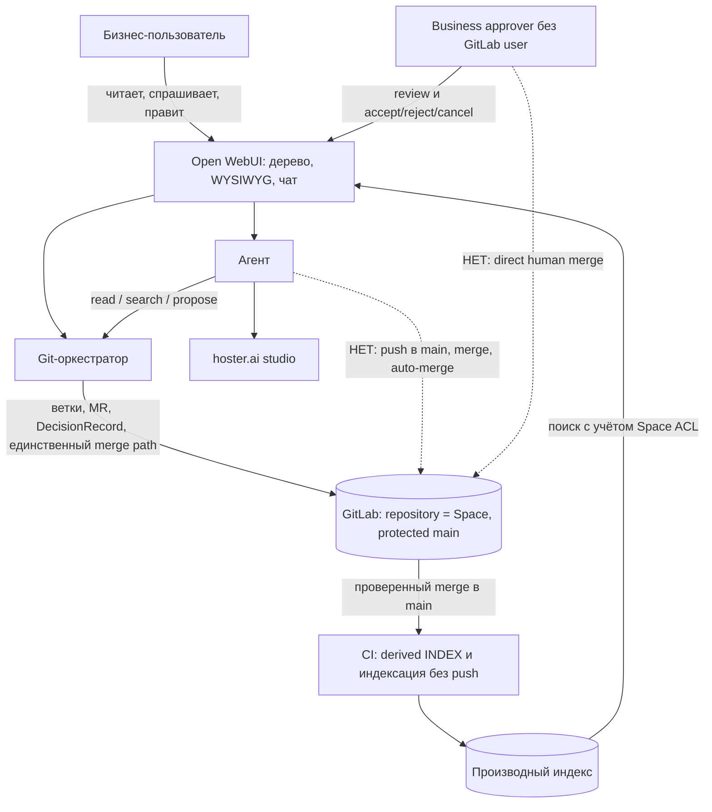
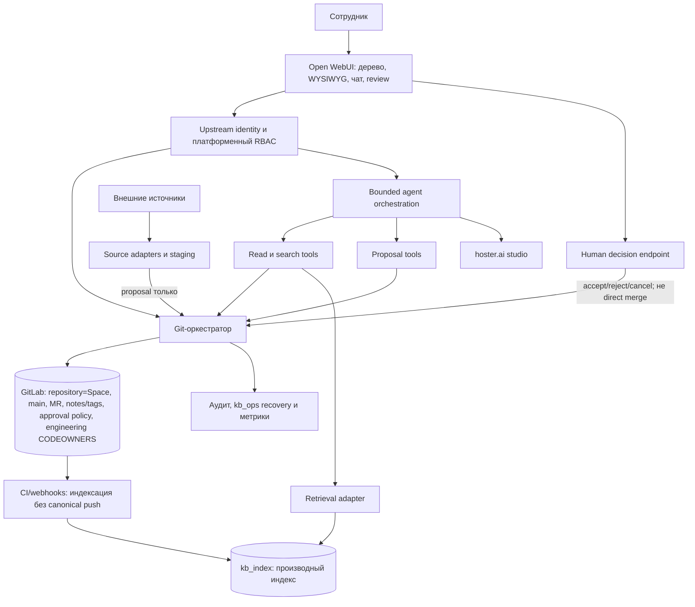
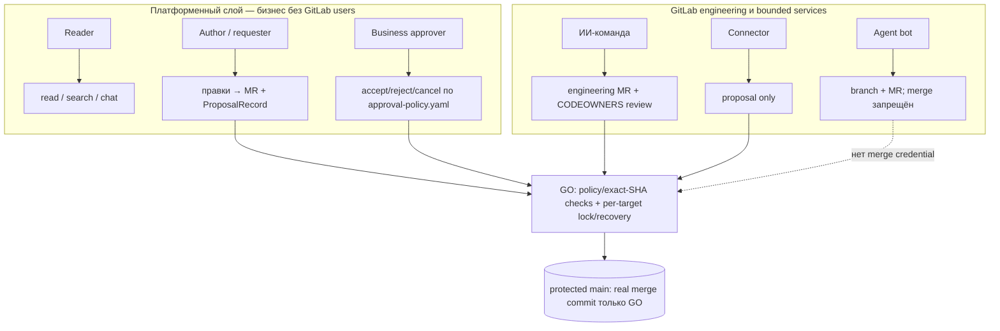
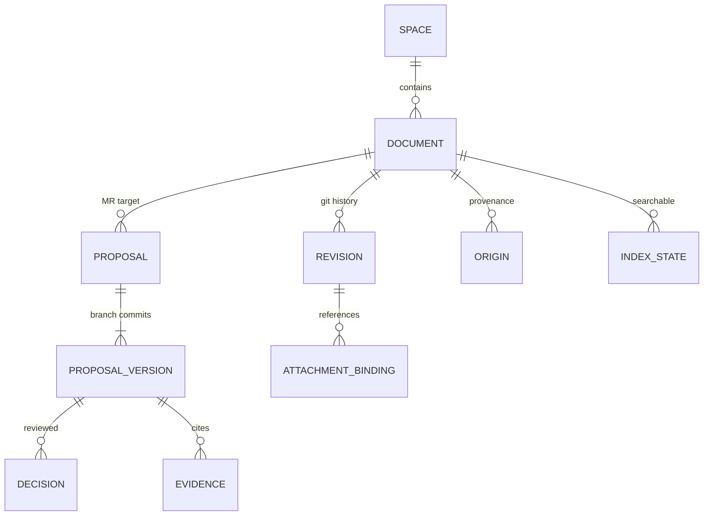
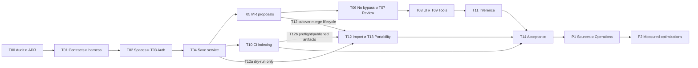

# Corporate Agentic Knowledge Platform
# Архитектурная спецификация и backlog для Spec-Driven Development

Версия спецификации: 1.3
Дата: 2026-11-06
Статус: proposed; **T00 DONE, G0 APPROVED 2026-11-08**; backlog readiness corrections **APPLIED after documentation validation 2026-11-08**, повторный readiness PASS не заявляется; implementation допускается только по dependencies после нового readiness PASS, НЕ production rollout.
Заказчик: команда hoster.ai; продуктовая основа: Open WebUI + GitLab.
Язык интерфейса и пользовательских сценариев: русский; технические ID стабильны.

**Revision summary 1.3:** нормативные требования синхронизированы с согласованным design package и ADR-03–ADR-16. Зафиксированы периметр «один GitLab repository = один Space», business approval без GitLab users через `approval-policy.yaml`, engineering-only CODEOWNERS, выполнение всех business/engineering merges только через GO, canonical DecisionRecord в MR note и protected annotated tag, exact-SHA merge parentage, per-target recovery, двухфазный cutover, single-writer PostgreSQL schemas и полный export с decisions/assets manifests. Добавлены A27–A36 без изменения существующих IDs. Решения владельца обязательны и не переоткрываются; T00/G0 этой ревизией не отмечаются выполненными.

Связанные документы: [`content-standard.md`](content-standard.md) — стандарт контентного конвейера 2.3; [`architecture.md`](architecture.md) и [`integration.md`](integration.md) — component и integration design; [`adr/README.md`](adr/README.md) — статусы и индекс ADR. Канонические машинные контракты: [`contracts/front-matter.schema.json`](contracts/front-matter.schema.json) и [`contracts/decision-record.schema.json`](contracts/decision-record.schema.json). Стандарт описывает, **как готовится корпус**; эта спецификация — **на какой платформе корпус живёт**.

## 0. Как использовать этот документ

Это единый вход в SDD: specification → audit → ADR/design → task plan → tests → implementation → verification → release. При противоречии предыдущим материалам (включая v1.1) не объединять решения молча: фиксировать решение владельца в ADR. Приоритет: R01–R18 и I01–I14 важнее деталей планирования. Согласованные AD-1–AD-16 Architecture Spine и ADR-03–ADR-16 обязательны; эта ревизия устраняет более ранний normative drift и не открывает принятые решения заново.

Документ задаёт требуемое поведение. Не содержит проверенных путей исходников Open WebUI или GitLab deployment и не является миграционным скриптом. Реализация должна соответствовать выбранным версиям/commit, а не предполагаемым моделям из README. На 2026-11-08 T00 DONE и G0 APPROVED; задачи T01–T20 выполняются только по dependencies и после implementation-readiness PASS, deferred gates и запрет production changes сохраняются.

### 0.1. Правила coding agent

1. Начать только с T00. Без согласованного baseline/design не выполнять product migrations, массовое форматирование и upgrade dependencies.
2. Читать локальные repository instructions, migrations/test conventions. Зафиксировать commit/tag Open WebUI, версию GitLab, toolchain и редактор.
3. Различать REQUIREMENT (обязательное поведение), DESIGN (предлагаемая реализация), UNKNOWN (проверить), DEFERRED (не делать сейчас).
4. Не добавлять сервис/библиотеку, пока существующая возможность upstream/GitLab не проверена. Не переписывать auth/chat/RAG Open WebUI и не строить собственный Git-хостинг без согласованного ADR.
5. На задачу: связать requirement IDs, изменить минимальную область, добавить негативные/конкурентные тесты, записать evidence и upgrade impact.
6. Не выводить секреты и реальные клиентские документы в отчёт. Использовать synthetic fixtures и согласованный обезличенный corpus.
7. Production migration, destructive cleanup, push/deploy, платные внешние вызовы и включение egress требуют отдельного разрешения владельца.
8. Не выдавать mocked integration за проверку hoster.ai studio или GitLab. Нет доступа — BLOCKED, не PASS.
9. Не переносить статус DONE из наличия UI/кода. DONE требует критериев, реально запущенных тестов и review.
10. Изменения scope/контрактов отражать в спецификации и ADR до реализации.

### 0.2. Предлагаемая структура SDD-артефактов

Пути ниже предлагаемые. Если репозиторий уже использует другой стандарт, сохранить его и добавить mapping.

```text
specs/corporate-kb/
  spec.md                 # этот контракт и traceability
  baseline.md             # audit выбранных версий Open WebUI и GitLab
  architecture.md         # уточнённый design с code references
  contracts/              # schemas/API/tool/event contracts
  adr/                    # решения и альтернативы
  tasks.md                # IDs, зависимости, статусы, evidence
  test-plan.md            # проверяемые сценарии
  operations.md           # deployment, backup, upgrade, rollback
  evidence/               # sanitized test reports, не секреты
```

Статусы задач: TODO → IN_PROGRESS → VERIFIED → DONE; BLOCKED отдельно. VERIFIED = тесты выполнены, DONE = критерии + review + документация. Возобновляющий агент сначала читает baseline/ADR/tasks, не переоткрывает архитектуру без оснований.

## 1. Цель и границы продукта

Построить переиспользуемую корпоративную базу знаний, которую можно развернуть у клиента или обслуживать как выделенный managed instance. Первый внутренний заказчик — отдел продаж hoster.by; затем подход упаковывается для внешних клиентов (inside-out). Сотрудник и AI-агент работают с одним корпусом адресуемых документов через один визуальный интерфейс.

**Источник истины — GitLab repository=Space с markdown/front matter, MR/ProposalRecords, DecisionRecord notes/tags, policies и cutover.** Платформа читает canonical revisions и вносит managed changes через GO/MR; все final merges выполняет GO. PostgreSQL содержит rebuildable projections и operational recovery state, а не второй канон. Коммерческий принцип: знания клиента остаются в его Git/GitLab и immutable objects; полный экспорт = согласованный clone + decisions/assets manifests и MR metadata, поэтому уход от платформы не требует database-first миграции.

Ключевые пользовательские действия:
- видеть дерево доступных документов, читать и создавать страницы;
- редактировать WYSIWYG без Git/CLI;
- задать вопрос по странице, разделу или разрешённому корпусу;
- получить ответ с источниками;
- получить и исправить предложение изменения (от агента или коллеги);
- принять/отклонить его, посмотреть историю и восстановить версию;
- безопасно обновить внешние источники.

Роли бизнес-пользователей (нормативно, проверяется acceptance):
1. Бизнес-пользователь работает с агентами по документному пространству: вопросы по странице/разделу/корпусу, ответы с источниками, агентные предложения правок.
2. Бизнес-пользователь просматривает и правит документы в платформе без Git/CLI; сохранение создаёт MR, статусы видны человеческим языком.
3. Business approver является HITL для агентных сборок и правок: получает review с diff, rationale и evidence, принимает/отклоняет/отменяет/исправляет через новую ProposalVersion. Его path role задаёт `approval-policy.yaml`, GitLab user отсутствует, direct merge не выполняется; source owner и engineering CODEOWNERS являются отдельными ролями.
4. Пользователь навигируется только по доступной ему части базы: дерево, поиск и агент фильтруются сервером по правам.
5. RBAC — двухслойный: платформенный для бизнес-пользователей, GitLab для инженерного контура (раздел 5).

Инференс: hoster.ai studio, без обязательного внешнего платного AI backend. Программная основа бесплатная; инфраструктура, inference, сопровождение и собственная разработка учитываются отдельно.

### Концепция одной картинкой

Open WebUI — лицо и голос, Git — память, GitLab — редакция, CI — типография. Агент предлагает, человек принимает решение, GO выполняет merge.



### Вне MVP

Общая multi-tenant БД, arbitrary page-level ACL внутри одного периметра, автоматическая публикация агентных правок, arbitrary shell над документами, GraphRAG/people graph, несколько согласующих по одному MR, realtime collaborative editing (CRDT), routine/self-service admin break-glass product capability, новый inference gateway, универсальный двусторонний sync, автоматический rebrand, второй хостинг Git, все коннекторы сразу. Emergency out-of-band privileged incident procedure по G0-D3 не является product capability и обязательна.

Возврат к database-first канону рассматривается только по двум стоп-триггерам: realtime-совместное редактирование становится твёрдым требованием, либо нужны page-level ACL внутри одного периметра с прямым доступом людей к Git. Решение — отдельный ADR и переоценка, не молчаливая прослойка.

## 2. Доказательная база и ограничения проверки

Проверена документация; исходники конкретных deployment не исследованы. Наличие функции в online docs не означает её наличие в выбранном release. Возможности GitLab (protected branches/tags, engineering CODEOWNERS review, exact-SHA merge requests и custom trailers, append-only structured MR notes и их IDs/audit, webhooks, merge-only-GO rules, metadata export) проверяются на выбранной версии в T00 — не предполагать по документации другой редакции. До этой проверки protocol-level append-only не объявляется физическим WORM-свойством.

| Источник | URL | Основание |
|---|---|---|
| S01 | https://docs.openwebui.com/features/notes/ | Notes существуют как личный контур; в Git-native модели НЕ являются каноном. |
| S02 | https://docs.openwebui.com/features/workspace/knowledge/ | Retrieval, direct reads, directories, Docling/extraction, PGVector и другие backends. Indexed text не равен original. |
| S03 | https://docs.openwebui.com/features/extensibility/plugin/tools/ | Native tools, arbitrary Python Tools, experimental approval. Tools Access = privileged capability. |
| S04 | https://docs.openwebui.com/features/authentication-access/rbac/permissions/ | Additive permissions; доступ к Tools — privileged capability. |
| S05 | https://github.com/open-webui/open-webui/blob/main/LICENSE | Branding/notices, отдельные исторические лицензии. |
| S06 | https://github.com/pgvector/pgvector | Vector search, FTS combination, approximate search/filtering tradeoffs. |
| S07 | https://github.com/docling-project/docling | Document conversion; MIT code, лицензии моделей отдельно. |
| S08 | https://github.com/promptfoo/promptfoo | Evaluation/regression/red teaming; MIT core; grader providers конфигурируются отдельно. |
| S09 | https://docs.opensearch.org/latest/security/access-control/document-level-security/ | Document-level search access; необязательная scale-альтернатива. |
| S10 | https://opensearch.org/faq/ | OpenSearch Apache-2.0. |
| S11 | https://docs.gitlab.com/api/merge_requests/ | MR lifecycle, merge по SHA, конфликты, идемпотентность — проверить на целевой версии. |
| S12 | https://docs.gitlab.com/user/project/codeowners/ | Только engineering ownership/review; edition/лимиты проверить. Business approval задаётся `approval-policy.yaml`, не CODEOWNERS. |
| S13 | https://docs.gitlab.com/user/project/repository/branches/protected/ | Protected branches, запрет push, allowed to merge. |

### Upstream reuse

Переиспользовать Open WebUI: auth/users, chat UI, model connections, existing grants, Native tools и существующий retrieval. Переиспользовать GitLab: версии, ветки, MR diff/review, protected branches/tags, notes, engineering CODEOWNERS, webhooks, audit и metadata export после проверки целевой версии. Business owners существуют только в platform/upstream identity; GitLab user records для них не создаются. Личные Notes пользователей не мигрируются и не ломаются; Notes не является каноном managed-корпуса. kb_exec file-only и не является каноническим read/write API.

Privileged arbitrary Python Tools, shell и неаудированные custom tools в managed-профиле отключаются; доступ к Tools — privileged capability [S03, S04].

## 3. Архитектурные решения

### 3.1. Базовая конфигурация

- **GitLab — каноническое хранилище и редакционный движок.** Markdown + front matter, full commit SHA = revision, MR = proposal, protected annotated tags и MR notes = DecisionRecord anchors, access/approval policies и CutoverRecords версионируются в Git. После cutover `main` protected; все managed changes проходят GO/MR. `approval-policy.yaml` связывает внешние группы с path-scoped business approver roles; CODEOWNERS используется только для engineering ownership/review.
- **Open WebUI — минимальный fork**: auth, chat, model connections, retrieval переиспользуются. Добавления тонкими швами: документный навигатор (дерево/чтение/редактор), агентные инструменты read/search/propose, адаптер индекса. Внутренности Notes не трогаем; owner-approved **TipTap adapter (G0-D8)** сохраняет WYSIWYG editing с canonical serializer и full source diff. Realtime collaboration/CRDT вне MVP: concurrent authors получают conflict detection, exact/fresh revisions, полный diff и новую ProposalVersion. Business owners не получают GitLab users и работают в platform review UI.
- **Identity adapter (ADR-10)** — универсальный, конфигурационный слой идентичности: режимы `ldap` (Active Directory/OpenLDAP, штатная LDAP-аутентификация Open WebUI) и `oidc` (Keycloak/ADFS и др., штатный OIDC Open WebUI). Адаптер нормализует внешнюю идентичность во внутреннюю: `{stable_id, username, display_name, groups[]}`; `stable_id` — неизменяемый атрибут (AD objectGUID / OpenLDAP entryUUID / issuer-scoped OIDC sub), не email/login. Свой LDAP/OIDC-клиент не пишем — переиспользуем upstream auth и зрелые библиотеки.
- **Git-оркестратор (GO)** — отдельный модульный монолит и единственный координатор canonical writes и всех business/engineering/source-managed merges после cutover. Люди выполняют review и accept/reject/cancel, но не имеют direct merge permission. GO владеет ProposalRecords, DecisionRecords, cutover, per-target serialization/recovery, webhooks и Git-derived reconciliation; merge credential недоступен UI, agent, connector и CI.
- **Производный индекс** в PostgreSQL (существующий retrieval backend; pgvector+FTS — кандидат унификации). Строится CI только из activated published `main` либо inactive cutover preflight на exact `cutover_sha`, versioned по Git ancestry/generation и index profile, ACL-aware. Полностью пересобираем из Git и immutable assets; preflight никогда не обслуживает retrieval.
- **PostgreSQL ownership:** один dedicated instance на клиента — DESIGN до T00; upstream tables и `kb_authz`, `kb_ops`, `kb_index` имеют отдельные roles и единственных writers/migration owners: upstream components, Identity/AuthZ adapter, GO и CI/index workers соответственно. Cross-schema writes запрещены.
- Background worker/CI для indexing/import/export. Доставка событий — GitLab webhooks + CI; надёжность достигается идемпотентностью, dependency-closure validation и ancestry reconciliation «HEAD vs индекс», отдельный broker не обязателен. CI не делает direct push производного `INDEX.md` в `main`.
- **Portability:** согласованный `git clone + manifest` с явными refs, обязательными decisions manifest (DecisionRecords и MR metadata) и assets manifest (immutable external objects и hashes). Full clone/export требует права на Space и всю его историю.
- Docling только при необходимости сложного extraction; сначала проверить готовую upstream-интеграцию.
- promptfoo + экспертный dataset для regression, не как runtime dependency.
- hoster.ai studio через имеющуюся OpenAI-compatible integration.
- OpenSearch только по измеренной необходимости; отдельный согласованный ADR.

MVP — Open WebUI fork + GO + CI; отделение сервисов по bottlenecks, не по диаграмме.



Это целевой design, не утверждение о готовых upstream modules.

### 3.2. Каноническая модель

**Git-native, не database-first.** Канон — markdown-файл с front matter в репозитории; полный commit SHA = revision. ProposalRecord и DecisionRecord хранятся в GitLab по контрактам; PostgreSQL содержит только пересобираемые projections и отдельно защищаемый operational recovery state. Экспорт = согласованный `git clone + manifest` с decisions/assets closure; backup = Git mirror + GitLab metadata + objects/config/secrets policy + restore-репетиция.

MVP-отображение сущностей строго 1:1: **один GitLab repository = один Space; Document → markdown-файл со стабильным opaque UUID `id` в front matter** (ID не зависит от пути и переименований). Repository объединяет ACL, blobs, refs/history, protected branch, credentials, cutover, index, decisions, clone/export и backup. Папки и path scopes организуют дерево/review, но не создают отдельный Space или read ACL. Разные права на tree/history/files/export требуют разных Spaces/repositories до corpus load, включая pricing. Поле `access` во front matter не является самостоятельным источником прав. Business identity и grants живут в платформе; прямой GitLab-доступ — только инженерный контур и не расширяет business grants. Full clone/export разрешён только с правом на весь Space и всю историю; filtered export/history removal — отдельный privileged workflow.

Одна curated база не означает одно физическое хранилище всех знаний компании. SharePoint/CRM/tickets могут остаться source of truth; у каждого объекта явный режим владения.

### 3.3. Типы контента

| ownership_mode | Где ведётся истина | Update contract |
|---|---|---|
| migrated | Git-репозиторий после cutover | Старый источник не перезаписывает |
| source_managed | Внешняя система | Детерминированное обновление через MR; локальная правка страницы запрещена policy |
| curated | Git-репозиторий | Внешнее изменение создаёт MR, не overwrite |
| live_operational | Бизнес-система | Read-only API, snapshot time; не автоматическая wiki-статья |

LLM-generated ingestion/summary и детерминированная source-managed синхронизация после cutover всегда создают MR через GO и требуют human decision с финальным merge только через GO. Agent/connector/LLM auto-merge запрещён для всех managed changes без исключений; controlled engineering bulk push допустим только в unpublished `main` до cutover, без пользовательского доступа и published index. `live_operational` предоставляет typed read-only API/snapshot и не становится wiki-страницей автоматически.

## 4. Нормативные требования

MUST/ДОЛЖЕН — обязательное; SHOULD — рекомендация с документируемым отступлением.

| ID | Требование |
|---|---|
| R01 | Один интерфейс: общий каталог, документ, агент; без Git/CLI для автора и business approver. |
| R02 | Stable opaque document IDs по `front-matter.schema.json`, дерево, ID-ссылки, versioned attachments и WYSIWYG; один repository = один Space. |
| R03 | Canonical content доступен direct read целиком/разделами с bounds, cursor и explicit truncation по exact revision SHA. |
| R04 | Exact/semantic retrieval только по eligible activated published `main`; inactive preflight не обслуживает retrieval; scope проверяется до exposure. |
| R05 | Shared stable identity и единая Space ACL на UI/API/tools/files/history/export/search. Business owners не имеют GitLab users; business approval задаёт `approval-policy.yaml`, engineering ownership/review — CODEOWNERS. |
| R06 | Agent/connector/LLM не публикуют managed changes: нет direct push, merge или auto-merge. После cutover все business/engineering/source-managed final applies выполняет только GO. |
| R07 | Proposal = MR с exact `base_sha`/`proposal_sha`, точным diff и append-only ProposalRecord: `author_stable_id`, `version_author_stable_id`, `requester_stable_id`, `actor_type`, optional `run_id`, `rationale`, `evidence[]`, idempotency metadata. |
| R08 | Accept/reject/cancel требуют canonical DecisionRecord по schema в structured MR note и protected annotated tag `kb-decisions/<uuid>` на `proposal_sha`; approval привязан к exact версии и не допускает self-approval author/version-author/requester. |
| R09 | Durable revisions = Git history; accepted publication — реальный merge commit без squash/rebase/fast-forward, first parent = `base_sha`, second parent = `proposal_sha`, с Decision trailers; restore — revert-MR/new commit. |
| R10 | Нет silent overwrite: все merges сериализуются GO per repository/target, `target HEAD == base_sha` перепроверяется непосредственно перед merge; retry идемпотентен по `decision_id` и `(repository_id,target_branch,proposal_sha)`, recovery conclusive. |
| R11 | Индекс производный, асинхронный, ACL/SHA/ancestry/profile-aware; full/incremental equivalence по dependency closure, single-writer active pointer, rebuild без потери канона. |
| R12 | Import dry-run даёт path→ID/provenance/links/attachments/errors без canonical writes. Controlled bulk допустим только до cutover в unpublished `main`; после cutover все changes — GO/MR/human decision/GO merge. |
| R13 | Повторный импорт не затирает curated правку; source_managed не имеет auto-merge; удаления явные; `live_operational` остаётся typed read-only и не становится wiki автоматически. |
| R14 | Переносимость = clone + decisions/assets manifests с exact refs, DecisionRecords/MR metadata, immutable external objects/hashes и policy closure; проверяемый mirror/metadata backup restore. |
| R15 | Все AI-вызовы через согласованные providers, data profiles, проверенные egress и secrets handling; unplanned fallback запрещён. |
| R16 | Ограниченные read/search/propose agent tools; недоверенные документы не дают полномочий; merge/grants/arbitrary Git/shell/SQL недоступны на любом канале. |
| R17 | Повторяемый dedicated deployment на клиента: repositories=Spaces + config + isolated PostgreSQL/index/objects/secrets/backups, single-writer schemas, без клиентских веток кода; upstream upgrade policy. |
| R18 | Regression/evaluation включает deterministic merge/recovery/ACL/schema/export/cutover tests и эксплуатационные метрики, не только UI smoke или LLM judge. |

## 5. Инварианты и security boundary

- I01: до cutover controlled engineering bulk push допустим только в unpublished `main` при закрытом пользовательском доступе и отсутствии published index; после активации published document изменяется только реальным merge commit в protected `main`, созданным через GO по canonical accepted DecisionRecord.
- I02: после cutover все managed builtin/tool/API/import/restore/engineering/source-managed paths идут через GO и MR; direct push и direct human/service merge закрыты для всех non-privileged managed identities. Routine/self-service admin break-glass product capability отсутствует. Privileged GitLab Owner bypass — out-of-band security/integrity incident: reconciliation обнаруживает unexpected HEAD/merge, немедленно устанавливает affected-target `recovery_required`/quarantine и managed-write freeze, сохраняет audit и запускает G0-D3 runbook; это не approved managed path и не абсолютное merge-only-GO для admins. Cutover начинается write freeze, требует `HEAD == cutover_sha`, затем protected tag/MR-only rules, inactive preflight и лишь после успеха activation; auto-merge отсутствует.
- I03: author/version-author/requester identity берётся из trusted execution context и stable external identity; LLM не задаёт actor_id/grants/tenant/run/policy. GitLab bot/service identity не заменяет principals ProposalRecord.
- I04: agent может создавать только разрешённые ветки и MR, но не accept/reject/cancel/merge/grants, даже если chat user author/admin. После cutover merge permission есть только у managed merge service identity GO; bot/connector/CI tokens merge не имеют. Привилегированный GitLab Owner может технически обойти rules вне GO; такой bypass классифицируется как incident с reconciliation/quarantine и не создаёт managed exception.
- I05: merge применяет exact `base_sha` и `proposal_sha` без повторной LLM-генерации, automatic conflict merge, squash, rebase или fast-forward; новый коммит/rebase создаёт ProposalVersion и инвалидирует approval. Проверяются first parent = base, second parent = proposal и Decision trailers.
- I06: stale base/proposal SHA, target race, policy bundle/revision mismatch, self-approval, потеря group/path role или revocation до merge/export, а также `HEAD != cutover_sha` → отказ и **ноль новых writes в `main`** для отклонённой операции.
- I07: canonical accept/reject/cancel DecisionRecord — один JSON с `record_sha256` в MR note и protected annotated tag `kb-decisions/<uuid>` на `proposal_sha`; note/tag/trailer/parent mismatch делает decision invalid. Перед external merge GO атомарно фиксирует `merge_attempted` и durable per-target `recovery_required`; timeout не означает ни merged, ни failed. Только Git-derived conclusive reconciliation снимает barrier, недоказуемый outcome остаётся quarantined; индексация отдельна. Распределённая ACID между GitLab и PostgreSQL не требуется и не имитируется.
- I08: pending/rejected proposals и ветки не входят в published search corpus; activated index строится только из eligible published `main`, cutover preflight остаётся inactive и `serving_allowed=false`.
- I09: один repository = один Space = один ACL/history/export perimeter; `access` во front matter не создаёт ACL. Tree/titles/snippets/chunks/files/history/export/tools авторизуются по versioned policy до payload и до отправки LLM; разные ACL требуют разных repositories.
- I10: rebuild `kb_index` возможен из Git + immutable assets, Git-derived `kb_ops` state — из MR/notes/tags/merge commits, `kb_authz` — из Git policy + IdP. GO-owned correction tasks/events/evidence/idempotency — non-Git-derived operational records, требующие durable `kb_ops` backup и linked-MR reconciliation после restore; Git-only rebuild не fabricate/delete/resolve/cancel tasks. Только owning components пишут upstream/managed grants/`kb_authz`/`kb_ops`/`kb_index`; indexed copy не редактируется как вторая истина, unknown recovery не очищается rebuild.
- I11: late job старой Git ancestry generation или index profile не возвращает старый snapshot в active search; SHA lexicographic ordering запрещён. Только CI/index writer продвигает pointer после полного validated run; incremental эквивалентен full по dependency closure; HEAD/index reconciliation регулярен.
- I12: политика доступа и execution capabilities не зависят от регистрации/канала инструмента: direct/deferred/note chat/automation/channel/OpenAPI/call_tool; один `policy_bundle_id` и согласованные full access/approval policy revision SHA обязательны для sensitive operations.
- I13: attachment revisions имеют тот же Space ACL, immutable object/version/hash и входят в assets manifest/export/backup; их удаление учитывает Git history, mirrors, object versions и retention. Cross-Space history/export isolation обязателен.
- I14: статусы `draft / in_review / published / indexed / archived / conflicted` явно различаются в UI; `recovery_required`, quarantine и inactive preflight не маскируются под published/indexed.

Privileged arbitrary Python Tools, shell, DB admin, GitLab admin и системный оператор находятся за пределами защиты от непривилегированного агента. Их нужно ограничить операционно [S03].

### Роли и permissions — двухслойный RBAC

Платформенный слой (бизнес-пользователи, аккаунты в Open WebUI, **GitLab user records отсутствуют**):
- Reader: read/search/chat в разрешённых Spaces.
- Author: manual edits и proposals в разрешённых Spaces; author не утверждает собственную версию.
- Owner/business approver: HITL review и accept/reject/cancel в path scope из versioned `approval-policy.yaml`; не выполняет direct GitLab merge. В MVP один approver, не совпадающий с `author_stable_id`, `version_author_stable_id` или `requester_stable_id`; редактор версии также не может её утвердить.
- Source owner: stable external identity владельца исходника/data barrier; не подменяет business approver и не получает права из front matter.
- Space admin: membership/config в пределах делегированных upstream semantics и versioned access policy.
- Instance admin: эксплуатационная privileged роль; routine/self-service break-glass product capability в MVP отсутствует. Привилегированный GitLab instance/project Owner может технически обойти protected rules вне GO; такой bypass не является approved managed path. Он классифицируется как out-of-band security/integrity incident: reconciliation обнаруживает unexpected HEAD/merge, немедленно устанавливает affected-target `recovery_required`/quarantine и managed-write freeze, сохраняет audit evidence и запускает explicit G0-D3 emergency runbook.

GitLab-слой (только инженерный контур):
- ИИ-команда: engineering MR/review через GitLab UI/API; CODEOWNERS задаёт только engineering ownership/review. После cutover нет direct push или direct human merge в `main`; final apply любого engineering MR выполняет GO по тем же DecisionRecord/serialization правилам.
- Agent bot: create branch/commit/MR через scoped proposal credential; merge запрещён на уровне GitLab и GO.
- Connector identity: только выбранные source bindings и proposal-only capability; auto-merge отсутствует.
- GO merge service identity: единственная managed identity с merge permission после cutover; credential не экспортируется в browser/agent/connector/CI. Privileged GitLab Owner bypass не входит в managed model и обрабатывается как out-of-band incident по G0-D3.



Roles — продуктовые scoped capabilities, а не обязательные новые global roles. Переиспользовать additive upstream grants; не выдумывать deny precedence поверх S04. MVP: единый versioned Space ACL, наследование документами и attachments, строго один repository = один Space. Разные ACL → разные repositories/Spaces. Path scopes в approval policy управляют только review routing и не становятся page-level read ACL.

### Identity и group mapping (ADR-10)

LDAP/OIDC отвечает «кто ты», платформа — «что тебе можно». Права не живут в LDAP-атрибутах документов; RBAC не строится внутри AD.

- **Аутентификация:** Open WebUI (LDAP или OIDC по конфигу) для бизнес-пользователей; GitLab LDAP — только для инженерного контура. Дизайн НЕ зависит от GitLab LDAP group sync (EE-фича, в CE отсутствует).
- **Авторизация:** согласованный versioned policy bundle содержит access policy («внешняя группа → роль/Space») и `approval-policy.yaml` («внешняя группа → path-scoped approver role»). Например, `cn=kb-sales → Space sales: Author`; `cn=kb-owners-pricing → approver pricing/` в отдельном pricing repository=Space. `policy_bundle_id` связывает repository + policy paths; `access_policy_revision` и `approval_policy_revision` — полные Git SHA одного согласованного bundle. Path matching нормализует separators/Unicode и запрещает `..`. Маппинг — в Git (не секрет), секреты bind — в deployment secrets. Персональные гранты вне групп — явно аудируемое исключение, не норма; front matter `access` авторизацию не задаёт.
- **Provisioning:** JIT при первом логине + периодическое обновление групп. Учётные записи не создаются вручную заранее.
- **Mover/joiner/leaver:** смена группы в AD автоматически меняет доступ и очередь ревью (очередь назначается группе, не человеку). Переименование login/email не разрывает историю и MR — идентичность по stable_id.
- **Клиентская упаковка:** подключение каталога — конфиг deployment (host, base DN, bind, group mapping), не код и не форк. У hoster.by — Active Directory; у клиента с готовым SSO — режим `oidc`.

Revocation предотвращает новые retrieval/tool payloads/exports/merges и прекращает live subscriptions после установленного policy barrier. Merge/export повторно проверяют external groups, Space/path scope и тот же policy bundle с access/approval revisions непосредственно перед операцией; mismatch или revocation даёт отказ без `main` write/export payload. Уже отправленный модели/браузеру текст невозможно «забыть». Истории чатов и retention регулируются отдельно.

**SLO на отзыв доступа: ≤ 30 минут** (утверждено владельцем). Механизм: фоновое обновление групп с интервалом ≤ 15 минут + перепроверка групп при чувствительных операциях (merge, export, выдача закрытых страниц) + ограниченный TTL сессии. Отзыв в AD → потеря доступа к закрытым разделам, поиску и агентным инструментам не позднее 30 минут; чувствительные операции — при ближайшей перепроверке.

## 6. Логическая модель данных — отображение на Git и БД

Имена условные. Принцип: **канонические сущности живут в Git/GitLab; в БД платформы — только производные и операционные.**

| Сущность | Где живёт | Поля/смысл |
|---|---|---|
| Space | Ровно один GitLab repository + platform config | stable lowercase `space_id`, `repository_id`, title, unified ACL, managed/activation flag; history/cutover/index/export perimeter |
| Document | Markdown-файл по `front-matter.schema.json` | opaque UUID `id`, path, `parent_id`, title, `ownership_mode`, archive metadata, attachments; `access` не является ACL |
| Revision | Commit | full SHA, ancestry/parents, attributed author/reason, timestamp; canonical revision = SHA, порядок только по ancestry |
| Proposal | GitLab MR + append-only ProposalRecord | proposal/iid, source/target, exact `base_sha`, status, idempotency/payload hash |
| ProposalVersion | Exact source commit + immutable ProposalRecord | `proposal_sha`, diff, `author_stable_id`, `version_author_stable_id`, `requester_stable_id`, `actor_type`, optional `run_id`, `rationale`, `evidence[]` |
| DecisionRecord | Canonical JSON в structured MR note + protected annotated tag `kb-decisions/<uuid>` | UUID, accept/reject/cancel, actor stable ID, exact SHAs, evidence, policy bundle+revisions, hash, optional supersedes; note/tag обязаны совпадать |
| Accepted merge | Real merge commit в protected target | first parent = base, second parent = proposal; `Decision-ID`, `Decision-Note-ID`, `Decision-Hash`, `Approved-by`; no squash/rebase/FF |
| CutoverRecord | GitLab record + protected validation/cutover tag | Space/repository, exact `cutover_sha/main_sha`, validation evidence, sign-off stable ID, UTC timestamp |
| PolicyBundle | Versioned access policy + `approval-policy.yaml` | repository+policy paths, full access/approval revision SHA, external groups, Space roles/path approver scopes |
| Evidence | ProposalRecord/DecisionRecord + authorized refs | source/document ID, version, section/range/hash; visibility checked at display/export |
| Origin | `origin` front matter + source registry | source/account/remote_id, source_version/hash, previous imported base, seen/proposed/merged cursors, ownership mapping |
| Attachment | Small Git asset или immutable external object + front matter binding | `{object_id,version,sha256,size,media_type,source_ref}`, media class/verification, Space ACL, retention |
| RecoveryBarrier | Durable `kb_ops` operational safety state | `(repository_id,target_branch)`, `recovery_required`, owner/fencing, unresolved decisions; не canonical DecisionRecord |
| DocOpsCorrectionTask | GO-owned `kb_ops` current projection + append-only events + restricted evidence + idempotency | `docops-correction-task-v1`: exact reported revision, stable actor, policy owner, evidence hash, optional linked MR, CAS, `open/in_review/resolved/cancelled`; не canonical content/DecisionRecord |
| IndexJob/IndexState | CI + `kb_index` | exact snapshot/document revisions, ancestry generation, profile, dependency closure, preflight/active state, retry/dead-letter; только index writer |
| ExportPackage | Согласованный clone + manifests | explicit refs, decisions manifest + MR metadata, assets manifest + immutable objects/hashes, policies/grants/closure hashes |
| AuditEvent | GitLab metadata + GO projection | actor/context, operation, target, result, proposal/decision/merge/index IDs, timestamp; no secrets/raw private content |

Один dedicated PostgreSQL instance на клиента (DESIGN до T00) содержит upstream-owned tables и независимые `kb_authz`, `kb_ops`, `kb_index`. Только upstream components выполняют upstream writes/migrations; только Identity/AuthZ adapter пишет managed upstream grants и `kb_authz`; только GO — `kb_ops`; только CI/index workers — `kb_index` и active pointer. Retrieval read-only. Любой cross-schema write запрещён DB roles, а не только дисциплиной кода; межкомпонентный доступ идёт через versioned contracts. Correction tasks — GO-owned non-Git-derived operational records: их current projection, append-only events, restricted evidence и idempotency records требуют durable `kb_ops` backup/restore и последующей linked-MR reconciliation; Git-only rebuild их не воссоздаёт и не удаляет.

Проверка «что именно ревьюил человек» = diff exact `base_sha`→`proposal_sha` и immutable ProposalRecord. Человеку показывается всё значимое: текст, структура, ссылки, вложения, front matter, principals/run, rationale/evidence; скрытое изменение атрибутов недопустимо. Если preview не способен достоверно показать изменение, MR не допускается к merge из платформы.



## 7. Основные протоколы

### 7.1. Human decision и merge только через GO

1. Author/agent получает authorized canonical read exact `base_sha` и создаёт attributed branch commit. GO создаёт MR и append-only ProposalRecord для exact `proposal_sha` со всеми principals, optional trusted `run_id`, rationale/evidence и idempotency metadata; `main` не меняется.
2. Review показывает exact base/proposal, полный diff/preview, front matter, структуру, ссылки, attachment revisions и evidence. Недостоверный preview блокирует apply. Edit/rebase/new commit создаёт новую ProposalVersion, `version_author_stable_id` и `proposal_sha`; прежний approval недействителен.
3. Business approver без GitLab user выбирает accept/reject/cancel в platform UI. GO проверяет fresh external group и path scope из `approval-policy.yaml`; approver не совпадает с author, version author или requester. Engineering review может использовать CODEOWNERS, но его final apply идёт тем же GO protocol.
4. До применения решения GO создаёт canonical DecisionRecord JSON по `decision-record.schema.json` с UUID, action, actor, exact SHAs, evidence, `policy_bundle_id`, full access/approval revisions и `record_sha256`. Одинаковые bytes/hash сохраняются в append-only structured MR note от GO и protected annotated tag `kb-decisions/<decision_id>` на `proposal_sha`. Missing/mismatched note/tag → `invalid`; исправление — новый UUID со `supersedes_decision_id`.
5. Для accept GO берёт advisory lock с owner/fencing token per `(repository_id,target_branch)` и повторно проверяет groups, все self-approval prohibitions, policy bundle/revisions, MR state, exact source `proposal_sha`, `target HEAD == base_sha`, отсутствие более новой версии и отсутствия `recovery_required`. Mismatch → forbidden/conflict и ноль writes в `main`.
6. Непосредственно перед external merge call GO в одной DB transaction устанавливает `merge_attempted`, создаёт первую реальную merge operation и durable per-target `recovery_required`. До этой transaction accepted decision имеет `recorded` и `attempts=[]`; synthetic attempt/no-merge claim не создаётся. Barrier блокирует все новые merges target и переживает crash, lock loss и fencing. Новый owner сначала выполняет target-wide reconciliation, включая unresolved accepted note/tag records.
7. Только merge service identity GO выполняет exact-SHA merge. Squash, automatic rebase и fast-forward запрещены. Accepted publication создаёт реальный merge commit: first parent = `base_sha`, second parent = `proposal_sha`; trailers `Decision-ID`, `Decision-Note-ID`, `Decision-Hash`, `Approved-by` совпадают с canonical record/note/approver.
8. Независимо от HTTP response GO читает GitLab и проверяет target ancestry, parents, trailers, note/tag/hash. Только проверенный commit в `main` подтверждает `merged`. Reject/cancel создают такой же durable note+tag и закрывают MR без merge/`main` write.
9. Повтор того же `decision_id` или уже применённого `(repository_id,target_branch,proposal_sha)` возвращает существующий Git-derived результат и не создаёт новый attempt. Timeout не разрешает blind retry с новым decision ID. `recorded accepted` после durable note+tag, но до первой merge DB transaction имеет `attempts=[]` и может иметь `recovery_required/target_quarantined=true` без `no_merge_proven`; reject/cancel не создают merge operation. `failed` допустим только после request completion+proven no-merge у последней real attempt и допускает лишь guarded recovery retry: новый real attempt ID, тот же `decision_id`, exact base/proposal и fresh preconditions. `conflicted/invalid` terminal. Conclusive reconciliation завершает recovery; недоказуемый outcome остаётся `merge_attempted` с recovery/quarantine flags, а не отдельным canonical state.
10. Merge не ждёт indexing. Webhook/reconciliation инициирует CI отдельно; производный `INDEX.md` является build artifact либо частью того же reviewed MR, никогда отдельным CI direct push.

Locks/transactions не удерживаются во время LLM calls или human review. Automatic conflict merge запрещён: конфликт требует новой ProposalVersion от свежего HEAD и нового независимого review.

```mermaid
sequenceDiagram
    actor H as Business approver без GitLab user
    participant A as Автор или агент
    participant G as Git-оркестратор
    participant I as Identity/AuthZ
    participant GL as GitLab
    participant CI as CI/Index
    A->>G: Proposal от exact base_sha + rationale/evidence
    G->>GL: Branch + MR + ProposalRecord exact proposal_sha
    GL-->>H: Полный review через platform UI
    H->>G: Accept/reject/cancel + decision_id
    G->>I: Fresh groups, path scope, policy bundle/revisions
    G->>GL: Canonical DecisionRecord note + protected tag
    alt Reject или cancel
        G->>GL: Проверенное закрытие MR без main write
    else Accept
        G->>G: Per-target lock + exact HEAD/base/proposal recheck
        G->>G: DB transaction: merge_attempted + recovery_required
        G->>GL: Только GO: real merge commit exact SHAs + trailers
        G->>GL: Verify parents/trailers/note/tag/hash
        alt Conclusive Git-derived result
            G-->>H: Merged или conclusive failure; recovery завершён
            GL-->>CI: Webhook/reconciliation → отдельная индексация
        else Timeout или недоказуемый outcome
            G-->>H: Quarantine; target recovery_required сохраняется
        end
    end
```

### 7.2. Редактирование и revisions

Owner-approved TipTap adapter (G0-D8) сохраняет WYSIWYG editing с canonical serializer, front-matter boundary, immutable attachment metadata и full source diff. Realtime collaborative editing/CRDT в MVP отсутствует — осознанное допущение Git-native модели. Save в платформе = коммит в ветку пользователя; публикация = MR. Два редактора одной страницы: второй получает `STALE_BASE`/«Документ изменился» с conflict detection, exact/fresh revision и полным diff; продолжение создаёт новую ProposalVersion, silent last-write-wins и automatic conflict merge запрещены.

История = git log по файлу; restore = revert-MR (новый коммит, не перезапись истории). Автосохранение черновиков — в ветку пользователя с явным статусом «черновик», не в main.

### 7.3. Proposal states

```mermaid
stateDiagram-v2
    [*] --> Pending: MR + ProposalRecord открыт
    Pending --> Pending: Новый commit/rebase = новая ProposalVersion, approval сброшен
    Pending --> Recorded: Canonical accept/reject/cancel note + tag
    Recorded --> Recorded: Accepted crash window; attempts=[], recovery flags без no-merge claim
    Recorded --> MergeAttempted: Accept; real attempt + DB barrier до external call
    MergeAttempted --> MergeAttempted: Timeout/unknown; quarantine=recovery flags, не canonical state
    MergeAttempted --> Merged: Проверенный merge parents/trailers/note/tag/hash
    MergeAttempted --> Failed: Request completed + proven no-merge
    Failed --> MergeAttempted: Guarded same-decision retry; новый real attempt + fresh preconditions
    MergeAttempted --> Conflicted: Conclusive Git-derived conflict
    MergeAttempted --> Invalid: Missing/mismatched note/tag или integrity evidence
    Recorded --> Rejected: Rejected DecisionRecord + MR закрыт без merge operation
    Recorded --> Cancelled: Cancelled DecisionRecord + MR закрыт без merge operation
    Pending --> Conflicted: Base изменился, apply запрещён
    Pending --> Superseded: Заменён новой ProposalVersion/MR
    Merged --> [*]
    Failed --> [*]: Nonretryable conclusive failure
    Rejected --> [*]
    Conflicted --> [*]
    Invalid --> [*]
    Cancelled --> [*]
    Superseded --> [*]
```

Любой transition проверяется server-side и выводится из GitLab; projection status не является terminal truth. `failed` при timeout не доказывает отсутствие merge и допустим только после completed request+no-merge evidence последней real attempt. `DecisionResult.attempts[]` содержит только реальные merge operations для accepted; `recorded accepted` и rejected/cancelled имеют `attempts=[]`. Replay того же decision/proposal возвращает существующий Git-derived результат и создаёт ноль attempts. Guarded retry после conclusive failed использует тот же decision ID и новый real attempt. Quarantine — `merge_attempted + recovery_required/target_quarantined` либо recovery flags поверх unresolved `recorded accepted`, не отдельный canonical state, и не очищается по таймеру или сменой GO owner.

### 7.4. Retrieval и source of truth

- Открытая короткая страница: прямое чтение из Git по SHA; не глобальный поиск по умолчанию.
- Корпус: exact/semantic retrieval → bounded candidates → read selected document/revision из Git → answer/citations.
- Structured current facts: typed read-only API позже, отдельная policy; не RAG по устаревшему отчёту.
- Scopes server-side: page, subtree, space, разрешённые spaces.

Индексный adapter отдаёт document_id/document_revision_sha и snapshot metadata, не независимые user-editable copies. Candidate с inactive/stale revision отклоняется; selected current canonical read выполняется отдельно через GO с новой авторизацией. Historical read явно маркируется и авторизуется; нельзя молча выдавать отозванное/удалённое или preflight содержимое.

### 7.5. Indexing protocol

События: verified merge в `main`, archive, AccessPolicyChanged, AttachmentChanged — через GitLab webhooks и/или CI. Webhook является подсказкой, не proof active revision: GO читает exact `main_sha` и Git ancestry. At-least-once processing использует idempotency, bounded retry, dead-letter и регулярный HEAD/index ancestry reconciliation; сортировка SHA и «monotonic SHA» запрещены.

`index-snapshot-v1` различает `snapshot_sha`, `document_revision_sha`, blob/content hash, dependency hash, `main_generation` и `index_profile_version`. History rewrite создаёт новую generation и требует full rebuild. Full и incremental runs строят exact+semantic projections в inactive storage. Incremental `ready/active` требует nonempty `closure.equivalence_evidence`: distinct full run+snapshot в conclusive canonical `ready/active` (`ready_to_publish` в DB), `validated_at`, complete closure, `missing_inputs=[]`, exact+semantic hashes и совпадение Space/repository/target/main SHA/generation/profile/closure hash; requested/failed/empty prerequisite отклоняется, иначе closure расширяется или выполняется full run. Только CI/index writer сериализует publication **per `(space_id,profile_id)` across all generations** (`profile_id` — projection identity для `index_profile_version`) после validated full run и атомарно выполняет CAS по expected current pointer/fence + latest Git ancestry + exact validated run/snapshot. Per-generation lock alone запрещён; concurrent old/new publishers используют один lock, stale owner обновляет ноль rows и late job не откатывает pointer.

Cutover preflight строится на exact `cutover_sha` как inactive snapshot с `serving_allowed=false` и никогда не обслуживает retrieval. Activated corpus индексируется только из eligible published `main`; `inbox`, templates, служебные и непроверенные critical media исключаются. Pending/rejected branches не попадают в corpus.

Смена ACL не ждёт индексации: fresh authorization проверяется при candidate selection и каждом delivery payload/export. Индекс может отставать, UI показывает pending/ready/failed. CI не выполняет post-merge direct push `INDEX.md` или других производных файлов в `main`; `INDEX.md` — build artifact либо часть того же reviewed MR.

pgvector HNSW/IVFFlat может ухудшать число/recall результатов при фильтрации; iterative scans/exact path/partitioning выбирать по результатам benchmark [S06]. SQL ACL predicate нельзя заменить фильтрацией уже отданных модели chunks.

Смена модели эмбеддингов или правил разбиения: новая `index_profile_version`, shadow build, прогон тестов и контролируемое переключение без destructive live rebuild. GitLab-outage stale read mode по умолчанию отключён и требует отдельного ADR.

### 7.6. External updates

Хранить previous imported base + incoming source + current curated document (Origin в front matter/реестре). No-op по version/hash. Curated конфликт → MR, не overwrite. Source deletion → tombstone/obsolete review, не удаление curations. Для source object не более одного outstanding proposal. Cursor различает `seen`, `proposed`, `merged`: каждая версия существует только вместе со своим hash; `proposal_pending` требует proposed version+hash и outstanding proposal ID+SHA, `merged` требует merged version+hash и verified Git merge, а merged и все non-pending states имеют `outstanding_proposal_id=outstanding_proposal_sha=null`. `proposed` продвигается после durable MR+ProposalRecord, `merged` — только после проверенного Git merge; reject/conflict/timeout/indexing не продвигают `merged`. При extraction/LLM failure checkpoint не выдаёт ложного success.

После cutover `migrated`, `source_managed`, `curated` обновляются только через GO/MR/human decision/GO merge; детерминированный source-managed auto-merge запрещён. `live_operational` использует typed bounded read-only result со `snapshot_time`, не создаёт автоматически wiki/MR/index/cursor и не читается из устаревшего wiki snapshot.

### 7.7. Controlled initial publication и cutover

1. До production corpus load согласуются repository=Space perimeter, source corpus, source owners, data profiles и access/approval policies. Naming/layout/provisioning остаются T00/owner decisions, но правило 1:1 не откладывается.
2. Import dry-run заранее возвращает deterministic path→ID map, provenance, links/anchors, attachment manifests, original/extracted hashes, losses/errors/security/PII/media gates и `canonical_writes=false`. Traversal, symlinks, executable HTML/MDX, secrets и oversized inputs отклоняются; файл без source owner и completed data barrier не поступает в corpus.
3. Controlled engineering bulk push допустим только в unpublished `main` при закрытом пользовательском доступе и отсутствии published index. Per-page MR в этой ограниченной фазе не требуется; protected unpublished corpus и strict data barrier сохраняются.
4. Human validation sign-off и CutoverRecord связывают Space/repository, exact `cutover_sha/main_sha`, validation evidence, sign-off stable ID и UTC timestamp.
5. Cutover первым включает **write freeze** и повторно требует `HEAD == cutover_sha`. Drift останавливает процесс; нужен новый CutoverRecord/sign-off/preflight.
6. Затем создаются protected cutover/validation tag и MR-only branch rules. Direct push закрыт для людей и всех bots; только merge service identity GO получает merge permission. Любой auto-merge запрещён.
7. CI строит full **inactive preflight** exact `cutover_sha`: eligibility, exact+semantic paths, dependency closure, attachments/media и negative ACL checks. Обязательны `snapshot_sha=cutover_sha`, `serving_allowed=false`, non-null exact/semantic hashes, complete closure и `preflight_validated_at`; requested/failed/empty evidence не годится. Preflight не обслуживает retrieval и не считается published index.
8. Только после conclusive validated preflight создаются **отдельные published run и non-preflight descriptor с новыми run/snapshot IDs на том же SHA**, повторная full validation и `published_validated_at`. Единственный writer per `(space_id,profile_id)` атомарно публикует validated pointer через current fence/latest ancestry/run CAS, затем GO активирует Space и пользовательский доступ. Preflight остаётся immutable non-serving; до pointer+activation доступ закрыт, обратный порядок запрещён.
9. Ошибка после protection/cutover исправляется новым reviewed MR; restore — revert-MR/new commit. History rewrite и возврат к bulk bypass запрещены. Replay идемпотентен по Space+`cutover_sha` только при сохранённом freeze и неизменном HEAD.

## 8. Контракты интерфейсов

Собственные контракты версионируются `/api/kb/v1`; это не реальные upstream маршруты. Машинные schemas находятся в `contracts/`, OpenAPI/tool/event mappings проверяются и реализуются после T00 по repo conventions. Mutations требуют `Idempotency-Key`, связанный с verified actor + normalized route + payload hash; повтор с другим payload — `IDEMPOTENCY_KEY_REUSED`.

Canonical document front matter следует [`document-front-matter-v2`](contracts/front-matter.schema.json): closed object, stable UUID/parent, ownership mode, origin/archive/attachments, canonical `links[]` по stable document IDs и `valid_until` (`date|null`). Front matter не дублирует Git status, owner или commit time; `access` не является ACL. `valid_until` создаёт DocOps review obligation, но не authorization grant и не автоматический cascade/archive. Source owner, business approver и engineering owner — разные роли: stable external identity реестра источника, `approval-policy.yaml`, engineering CODEOWNERS соответственно.

DecisionRecord следует [`contracts/decision-record.schema.json`](contracts/decision-record.schema.json): closed canonical JSON, deterministic serialization/hash по контракту, одинаковые note/tag bytes и decisions manifest export. Access/approval policy активируются одним bundle; `policy_bundle_id`, `access_policy_revision` и `approval_policy_revision` перепроверяются при merge/export. `INDEX.md` — derived build artifact либо reviewed content того же MR, never CI direct push.

«Нашёл ошибку» использует только [`docops-correction-task-v1`](contracts/docops-correction-task.schema.json) и [correction API](contracts/docops-correction-api.md): GO-owned `kb_ops` operational record, exact reported revision, server-derived stable requester, policy-derived owner, evidence hash, optional linked MR, idempotency/CAS и `open/in_review/resolved/cancelled`. Create/get/resolve/cancel не меняют canonical content; content resolution требует normal MR/human DecisionRecord/GO merge, no-MR resolution требует reason+evidence hash. Task/events/evidence не полностью Git-derived и подлежат durable backup/restore с reconciliation.

### Agent tools

```text
list_documents(space_id, parent_id?, cursor?)
search_documents(query, scope, mode=exact|semantic, cursor?)
read_document(document_id, revision_sha?, section?, cursor?)
get_document_links(document_id)
propose_create_document(parent_id, content, rationale, evidence, idempotency_key)
propose_edit_document(document_id, base_sha, patch, rationale, evidence, idempotency_key)
get_proposal(proposal_id, version?)
```

Чтение ограничено по размеру и возвращает SHA, truncation/cursor, scope. Agent не получает merge, grant modification, generic SQL, shell, arbitrary filesystem или Git push вне своих веток.

### Human endpoints

Manual edit/save (→ MR), proposal edit/accept/reject/cancel, history/read/diff/restore (revert-MR), archive, import dry-run/commit, cutover, export, grants и DocOps correction-task create/get/resolve/cancel. Human decision endpoint не является direct GitLab merge: он создаёт DecisionRecord и вызывает GO merge coordinator. Correction-task endpoints создают только GO-owned operational records и не являются content write path. Business principals берутся из trusted server context; version author не может self-approve. Sensitive endpoints требуют authenticated browser context/CSRF policy по upstream и fresh `AuthzContext`; отсутствие merge в schema инструмента само по себе не security boundary — capability независимо закрывается GO, Identity/AuthZ, GitLab protected rules и credential scopes. Full export требует export permission на Space и всю историю и повторной авторизации каждого batch.

### Ошибки и идемпотентность

Стандартные machine-readable codes: FORBIDDEN/NOT_FOUND по anti-enumeration policy, STALE_BASE, PROPOSAL_VERSION_MISMATCH, PATCH_AMBIGUOUS, POLICY_REVISION_MISMATCH, APPROVER_CONFLICT, DECISION_INVALID, RECOVERY_REQUIRED, AUTHZ_CONTEXT_STALE/GROUP_SNAPSHOT_STALE, INDEX_NOT_READY, STALE_INDEX_CANDIDATE, REVISION_CONFLICT, DEPENDENCY_CLOSURE_MISMATCH, SECURITY_REJECTED/PII_REVIEW_REQUIRED, INVALID_STRUCTURE/INVALID_STATE, UPSTREAM_UNAVAILABLE, LIMIT_EXCEEDED. Любое precondition/policy/parent/trailer/note/tag mismatch до merge даёт ноль новых `main` writes. Timeout после `merge_attempted` требует reconciliation; blind retry mutation с новым idempotency/decision key запрещён.

## 9. Конфигурация и deploy

- Один dedicated deployment на клиента: один или несколько repositories строго по одному на Space + конфиг + independent PostgreSQL/index/object storage/secrets/backups/egress. Нет общего canonical store между клиентами.
- GitLab — обязательная зависимость: self-hosted instance hoster.ai или GitLab клиента; версия/edition фиксируются. Engineering CODEOWNERS semantics зависят от edition [S12], но business approval не зависит от CODEOWNERS или GitLab users и обеспечивается `approval-policy.yaml` + GO.
- Online app и CI workers имеют отдельные concurrency/resource budgets и credentials. GO merge identity — единственная managed identity с normal merge permission после cutover; proposal/agent/connector/CI identities merge не получают. Privileged Owner bypass остаётся out-of-band incident по G0-D3.
- Dedicated PostgreSQL instance на клиента — DESIGN до T00. Upstream tables, `kb_authz`, `kb_ops`, `kb_index` имеют отдельные DB roles, writers и migrations; Identity/AuthZ adapter единолично пишет managed grants/`kb_authz`, GO — `kb_ops`, CI/index — `kb_index`. Cross-writes и скопированные upstream migrations запрещены.
- Feature flags managed KB opt-in; personal Notes и ordinary chats не мигрируются и не изменяются.
- Клиентские различия — конфигурацией и versioned adapters, без клиентских веток кода.
- Секреты через deployment secret mechanism, не UI-export/repo/log/model payload. Export/backup credentials находятся вне agent perimeter.
- hoster endpoints/base URLs/model IDs/embedding dimensions задаются config. Не выдумывать конкретные URL.
- **Профили обработки данных (стандарт 2.3):** `strict` (по умолчанию — файлы с персональными/идентифицируемыми клиентскими данными не принимаются) и `pii_permitted` — только при документированных правовых основаниях клиента и собственном инференсе hoster.ai (выделенный контур клиента или hoster.ai, по заказчику); никакого внешнего egress с такими данными. Профиль — конфиг deployment, выбирается владельцем до импорта корпуса.
- Холодный запуск без внешнего интернета проверить отдельно; embeddings/OCR model assets подготовить заранее.
- Export по [`export-manifest-v2`](contracts/export-manifest.schema.json): согласованный clone + explicit refs + decisions manifest (accepted/rejected/cancelled, MR note/tag/canonical JSON hashes, explicit outcome/real attempts/recovery evidence) + assets manifest (immutable external objects/hashes) + policy/grants/closure hashes. Accepted `recorded/merge_attempted/failed/conflicted/invalid` экспортируется без merge; `recorded accepted` имеет `attempts=[]` без no-merge claim, rejected/cancelled — `attempts=[]` и verified MR closure без merge operation. Только `merged` содержит merge commit/repository/target ancestry/base+proposal parents/trailers/note+tag proof. `documentEntry.valid_until` обязателен и равен canonical front-matter-v2 значению на exact document revision. Full export требует права на Space и всю историю; filtered export/history removal — отдельный privileged workflow.
- Backup: Git mirror со всеми refs + GitLab MR/note/audit metadata + object storage + config + secrets policy + durable `kb_ops` correction-task current/events/evidence/idempotency backup; `kb_index` пересобираем. Restore drill проверяет decisions/assets/grants closure, conservative `kb_ops` recovery, correction-task restore/linked-MR reconciliation и full index rebuild; Git-only rebuild не воссоздаёт correction tasks.
- Retention задаётся владельцем для веток/MR/notes/tags/audit/chats/files/backups и correction tasks/evidence. История Git не отменяет privacy deletion requirements; hard purge/history rewrite и routine/self-service admin break-glass в MVP отключены и требуют отдельного ADR/privileged workflow/index-generation/mirror-retention protocol. Emergency G0-D3 incident runbook обязателен и не является routine break-glass feature.

Лицензия Open WebUI не является обычной MIT. Не удалять branding и notices. Перед коммерческим распространением — license review core/plugins/models/dependencies [S05]. GitLab CE/EE edition и лицензии engineering CODEOWNERS review проверить до обещаний клиенту [S12, S13]; отсутствие native CODEOWNERS approvals не ослабляет business policy и не является основанием создавать business GitLab users. Docling code MIT, модели отдельно; promptfoo core MIT [S07, S08].

## 10. Нефункциональные требования и оценка

Не обещать универсальные SLA. До release владелец согласует: corpus/profile/concurrency, p95/p99 latency, freshness (lag merge→индекс), queue lag, RPO/RTO, retention, eval quality thresholds, budget.

- Безопасность: ноль обнаруженных unauthorized disclosures в согласованном adversarial suite; детерминированные negative tests для merge/push boundary. **SLO на отзыв доступа ≤ 30 минут** (ADR-10), чувствительные операции — при ближайшей перепроверке групп.
- Качество: retrieval metrics отдельно от factual correctness/evidence support/citation correctness/abstention. Экономический центр проекта после ADR-08 — качество корпуса и ответов, а не жизненный цикл документа.
- Performance: TTFT и full-response отдельно; Git read latency, merge latency, CI lag.
- Changes: patch accuracy, conflict safety, merge idempotency, restore success (revert-MR).
- Operations: CI backlog, stale index (HEAD vs index), webhook loss reconciliation, backup restore и upgrade regression.
- Cost: inference+embeddings+extraction+storage+review+GitLab, не только token price.

promptfoo вызывает deployed API или agreed adapter. Built-in graders направить на согласованные local endpoints либо использовать deterministic checks. Экспертный golden set обязателен; LLM judge не окончательный арбитр.

## 11. Backlog с зависимостями и критериями

Приоритеты: P0 — безопасный MVP; P1 — клиентский pilot/production readiness; P2 — отложенное масштабирование. Утверждённой оценки нет до T00; оценки v1.1 отозваны (раздел 18).

### T00 — Baseline audit и design gate [P0]
Depends: none. Requirements: R01–R18.
- [ ] Pin commit/tag Open WebUI, версию/edition GitLab, toolchain; воспроизвести test/dev environment и вывести lint/test/typecheck команды из pinned repositories.
- [ ] Карта Open WebUI: auth/grants/tools/RAG/chat seams с code references; upstream schema/migration conventions, managed grant seams и отдельные DB roles — без аудита Notes collab как канона.
- [ ] Проверка GitLab на real sandbox: exact-SHA reads/merge и conflicts; настоящий merge commit с configurable trailers и first/second parent semantics; запрет squash/rebase/FF в managed path; protected branches и protected annotated tags `kb-decisions/<uuid>` на arbitrary `proposal_sha`; structured MR note ID/body/audit/mutation semantics; webhooks; merge-only-GO rules; proposal/agent/CI scoped tokens без merge; metadata/notes/tags export.
- [ ] Проверить cutover capabilities: write freeze, exact `HEAD == cutover_sha`, protected validation/cutover tag, MR-only rules, inactive preflight и activation без окна direct push. Repository-per-Space provisioning design на synthetic fixtures, без production corpus.
- [ ] Выбор web-редактора markdown с front matter: готовый компонент/библиотека, полный preview diff, кириллица, вложения, schema fidelity. Не строить свой редактор без ADR.
- [ ] Проверить existing retrieval/indexing: CI из exact `main`, Git ancestry generation, document/snapshot SHA mapping, preflight non-serving, single-writer active pointer, full/incremental dependency closure.
- [ ] Проверить и оформить весь ADR set: ADR-03/04/05/06/07 — Proposed до соответствующих audits/benchmarks/owner decisions; ADR-08/09/10 — Accepted по ранним решениям владельца; ADR-11–16 — Accepted during architecture coaching 2026-11-06, реализация зависит от результатов T00. Не переоткрывать принятые инварианты и не объявлять G0 approved от их наличия.
- [ ] **Identity (ADR-10/12):** LDAP/OIDC на выбранном commit, CVE-2026-44551 (пустой пароль → отказ), stable_id (objectGUID/entryUUID/issuer-scoped sub), nested AD groups, read-only bind + LDAPS/StartTLS, JIT без GitLab business users, group recheck и path-scoped `approval-policy.yaml`; CODEOWNERS только engineering.
- [ ] Проверить single-writer DB ownership: upstream/managed grants, `kb_authz`, `kb_ops`, `kb_index`, migrations и recovery barrier persistence/rebuild semantics. Один instance остаётся DESIGN assumption до pinned deployment check.
- [ ] Capability matrix, sanitized baseline smoke, риски, UNKNOWN/DEFERRED, предложенный first vertical slice и requirement-to-test mapping A01–A36.
AC: нет непроверенных core assumptions в design; владелец явно согласовал baseline и ADR/design package на G0. Никаких production changes; mocked GitLab/hoster.ai не считается integration PASS. Фактический статус на 2026-11-08: **T00 DONE, G0 APPROVED**; deferred checks не отмечаются PASS.

### T01 — SDD contracts и test harness [P0]
Depends: T00. Requirements: R18.
- [ ] Versioned closed schemas: front matter, ProposalRecord, canonical DecisionRecord и deterministic hash, AuthzContext, access/approval policy bundle, index snapshot, export/decisions/assets manifests, events и error codes; requirements→tests A01–A36.
- [ ] Synthetic fixtures: **два отдельных repositories = два Spaces** с разными ACL, readers/authors/source owners/business approvers без GitLab users/engineering owners/admin, source-managed/curated/live-operational fixtures, nested links/files и pricing isolation; protected `main`, `approval-policy.yaml`, engineering-only CODEOWNERS.
- [ ] Merge/decision/recovery vectors: exact base/proposal, note+tag, first/second parents/trailers, per-target lock/fencing/`recovery_required`, accept/reject/cancel, crash points и quarantine; schema cross-write denial fixtures для upstream/managed grants/`kb_authz`/`kb_ops`/`kb_index`.
- [ ] Unit/integration/browser/fault-injection suites по existing tooling, real sandbox GitLab + PostgreSQL + CI; mocks только для unit state machines.
AC: baseline reproducible; closed-schema и deterministic negative/concurrency/crash tests отделены от upstream failures; два Spaces не разделяют history/export; mocked integration не маркируется PASS.

### T02 — Spaces/documents mapping [P0]
Depends: T00,T01. Requirements: R01,R02,R03.
- [ ] Строго один repository = один Space; stable lowercase `space_id`, repository binding и единый ACL/history/cutover/index/export perimeter. Root folders/path scopes не создают Spaces или read ACL; разные ACL выносятся в отдельные repositories до corpus load.
- [ ] Stable opaque UUID и canonical front matter по schema, дерево из структуры репозитория, title/parent metadata, ownership mode, origin/archive/attachments без access-as-ACL и дублирования Git status/owner/commit time.
- [ ] Canonical direct read целиком/разделами по exact revision SHA с bounds, cursor и explicit truncation входит в document/read mapping T02; полноценный tool/retrieval lifecycle остаётся в T08–T10.
- [ ] Валидация циклов/orphans/дублей ID; rename/перемещение файла сохраняет ID и ссылки (rename через MR).
- [ ] Archive/restore через MR; explicit deletion semantics для потомков; cross-Space history/export anti-enumeration.
- [ ] Personal Notes unchanged.
AC: nested CRUD через MR работает, повторные имена в разных ветках дерева не конфликтуют, глубокая ссылка стабильна после rename, кириллица в путях корректна; exact-revision whole/section direct read возвращает bounds/cursor/explicit truncation без silent substitution.

### T03 — Authorization boundary [P0]
Depends: T02. Requirements: R05,R16.
- [ ] Platform RBAC → managed upstream grants и `kb_authz` только через Identity/AuthZ adapter; default private; один versioned Space ACL на documents/attachments/history/export; front matter `access` не используется как ACL.
- [ ] Versioned access policy + `approval-policy.yaml` активируются одним `policy_bundle_id` с полными access/approval revision SHA. Business owners не имеют GitLab users; path-scoped approver groups и CODEOWNERS engineering-only разделены.
- [ ] Проверить tree/titles/read/write/search/snippets/chunks/history/proposals/files/export/tools под platform rights до payload; full clone/export только с правом на Space и всю историю; cross-Space isolation.
- [ ] GitLab-слой после cutover: protected `main`, no direct push/direct human merge для всех non-privileged managed identities, merge-only-GO как единственный normal managed path, bot/connector/CI tokens без merge; engineering MR тоже применяется GO. Privileged Owner bypass — out-of-band incident с reconciliation/quarantine, не managed exception.
- [ ] Self-approval denial для author/version-author/requester; fresh group/path recheck и policy bundle validation при merge/export; revocation закрывает live subscriptions и инвалидирует contexts/cursors.
- [ ] **Identity adapter (ADR-10):** нормализация {stable_id, username, display_name, groups[]}; JIT без business GitLab users; фоновое обновление групп ≤ 15 минут; mover/leaver; issuer-scoped OIDC sub; server-issued `AuthzContext` с bundle/revisions/timestamps.
- [ ] DB least privilege: только Identity adapter пишет managed grants/`kb_authz`; cross-schema writes других components отклоняются DB roles. Routine/self-service admin break-glass в MVP отключён; emergency privileged Owner incident подлежит G0-D3 detection/quarantine/runbook.
AC: IDOR/cross-space history/export tests; потеря прав или policy mismatch между review и merge/export → отказ и ноль `main` writes/no payload; version-editor self-approval denied; non-privileged bot/человек не может direct merge; direct push отклонён GitLab; privileged Owner bypass обнаруживается и quarantined как incident; удаление из AD-группы → потеря доступа ≤ 30 минут и ближайший sensitive recheck; пустой LDAP-пароль отклонён; rename сохраняет stable identity/history.

### T04 — Save service и revisions [P0]
Depends: T03. Requirements: R09,R10.
- [ ] Все manual writes через GO: save → ветка + коммит с атрибуцией пользователя.
- [ ] История/дифф/restore (revert-MR) через Git; canonical hash = SHA.
- [ ] Draft autosave в ветку, статусы черновик/MR/опубликована (I14).
- [ ] Attachment revision semantics, кириллица, конфликт двух редакторов → явный конфликт, не overwrite.
AC: restart не теряет черновики; история и restore работают; второй редактор получает конфликт с просмотром разницы; атрибуция корректна.

### T05 — Proposal engine (MR orchestration) [P0]
Depends: T04. Requirements: R06–R10.
- [ ] Create/edit page, partial patch, exact base/proposal diff; append-only ProposalRecord каждой версии с `author_stable_id`, `version_author_stable_id`, `requester_stable_id`, `actor_type`, optional `run_id`, rationale/evidence, idempotency/payload hash.
- [ ] Canonical accept/reject/cancel DecisionRecord JSON в structured MR note + protected annotated tag `kb-decisions/<uuid>` на `proposal_sha`; `record_sha256`, supersedes, missing/mismatch invalid, replay по `decision_id`.
- [ ] Все business/engineering merges только GO; per-`(repository_id,target_branch)` advisory lock owner/fencing; fresh policy/group/self-approval/exact SHA/`target HEAD == base_sha` checks; version editor self-approval denied.
- [ ] До external call одна DB transaction: `merge_attempted` + первая real merge operation + durable per-target `recovery_required`; `recorded accepted` до transaction имеет `attempts=[]` и может нести recovery/quarantine flags без no-merge claim, reject/cancel не создают merge operation. Target-wide reconciliation после crash/lock loss/timeout, quarantine как flags, no blind retry; Git-derived rebuild без сброса unknown barrier.
- [ ] Только реальный merge commit без squash/rebase/FF: first parent = base, second parent = proposal; `Decision-ID`, `Decision-Note-ID`, `Decision-Hash`, `Approved-by`; `(repository_id,target_branch,proposal_sha)` backstop.
- [ ] State machine `recorded → merge_attempted → merged/failed/conflicted/invalid` как disposable projection; `attempts[]` только реальные merge operations. `failed` только после completed request+no-merge evidence последней attempt и допускает guarded same-decision retry с новым real attempt/fresh preconditions; `conflicted/invalid` terminal, identical replay создаёт ноль attempts. Approval инвалидируется новым commit/rebase; ambiguous/invalid patch не применяется, no-op defined.
AC: до merge `main` unchanged; target race/double accept/concurrent retry → не более одной публикации; crash после merge до projection восстанавливается из Git без duplicate и с target barrier; stale/tampered proposal, squash/rebase/FF, parent/trailer/note/tag mismatch отклоняются; reject/cancel durable и recoverable без merge.

### T06 — Закрытие всех agent write bypass [P0, blocker pilot]
Depends: T05. Requirements: R05–R08,R16.
- [ ] После cutover protected `main`: no direct push и **no direct human/service merge** для всех non-privileged business/engineering/bot/connector/CI/source identities; только managed merge service identity GO имеет normal merge permission. Routine/self-service break-glass в MVP отключён и не создаёт исключение. Privileged GitLab Owner bypass — out-of-band integrity incident, обнаруживаемый reconciliation и quarantined до conclusive remediation по G0-D3, а не доказательство абсолютного admin merge-only-GO.
- [ ] Agent bot/connector: proposal-only credentials; merge permission отсутствует на уровне GitLab и GO, не только в tool schema. Engineering final apply также только через GO.
- [ ] Direct/deferred/note-attached/ordinary/native/temporary chats, channels, automations, external OpenAPI и call_tool не дают accept/reject/cancel/merge/grants/arbitrary Git или прямую запись в `main`.
- [ ] Отключить arbitrary Tool Creation, shell/terminal, generic SQL/filesystem и неаудированные custom tools в managed profile; human execution context не экспортируется как LLM tool.
- [ ] Private Notes→managed import только через MR; source-managed детерминированный auto-merge запрещён; CI не имеет canonical write/push capability для `INDEX.md`.
- [ ] Fault/adversarial matrix: target race, crash около external call, lock handover/fencing, response lost, stale owner и side-writer attempts; target barrier остаётся до conclusive reconciliation.
AC: adversarial «ignore approval»/external OpenAPI/deferred calls не публикуют managed content; direct human/bot/engineering merge и auto-merge для non-privileged identities отклонены GitLab; normal managed `main` меняется только проверенным GO real merge commit; privileged Owner out-of-band write обнаруживается reconciliation, не маркируется GO merge и вызывает incident/quarantine; unknown outcome quarantined; trusted server-code privilege documented.

### T07 — Review UI [P0]
Depends: T05. Requirements: R07,R08.
- [ ] Diff + preview + affected structure/files/front matter/links/attachments + rationale/evidence/provenance + exact base/proposal и author/version-author/requester/run. По ADR-09 (Accepted): минимальный экран в платформе поверх GitLab API; бизнес-владельцы без GitLab users.
- [ ] Accept/reject/cancel/comment/edit/version tracking; pending list и group-assigned queues; reload survives. Каждое решение получает durable canonical DecisionRecord note+tag; UI не предлагает direct human merge.
- [ ] Edit инвалидирует старый approval (новый SHA/version author); stale/conflict требует свежей proposal; self-approval author/version-author/requester отклоняется сервером независимо от UI.
- [ ] Явные состояния draft/in_review/published/indexed/archived/conflicted, `recovery_required`/quarantine и inactive preflight; человеку понятно, что timeout не означает успех/отсутствие merge.
- [ ] Review policy mismatch/revocation и invalid DecisionRecord блокируют apply; конфликт объясняется человеческим языком без Git-терминологии.
AC: владелец-неинженер проходит accept/reject/cancel/edit без GitLab и CLI; version-editor self-approval denied; note/tag recovery виден корректно; XSS rejected; no lost text; accessibility/keyboard smoke.

### T08 — Working environment и context [P0]
Depends: T02,T03,T07. Requirements: R01–R03.
- [ ] Shared spaces navigator (дерево из Git), WYSIWYG редактор + sidebar chat, scope selector, breadcrumbs/deep links.
- [ ] Selection+page ID+SHA; explicit full/partial context limits.
- [ ] Статусы черновик/на ревью/опубликована/в индексе; unsaved navigation guard.
- [ ] Per-user chat privacy preserved.
AC: бизнес-пользователь проходит дерево→редактор→агент→diff→merge без CLI/другого приложения.

### T09 — Direct-read и proposal tools [P0]
Depends: T06,T08. Requirements: R03,R06,R07.
- [ ] read/list/search по Git и индексу; typed bounded schemas/results; expected SHA/section anchor; safe errors.
- [ ] propose_* создают ветку+MR через GO; evidence captures SHA/source version; model call log redacted.
AC: trace search/read/propose соответствует правильному document ID, длинный текст не теряется молча, read-only user cannot propose/merge.

### T10 — CI indexing и versioned retrieval [P0]
Depends: T04,T03. Requirements: R04,R11.
- [ ] CI pipeline от verified published `main` exact SHA либо inactive cutover preflight `cutover_sha`; canonical→derived mapping; eligible-only projection, pending/rejected/inbox/templates/unverified critical media исключены.
- [ ] `index-snapshot-v1`: snapshot/document revision/content/dependency hashes, Git ancestry `main_generation`, independent `index_profile_version`; no SHA sorting. Late old generation не активируется.
- [ ] Full/incremental dependency closure: incremental `ready/active` только при nonempty evidence distinct validated full run+snapshot на том же `main_sha`, closure hash/profile/perimeter и пустом missing-input list; requested/failed/empty prerequisite запрещён. Exact+semantic projections валидируются до pointer publication. Только CI/index writer пишет `kb_index` и pointer **per `(space_id,profile_id)` across generations** с current fence/latest ancestry/run CAS; per-generation lock alone недостаточен, retrieval read-only.
- [ ] Webhooks + periodic HEAD/index ancestry reconciliation; idempotency, bounded retry/dead-letter/backpressure/error UI. AccessPolicyChanged/AttachmentChanged используют тот же контур; revocation deny не ждёт reindex.
- [ ] Cutover preflight имеет `serving_allowed=false`, не обслуживает retrieval и не считается active/published. Archive/delete только по новому canonical snapshot; stale candidate отклоняется, current canonical read отдельно через GO.
- [ ] `INDEX.md` — derived build artifact либо часть того же reviewed MR; CI direct push в `main` запрещён. GitLab-outage stale reads по умолчанию отключены.
AC: preflight не отвечает на retrieval до activation; incremental/full closure mismatch не публикуется; late old job не активирует старый snapshot; lost webhook ловится reconciliation; archive/revoke не выдаёт контент; full rebuild из Git+assets succeeds; CI outage не теряет canonical changes; CI push отсутствует.

### T11 — hoster.ai studio integration [P0; config-first]
Depends: T09. Requirements: R15,R18.
- [ ] Native streaming tool calls, sequential/parallel calls, malformed args, retries/cancel/timeouts.
- [ ] Task/title/summarization models, embeddings/reranker/OCR/extraction dependencies inventory.
- [ ] Egress allowlist, secrets redaction, assets for cold offline startup.
- [ ] Нет незапланированного внешнего fallback; model dimensions/version tracked.
AC: full lifecycle через реальный согласованный endpoint; no credentials = BLOCKED, mocks insufficient.

### T12 — Markdown/Git import и source bindings [P0]
Depends: T03,T04,T05 для cutover merge lifecycle. Отдельная T12a dry-run/admission работа может начаться после T03,T04 параллельно T05/T10; полная T12/T12b cutover/activation ждёт T05 и использует preflight/published artifacts T10 по story mapping. Requirements: R12,R13.
- [ ] Dry-run/manifest/deterministic path→ID, tree, relative links/anchors, attachment manifests, source version/hash, provenance, losses/errors и `canonical_writes=false`. Ранний dry-run является отдельной T12a работой и не разрешает unpublished load/cutover/activation до T05.
- [ ] До load согласовать repository=Space и ACL: разные ACL, включая pricing, разводятся по разным repositories. Source owner/stable external identity и completed strict data barrier обязательны; protected unpublished corpus не получает user access/published index.
- [ ] **Controlled pre-cutover bulk:** engineering push только в unpublished `main`, без per-page MR. Экспертная валидация и CutoverRecord связывают exact `cutover_sha`, evidence, sign-off actor и timestamp.
- [ ] **Cutover:** write freeze первым → `HEAD == cutover_sha` → protected cutover/validation tag + MR-only/merge-only-GO rules → full inactive preflight exact SHA с validated evidence/timestamp → отдельные published run+non-preflight descriptor с новыми IDs и full validation на том же SHA → per-Space/profile CAS pointer → Space/user activation. HEAD drift останавливает; preflight никогда не serving/mutating in active; auto-merge отсутствует.
- [ ] **После cutover:** любые repeated imports/external updates/engineering fixes — GO/MR/human decision/GO merge; idempotent rerun/resume, same basename/cyrillic, unsupported-format report, restore через revert-MR, без history rewrite/bulk bypass.
- [ ] Security: archive traversal/symlink/executable HTML/MDX/decompression/size limits; exclude `.git`/`.env`/secrets; owner/PII/media unresolved hits блокируют admission.
- [ ] Import modes migrated/source_managed/curated; source-managed без auto-merge, live_operational typed read-only без wiki; повторная конвертация = diff + MR, never overwrite.
AC: dry-run не делает canonical writes; sign-off относится к exact `cutover_sha`; HEAD drift/write freeze нарушение останавливает cutover без activation; preflight не обслуживает retrieval и доступ закрыт до pointer+activation; после cutover direct push/merge/auto-merge отклонены; повтор без duplicates, interrupted job resumable, curated правки сохраняются.

### T13 — Portability и backup [P0 minimal; P1 full]
Depends: T12. Requirements: R14.
- [ ] Export = согласованный `git clone + manifest` по `export-manifest-v2` exact repository snapshot с explicit refs/full object SHA/peeled target/raw object hashes, IDs/tree/links/origin/document revisions/content hashes, обязательный `documentEntry.valid_until` и policy bundle+revisions/grants mapping.
- [ ] Обязательный **decisions manifest**: accepted/rejected/cancelled canonical DecisionRecords, hashes, MR note/tag/canonical JSON metadata, protected `refs/tags/kb-decisions/<uuid>`, supersedes, explicit outcome/real attempts/recovery evidence. Accepted `recorded/merge_attempted/failed/conflicted/invalid` не требует merge; `recorded accepted` и rejected/cancelled имеют `attempts=[]` без synthetic no-merge attempt. Только `merged` содержит merge commit/repository/target ancestry/parents/trailers/note+tag proof. Manifest дополняет, не заменяет note+tag anchors.
- [ ] Обязательный **assets manifest**: immutable external object/version/storage ref, SHA-256, size, media type/source ref/status; mutable current URL не принимается. Closure complete/ready требует decisions+assets+authorization closure и пустой `missing[]`; missing/rejected asset не имеет фиктивного hash и запрещает complete claim.
- [ ] Fresh export permission на Space **и всю его историю**, policy bundle/revocation recheck и авторизация каждого batch; cross-Space history/export isolation; no secrets/private chats/unapproved payloads. Filtered export/history removal — отдельный privileged workflow, не обычный export.
- [ ] Backup: Git mirror all refs + GitLab metadata + object storage + config + secrets policy + отдельный durable non-Git-derived backup correction-task current projections, append-only events, restricted evidence и idempotency records в `kb_ops` по существующему T07b contract. Clean restore: explicit policy/grants mapping → conservative Git-derived `kb_ops` recovery/rebuild из notes/tags/MR/history → отдельный correction-task restore с hashes/event-sequence checks и linked-MR reconciliation без fabrication/deletion/resolve/cancel → full `kb_index` rebuild → closure validation. Correction restore/API не создаёт второй canonical write path; content corrections остаются MR/human DecisionRecord/GO merge.
AC: clone+decisions+assets manifests → clean dedicated instance → rebuild; структура/контент/ссылки/вложения/policies/decisions на месте, parents/trailers/note/tag/hash сходятся, missing external object блокирует complete claim; mirror/metadata backup + отдельный correction backup/restore + linked-MR reconciliation drill пройден без второго canonical write path, другой Space/client не раскрыт.

### T14 — Evaluation и adversarial regression [P0 initial; continuous]
Depends: T01,T09,T10,T11. Requirements: R18.
- [ ] promptfoo/test adapter hits actual app pipeline, expert golden questions и rubrics (включая реальные вопросы отдела продаж).
- [ ] Отдельные direct-read/retrieval/evidence/answer/proposal tests, no-answer/conflict/stale/private cases.
- [ ] Configure grader models local/approved, redact dataset/results.
- [ ] Зафиксировать corpus snapshot (SHA)/model/config/tool schemas, cold/warm latency и CI gates.
AC: deterministic safety gates green (push/merge boundary, ACL); quality thresholds утверждены владельцем; failures видимы и reproducible; нет бездоказательных score claims.

### T15 — Safe external update protocol [P1]
Depends: T12,T05,T10. Requirements: R13.
- [ ] Previous imported base/current curated/incoming source, hash/version no-op, не более одного outstanding proposal на source object, durable retry/resume.
- [ ] Cursor разделяет `seen`/`proposed`/`merged`: proposed после durable MR+ProposalRecord, merged только после verified Git merge; reject/conflict/timeout/indexing не продвигают merged.
- [ ] Migrated не принимает old-source writes; curated updates→MR/conflict без overwrite; source-managed запрещает local edits и обновляется только GO/MR/human decision/GO merge — **auto-merge отсутствует даже для deterministic trusted sync**.
- [ ] `live_operational` typed bounded read-only со snapshot_time, без автоматического wiki/MR/index/cursor; source deletion → tombstone/obsolete review; stale status/source ACL/owner feedback явны.
AC: разные абзацы не теряются, same-paragraph conflict explicit, source deletion не сносит curated knowledge, повторный deterministic update не публикуется без human decision, cursor crash/replay не даёт ложного merged.

### T16 — Один connector [P1]
Depends: T15,T03. Requirements: R12,R13,R16.
- [ ] Владелец выбирает SharePoint/Bitrix24/Kayako и точные объекты, editions/API/auth constraints проверены отдельно.
- [ ] list/changes/fetch/version/attachments/deletions/access hints, backoff, least credentials.
- [ ] Ingestion через GO/MR; connector identity MR-only.
AC: update/revoke/delete/retry на sandbox клиента, provenance и lag видны. Остальные connectors не считаются готовыми.

### T17 — Extraction quality [P1; conditional]
Depends: T12. Requirements: R12,R18.
- [ ] Проверить готовый Docling upstream integration; не добавлять второй pipeline без причины.
- [ ] Preserve original/extracted/canonical provenance; таблицы/scans/languages test set (включая русский).
- [ ] Quarantine losses/failures, no blind publish LLM summary; model licenses/assets pinned.
- [ ] Медиа-классы по стандарту 2.3 (раздел A7): декоративные/иллюстративные/содержательные/критические/рукописные; LLM-описания содержательных медиа всегда помечены и ссылаются на оригинал (страница/слайд); критические и рукописные — только ручная транскрипция/сверка, без авто-публикации описаний; нетранскрибированное не индексируется. Immutable attachment revisions входят в assets manifest и наследуют единый Space ACL, а не front matter `access`.
AC: agreed sample quality report (включая медиа-профиль), original recoverable; для Markdown-only workload задача N/A по ADR.

### T18 — Operations и repeatable deployment [P1]
Depends: P0 safety gates,T13 + соответствующие release gates; полный T18/G3 явно зависит также от T16/E08.2 selected real connector. Necessary pilot/T18a slices не закрывают full T18 без T16. Requirements: R14,R17,R18.
- [ ] Dedicated client deployment: repositories=Spaces, config/adapters, isolated PostgreSQL/index/objects/secrets/backups/egress, без client code branch. Второй клиент повторяет config-only delivery.
- [ ] Single-writer DB roles/migrations: upstream components — upstream tables; Identity/AuthZ — managed grants/`kb_authz`; GO — `kb_ops`; CI/index — `kb_index`/pointer; retrieval read-only. Negative cross-write и owner migration tests обязательны.
- [ ] Backup: Git mirror all refs + GitLab metadata + objects + config + secrets policy + отдельный durable non-Git-derived `kb_ops` correction-task current/events/evidence/idempotency backup; restore drill с decisions/assets/grants closure. `kb_index` full rebuild; Git-derived `kb_ops` rebuild с global bootstrap merge freeze и conservative per-target barriers; correction tasks восстанавливаются отдельно из backup, проверяются по hashes/event sequence/perimeter и проходят linked-MR reconciliation без fabrication/deletion/resolve/cancel; unknown outcome не очищается. Correction restore/API не создаёт второй canonical write path.
- [ ] Metrics/alerts: merge result/latency, lock wait/fencing, `recovery_required` age/quarantine, decision mismatch, CI backlog/webhook loss/HEAD ancestry drift/stale candidates, revocation, source cursors, export closure, TTFT/full response; sanitized logs без raw private content/secrets.
- [ ] Cutover/activation runbook, merge recovery/quarantine runbook, retention/attachment/mirror cleanup. Routine/self-service break-glass/hard purge остаются отключёнными без отдельного ADR/owner authorization. Emergency G0-D3 runbook обязателен: privileged account inventory/review, отдельное emergency authorization record, actor/reason/repository/target/SHAs/timestamp/audit refs, immediate managed-write freeze + affected-target quarantine, unexpected-commit reconciliation, reviewed remediation/revert-MR без history rewrite, credential review/rotation и owner-reviewed closure.
- [ ] Migration/upgrade/rollback runbook (Open WebUI и GitLab), seam registry, pinned dependencies/SBOM/license review, branding/notices preserved, offline assets/cold start.
AC: clean deploy+clone/manifests/metadata backup restore+upgrade rehearsal; schema cross-writes denied; rebuild не открывает target с unknown merge; отдельный correction backup/restore и linked-MR reconciliation подтверждены без fabrication/deletion и второго canonical write path; RPO/RTO/retention/ownership согласованы владельцем; второй клиент изолирован без code edits; full T18/G3 acceptance использует реальное T16 connector evidence.

### T19 — Retrieval evolution [P2; benchmark gate]
Depends: T14. Requirements: R04,R11,R18.
- [ ] Compare baseline с PG FTS+pgvector; гибридный поиск с лемматизацией и реранкингом для русского — по измерениям на golden set, не по блогам.
- [ ] ANN filtering recall, exact fallback/iterative scan, index schema migrations.
- [ ] OpenSearch only if measured need.
- [ ] Shadow index/dual-read evaluation, cutover без destructive live rebuild.
AC: согласованный quality/latency/cost выигрыш и migration plan; no automatic stack expansion.

### T20 — Fast/Trust/Scale policies [P2]
Depends: T14,T18.
- [ ] Trust approved sources/effective dates/abstention, expert acceptance.
- [ ] Fast bounded path/cache с tenant+ACL+SHA/policy keys; no cross-client cache.
- [ ] Scale queues/domain routing measured recall/fallback; online/batch resource separation.
AC: profiles config-driven, measured on client workload; не отдельные forks.

## 12. Порядок поставки и gates



G0: pinned baseline и весь ADR-03–ADR-16/design package явно reviewed/approved владельцем; required GitLab/identity/DB capabilities подтверждены либо несовместимость вынесена как BLOCKED/stop. **Фактический статус на 2026-11-08: T00 DONE, G0 APPROVED** ([g0-review.md](g0-review.md)); deferred implementation/integration/production gates не закрыты.
G1: одна страница, два пользователя, manual edit→MR→ProposalRecord→review→DecisionRecord→GO real merge→restore; business owner без GitLab user, version-editor self-approval denied; direct human/bot merge невозможен для non-privileged managed identities, а privileged Owner bypass обнаруживается и quarantined как incident; parent/trailer/race/crash/recovery/bypass tests green.
G2: согласованный корпус продаж с repository-per-Space ACL, controlled cutover/preflight/activation, retrieval/indexing/import/full export, hoster endpoint, P0 suite green; владельцы-неинженеры проходят review.
G3: один внешний источник без auto-merge, second dedicated instance, schema ownership, decisions/assets/metadata backup restore, operational/security acceptance. Полный T18/G3 требует T16 connector evidence; necessary pilot/T18a не закрывают full T18 самостоятельно.
G4: клиентские profile optimizations после измерений.

Разрешено параллелить независимые задачи, но UI proposal без серверных guarantees не даёт G1. Коннекторы не должны опережать core invariants.

## 13. Acceptance matrix и traceability

| Test | Сценарий | Requirements | Основные tasks |
|---|---|---|---|
| A01 | Tree/deep link/WYSIWYG/review без Git/CLI; stable UUID сохраняется после rename внутри repository=Space | R01,R02 | T02,T08 |
| A02 | Open page/section direct read из exact Git revision с bounds/cursor/explicit truncation; stale candidate молча не подставляется | R03,R11 | T09,T10 |
| A03 | Exact+semantic search по eligible activated published `main` с citations, fresh Space scope и revision validation; preflight/pending/rejected исключены | R04,R11 | T10,T14 |
| A04 | Reader не пишет через UI/API/tools/channels; server/GO/GitLab независимо отклоняют direct push/merge/grants | R05,R16 | T03,T06 |
| A05 | Create/edit сохраняет branch+MR+ProposalRecord с exact base/proposal/principals; до verified GO merge `main` unchanged | R06,R07 | T05,T06 |
| A06 | Новый commit/rebase создаёт ProposalVersion и новый `proposal_sha`; старый approval/DecisionRecord не применяется к новой версии | R08,R10 | T05,T07 |
| A07 | Accept/reject/cancel и reload идемпотентны по `decision_id`; note+tag сохраняются, merge replay возвращает Git-derived результат | R08,R10 | T05,T07 |
| A08 | Другой MR изменил target между proposal и accept → `STALE_BASE`, новая ProposalVersion обязательна, silent overwrite отсутствует | R09,R10 | T04,T05 |
| A09 | Два concurrent accepts/different proposals сериализуются per target; один verified outcome, второй conflict без второго apply | R10 | T05,T06 |
| A10 | Restart/history/revert-MR/attribution сохраняют Git ancestry и principals; history rewrite не используется | R09 | T04,T05 |
| A11 | Revoke private access закрывает search/tree/snippets/chunks/files/history/export/tools и live subscriptions; fresh deny не ждёт reindex | R05,R11 | T03,T10,T13 |
| A12 | Late index generation/archive/CI outage/webhook loss обрабатываются ancestry reconciliation; active pointer не откатывается | R11 | T10 |
| A13 | Dry-run nested import сохраняет links/files/provenance без writes; controlled bulk только unpublished; post-cutover rerun через GO/MR без duplicates | R12 | T12 |
| A14 | Curated reimport conflict/deletion не затирает curated knowledge; source_managed требует human decision, live_operational read-only | R13 | T15,T16 |
| A15 | Clone+decisions+assets manifests → clean instance + explicit grants + conservative recovery + full rebuild; mirror/metadata restore проверен | R14 | T13,T18 |
| A16 | Native inference/extraction/embedding/OCR используют approved inventory/profile/egress; secrets и unplanned fallback отсутствуют | R15 | T11,T17 |
| A17 | Direct/deferred/note chat/automation/channel/OpenAPI/call_tool bypass и bot/connector/CI/human direct merge отклонены; auto-merge невозможен | R06,R16 | T06 |
| A18 | Prompt injection пытается подменить actor/run/groups/tenant/policy, расширить tools или опубликовать; trusted context и credential boundary отклоняют | R05,R16 | T03,T06,T14 |
| A19 | Второй клиент: repositories=Spaces+config без code fork, отдельные PostgreSQL/index/objects/secrets/backups/egress | R17 | T18 |
| A20 | Existing personal Notes и ordinary chats regression: managed KB opt-in не мигрирует и не изменяет их | R01,R17 | T00,T14,T18 |
| A21 | Exact codes/cyrillic/Unicode paths/multiple headings/long page/stable links проходят schema/read/search/patch validation без ambiguity | R02–R04 | T01,T09,T10,T14 |
| A22 | Open MR/evidence/attachments/unverified media не утекают в published index/чужие ответы; review payload авторизуется отдельно | R05,R07,R11 | T03,T07,T10 |
| A23 | XSS/executable HTML-MDX/archive traversal/symlink/secrets/oversized/decompression inputs отклоняются до corpus/preview | R12,R16 | T07,T12,T17 |
| A24 | LDAP/OIDC login: пустой пароль отклонён (CVE-2026-44551), невалидные credentials отклонены; business JIT не создаёт GitLab user | R05,R16 | T00,T03 |
| A25 | Удаление из AD-группы → потеря доступа к Space/search/tools/history ≤ 30 минут; merge/export/private payload — при ближайшем recheck | R05,R11 | T03,T10,T13 |
| A26 | Переименование login/email сохраняет stable_id, ProposalRecords/Decisions/history; mover меняет Space grants и group review queue | R05 | T03 |
| A27 | Accept/reject/cancel создают совпадающий canonical DecisionRecord в MR note и protected tag на exact proposal; потеря/mismatch/tag target/hash → invalid; recovery и supersedes работают | R08,R09,R14 | T05,T07,T13 |
| A28 | Crash после GitLab merge до projection: commit/note/tag обнаруживаются, Git-derived merged восстанавливается без duplicate; per-target `recovery_required` блокирует новые merges до conclusive reconciliation | R09,R10,R18 | T05,T06,T18 |
| A29 | Target race между precondition check и merge: lock/fencing и recheck не допускают второй apply при изменённом HEAD; losing operation получает conflict и ноль новых `main` writes | R10,R16 | T05,T06 |
| A30 | Approver = original author, requester или version editor → self-approval denied; новый editor не может утвердить собственную версию даже при прежнем approver | R05,R08 | T03,T05,T07 |
| A31 | Cutover HEAD drift после sign-off/freeze останавливает activation; write freeze/protection обязательны, preflight не serving, user access/published index отсутствуют до успешного pointer+activation | R05,R11,R12 | T03,T10,T12 |
| A32 | Пользователь одного Space не получает tree/titles/snippets/chunks/files/history/decisions/export/tools другого; clone/mirror/late jobs не смешивают repositories | R02,R05,R11,R14 | T02,T03,T10,T13 |
| A33 | Identity adapter/GO/indexer/retrieval/upstream components не могут писать чужие upstream/managed grants/`kb_authz`/`kb_ops`/`kb_index`; DB role denial и migration ownership проверены | R05,R11,R17,R18 | T01,T03,T18 |
| A34 | Squash, automatic rebase, fast-forward либо first/second parent или Decision trailer/note/tag/hash mismatch не признаются merged; target recovery/quarantine сохраняется | R08–R10 | T00,T05,T06 |
| A35 | Cutover preflight имеет `serving_allowed=false` и не отвечает на retrieval; incremental run с неполным dependency closure не публикуется и расширяется/full rebuild до full equivalence | R04,R11,R12 | T10,T12 |
| A36 | Несогласованный `policy_bundle_id`/access/approval revision SHA, утрата group/path role или revocation между review и merge/export → forbidden/mismatch, ноль `main` writes и ноль export payload | R05,R08,R10,R14 | T03,T05,T13 |

Quality tests не должны подменять безопасность вероятностным score. A04–A15/A17/A18/A21–A36 — детерминированные contract/negative/concurrency/crash/integration tests там, где поведение backend/GitLab/PostgreSQL детерминировано; модельные robustness тесты — дополнение. Mock GitLab/IdP/DB/hoster.ai не засчитывается как реальная integration проверка.

## 14. ADR и открытые вопросы

| ID | Решение и статус | Обязательный default | Когда остановиться / что остаётся UNKNOWN |
|---|---|---|---|
| [ADR-03](adr/ADR-003-retrieval-adapter.md) | Retrieval adapter — **Proposed** до T00 audit и ACL-aware benchmark | Existing backend + versioned adapter; eligible published main/preflight separation; snapshot/document SHA, ancestry/profile и fresh ACL | Backend/ANN/parameters не выбраны; STOP при невозможности ACL/SHA-safe retrieval |
| [ADR-04](adr/ADR-004-execution-capability-boundary.md) | Execution capability boundary — **Proposed** для G0, реализация зависит от результатов T00 | Agent read/search/propose only; trusted context; merge-only-GO и scoped credentials на всех каналах | STOP при любом agent/connector/human direct merge/push bypass или невозможности enforcement |
| [ADR-05](adr/ADR-005-index-delivery.md) | Index delivery — **Proposed** для G0; engine specifics до audit/benchmark | Webhooks + CI + ancestry reconciliation; single-writer pointer; full/incremental dependency closure; preflight non-serving | STOP при необнаруживаемой потере событий/rollback pointer/неполном closure; CI transport UNKNOWN |
| [ADR-06](adr/ADR-006-portability-retention.md) | Portability/retention — **Proposed** для G0; параметры retention/recovery за владельцем | Clone + decisions/assets manifests + mirror/metadata backup; export на Space и всю историю | STOP при необнаружимой потере closure; RPO/RTO/retention UNKNOWN |
| [ADR-07](adr/ADR-007-client-packaging-license.md) | Client packaging/license — **Proposed** до T00, license/SBOM/edition review | Dedicated deployment, config/adapters без client code forks, branding/notices preserved | Open WebUI/GitLab versions/edition/licensing UNKNOWN; CODEOWNERS затрагивает только engineering review, не business approval |
| [ADR-08](adr/ADR-008-git-native-canonical-storage.md) | **Git-native canonical storage — Accepted** владельцем 2026-11-05, дополнен 2026-11-06; заменяет ADR-01/02 | Git = истина, full SHA = revision, MR = proposal, canonical DecisionRecord note+tag, real GO merge; DB только projections/recovery | Realtime collab или обязательный page-level ACL с прямым Git access → отдельный ADR о каноне; нельзя молча ослаблять |
| [ADR-09](adr/ADR-009-platform-review-ux.md) | Platform review UX — **Accepted** владельцем; дополнен coaching | Platform review «было/стало/rationale/evidence + accept/reject/edit/cancel»; business owners без GitLab users; GitLab MR UI только engineering | **TipTap adapter selected, G0-D8 APPROVED**; WYSIWYG adapter и T04 browser validation впереди; realtime CRDT вне MVP; недостоверный preview блокирует merge |
| [ADR-10](adr/ADR-010-ldap-oidc-identity.md) | LDAP/OIDC identity — **Accepted** владельцем; дополнен coaching | stable_id=objectGUID/entryUUID/issuer-scoped sub; upstream auth/JIT; group→Space/approver policy; refresh ≤15 мин, revocation ≤30 мин и sensitive recheck | STOP при невозможности stable ID/group recheck; конкретный provider/config UNKNOWN |
| [ADR-11](adr/ADR-011-two-phase-publication.md) | Two-phase publication — **Accepted during architecture coaching 2026-11-06; реализация зависит от результатов T00** | Controlled bulk только unpublished; freeze → exact HEAD → tag/protection → inactive preflight → pointer+activation; после cutover GO/MR/human decision, no auto-merge | STOP при невозможности закрыть direct write/activation window; production corpus не разрешён |
| [ADR-12](adr/ADR-012-business-approval-without-gitlab-users.md) | Business approval without GitLab users — **Accepted during coaching; conditional on T00** | `approval-policy.yaml` по external groups/path; ProposalRecord principals; один approver ≠ author/version-author/requester; CODEOWNERS engineering only | STOP при actor spoofing/self-approval/group recheck failure; native business GitLab approval не требуется |
| [ADR-13](adr/ADR-013-merge-serialization-recovery.md) | Merge serialization/recovery — **Accepted during coaching; conditional on T00** | Все merges через GO; per-target lock/fencing + durable `recovery_required`; exact SHAs; first parent base/second proposal; conclusive reconciliation/quarantine | STOP при side writer, duplicate/unknown outcome без barrier или невозможности required parent/trailer semantics |
| [ADR-14](adr/ADR-014-canonical-decision-record.md) | Canonical DecisionRecord — **Accepted during coaching; conditional on T00** | Один JSON+hash в MR note и protected annotated `kb-decisions/<uuid>` на proposal; accept/reject/cancel; supersedes; decisions manifest; Git-derived rebuild | STOP при missing/mismatched anchors или отсутствии required note/tag/export capabilities; физический WORM не предполагать |
| [ADR-15](adr/ADR-015-postgresql-schema-ownership.md) | PostgreSQL schema ownership — **Accepted during coaching; conditional on T00** | Dedicated instance DESIGN; upstream/managed grants/`kb_authz`/`kb_ops`/`kb_index` имеют единственных writers/migration owners и отдельные roles | STOP/design review при невозможности безопасного physical separation; cross-write запрещён независимо от layout |
| [ADR-16](adr/ADR-016-repository-per-space.md) | One repository per Space — **Accepted during coaching; conditional on T00** | Строго 1:1 repository=Space=ACL/history/cutover/index/export; разные ACL → разные repos; `access` не ACL | Naming/group layout/provisioning UNKNOWN T00/owner; обязательный page-level ACL → STOP для пересмотра канона |

ADR-01 (Notes/pages как канон, PostgreSQL operational DB) и ADR-02 (collab checkpoint/apply consistency) из v1.1 **сняты** решением ADR-08: Notes не является каноном, realtime collab вне MVP. Полный статусный индекс: [`adr/README.md`](adr/README.md). Accepted не означает production/security/G0 approval.

Вопросы владельцу после T00: точные версии Open WebUI/GitLab (edition!); corpus fixtures; hoster endpoints/model IDs; первый внешний источник; repository naming/group layout/provisioning (но не правило 1:1); retention/RPO/RTO и остальные SLO (revocation уже утверждён = 30 минут); конкретные source owners, business approver AD/OIDC groups/path scopes для `approval-policy.yaml`, engineering CODEOWNERS и лицензии.

Не просить эти данные как предлог не проводить локальный аудит доступного репозитория. Но не угадывать их для production configuration.

## 15. Definition of Ready / Done

Ready: requirement IDs, scope, dependencies, approved contract, fixtures и способ проверки определены.
Done: acceptance tests запущены; отчёт с commands/environment/results; code review; operations/ADR/contracts updated; нет critical regression; secrets не попали в git/logs; upstream upgrade impact указан.

Report per task:

```text
Task ID / state:
Commit / upstream baseline (Open WebUI + GitLab versions):
Requirements:
Reused upstream/GitLab capability:
Changed modules / migrations:
Tests executed / results:
Tests blocked / why:
Security and data implications:
Rollback / upgrade impact:
Evidence references:
Next task:
```

Автоматический агент не должен сам объявлять security/design approval владельца выполненным. Сохранять явные approvals/review records.

## 16. Первый промпт агенту

> Используй этот документ как SDD-спецификацию и прочитай Architecture Spine, ADR-03–ADR-16, architecture.md, integration.md и contracts. Выполни только T00: зафиксируй Open WebUI commit/tag, GitLab version/edition, toolchain и воспроизведи dev/test baseline с реальными code references и lint/test/typecheck командами. На real sandbox GitLab проверь exact-SHA reads/merge, реальные merge commits без squash/rebase/FF, first parent=base/second parent=proposal, Decision trailers, structured MR note ID/hash/audit/mutation, protected annotated `kb-decisions/<uuid>` tags на proposal SHA, protected branches, merge-only-GO/no-direct-human-or-bot-merge, scoped proposal/CI tokens без merge, webhooks и metadata export. Отдельно проверь cutover freeze/exact HEAD/protection/inactive preflight/activation и repository-per-Space semantics на synthetic fixtures. Найди Open WebUI auth/grants/tool injection/RAG seams, upstream migrations и возможность single-writer upstream/managed grants/`kb_authz`/`kb_ops`/`kb_index` roles. Проверь stable LDAP/OIDC identity, nested groups, group recheck и business `approval-policy.yaml` без GitLab users; CODEOWNERS оценивай только как engineering review. Предложи готовый web-редактор с front matter fidelity и retrieval/index design с ancestry/SHA/dependency closure/preflight non-serving. Сверь весь ADR-03–ADR-16 package: Accepted решения не переоткрывай, Proposed engine/editor/deployment details и UNKNOWN зафиксируй; подготовь минимальный план G1 и mapping A01–A36. Не обновляй зависимости, не меняй product code, не выполняй миграции/production corpus load и не подключай реальные клиентские данные/платные сервисы. Результат: baseline.md, verified capability matrix, required ADR/design review updates, tasks mapping и sanitized test evidence; mocked integration обозначь BLOCKED, не PASS. После этого остановись для owner G0 design review; не отмечай T00/G0 выполненными без явных evidence и approval.

## 17. Ревизия 1.2: архитектурная и экономическая рамка

Дата: 2026-11-05. Основание: решение владельца о Git-native каноне (ADR-08), вариант «все правки через MR + сервисный люк для ИИ-команды», отказ от database-first до появления стоп-триггеров.

### 17.1. Статус и приоритет решений

Это пересобранная спецификация, а не результат аудита исходников. В ревизии 1.3 R01–R18, I01–I14, T00–T20, A01–A26, E00–E08 сохраняют стабильные IDs и уточнены под согласованный design package; A27–A36 добавлены без перенумерации. Обязательность T00/G0 и запрет реализации сохранены. E00–E08 — группировка работ для управления поставкой.

### 17.2. Что строим и за что платим

Продукт — корпоративная документальная платформа с управляемым AI-редактированием, где **Git уже даёт жизненный цикл документа**. Три уровня:

| Уровень | Назначение | Основная сложность |
|---|---|---|
| Документальная среда | Дерево, WYSIWYG редактор, ссылки, вложения поверх Git | UX для не-инженеров, конфликты человеческим языком |
| Управление изменениями | MR/ProposalRecord workflow, access+approval policy bundle, canonical Decisions, платформенный RBAC, engineering CODEOWNERS, merge-only-GO | GO serialization/recovery, GitLab note/tag/trailer enforcement, полнота negative/fault tests |
| AI и поиск | Retrieval, direct read, ответы, подготовка изменений | **Качество корпуса/контекста/модели — экономический центр проекта** |

Open WebUI — ускоритель чата/identity/retrieval, GitLab — ускоритель редакционного контура. Наличие UI не уменьшает требования к серверным гарантиям: merge/push boundary проверяется детерминированными тестами.

### 17.3. Измеримый ограниченный fork

- Open WebUI: добавления швами (навигатор, инструменты, адаптер индекса), без хирургии Notes/editor/collab.
- Реестр seams: code reference, назначение, зависимость от upstream, тесты, ответственный, риск upgrade.
- Не создавать клиентские ветки кода. Различия клиентов — конфигурацией, репозиториями и versioned adapters.
- Для каждого обновления измерять труд интеграции, конфликты и regressions (Open WebUI и GitLab).
- Логическая модель не зависит от конкретного редактора: замена WYSIWYG-компонента не меняет канон.

### 17.4. Ограниченный язык агентных изменений первой поставки

Scope G1: создать одну страницу либо изменить текст/поддерживаемое форматирование одной страницы одним MR. Для partial patch требуется однозначная адресация и серверная валидация. Whole-page replacement допустим только с проверкой актуальности base SHA и полным содержательным review.

Не включать в первую поставку агентные bulk-операции, перемещение поддеревьев, управление вложениями и сложную переработку таблиц. Неподдерживаемые операции отклоняются сервером. Ручное редактирование и сохранность существующих вложений/структуры этим не отменяются.

Текстовый diff не должен скрывать изменения front matter, ссылок или структуры. Если preview не способен достоверно показать изменение, MR не допускается к merge из платформы.

## 18. Оценка затрат и календаря

### 18.1. Статус оценок v1.1

**Числовые оценки v1.1 (133–228 человеко-дней пилот, 45–85 клиентский этап, денежные сценарии) отозваны.** Они опирались на database-first канон, DGM, mutation boundary поверх Notes collab — архитектуру, снятую ADR-08. Приводить новые диапазоны до T00 было бы подгонкой: ревизия 1.3 явно добавляет DecisionRecord note/tag, merge serialization/crash recovery, cutover/preflight, repository-per-Space, schema ownership и decisions/assets export, поэтому прежний состав и коэффициенты неприменимы.

### 18.2. Допущения для будущей оценки

Базовый сценарий: GitLab на выбранной edition подтверждает required exact-SHA real merge/parents/trailers, note/tag/protection/export и merge-only-GO capabilities; engineering CODEOWNERS используется только где поддержан; business approval работает через `approval-policy.yaml`; готовый markdown-редактор подходит; realtime collab не требуется; права строго на уровне repository=Space; один независимый approver на MR; без automatic conflict merge/auto-merge; один dedicated deployment на клиента; существующий retrieval; доступный hoster.ai studio; преимущественно Markdown-перенос; без отдельного enterprise SSO-проекта.

Оценка НЕ покрывает: realtime collaborative editing, page-level ACL внутри периметра, все внешние системы, T19/T20, произвольный корпус сложных сканов, собственный полноценный review-редактор сверх минимального экрана ADR-09.

Человеко-день — 8 часов совокупного труда команды (анализ, реализация, review, локальные проверки); сквозная интеграция учитывается отдельно.

### 18.3. Структура будущей оценки

Оцениваются заново после T00 по корзинам: T00 аудит; контракты/модель/RBAC; save service + MR orchestration + review UX; документный UX + инструменты + hoster.ai studio; CI indexing + retrieval; import/portability; сквозные тесты/eval/hardening/pilot operations; клиентский этап (connector, external updates, repeatable deploy). Резерв бюджетирования назначается после аудита отдельно и не считается автоматически израсходованным.

Отдельно: инфраструктура, GitLab (инфраструктура/лицензии edition), GPU/inference, embeddings/extraction, backup/storage, коммерческие лицензии, юридическая проверка, работа владельцев знаний, независимый security audit, налоги и маржа. Не считать собственный inference и GitLab бесплатными.

### 18.4. Команда и coding agents

Предлагаемый состав: tech lead/backend (GO, consistency, security boundary), full-stack/frontend (навигатор, редактор, review), QA automation (с начала), DevOps (частично: GitLab/CI/backup), product owner и владельцы знаний (решения, fixtures, экспертная приёмка).

Coding agents — для исследовательских черновиков, реализации по контракту, fixtures и тестов. Человек отвечает за security/design review. Не применять универсальный коэффициент ускорения. Политика передачи кода/данных внешним моделям согласуется отдельно.

### 18.5. Правила пересмотра оценки

Переоценка обязательна после T00, после G1, перед клиентским обязательством и при изменении supported content/source/auth profile. В отчёте: baseline, actuals, remaining estimate, risks, reserve usage, forecast и решение владельца. Sunk cost не является основанием продолжать невыгодную архитектуру; стоп-триггеры ADR-08 проверяются на каждой переоценке.

## 19. Эпики и traceability

Epic считается завершённым по проверяемому результату, а не по merge всех UI-задач. Одна T-задача может поддерживать несколько результатов, но имеет одного ответственного и единый учёт труда.

| Epic | Результат | Основные T-задачи | Зависимость / gate |
|---|---|---|---|
| E00 Foundation audit | Проверенный baseline Open WebUI+GitLab, ADR-03–16/design capabilities и owner G0 review | T00 | Старт; G0 |
| E01 Contracts & test foundation | Schemas, fixtures (тестовый репозиторий), CI, traceability | T01; начальный T14 harness | После G0 |
| E02 Managed documents & access | Stable IDs, дерево из Git, двухслойный RBAC | T02,T03 | E01 |
| E03 Save & history | Save-to-branch, черновики, revert-MR, конфликты | T04 | E02 |
| E04 Governed agent workflow | MR proposal → review → human merge без обходов | T05,T06,T07,T08,T09; G1-профиль T11 | E03; G1 |
| E05 Published knowledge pipeline | CI index из main, ACL/SHA guards, scoped retrieval | T10; проверки T14 | E02/E03 |
| E06 Migration & portability | Dry-run + controlled unpublished bulk, exact-SHA cutover/preflight/activation; post-cutover MR-only; clone+decisions/assets manifests, mirror/metadata backup | T12,T13; минимальная защита T15 | E02/E03; E06.1 dry-run отдельно после T03/T04; полный T12/T12b — после T05 с T10 artifacts |
| E07 Internal pilot acceptance | Реальный корпус продаж, inference, eval, hardening, pilot runbook | T11,T14; необходимая часть T18 | E04–E06; G2 |
| E08 Repeatable client delivery | Один connector, external updates, второй deployment, operations | T15,T16,T18; T17 условно | G2; G3; полный T18/G3 явно после T16/E08.2 |

T19/T20 — отложенные отдельные эпики после benchmark/business gate. T17 вводится только по sample evidence.

### 19.1. Деление на stories

Story содержит: пользователя/сценарий, R/I/A IDs, границы, зависимости, контракт, позитивные и негативные проверки, evidence, rollback/upgrade impact. Не заменять stories техническим перечнем «сделать таблицу, endpoint, кнопку» без пользовательского результата.

Пример вертикального деления E04:
1. Агент сохраняет MR по прочитанному SHA, main не меняется.
2. Владелец видит точное изменение и evidence с проверкой доступа.
3. Правка MR создаёт новый SHA и инвалидирует approval.
4. Владелец принимает одну exact ProposalVersion; DecisionRecord note+tag и идемпотентный real merge выполняет GO.
5. Stale base, version-editor self-approval, lost grants/policy mismatch и повторный merge другой версии отклоняются.
6. Доказано: bot/deferred/note-chat/human engineering paths не обходят merge-only-GO/push boundary, crash recovery удерживает target barrier.

Каждый пункт может включать backend/UI/tests. Неполный вертикальный срез не выдаётся за завершённый G1.

## 20. Планирование спринтов

### 20.1. Принципы

Предлагаемая длина — 2 недели. Аудит T00 — отдельный timeboxed этап до реализации. Ниже — последовательность целей, а не утверждённый sprint commitment и не календарный прогноз: состав работ изменился в 1.2, длительность уточняется после T00 и первых измерений throughput.

На planning команда выбирает объём по реальной capacity и зависимостям. Не обещать одновременно все строки плана как fixed scope/fixed date. Завершение задач в sprint и выпуск продукта — разные события.

### 20.2. Рекомендуемая последовательность

| Период | Цель | Основной объём | Evidence / выход |
|---|---|---|---|
| A0: audit window | Решить реализуемость | E00: T00, GitLab/identity/DB capability matrix, ADR-03–16/design review, выбор редактора | Baseline и owner design review; G0 или BLOCKED |
| S1 | Контракты и минимальный managed document | E01, старт E02 | Fixtures (тестовый репозиторий), CI, IDs, минимальный tree/read |
| S2 | Полномочия и save | E02, старт E03 | RBAC negative tests; protected main/no-push/bot-no-merge доказаны; save-to-branch |
| S3 | История и MR engine | E03, старт E04 | Draft/history/revert; ProposalRecord versions, canonical DecisionRecords, parent/trailer и idempotent recovery tests |
| S4 | Review + безопасный agent loop | E04: T06–T09, ранний T11 | Два пользователя, diff/edit/accept/reject/cancel/GO merge/revert, self-approval/race/crash/bypass tests; G1 при полном evidence |
| S5 | Published index | E05 | CI indexing, ancestry/dependency closure, scope, revoke/archive, open-MR/preflight exclusion, no CI direct push |
| S6 | Перенос и переносимость | E06 | Synthetic dry-run; controlled unpublished bulk; freeze→exact HEAD→tag/protection→inactive preflight→activation; post-cutover repeated import-MR, local-change protection, clone+decisions/assets manifests и clean restore |
| S7 | Реальный inference и комплексная приёмка | E07 | Реальный hoster lifecycle, expert dataset (вопросы продаж), latency/quality, operational smoke |
| S8+ при необходимости | Устранить выявленные дефекты и закончить G2 | Незавершённые E05–E07, hardening | Подтверждённый G2, не автоматическое закрытие по календарю |

При достаточной capacity независимые работы E05/E06 начинаются раньше; после G0 план уточняется. Если фактический объём требует больше спринтов, это показывается в forecast, а не срезание критериев.

### 20.3. Ранние проверки и зависимости

- В T00 допустимы read-only inspection и согласованные неразрушающие baseline tests (включая sandbox-репозиторий GitLab), но не product implementation.
- **GitLab merge-only-GO, exact-SHA parent/trailer, note/tag/export и no-direct-push/merge проверить в первые дни T00** — это критический путь вместо collab-рисков v1.1. Engineering CODEOWNERS edition проверяется отдельно и не является business approval dependency.
- Реальный endpoint hoster.ai и model capabilities проверить рано после G0.
- T01 test harness и fixtures (тестовый репозиторий) появляются до основной реализации.
- Webhook/reconciliation проектируется в T04/T05; CI indexing реализуется в T10.
- T06 inventory начинается в T00, enforcement — вместе с T05, проверяется до G1.
- UI T07/T08 может разрабатываться по согласованному контракту параллельно, но mock UI не закрывает gate.
- T12 sample discovery рано без production-импорта. Commit реальных данных — только после готовой boundary и отдельного разрешения.

### 20.4. Capacity, WIP и работа с блокировками

На planning: доступные дни по ролям → обязательные carry-over/операционные работы → Ready stories → оценка рисков → выбранная цель. Оставлять явный запас capacity на неизвестное.

Рекомендуемый WIP: один критический backend-поток (GO/boundary) и один независимый UI/adapter-поток; не открывать одновременно все эпики. QA работает с обоими потоками.

Нет endpoint/fixture/решения — задача BLOCKED с владельцем, датой и условием разблокировки. Нельзя заменять реальную проверку моками и помечать PASS. Не переносить незавершённую задачу автоматически без re-planning. Story points не конвертируются механически в деньги или производительность.

### 20.5. Sprint review и Definition of Done

На review демонстрировать сценарий и evidence: commit, окружение (версии Open WebUI/GitLab), команды тестов, результаты, blocked checks, security implications, updated ADR/contracts, upgrade impact. Для concurrency — два независимых клиента и контролируемый порядок событий (два MR на одну страницу).

Существующая Definition of Done раздела 15 сохраняется. Дополнительно: reviewed exact base/proposal соответствует real merge parentage и Decision trailers; canonical note+tag/hash проверены для accept/reject/cancel; нет direct human/bot/CI merge/push или auto-merge; crash/timeout не оставляет неучтённый target без `recovery_required`/quarantine; repository=Space и schema single-writer negative tests пройдены; cutover preflight не serving; export содержит decisions/assets closure; performance evidence не содержит неподтверждённых SLA; пользовательские данные и секреты не попали в артефакты.

Self-approval coding agent не заменяет owner review. Gate закрывается явной записью решения владельца, а не истечением спринта.

### 20.6. Клиентский этап после G2

Предварительная последовательность (длительность по выбранному connector и capacity):
1. Выбор source objects/auth, safe update contracts, sandbox, source ACL policy.
2. Connector happy path + изменения/удаления/вложения + retry/cursor tests (всё через MR).
3. Второй deployment (репозиторий+конфиг) без code edits, mirror backup/restore, monitoring и upgrade rehearsal.
4. Клиентский corpus/security acceptance, обучение владельцев и handover.
5. При необходимости — устранение найденных дефектов.

G3 включает реальные проверки T16/T18; подготовленный Helm/Compose/репозиторий сам по себе не доказывает repeatability.

## 21. Инвестиционные решения и продуктовая экономика

### 21.1. Транши

| Транш | Что финансирует | Условие продолжения |
|---|---|---|
| A: feasibility | Только T00 | G0: owner approved baseline и ADR-03–16/design package, required GitLab/identity/DB capabilities подтверждены, понятная стоимость seams |
| B: safe document core | E01–E04, G1 | MR-цикл и bypass/concurrency tests на выбранном baseline |
| C: internal usefulness | E05–E07, G2 | Реальный корпус продаж/inference, подтверждённая польза и эксплуатационная проверка |
| D: repeatable delivery | E08, G3 | Первый connector, второй instance, restore/upgrade, клиентская приёмка |

Разбивку стоимости B/C утвердить после T00, не выдавать новые неподтверждённые точные суммы. Резерв расходуется по явному решению с причиной.

### 21.2. Измерение пользы

До пилота владелец задаёт критерии: успешность типовых задач продаж, source-supported answer quality, доля полезных принятых MR, время поиска/обновления, длительность review владельцем. Численные thresholds берутся из согласованного baseline, не назначаются без измерений.

Не считать acceptance rate единственным KPI: короткое ненужное изменение не ценнее правильного отказа. Отдельно оценивать права/consistency, retrieval, factual correctness и человеческую полезность.

### 21.3. Себестоимость и коммерческая модель

Разделять:
1. Однократную разработку reusable core.
2. Внедрение клиента: аудит источников, mapping прав, создание repositories=Spaces, access/approval policies и engineering CODEOWNERS, controlled cutover, connector config, обучение source owners/business approvers.
3. Регулярную эксплуатацию: app/GitLab/CI/DB/storage/backup, inference, extraction/indexing, support, updates.
4. Клиентские расширения, которые принимаются в общее ядро только по product review.

Формула месячной себестоимости: C = app/GitLab/CI/DB/storage/backup + inference + extraction/indexing + support + updates. Для GPU учитывать загрузку и резервирование, для support — фактический труд на instance.

Измерять стоимость успешного подтверждённого ответа, стоимость полезного принятого изменения, время review и труд сопровождения одного deployment. Внедрения продаются как конфигурируемые пакеты, не как обещание индивидуального fork.

Коммерческий принцип Git-native: «знания остаются в вашем Git» — низкий lock-in как аргумент продажи; экспорт = согласованный clone + decisions/assets manifests, backup = mirror + GitLab metadata + objects/config/secrets policy. Это сознательный выбор модели, а не побочный эффект.

## 22. Реестр существенных рисков и stop conditions

| Риск | Ранний сигнал | Реакция |
|---|---|---|
| GitLab edition не даёт engineering CODEOWNERS review | Проверка T00 показывает лимит edition | Не является business approval stop condition: ADR-07/12 фиксирует engineering-only fallback через reviewed design; нельзя создавать business GitLab users или переносить business policy в CODEOWNERS. Если required engineering controls невозможны — G0 BLOCKED |
| GitLab не поддерживает merge-only-GO/exact parent/trailers/note/tag/export | Sandbox capability check не подтверждает required semantics | G0 STOP/BLOCKED, ADR-04/07/11/13/14 design review; не заменять проверку mock и не ослаблять инвариант |
| Bot/человек/engineering identity мержит или пушит мимо GO/review | Adversarial test проходит | G1 BLOCKED до закрытия на уровне GitLab protected rules+credentials, не только GO |
| Утечка через индекс/files/history | Grant проверяется лишь в UI | G1/G2 BLOCKED по соответствующему сценарию |
| Потерянные webhooks → вечно устаревший индекс | Reconciliation находит расхождение HEAD vs индекс | Alert + догоняющая индексация; freshness метрика в G2 |
| Недоступность GitLab останавливает запись или делает merge outcome неизвестным | Деградация/таймауты GitLab API | Write freeze для affected target, durable `recovery_required`, Git-derived reconciliation/quarantine; stale read mode по умолчанию выключен и требует отдельного ADR; не вводить обходную запись/blind retry |
| Crash/lock handover теряет in-flight merge | Projection отсутствует, новый GO owner продолжает writes | G1 BLOCKED: target-wide barrier, fencing, conclusive reconciliation; crash после merge восстанавливается из parents/trailers/note/tag без duplicate |
| Merge conflict непонятен не-инженеру | Владелец не может завершить ревью | Упростить UX (T07); automatic conflict merge/auto-merge не вводить |
| Владельцы не принимают GitLab MR UI | Пилот ревью буксует | ADR-09: свой review-экран обязателен, переоценка T07 |
| Модель не выполняет tools надёжно | Реальные malformed/unsupported calls | Ранний capability test, согласованный выбор модели; не ослаблять boundary |
| Потери migration/export | Таблицы/ссылки/атрибуты не восстанавливаются | Loss report, supported profile, manual review, re-estimate |
| Разрастание scope | Все connectors/SSO/ACL/realtime одновременно | Change request с ценой и влиянием на gate |
| Неподходящие условия брендинга/распространения | Нужен собственный brand/white-label | Проверка LICENSE выбранного commit и юристом до клиентских обязательств |
| Нет владельцев знаний | Некому review/update corpus | Pilot readiness BLOCKED: назначить source owners со stable external identity и business approver groups/path scopes в `approval-policy.yaml`; engineering CODEOWNERS отдельно |
| Cross-Space history/export disclosure | Несколько ACL помещены в один repository или clone содержит чужие refs | G1/G2 BLOCKED: разделить repositories=Spaces до corpus load; full export только на Space и всю историю |
| Cutover активирует другой corpus или открывает preflight | HEAD drift, early user access/retrieval | Остановить activation: freeze → exact HEAD → tag/protection → inactive preflight → pointer+activation |
| Cross-schema writer/migration повреждает projection | GO/indexer/Identity использует чужую DB role | G1/G3 BLOCKED: single-writer DB roles и contracts; recovery rebuild не очищает unknown merge barrier |
| **Стоп-триггер DB-first: realtime collab** | Твёрдое требование совместного редактирования | Отдельный ADR о каноне, переоценка; не молчаливая прослойка |
| **Стоп-триггер DB-first: page-level ACL** | Обязательные разные read rights внутри одного repository при прямом Git-доступе людей | Не эмулировать front matter/folders/search filters: STOP и отдельный ADR о каноне; допустимые разные ACL заранее разделяются на repositories=Spaces |

Новые сведения о лицензировании считаются сигналом для проверки, а не юридическим заключением. Коммерческая модель, брендинг и конкретные license terms проверяются совместно до клиентской поставки.

## 23. Дополнение к стартовому поручению агенту

Использовать промпт раздела 16 без расширения разрешений. Дополнительно в результате T00:
- Сопоставить E00–E08 с реальными integration seams и критическим путём (ожидание: GitLab capabilities и review UX вместо collab-рисков v1.1).
- Проверить допущения оценки раздела 18; отметить подтверждённые, опровергнутые и UNKNOWN.
- Предложить person-day ranges, confidence/risks и capacity-based план первых двух delivery-спринтов.
- Не подгонять архитектуру под желаемый календарь; вынести stop conditions и решения владельца.
- Зафиксировать license/branding/edition unknowns (Open WebUI и GitLab); не обещать white-label.
- После baseline/ADR и предложенного плана остановиться. G0, старт реализации, production operations и egress остаются отдельными разрешениями.

## 24. Changelog

### 1.3 — 2026-11-06

- Синхронизирован весь нормативный текст с Architecture Spine AD-1–AD-16 и ADR-03–ADR-16; принятые решения не переоткрыты. Статус остаётся **proposed**, реализация не разрешена, фактические состояния T00/G0 не изменены.
- Зафиксировано строгое **один GitLab repository = один Space** для ACL/blobs/history/protection/credentials/cutover/index/export/backup; root-folder Space и front matter `access` как ACL исключены. Разные ACL, включая pricing, требуют разных repositories.
- Business owners работают без GitLab users. Business approval вынесен в versioned `approval-policy.yaml` по external groups/path scopes; CODEOWNERS ограничен engineering ownership/review. Source owner, business approver и engineering owner разведены.
- Все business/engineering/source-managed final applies после cutover выполняются только GO; direct human/bot merge и agent/connector/LLM auto-merge запрещены. Добавлены ProposalRecord author/version-author/requester/run/rationale/evidence, self-approval prohibition для всех ролей и policy bundle+access/approval revision checks.
- Добавлен canonical DecisionRecord для accept/reject/cancel: один JSON+`record_sha256` в structured MR note и protected annotated tag `kb-decisions/<uuid>` на exact `proposal_sha`, supersedes, merge trailers и обязательный decisions manifest. Reject/cancel также durable и recoverable.
- Merge protocol требует exact base/proposal SHA, запрет squash/rebase/fast-forward, first parent=base/second parent=proposal, per-target advisory lock+fencing и durable `recovery_required` до external call. Timeout/unknown outcome обрабатывается target-wide conclusive reconciliation либо quarantine; distributed ACID не имитируется.
- I01/I02 стали cutover-aware, I06 явно требует ноль новых `main` writes при отказе, I07 заменён на canonical DecisionRecord+recovery. Controlled engineering bulk сохранён только для unpublished `main`; cutover выполняет write freeze → `HEAD == cutover_sha` → protected tag/MR-only/merge-only-GO → inactive preflight → published pointer+activation. Preflight не обслуживает retrieval, auto-merge отсутствует.
- Индекс использует Git ancestry generation/profile, single-writer active pointer и full/incremental dependency-closure equivalence. `INDEX.md` — derived artifact или часть того же reviewed MR, никогда CI direct push.
- PostgreSQL upstream/managed grants/`kb_authz`/`kb_ops`/`kb_index` получили single-writer/migration ownership. Export дополнен exact refs, decisions manifest с MR metadata и assets manifest с immutable external objects/hashes; full export требует права на Space и всю историю.
- Обновлены модель, протоколы, contracts/deploy, T00/T01/T02/T03/T05/T06/T07/T10/T12/T13/T15/T17/T18, ADR table 03–16, первый T00-промпт, E06/S6, риски и CODEOWNERS stop condition. Ссылка на content standard обновлена до 2.3.
- Acceptance A01–A26 приведены к текущему design без изменения IDs. Добавлены A27–A36: DecisionRecord recovery, crash after merge/target barrier, target race, version-editor self-approval, cutover drift/freeze/preflight, cross-Space isolation, schema cross-write denial, parent/trailer mismatch, preflight/dependency closure и policy bundle/revocation.

### 1.2 — 2026-11-05

- ADR-09 принят (2026-11-06): минимальный review-экран в платформе; T07 зафиксирован без альтернативы GitLab MR UI для бизнеса.
- Профили обработки данных (2026-11-06, стандарт 2.2): `strict` по умолчанию и `pii_permitted` при правовых основаниях + собственный инференс в выделенном контуре.
- Уточнение T12 по итогам разделения контентных процессов (стандарт 2.0): первичный bulk import до публикации — прямой push + экспертный гейт (sign-off до включения индекса/доступа); повторный импорт и внешние обновления после публикации — только MR.
- Уточнение T17 по стандарту 2.1 (раздел A7): медиа-классы, помеченные LLM-описания содержательных медиа со ссылкой на оригинал, критические медиа и рукописные сканы только после ручной сверки, нетранскрибированное не индексируется.
- **ADR-08: канон изменён на Git-native.** Git = источник истины, commit SHA = revision, MR = proposal, human merge = apply; БД платформы — только производный индекс и операционный кэш. ADR-01/02 из v1.1 сняты.
- DGM заменён тонким Git-оркестратором (GO); индексация — CI/webhooks + reconciliation «HEAD vs индекс».
- Двухслойный RBAC: платформенный для бизнес-пользователей, GitLab (protected main, CODEOWNERS, bot-no-merge) для инженерного контура.
- Добавлен ADR-09 (review UX владельца; default — минимальный экран в платформе).
- T00 перенацелен: GitLab capabilities (edition, MR API, CODEOWNERS, scoped tokens, webhooks) и выбор web-редактора вместо аудита Notes collab.
- T04–T07 пересобраны: save-to-branch, MR orchestration, branch protection, review UI. T10 — CI indexing. T13 — clone/manifest/mirror.
- Оценки трудоёмкости и календаря v1.1 отозваны; переоценка после T00.
- Экономический центр проекта перенесён с жизненного цикла документа на качество корпуса и ответов.
- Добавлены риски Git-native (GitLab edition, webhook loss, GitLab availability, conflict UX, review adoption) и два стоп-триггера возврата к database-first (realtime collab, page-level ACL).
- **ADR-10 (2026-11-06): identity — универсальный LDAP/OIDC adapter.** Нормализация {stable_id, groups[]}, group→role/space/approver маппинг в Git, JIT provisioning, revocation SLO ≤ 30 минут. Добавлены проверки T00 (CVE-2026-44551, objectGUID/memberOf, read-only bind/LDAPS), реализация в T03, acceptance A24–A26.
- Сохранены ID: R01–R18, I01–I14, T00–T20, A01–A23 (добавлены A24–A26), E00–E08, G0–G4; запрет реализации до design review.

### 1.1 — 2026-11-05

- Добавлена архитектурно-экономическая рамка и измеримость ограниченного fork (database-first модель, superseded by 1.2).
